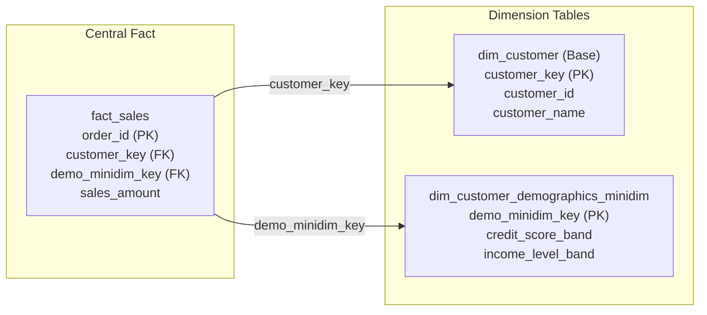

# Advanced SCD patterns

Advanced slowly changing dimension (SCD) patterns build on foundational
change-handling techniques, including Type 0, Type 1, and Type 2, to resolve
complex enterprise data warehousing challenges. While basic Type 1 overwrites
erase historical context and Type 2 row additions partition history, real-world
analytics often require dual-reporting perspectives, containment of
high-frequency attribute updates, or simultaneous historical and current
rollups.

Enterprise dimensional models rely on three advanced patterns: type 3 previous
or alternate columns, type 4 minidimensions with base tables, and type 6 hybrid
designs.

## Advanced SCD patterns breakdown

Data warehouses categorize these advanced techniques based on their physical
table structures and history tracking horizons.

### SCD Type 3: previous or alternate column

SCD Type 3 tracks attribute changes by adding a dedicated column to the existing
dimension table rather than inserting new rows. It supports two simultaneous
views of the data, allowing analysts to report facts using either the current
attribute value or a prior attribute value across the entire transaction
history.

#### Structural mechanics

Type 3 maintains a fixed number of rows and surrogate keys:

- No new rows: the physical record and its surrogate key remain unchanged.
- Column shift: when an attribute value changes, the ingestion pipeline copies
  the existing value from the current attribute column into a `prior_attribute`
  column.
- In-place overwrite: the pipeline then overwrites the primary attribute
  column with the new value as an in-place Type 1 update.

For example, when a customer upgrades from `Gold` to `Platinum`:

| State | `customer_key` | `customer_id` | `current_service_tier` | `prior_service_tier` |
| :--- | :--- | :--- | :--- | :--- |
| Initial state | 101 | `CUST-1001` | Gold | N/A |
| After Type 3 update | 101 | `CUST-1001` | Platinum | Gold |

#### Primary use cases

Type 3 is ideal for soft organizational redefinitions, such as sales territory
realignments, corporate department restructurings, or customer loyalty tier
updates where management wants to analyze historical performance under both
past and present classifications.

#### Operational trade-offs

Type 3 tables are compact because they require no new surrogate keys or row
insertions. Analysts can directly compare old versus new classifications side
by side across all historical fact records without writing complex multi-pass
queries.

However, Type 3 has a limited memory horizon. It preserves only a single prior
state. If an attribute changes multiple times, such as moving from `Gold` to
`Platinum` and then to `Diamond`, intermediate values are permanently erased.

### SCD Type 4: minidimension and base table

SCD Type 4 resolves the challenge of rapidly changing monster dimensions:
massive dimension tables containing millions of records where descriptive
attributes mutate frequently. Applying standard Type 2 row additions to a
ten-million-row customer dimension that updates daily causes catastrophic table
bloat and degrades query performance.

Type 4 isolates volatile or heavily queried attributes into a standalone
history table or minidimension.

#### Structural mechanics

The pattern divides customer attributes across two separate physical dimension
tables:

- Base dimension table: stores static or slowly changing attributes, such as
  customer name, date of birth, and original registration date, with exactly
  one row per business entity.
- Minidimension table: stores combinations of volatile, frequently updated
  attributes, such as credit score bands, income tiers, and age brackets.
  Data engineers group continuous numeric attributes into discrete ranges to
  keep the total row count in the minidimension small.
- Fact table dual foreign keys: the central fact table contains two foreign
  keys: `customer_key` pointing to the static base customer dimension, and
  `demo_minidim_key` pointing to the specific demographic profile active at the
  exact moment the transaction occurred.



#### Primary use cases

Type 4 is common in customer relationship management (CRM) systems, credit risk
scoring, and demographic segmentation where customer attributes mutate on a
weekly or monthly cadence.

#### Operational trade-offs

Type 4 prevents row explosion in primary dimension tables, supports rapid
browsing of demographic combinations, and captures point-in-time attribute
states without updating existing base dimension rows.

However, grouping continuous numbers into discrete bands limits ad-hoc analysis
outside those predefined boundaries. Data pipelines must also manage two foreign
keys in the fact table instead of one.

### SCD Type 6: hybrid pattern

SCD Type 6 combines elements of Type 1, Type 2, and Type 3, matching the formula
1 + 2 + 3 = 6. Teams use it for scenarios where business users require both
historically accurate point-in-time reporting and the ability to summarize all
past historical facts using current attribute assignments.

#### Structural mechanics

Type 6 implements structural mechanisms from all three baseline types:

- Type 2 row insertion: when an attribute changes, the pipeline inserts a new
  dimension row with a new surrogate key, effective and expiration timestamps,
  and an `is_current` flag.
- Type 3 dual columns: the table maintains two distinct attribute columns:
  `historical_attribute` to record the point-in-time value when the row was
  active, and `current_attribute` to record the active value.
- Type 1 in-place update: upon inserting the new Type 2 row, the pipeline runs
  an update to overwrite the `current_attribute` column across all historical
  rows sharing that natural business key.

For example, when customer `C-10` relocates from `East` to `West`:

| Row version | `customer_key` | `customer_id` | `historical_region` | `current_region` | `is_current` |
| :--- | :--- | :--- | :--- | :--- | :--- |
| Row 1: closed | 1001 | `C-10` | East | West | `FALSE` |
| Row 2: active | 1002 | `C-10` | West | West | `TRUE` |

Row 1 retains `East` as its historical region but updates its current region to
`West` via a Type 1 backfill. Row 2 records `West` for both historical and
current regions.

#### Primary use cases

Type 6 powers executive dashboards that demand dual-perspective slicing. For
instance, an analyst can evaluate multi-year sales trends according to the
historical sales territories active when transactions occurred, or re-aggregate
all historical sales under today's restructured sales district map.

#### Operational trade-offs

Type 6 provides maximum analytical flexibility without requiring complex
multi-pass SQL or custom reporting views. Users can toggle between historical
truth and current structure by switching the grouping column in their queries.

However, Type 6 increases pipeline complexity in both ETL and ELT workflows.
Inserting a new dimension record triggers write operations across all existing
historical rows for that entity. This generates write amplification and database
lock contention.

## Comparison of advanced SCD patterns

The following matrix compares structural mechanics, history horizons, and
architectural impacts across advanced SCD patterns:

| SCD pattern | Action on change | History retention | Fact table foreign key impact | Ideal business scenario |
| :--- | :--- | :--- | :--- | :--- |
| Type 3 | Overwrites current column and shifts prior value | Retains current value and one prior value in the same row | Single surrogate key | Soft organizational redefinitions and territory realignments |
| Type 4 | Inserts row into minidimension and assigns fact key | Stores banded demographic profiles in a separate table | Two foreign keys: base key and minidimension key | High-frequency updates on massive customer dimensions |
| Type 6 | Inserts new Type 2 row and updates current column on old rows | Retains full Type 2 version history alongside overwritten Type 1 current attributes | Single surrogate key | Dual-reporting requirements for point-in-time versus current rollups |

## Production schema implementation

The following PostgreSQL schema models a customer account system integrating
Type 3, Type 4, and Type 6 dimensions alongside a dual-key sales fact table.

### Relational table definitions

```sql
-- ============================================================================
-- 1. TYPE 4: Demographic Minidimension Table
-- Holds banded, volatile attributes to prevent base table row explosion.
-- ============================================================================
CREATE TABLE dim_customer_demographics_minidim (
    demo_minidim_key  INT PRIMARY KEY,
    credit_score_band VARCHAR(20) NOT NULL,
    income_level_band VARCHAR(20) NOT NULL,
    age_group_band    VARCHAR(20) NOT NULL
);

-- ============================================================================
-- 2. TYPE 3 & TYPE 6: Main Customer Dimension Table
-- Integrates Type 3 tier tracking and Type 6 region dual-slicing.
-- ============================================================================
CREATE TABLE dim_customer (
    customer_key         INT PRIMARY KEY,
    customer_id          VARCHAR(20) NOT NULL,
    customer_name        VARCHAR(100) NOT NULL,
    
    -- Type 3 attributes: current versus prior tier
    current_service_tier VARCHAR(20) NOT NULL,
    prior_service_tier   VARCHAR(20) NOT NULL,
    
    -- Type 6 attributes: historical point-in-time versus current region
    historical_region    VARCHAR(50) NOT NULL,
    current_region       VARCHAR(50) NOT NULL,
    
    -- Type 2 / Type 6 audit metadata
    effective_start_date DATE NOT NULL,
    effective_end_date   DATE NOT NULL DEFAULT '9999-01-01',
    is_current           BOOLEAN NOT NULL DEFAULT TRUE
);

-- ============================================================================
-- 3. CENTRAL FACT TABLE
-- Links to base customer and point-in-time demographic minidimension.
-- ============================================================================
CREATE TABLE fact_sales (
    order_id         BIGINT PRIMARY KEY,
    customer_key     INT NOT NULL REFERENCES dim_customer(customer_key),
    demo_minidim_key INT NOT NULL REFERENCES dim_customer_demographics_minidim(demo_minidim_key),
    sales_amount     NUMERIC(10, 2) NOT NULL
);
```

### Data lifecycle walkthrough

The following SQL statements demonstrate the customer lifecycle across initial
ingestion, a Type 3 tier upgrade, and a combined Type 6 relocation and Type 4
demographic shift:

```sql
-- Step A: Initial ingestion for customer C-1001 in East Region with Gold Tier
INSERT INTO dim_customer_demographics_minidim (
    demo_minidim_key, credit_score_band, income_level_band, age_group_band
) VALUES (
    1, '700-749', '$75k-$100k', '30-39'
);

INSERT INTO dim_customer (
    customer_key, customer_id, customer_name,
    current_service_tier, prior_service_tier,
    historical_region, current_region,
    effective_start_date, effective_end_date, is_current
) VALUES (
    101, 'C-1001', 'Alice Smith',
    'Gold', 'N/A',
    'East', 'East',
    '2025-01-01', '9999-01-01', TRUE
);

-- First sales fact links to customer 101 and demographic profile 1
INSERT INTO fact_sales (order_id, customer_key, demo_minidim_key, sales_amount)
VALUES (8001, 101, 1, 500.00);

-- Step B: Type 3 change on 2025-06-01 (Tier upgrades from Gold to Platinum)
UPDATE dim_customer 
SET prior_service_tier = current_service_tier,
    current_service_tier = 'Platinum'
WHERE customer_id = 'C-1001';

-- Step C: Type 6 & Type 4 change on 2026-01-01 (Moves to West, credit score 750-799)
-- 1. Insert new demographic profile into minidimension (Type 4)
INSERT INTO dim_customer_demographics_minidim (
    demo_minidim_key, credit_score_band, income_level_band, age_group_band
) VALUES (
    2, '750-799', '$75k-$100k', '30-39'
);

-- 2. Expire old Type 6 row
UPDATE dim_customer 
SET effective_end_date = '2025-12-31', is_current = FALSE 
WHERE customer_key = 101;

-- 3. Insert new Type 6 version (Version 2)
INSERT INTO dim_customer (
    customer_key, customer_id, customer_name,
    current_service_tier, prior_service_tier,
    historical_region, current_region,
    effective_start_date, effective_end_date, is_current
) VALUES (
    102, 'C-1001', 'Alice Smith',
    'Platinum', 'Gold',
    'West', 'West',
    '2026-01-01', '9999-01-01', TRUE
);

-- 4. Overwrite current_region across ALL rows for C-1001 (Type 1 backfill for Type 6)
UPDATE dim_customer 
SET current_region = 'West' 
WHERE customer_id = 'C-1001';

-- 5. Insert new sales fact linking to CustomerKey 102 and DemographicKey 2
INSERT INTO fact_sales (order_id, customer_key, demo_minidim_key, sales_amount)
VALUES (8002, 102, 2, 750.00);
```

### Analytical query demonstration

The dimensional structure enables three distinct analytical reporting
perspectives from the same underlying tables:

```sql
-- Perspective 1: Historical point-in-time reporting (as it was when sold)
-- Result: East = $500.00, West = $750.00
SELECT 
    c.historical_region,
    SUM(f.sales_amount) AS historical_regional_sales
FROM fact_sales f
JOIN dim_customer c 
    ON f.customer_key = c.customer_key
GROUP BY 
    c.historical_region;

-- Perspective 2: Current restructured rollup (as it is today)
-- Result: West = $1,250.00 (all historical sales roll up to West)
SELECT 
    c.current_region,
    SUM(f.sales_amount) AS current_regional_sales
FROM fact_sales f
JOIN dim_customer c 
    ON f.customer_key = c.customer_key
GROUP BY 
    c.current_region;

-- Perspective 3: Type 3 prior versus current tier comparison
-- Result: Prior Gold -> Current Platinum = $1,250.00
SELECT 
    c.prior_service_tier,
    c.current_service_tier,
    SUM(f.sales_amount) AS total_sales
FROM fact_sales f
JOIN dim_customer c 
    ON f.customer_key = c.customer_key
WHERE c.is_current = TRUE
GROUP BY 
    c.prior_service_tier, 
    c.current_service_tier;
```

## Operational considerations and query engine optimization

Advanced SCD architectures require balancing ingestion throughput against
analytical query flexibility:

### Write amplification in columnar and lakehouse engines

In modern columnar formats, such as Parquet and ORC, and table formats, such as
Delta Lake and Apache Iceberg, data files are immutable. When an ingestion
pipeline executes a Type 6 backfill updating `current_region` across older rows,
the engine can't modify rows in place. Instead, it must rewrite the entire
Parquet file containing the historical records.

In high-volume streaming or frequent micro-batch pipelines, repeated Type 6
backfills cause severe write amplification, file compaction churn, and snapshot
metadata overhead. Schedule Type 6 backfills as consolidated batch operations
rather than running them per event.

### Value band granularity in minidimensions

Designing minidimensions requires careful selection of band intervals. If bands
are too narrow, such as setting credit score intervals every five points, the
number of distinct combinations approaches the cardinality of the base
dimension, negating the benefits of Type 4. If bands are too wide, analysts
can't extract meaningful segmentation insights.

Profile source distributions thoroughly before defining band boundaries. Once
fact tables store foreign keys referencing specific minidimension records,
modifying band definitions requires backfilling and re-mapping all historical
fact rows.

## Common pitfalls

When implementing advanced slowly changing dimension patterns, watch for these
frequent mistakes:

### Type 6 write amplification and partition lock contention

Executing Type 1 backfills across millions of historical dimension rows on
every Type 6 event creates severe database contention. In distributed engines,
frequent row updates lock database partitions while forcing full file rewrites.
Consolidate Type 6 backfills into scheduled daily or hourly batch jobs to prevent
pipeline lockouts.

### Inflexible value bands in minidimensions

Setting minidimension numeric ranges without deep stakeholder review locks the
warehouse into rigid reporting brackets. Once billions of fact records reference
specific demographic keys, restructuring age or income bands requires
recalculating and updating foreign keys across the entire fact table history.
Define broad, standardized ranges that accommodate long-term analytical
requirements.

### User confusion in semantic business intelligence layers

Exposing both historical and current attributes, such as `historical_region` and
`current_region` or `current_service_tier` and `prior_service_tier`, in
self-service BI tools without clear documentation leads to reporting errors.
Business users frequently combine historical and current attributes within the
same visualization, producing conflicting numbers or double-counted totals. Use
clear column descriptions and separate logical folders in the semantic layer to
distinguish point-in-time attributes from current restructurings.

### Intermediate state loss in Type 3 dimensions

Relying on Type 3 for attributes that change repeatedly results in silent data
loss. Because Type 3 preserves only a single prior value, any subsequent change
permanently erases intermediate states. If an attribute changes more than once
over an entity's lifecycle and you must audit the full progression, use Type 2 or
Type 6 instead.

### Inconsistent surrogate key assignment in hybrid pipelines

Failing to maintain a centralized surrogate key assignment authority in hybrid
pipelines breaks dimension lineage. If the pipeline assigns a new surrogate key
during a Type 3 update or fails to assign a new key during a Type 6 row
insertion, fact tables link to incorrect historical versions. Enforce
strict surrogate key generation rules in the transformation pipeline.

## What's next

- Review baseline change handling in
  [Slowly changing dimensions core](/modeling/slowly-changing-dimensions-core).
- Learn about surrogate keys, natural keys, and hash keys in
  [Primary and key management](/modeling/primary-and-key-management).
- Explore factless and allocated designs in
  [Specialized fact designs](/modeling/specialized-fact-designs).
- Review star schema and snowflake architectures in
  [Schema architectures](/modeling/schema-architectures).
- Study join execution strategies and join hashing algorithms in
  [Advanced query optimization](/sql/advanced-query-optimization).
