# Data modeling fundamentals

## Overview

Data modeling translates real-world business processes, organizational workflows, and domain rules into structured database representations. Software systems build on data models by progressing from abstract business definitions down to physical storage structures on disk.

Data modeling follows a three-tier continuum:

1. **Conceptual data model**: captures business entities and relationships at the highest level of abstraction.
2. **Logical data model**: adds structural detail, attributes, keys, and relational mechanics without binding to a specific database vendor.
3. **Physical data model**: implements the schema for a specific database management system, specifying data types, indexes, partitioning, and storage configurations.

## Data modeling tiers

A complete design progresses through three distinct tiers. These tiers are the Conceptual Data Model (CDM), Logical Data Model (LDM), and Physical Data Model (PDM). Each tier targets a distinct audience and resolves specific design questions.

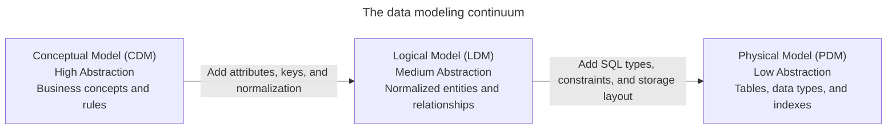

### Conceptual data model

The Conceptual Data Model (CDM) represents the highest level of abstraction. It defines what the business domain contains rather than how a technical database operates.

- **Target audience**: business stakeholders, domain subject matter experts, business analysts, and product architects.
- **Core focus**: identifies primary business entities, such as customers, orders, products, and stores, and defines real-world interactions among them.
- **Technology-agnostic**: operates independently of any Database Management System (DBMS), hardware platform, or programming language.
- **No data types or technical attributes**: focuses on business concepts and boundaries rather than column names or data types.
- **Direct many-to-many relationships**: represents real-world associations directly, such as students enrolling in courses or orders containing products, without introducing intermediate junction tables.

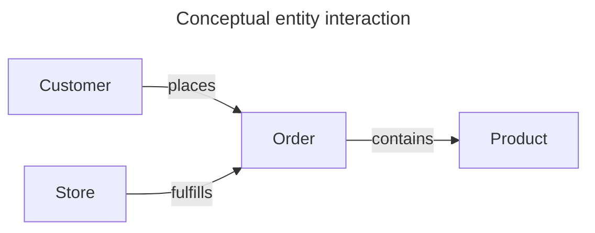

### Logical data model

The Logical Data Model (LDM) refines the conceptual blueprint by introducing structural rigor and relational mechanics. It establishes how entities interact within a structured data system.

- **Target audience**: data architects, data engineers, software engineers, and app developers.
- **Core focus**: translates business entities into explicit relations, defines business attributes, and resolves entity relationships.
- **Attribute and type definitions**: lists all required attributes and generic data types, such as integer, string, date, and numeric, for each entity.
- **Key identifiers**: specifies candidate keys, primary keys, and foreign keys to establish referential integrity between entities.
- **Relationship resolution**: decomposes many-to-many relationships into two one-to-many relationships through associative entities. These entities are also known as junction tables, or bridge entities.
- **Normalization**: organizes relational attributes into third normal form to eliminate data redundancy and prevent update anomalies.
- **Engine-agnostic**: defines schema structures without depending on vendor-specific SQL syntax or physical storage parameters.

### Physical data model

The Physical Data Model (PDM) translates the logical model into concrete implementation artifacts for a target Database Management System (DBMS), such as PostgreSQL, MySQL, Snowflake, or BigQuery.

- **Target audience**: database administrators, data platform engineers, and site reliability engineers.
- **Core focus**: query execution, storage layout, indexing strategies, memory allocation, and operational performance.
- **Engine-specific Data Definition Language (DDL)**: specifies concrete database data types, such as `BIGINT`, `VARCHAR(255)`, `TIMESTAMPTZ`, and `NUMERIC(10, 2)`.
- **Integrity constraints**: enforces schema integrity through `PRIMARY KEY`, `FOREIGN KEY`, `NOT NULL`, `UNIQUE`, and `CHECK` constraints.
- **Performance optimization**: defines B-tree indexes, hash indexes, clustering keys, and physical table partitioning strategies, such as partitioning tables by calendar year.
- **Storage architecture**: aligns schemas with underlying storage mechanics, such as row-oriented heap pages versus columnar block layouts, buffer cache dynamics, and file structures.

## Comparison of modeling tiers

The following table compares the characteristics, audiences, and technical requirements across the three modeling tiers:

| Dimension | Conceptual model | Logical model | Physical model |
| :--- | :--- | :--- | :--- |
| **Primary audience** | Business leaders and domain experts | Data architects and app engineers | Database administrators and platform engineers |
| **Abstraction level** | High business-domain view | Medium structural design | Low hardware and engine implementation |
| **Technology dependency** | Independent of software and hardware | Independent of database vendor | Specific to target DBMS engine |
| **Entities and relations** | Business entities and conceptual links | Normalized entities and junction entities | Physical tables, views, and partitions |
| **Attributes and types** | None or minimal high-level names | Generic types, such as text, number, and date | Engine types, such as `VARCHAR`, `INT8`, and `NUMERIC` |
| **Key specifications** | Natural business identifiers | Explicit primary keys and foreign keys | Indexed primary keys, foreign key constraints, and clustered keys |
| **Storage parameters** | None | None | File groups, table spaces, block sizes, and compression |

## Database keys and identity mechanics

In relational modeling, keys enforce entity identity, ensure data integrity, and establish links between tables.

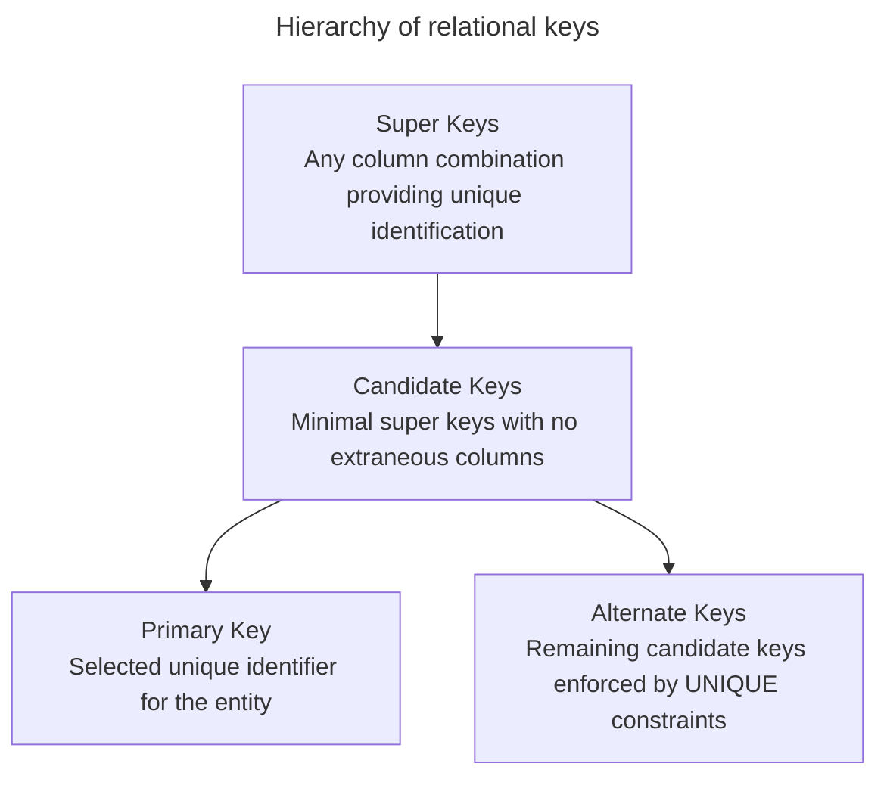

### Super keys

A super key is any set of one or more attributes that uniquely identifies a record in a table. A super key can include extra attributes that aren't necessary for unique identification.

For example, in a table with columns `employee_id`, `email`, and `department_id`, the set containing all three columns is a super key because no two rows share the same values. The combination `employee_id` and `department_id` is also a super key. Super keys provide uniqueness, but they often carry redundant data.

### Candidate keys

A candidate key is a minimal super key. It contains no redundant attributes. If you remove any attribute from a candidate key, the remaining attributes no longer identify rows uniquely.

A table can have multiple candidate keys. In an employee table, both `employee_id` and `work_email` can serve as candidate keys if each value remains unique across the entire organization.

### Primary keys

A primary key is the candidate key selected by the data architect to uniquely identify each row in a table.

A primary key must satisfy three rules:

- **Uniqueness**: every row must have a distinct primary key value.
- **Non-null value**: a primary key column can't contain `NULL`.
- **Immutability**: primary key values shouldn't change after row creation.

Data models choose between two primary key patterns:

- **Natural keys**: use existing real-world business attributes, such as government identification numbers, International Standard Book Numbers, or domain codes. Natural keys eliminate extra identifier columns, but they expose tables to upstream business changes. If an external agency changes an identifier format, the database must cascade updates across all referencing foreign keys.
- **Surrogate keys**: use system-generated identifiers with no business meaning, such as auto-incrementing integers, identity sequences, or Universally Unique Identifiers. Surrogate keys insulate database schemas from external workflow changes, keeping foreign key relationships stable.

### Alternate keys

An alternate key, also called a secondary key, is any candidate key that isn't selected as the primary key.

Alternate keys represent secondary business identifiers. Relational databases enforce alternate keys using `UNIQUE` constraints and non-null column rules. For example, if a table selects `user_id` as the primary key, `email_address` serves as an alternate key with a unique constraint.

### Composite keys

A composite key is a primary key or candidate key formed by combining two or more columns.

Composite keys appear frequently in associative junction entities and partitioned tables. For example, in an `enrollments` table, neither `student_id` nor `course_id` alone uniquely identifies a row. The combination `(student_id, course_id)` creates a composite primary key that prevents duplicate enrollments for the same course.

### Foreign keys and referential integrity

A foreign key is a column or group of columns in a child table that references the primary key or alternate key of a parent table. Foreign keys enforce referential integrity, preventing child rows from referencing non-existent parent rows.

When parent records change or disappear, database engines enforce referential integrity using explicit foreign key actions:

- **`RESTRICT` or `NO ACTION`**: prevents deletion or modification of a parent row if child rows reference it.
- **`CASCADE`**: automatically deletes or updates referencing child rows when someone deletes or modifies the parent row.
- **`SET NULL`**: sets the child foreign key column to `NULL` upon parent row deletion. This action requires the child foreign key column to allow null values.
- **`SET DEFAULT`**: sets the child foreign key column to its declared default value upon parent row deletion.

Database management systems don't automatically create indexes on foreign key columns. Omitting explicit secondary indexes on foreign key columns causes multi-table join queries and parent deletion checks to execute slow sequential table scans.

## Entity-relationship modeling

An Entity Relationship Diagram (ERD) is a visual diagram that illustrates entities, attributes, and relationships. It communicates database structures across engineering and domain teams.

### Entities and entity sets

An entity is a real-world object, transaction, or concept about which a system stores data. A collection of similar entities forms an entity set, which corresponds to a table in a relational database.

ER modeling categorizes entities into two forms:

- **Strong entities**: exist independently of other entities. A strong entity possesses its own primary key that uniquely identifies each instance. For example, a customer or employee is a strong entity.
- **Weak entities**: depend on the existence of a parent strong entity for identity. A weak entity lacks a complete primary key of its own. It uses a partial key, or discriminator, combined with the primary key of the parent entity to establish uniqueness. For example, an order line item or dependent family member is a weak entity that can't exist without its parent record.

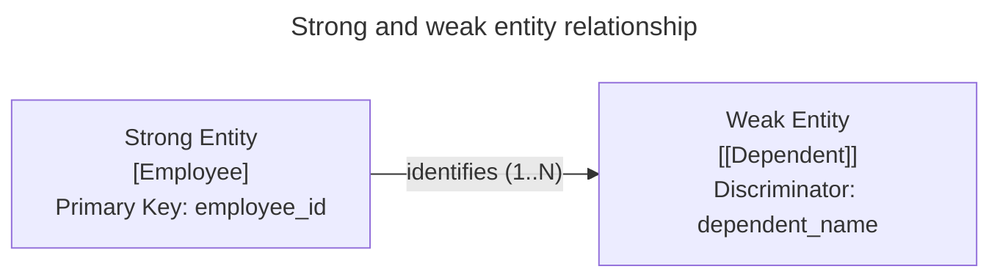

### Attributes and data characteristics

Attributes describe properties of entities. Relational schemas map attributes to table columns.

Attributes fall into distinct categories:

- **Simple or atomic attributes**: hold indivisible atomic values that can't break down into smaller components, such as a status code, an account balance, or a transaction amount.
- **Composite attributes**: consist of multiple logical sub-elements. For example, an address attribute divides into street, city, state, and postal code. In a normalized physical database, engineers flatten composite attributes into distinct columns.
- **Multi-valued attributes**: store multiple values for an entity instance, such as phone numbers, email addresses, or skill tags. In normalized relational design, architects convert multi-valued attributes into separate child tables linked by foreign keys.
- **Derived attributes**: calculate values from other attributes or stored data rather than storing static entries. For example, an employee's age derives from `birth_date`, and an order line total derives from `quantity * unit_price`.
- **Key attributes**: uniquely distinguish individual entity instances within an entity set, such as `user_id`.

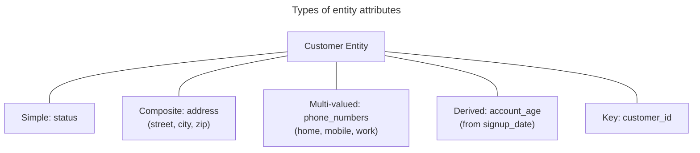

### Relationship degrees

The degree of a relationship describes the number of entities participating in that relationship:

- **Recursive relationships**: involve a single entity associating with itself, also called a `unary` relationship. For example, an employee supervises other employees within an `employees` entity, or a product category references a parent category.
- **Binary relationships**: involve two distinct entities. Binary relationships represent the most common association in operational systems, such as a customer placing an order.
- **Ternary relationships**: involve three distinct entities simultaneously. For example, a doctor prescribes a medication to a patient, linking `Doctor`, `Patient`, and `Medication` in a single relationship.
- **N-ary relationships**: involve four or more entities simultaneously. Teams often decompose n-ary relationships into multiple binary relationships using associative tables.

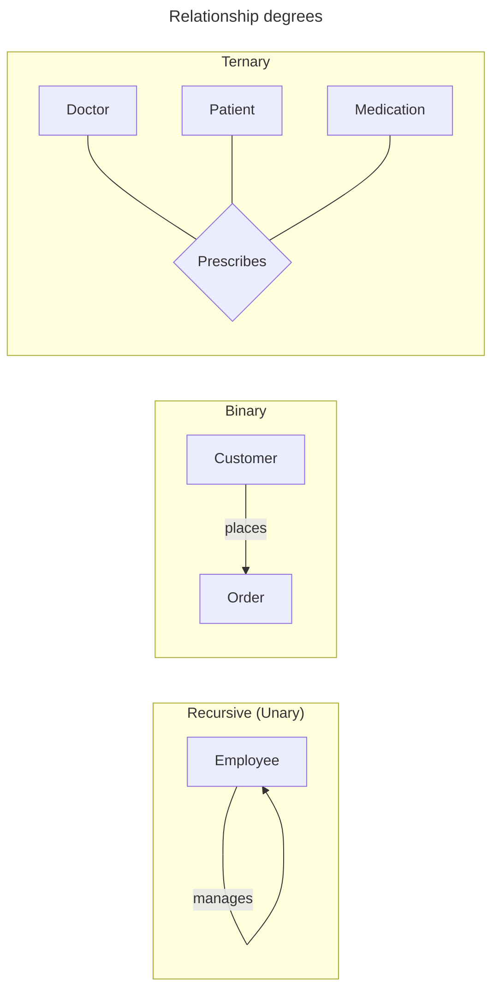

### Cardinality and multiplicity

Cardinality specifies the minimum and maximum number of entity instances that can participate in an association:

- **One-to-one relationships**: each instance of entity A associates with at most one instance of entity B, and each instance of B links to at most one instance of A. For example, a user account links to exactly one user security profile.
- **One-to-many relationships**: one instance of entity A associates with multiple instances of entity B, but each instance of B links back to exactly one instance of A. For example, a department employs multiple staff members.
- **Many-to-many relationships**: multiple instances of entity A associate with multiple instances of entity B. For example, students enroll in multiple courses, and courses enroll multiple students.

### Participation constraints

Participation constraints determine whether entity instances must exist in a relationship:

- **Total participation**: every instance of an entity must participate in the relationship. This represents a mandatory existence dependency. For example, every order line item must belong to an order.
- **Partial participation**: only some instances of an entity participate in the relationship. This represents an optional association. For example, some employees manage departments, while other employees don't.

### Crow's foot notation

Crow's foot notation represents cardinality and participation constraints using visual symbols at the ends of relationship lines. The outer symbol denotes the maximum cardinality, while the inner symbol denotes the minimum cardinality:

| Symbol | Visual notation | Relationship rule |
| :--- | :--- | :--- |
| `\|\|` | Mandatory one | Minimum one, maximum one: exactly one instance |
| `\|o` | Optional one | Minimum zero, maximum one: zero or one instance |
| `>\|` | Mandatory many | Minimum one, maximum many: one or more instances |
| `>o` | Optional many | Minimum zero, maximum many: zero, one, or more instances |

## Enhanced entity-relationship concepts

Enhanced Entity-Relationship (EER) modeling introduces object-oriented abstraction mechanisms to model complex domain hierarchies.

### Generalization and specialization

Generalization and specialization represent opposite perspectives of class hierarchies:

- **Generalization**: a bottom-up design process. It extracts shared attributes and relationships from multiple specialized entities to create a unified generalized entity. For example, combining `UndergraduateStudent` and `GraduateStudent` into a common `Student` super-entity.
- **Specialization**: a top-down design process. It divides a high-level entity into distinct sub-entities based on distinguishing business attributes. For example, dividing an `Account` entity into `CheckingAccount` and `SavingsAccount`.

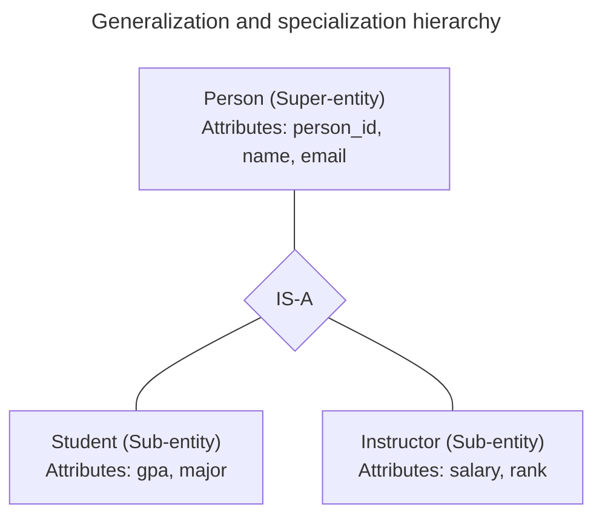

### Attribute inheritance

Attribute inheritance allows specialized sub-entities to inherit all attributes, primary keys, and relationships from their parent super-entity.

In an inheritance hierarchy:

- The sub-entity automatically acquires all columns declared on the super-entity.
- The sub-entity declares only columns specific to its specialized domain.
- The sub-entity shares the primary key value of the parent super-entity.

### Aggregation

Aggregation treats an entire relationship between two entities as a higher-level entity. This allows the relationship itself to participate in further relationships with other entities.

For example, when an employee works on a project, that assignment can require technical equipment. Instead of creating a complex ternary relationship, aggregation encapsulates the `WorksOn` relationship between `Employee` and `Project`, linking that composite unit directly to `Equipment`.

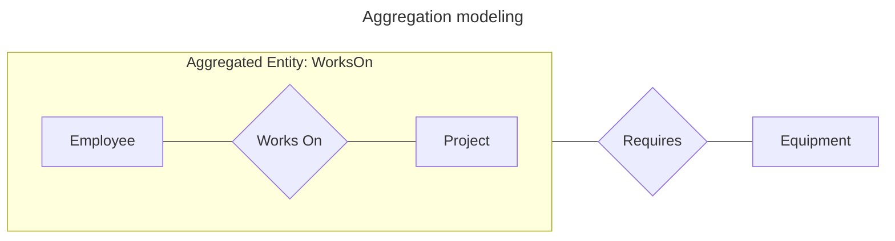

## Real-world university database schema

The following university system demonstrates an enterprise schema with 11 entities, various cardinality rules, primary keys, foreign keys, and participation constraints.

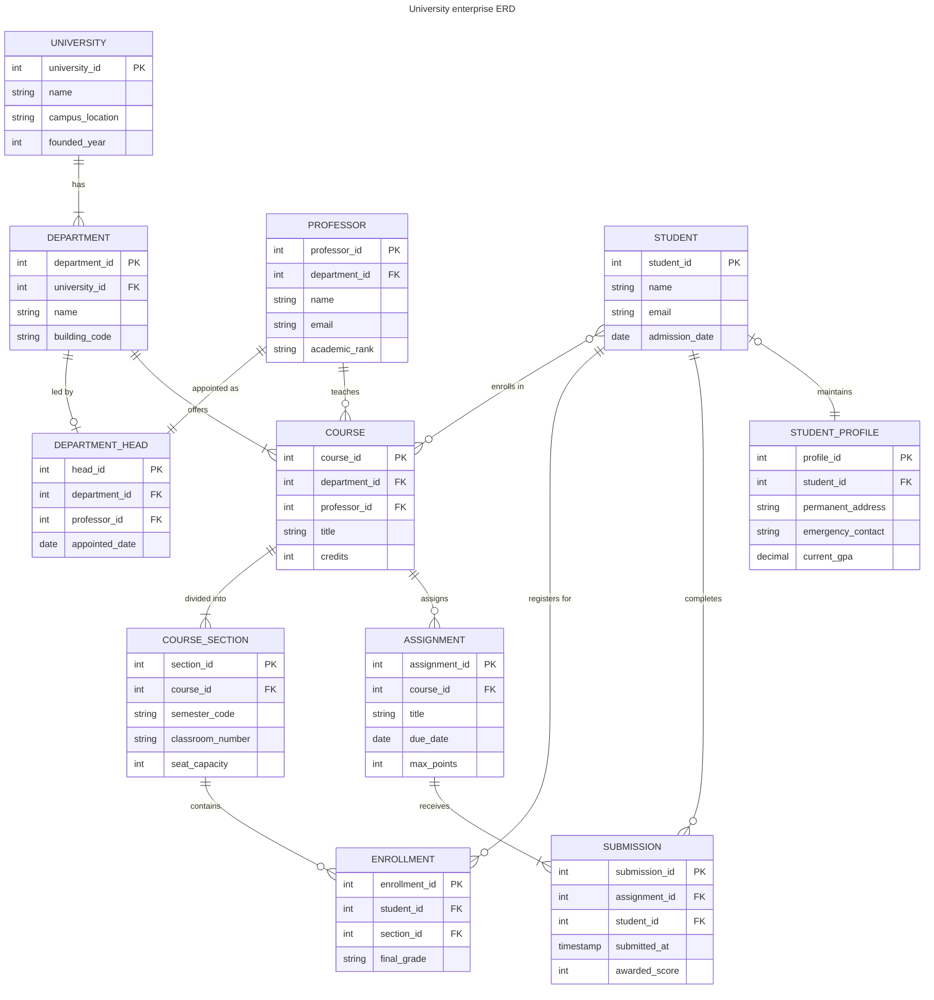

### Detailed relationship breakdown

The university schema enforces explicit real-world business constraints:

1. **`UNIVERSITY` to `DEPARTMENT` with `||--|{`**: mandatory one-to-many. A university must establish at least one department, and each department belongs to exactly one university.
2. **`DEPARTMENT` to `DEPARTMENT_HEAD` with `||--o|`**: optional one-to-one. A department has at most one department head, but a newly formed department can operate temporarily without an appointed head.
3. **`PROFESSOR` to `DEPARTMENT_HEAD` with `||--||`**: mandatory one-to-one. A department head must hold an active appointment as a professor, and an individual professor heads at most one department.
4. **`DEPARTMENT` to `COURSE` with `||--|{`**: mandatory one-to-many. A department offers one or more courses, and every course originates from a single parent department.
5. **`PROFESSOR` to `COURSE` with `||--o{`**: optional one-to-many. A professor teaches zero, one, or more courses, accommodating faculty on research sabbatical.
6. **`COURSE` to `COURSE_SECTION` with `||--|{`**: mandatory one-to-many. Every course divides into one or more instructional sections for semester delivery.
7. **`COURSE_SECTION` to `ENROLLMENT` with `||--o{`**: optional one-to-many. A newly scheduled section starts with zero enrollments before students register.
8. **`STUDENT` to `STUDENT_PROFILE` with `o|--||`**: optional-to-mandatory one-to-one. Every profile links to exactly one student, while newly admitted students can delay profile completion.
9. **`ASSIGNMENT` to `SUBMISSION` with `||--|{`**: mandatory one-to-many. An assignment tracks one or more student submissions.

## E-commerce implementation guide

The following end-to-end example tracks an e-commerce order system through conceptual, logical, and physical tiers.

### Conceptual model design

The business domain requires three core entities: `Customer`, `Order`, and `Product`.

Business rules define the following relationships:

- A customer places zero or more orders.
- An order belongs to exactly one customer.
- An order contains one or more products.
- A product appears in zero, one, or more orders.

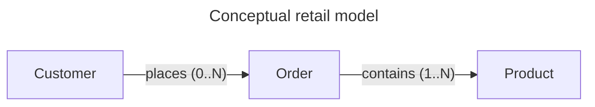

### Logical model design

The logical model adds attributes, defines the data grain, and resolves the many-to-many relationship between orders and products.

1. **Establish the data grain**:
   - `Customer`: one row represents one registered buyer.
   - `Order`: one row represents one distinct purchase transaction.
   - `OrderItem`: one row represents one distinct product line item in an order.
   - `Product`: one row represents one distinct catalog item available for sale.
2. **Resolve the many-to-many relationship**: introducing the associative entity `OrderItem` transforms the many-to-many relationship into two one-to-many relationships.

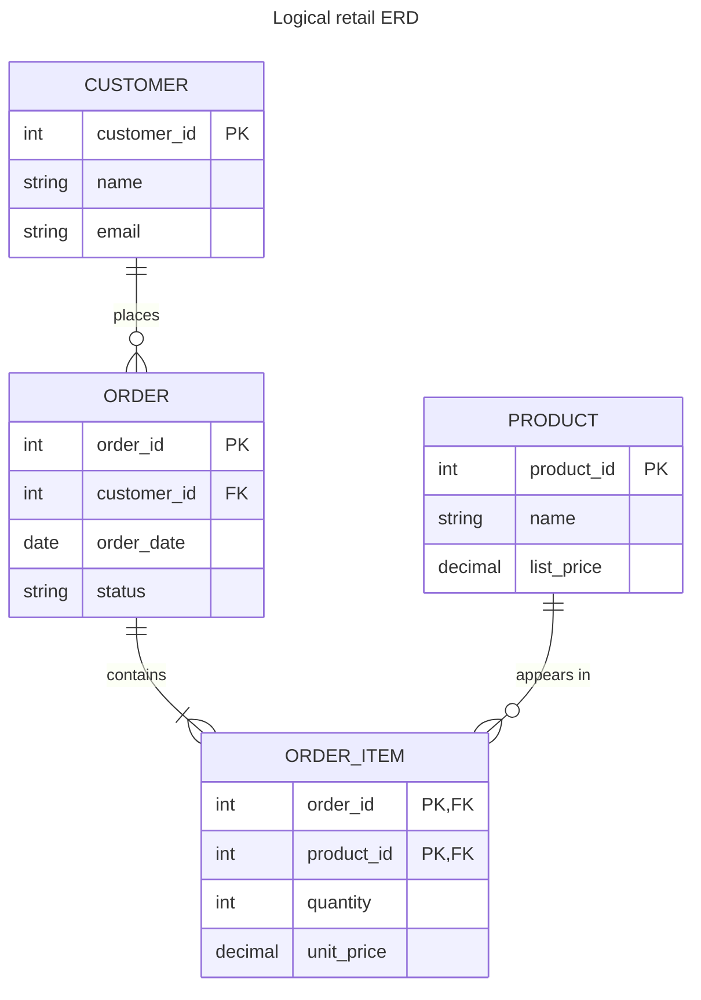

### Physical model implementation

The physical model generates PostgreSQL Data Definition Language (DDL) statements with concrete types, composite primary keys, foreign key constraints, table partitioning, and secondary indexes:

```sql
-- 1. Physical Customer Table
CREATE TABLE customers (
    customer_id BIGINT GENERATED ALWAYS AS IDENTITY PRIMARY KEY,
    name VARCHAR(100) NOT NULL,
    email VARCHAR(255) NOT NULL UNIQUE,
    created_at TIMESTAMPTZ NOT NULL DEFAULT CURRENT_TIMESTAMP
);

-- 2. Physical Product Table
CREATE TABLE products (
    product_id BIGINT GENERATED ALWAYS AS IDENTITY PRIMARY KEY,
    name VARCHAR(150) NOT NULL,
    unit_price NUMERIC(10, 2) NOT NULL CHECK (unit_price >= 0.00),
    stock_qty INTEGER NOT NULL DEFAULT 0 CHECK (stock_qty >= 0)
);

-- 3. Physical Order Table (Partitioned by Year)
CREATE TABLE orders (
    order_id BIGINT GENERATED ALWAYS AS IDENTITY,
    customer_id BIGINT NOT NULL,
    order_date DATE NOT NULL,
    order_status VARCHAR(20) NOT NULL DEFAULT 'PENDING',
    PRIMARY KEY (order_id, order_date),
    CONSTRAINT fk_orders_customer
        FOREIGN KEY (customer_id)
        REFERENCES customers (customer_id)
        ON DELETE RESTRICT
) PARTITION BY RANGE (order_date);

-- Annual Partitions
CREATE TABLE orders_2025 PARTITION OF orders
    FOR VALUES FROM ('2025-01-01') TO ('2026-01-01');

CREATE TABLE orders_2026 PARTITION OF orders
    FOR VALUES FROM ('2026-01-01') TO ('2027-01-01');

-- Secondary Index for Customer Lookups
CREATE INDEX idx_orders_customer_id ON orders(customer_id);

-- 4. Physical OrderItem Junction Table
CREATE TABLE order_items (
    order_id BIGINT NOT NULL,
    order_date DATE NOT NULL,
    product_id BIGINT NOT NULL,
    quantity INTEGER NOT NULL CHECK (quantity > 0),
    sale_price NUMERIC(10, 2) NOT NULL CHECK (sale_price >= 0.00),
    PRIMARY KEY (order_id, order_date, product_id),
    CONSTRAINT fk_items_order
        FOREIGN KEY (order_id, order_date)
        REFERENCES orders (order_id, order_date)
        ON DELETE CASCADE,
    CONSTRAINT fk_items_product
        FOREIGN KEY (product_id)
        REFERENCES products (product_id)
        ON DELETE RESTRICT
);

-- Secondary Index for Product Lookups on Junction Table
CREATE INDEX idx_order_items_product_id ON order_items(product_id);
```

This physical implementation applies several important design decisions:

- **Partition key alignment**: the `orders` table partitions by `order_date`. In PostgreSQL, a unique or primary key on a partitioned table must include the partition column. Therefore, `orders` uses the composite primary key `(order_id, order_date)`.
- **Composite foreign key reference**: because `orders` uses a composite primary key, the `order_items` table references both `order_id` and `order_date` to preserve referential integrity.
- **Secondary foreign key indexing**: database engines such as PostgreSQL automatically index primary keys, but they don't create indexes for foreign keys. The statements create `idx_orders_customer_id` and `idx_order_items_product_id` so join queries don't trigger sequential table scans.
- **Cascading delete policy**: when an app deletes an order, `ON DELETE CASCADE` automatically removes all associated line items in `order_items`, preventing orphaned records. Conversely, `fk_items_product` specifies `ON DELETE RESTRICT` to prevent catalog managers from deleting products that appear in existing purchase records.

## Common design pitfalls

### Skipping conceptual and logical modeling

Skipping the conceptual and logical stages to write physical `CREATE TABLE` statements immediately often causes structural schema defects. Without thorough entity and relationship analysis, teams overlook business edge cases, miss junction entities for many-to-many relationships, and produce rigid schemas that require expensive database migrations.

### Conflating entity-relationship diagrams with normal forms

An ERD provides a visual syntax composed of boxes and lines. It doesn't enforce third normal form rules. Both normalized schemas and dimensional schemas, such as star and snowflake schemas for analytics, use ERD notation. Normalization depends on functional dependencies and business requirements rather than diagramming syntax.

### Leaving table grain undefined

Designing tables without formally declaring the grain, or the exact real-world meaning of a single row, leads to mixed levels of detail within the same table. For example, if an order table mixes order header data with individual line-item items, aggregation queries with `SUM` and `AVG` double-count order totals.

### Omitting indexes on foreign keys

Relational database engines automatically construct unique B-tree indexes for primary key constraints, but they don't automatically index foreign key columns. Omitting explicit secondary indexes on foreign keys causes multi-table `JOIN` operations and cascading deletions to perform sequential table scans.

### Introducing premature `denormalization`

Combining tables early through `denormalization` to avoid table joins creates duplicate data across tables. When client apps update an attribute in one table, out-of-sync replicas introduce data anomalies. Keep Online Transaction Processing (OLTP) systems normalized to protect transactional integrity, and apply `denormalization` in dedicated read-optimized reporting tables or analytical data marts.

## Key takeaways

- Progress through conceptual, logical, and physical tiers to decouple business rules from storage implementation details.
- Use conceptual models to define business boundaries with non-technical stakeholders.
- Use logical models to define entities, attributes, primary keys, foreign keys, and third normal form normalization.
- Use physical models to implement database-specific types, storage parameters, constraints, and indexes.
- Distinguish super keys, candidate keys, primary keys, and alternate keys during schema design.
- Define the exact grain of every table before writing DDL statements.
- Index foreign key columns explicitly to ensure efficient joins and cascading updates.
- Keep operational databases normalized, reserving `denormalization` for analytical workloads.
