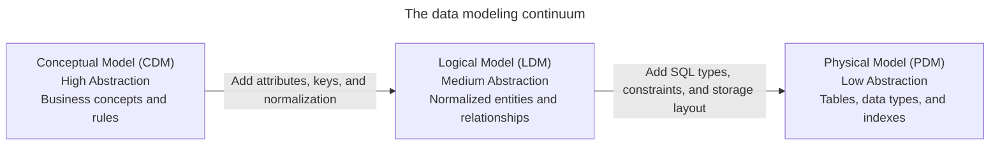
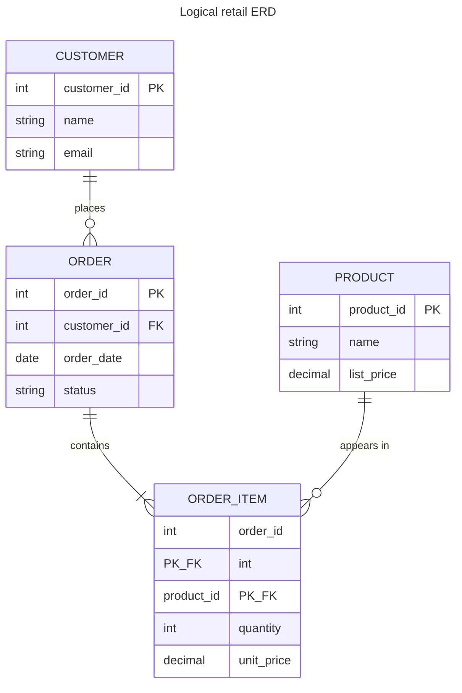

# Data modeling fundamentals

## Overview

Data modeling translates real-world business processes, workflows, and domain rules into structured database representations. Apps build on data models by progressing from abstract business definitions down to physical storage structures on disk.

Data modeling follows a three-tier continuum:

1. **Conceptual data model**: captures business entities and relationships at the highest level of abstraction.
2. **Logical data model**: adds structural detail, attributes, keys, and relational mechanics without binding to a specific database vendor.
3. **Physical data model**: implements the schema for a specific database management system, specifying data types, indexes, partitioning, and storage configurations.

## Data modeling tiers

A complete design progresses through three distinct tiers. These tiers are the Conceptual Data Model (CDM), Logical Data Model (LDM), and Physical Data Model (PDM). Each tier targets a distinct audience and resolves specific design questions.



### Conceptual data model

The Conceptual Data Model (CDM) represents the highest level of abstraction. It defines what the business domain contains rather than how a technical database operates.

- **Target audience**: business stakeholders, domain subject matter experts, business analysts, and product architects.
- **Core focus**: identifies primary business entities, such as customers, orders, products, and stores, and defines real-world interactions among them.
- **Technology-agnostic**: operates independently of any Database Management System (DBMS), hardware platform, or programming language.
- **No data types or technical attributes**: focuses on business concepts and boundaries rather than column names or data types.
- **Direct many-to-many relationships**: represents real-world associations directly, such as students enrolling in courses or orders containing products, without introducing intermediate junction tables.

### Logical data model

The Logical Data Model (LDM) refines the conceptual blueprint by introducing structural rigor and relational mechanics. It establishes how entities interact within a structured data system.

- **Target audience**: data architects, data engineers, software engineers, and app developers.
- **Core focus**: translates business entities into explicit relations, defines business attributes, and resolves entity relationships.
- **Attribute and type definitions**: lists all required attributes and generic data types, such as integer, string, date, and numeric, for each entity.
- **Key identifiers**: specifies candidate keys, primary keys, and foreign keys to establish referential integrity between entities.
- **Relationship resolution**: decomposes many-to-many relationships into two one-to-many relationships through associative entities. These entities are also known as junction tables, or bridge entities.
- **Normalization**: organizes relational attributes into third normal form to eliminate data redundancy and prevent update anomalies.
- **Engine-agnostic**: defines schema structures without depending on vendor-specific SQL syntax or physical storage parameters.

### Physical data model

The Physical Data Model (PDM) translates the logical model into concrete implementation artifacts for a target Database Management System (DBMS), such as PostgreSQL, MySQL, Snowflake, or BigQuery.

- **Target audience**: database administrators, data platform engineers, and site reliability engineers.
- **Core focus**: query execution, storage layout, indexing strategies, memory allocation, and operational performance.
- **Engine-specific Data Definition Language (DDL)**: specifies concrete database data types, such as `BIGINT`, `VARCHAR(255)`, `TIMESTAMPTZ`, and `NUMERIC(10, 2)`.
- **Integrity constraints**: enforces schema integrity through `PRIMARY KEY`, `FOREIGN KEY`, `NOT NULL`, `UNIQUE`, and `CHECK` constraints.
- **Performance optimization**: defines B-tree indexes, hash indexes, clustering keys, and physical table partitioning strategies, such as partitioning tables by calendar year.
- **Storage architecture**: aligns schemas with underlying storage mechanics, such as row-oriented heap pages versus columnar block layouts, buffer cache dynamics, and file structures.

## Comparison of modeling tiers

The following table compares the characteristics, audiences, and technical requirements across the three modeling tiers:

| Dimension | Conceptual model | Logical model | Physical model |
| :--- | :--- | :--- | :--- |
| **Primary audience** | Business leaders and domain experts | Data architects and app engineers | Database administrators and platform engineers |
| **Abstraction level** | High business-domain view | Medium structural design | Low hardware and engine implementation |
| **Technology dependency** | Independent of software and hardware | Independent of database vendor | Specific to target DBMS engine |
| **Entities and relations** | Business entities and conceptual links | Normalized entities and junction entities | Physical tables, views, and partitions |
| **Attributes and types** | None or minimal high-level names | Generic types, such as text, number, and date | Engine types, such as `VARCHAR`, `INT8`, and `NUMERIC` |
| **Key specifications** | Natural business identifiers | Explicit primary keys and foreign keys | Indexed primary keys, foreign key constraints, and clustered keys |

## Entity-relationship diagrams

An Entity Relationship Diagram (ERD) is a visual diagram that illustrates entities and the relationships connecting them. Teams use ERD diagrams to communicate schemas for both normalized operational databases and dimensional data warehouses.

### Core components

An ERD models three foundational constructs:

- **Entities**: distinct objects or concepts in the business domain.
  - *Strong entity*: exists independently of other entities, such as a customer.
  - *Weak entity*: depends on the existence of a parent entity for its identity, such as an order line item that can't exist without its parent order.
- **Attributes**: properties or characteristics belonging to an entity.
  - *Atomic attribute*: represents an indivisible unit of data, such as a status code.
  - *Composite attribute*: consists of multiple sub-components, such as a street address composed of street name, city, state, and postal code.
  - *Multi-valued attribute*: holds multiple values for a single entity instance, such as phone numbers, email addresses, or skill tags.
- **Relationships**: logical associations or interactions between two or more entities, such as a customer placing an order.

### Cardinality and multiplicity

Cardinality defines the numerical limits of a relationship between participating entities:

- **One-to-one relationships**: each instance of entity A associates with at most one instance of entity B, and each instance of B links to at most one instance of A. For example, a user account associates with one user profile.
- **One-to-many relationships**: one instance of entity A associates with multiple instances of entity B, but each instance of B links back to exactly one instance of A. For example, a department contains many employees.
- **Many-to-many relationships**: multiple instances of entity A associate with multiple instances of entity B. For example, students enroll in multiple courses, and each course contains multiple students.

### Crow's foot notation

Crow's foot notation uses visual symbols at line endings to indicate minimum and maximum cardinality:

| Symbol | Notation name | Relationship meaning |
| :--- | :--- | :--- |
| `\|\|` | Mandatory one | Exactly one instance |
| `\|o` | Optional one | Zero or one instance |
| `>\|` | Mandatory many | One or more instances |
| `>o` | Optional many | Zero, one, or more instances |

## E-commerce implementation guide

The following end-to-end example tracks an e-commerce order system through conceptual, logical, and physical tiers.

### Conceptual model design

The business domain requires three core entities: `Customer`, `Order`, and `Product`.

Business rules define the following relationships:

- A customer places zero or more orders.
- An order belongs to exactly one customer.
- An order contains one or more products.
- A product appears in zero, one, or more orders.


### Logical model design

The logical model adds attributes, defines the data grain, and resolves the many-to-many relationship between orders and products.

1. **Establish the data grain**:
   - `Customer`: one row represents one registered buyer.
   - `Order`: one row represents one distinct purchase transaction.
   - `OrderItem`: one row represents one distinct product line item in an order.
   - `Product`: one row represents one distinct catalog item available for sale.
2. **Resolve the many-to-many relationship**: introducing the associative entity `OrderItem` transforms the many-to-many relationship into two one-to-many relationships.



### Physical model implementation

The physical model generates PostgreSQL Data Definition Language (DDL) statements with concrete types, composite primary keys, foreign key constraints, table partitioning, and secondary indexes:

```sql
-- 1. Physical Customer Table
CREATE TABLE customers (
    customer_id BIGINT GENERATED ALWAYS AS IDENTITY PRIMARY KEY,
    name VARCHAR(100) NOT NULL,
    email VARCHAR(255) NOT NULL UNIQUE,
    created_at TIMESTAMPTZ NOT NULL DEFAULT CURRENT_TIMESTAMP
);

-- 2. Physical Product Table
CREATE TABLE products (
    product_id BIGINT GENERATED ALWAYS AS IDENTITY PRIMARY KEY,
    name VARCHAR(150) NOT NULL,
    unit_price NUMERIC(10, 2) NOT NULL CHECK (unit_price >= 0.00),
    stock_qty INTEGER NOT NULL DEFAULT 0 CHECK (stock_qty >= 0)
);

-- 3. Physical Order Table (Partitioned by Year)
CREATE TABLE orders (
    order_id BIGINT GENERATED ALWAYS AS IDENTITY,
    customer_id BIGINT NOT NULL,
    order_date DATE NOT NULL,
    order_status VARCHAR(20) NOT NULL DEFAULT 'PENDING',
    PRIMARY KEY (order_id, order_date),
    CONSTRAINT fk_orders_customer
        FOREIGN KEY (customer_id)
        REFERENCES customers (customer_id)
        ON DELETE RESTRICT
) PARTITION BY RANGE (order_date);

-- Annual Partitions
CREATE TABLE orders_2025 PARTITION OF orders
    FOR VALUES FROM ('2025-01-01') TO ('2026-01-01');

CREATE TABLE orders_2026 PARTITION OF orders
    FOR VALUES FROM ('2026-01-01') TO ('2027-01-01');

-- Secondary Index for Customer Lookups
CREATE INDEX idx_orders_customer_id ON orders(customer_id);

-- 4. Physical OrderItem Junction Table
CREATE TABLE order_items (
    order_id BIGINT NOT NULL,
    order_date DATE NOT NULL,
    product_id BIGINT NOT NULL,
    quantity INTEGER NOT NULL CHECK (quantity > 0),
    sale_price NUMERIC(10, 2) NOT NULL CHECK (sale_price >= 0.00),
    PRIMARY KEY (order_id, order_date, product_id),
    CONSTRAINT fk_items_order
        FOREIGN KEY (order_id, order_date)
        REFERENCES orders (order_id, order_date)
        ON DELETE CASCADE,
    CONSTRAINT fk_items_product
        FOREIGN KEY (product_id)
        REFERENCES products (product_id)
        ON DELETE RESTRICT
);
```

This physical implementation applies several important design decisions:

- **Partition key alignment**: the `orders` table partitions by `order_date`. In PostgreSQL, a unique or primary key on a partitioned table must include the partition column. Therefore, `orders` uses the composite primary key `(order_id, order_date)`.
- **Composite foreign key reference**: because `orders` uses a composite primary key, the `order_items` table references both `order_id` and `order_date` to preserve referential integrity.
- **Secondary foreign key indexing**: database engines such as PostgreSQL automatically index primary keys, but they don't create indexes for foreign keys. The statement creates `idx_orders_customer_id` so customer joins don't trigger sequential scans.

## Common pitfalls

### Skipping conceptual and logical modeling

Skipping the conceptual and logical stages to write physical `CREATE TABLE` statements immediately often causes structural schema defects. Without thorough entity and relationship analysis, teams overlook business edge cases, miss junction entities for many-to-many relationships, and produce rigid schemas that require expensive database migrations.

### Conflating entity-relationship diagrams with normal forms

An ERD provides a visual syntax composed of boxes and lines. It doesn't enforce third normal form rules. Both normalized schemas and dimensional schemas, such as star and snowflake schemas for analytics, use ERD notation. Normalization depends on functional dependencies and business requirements rather than diagramming syntax.

### Leaving table grain undefined

Designing tables without formally declaring the grain, or the exact real-world meaning of a single row, leads to mixed levels of detail within the same table. For example, if an order table mixes order header data with individual line-item items, aggregation queries with `SUM` and `AVG` double-count order totals.

### Omitting indexes on foreign keys

Relational database engines automatically construct unique B-tree indexes for primary key constraints, but they don't automatically index foreign key columns. Omitting explicit secondary indexes on foreign keys causes multi-table `JOIN` operations and cascading deletions to perform sequential table scans.

### Introducing premature `denormalization`

Combining tables early through `denormalization` to avoid table joins creates duplicate data across tables. When client apps update an attribute in one table, out-of-sync replicas introduce data anomalies. Keep Online Transaction Processing (OLTP) systems normalized to protect transactional integrity, and apply `denormalization` in dedicated read-optimized reporting tables or analytical data marts.

## Key takeaways

- Progress through conceptual, logical, and physical tiers to decouple business rules from storage implementation details.
- Use conceptual models to define business boundaries with non-technical stakeholders.
- Use logical models to define entities, attributes, primary keys, foreign keys, and third normal form normalization.
- Use physical models to implement database-specific types, storage parameters, constraints, and indexes.
- Define the exact grain of every table before writing DDL statements.
- Index foreign key columns explicitly to ensure efficient joins and cascading updates.
- Keep operational databases normalized, reserving `denormalization` for analytical workloads.
