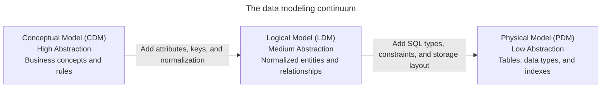
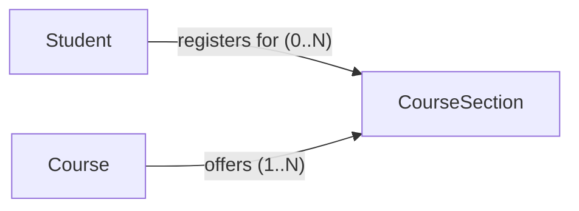
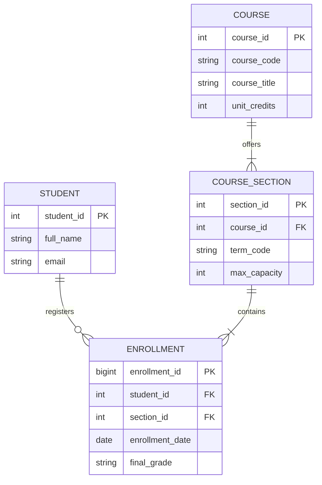

# Data modeling fundamentals

## Overview

Data modeling translates real-world business processes, workflows, and domain rules into structured database representations. Apps build on data models by progressing from abstract business definitions down to physical storage structures on disk.

Data modeling follows a three-tier continuum:

1. **Conceptual data model**: captures business entities and relationships at the highest level of abstraction.
2. **Logical data model**: adds structural detail, attributes, keys, and relational integrity rules without binding to a specific database vendor.
3. **Physical data model**: implements the schema for a specific database management system, specifying data types, indexes, partitioning, and storage configurations.

## Data modeling tiers

A complete design progresses through three distinct tiers. These tiers are the Conceptual Data Model (CDM), Logical Data Model (LDM), and Physical Data Model (PDM). Each tier targets a distinct audience and resolves specific design questions.



### Conceptual data model

The Conceptual Data Model (CDM) represents the highest level of abstraction. It defines what the business domain contains rather than how a technical database operates.

A conceptual data model has the following characteristics:

- Identifies primary business entities (such as customers, orders, products, and stores) and defines interactions among them for business stakeholders and analysts.
- Operates independently of any Database Management System (DBMS), hardware platform, or programming language.
- Focuses on business concepts and domain boundaries without defining column names, data types, or physical attributes.
- Represents real-world associations directly (such as students enrolling in courses or orders containing products) without introducing intermediate junction tables.

### Logical data model

The Logical Data Model (LDM) refines the conceptual blueprint by introducing structural rigor and relational integrity rules. It establishes how entities interact within a structured data system.

A logical data model has the following characteristics:

- Translates business entities into explicit relations, defines business attributes, and resolves entity relationships for data architects and software engineers.
- Lists all required attributes and generic data types (such as integer, string, date, and numeric) for each entity.
- Specifies candidate keys, primary keys, and foreign keys to establish referential integrity between entities.
- Decomposes many-to-many relationships into two one-to-many relationships through associative entities (also known as junction tables or bridge entities).
- Organizes relational attributes into third normal form to eliminate data redundancy and prevent update anomalies.
- Defines schema structures without depending on vendor-specific SQL syntax or physical storage parameters.

### Physical data model

The Physical Data Model (PDM) translates the logical model into concrete implementation artifacts for a target Database Management System (DBMS), such as PostgreSQL, MySQL, Snowflake, or BigQuery.

A physical data model has the following characteristics:

- Focuses on query execution, storage layout, indexing strategies, memory allocation, and operational performance for database administrators and platform engineers.
- Specifies engine-specific Data Definition Language (DDL) and concrete database data types, such as `BIGINT`, `VARCHAR(255)`, `TIMESTAMPTZ`, and `NUMERIC(10, 2)`.
- Enforces schema integrity through `PRIMARY KEY`, `FOREIGN KEY`, `NOT NULL`, `UNIQUE`, and `CHECK` constraints.
- Defines B-tree indexes, hash indexes, clustering keys, and physical table partitioning strategies (such as partitioning tables by calendar year).
- Aligns schemas with underlying storage engines, such as row-oriented heap pages versus columnar block layouts, buffer cache dynamics, and file structures.

## Comparison of modeling tiers

The following table compares the characteristics, audiences, and technical requirements across the three modeling tiers:

| Dimension | Conceptual model | Logical model | Physical model |
| :--- | :--- | :--- | :--- |
| **Primary audience** | Business leaders and domain experts | Data architects and app engineers | Database administrators and platform engineers |
| **Abstraction level** | High business-domain view | Medium structural design | Low hardware and engine implementation |
| **Technology dependency** | Independent of software and hardware | Independent of database vendor | Specific to target DBMS engine |
| **Entities and relations** | Business entities and conceptual links | Normalized entities and junction entities | Physical tables, views, and partitions |
| **Attributes and types** | None or minimal high-level names | Generic types, such as text, number, and date | Engine types, such as `VARCHAR`, `INT8`, and `NUMERIC` |
| **Key specifications** | Natural business identifiers | Explicit primary keys and foreign keys | Indexed primary keys, foreign key constraints, and clustered keys |

## Entity-relationship diagrams

An Entity Relationship Diagram (ERD) is a visual diagram that illustrates entities and the relationships connecting them. Teams use ERD diagrams to communicate schemas for both normalized operational databases and dimensional data warehouses.

### Core components

An ERD models three foundational constructs:

| Component | Definition | Examples |
| :--- | :--- | :--- |
| Entity | A distinct object or concept in the business domain. | Strong entity (customer), weak entity (order line item dependent on order) |
| Attribute | A property or characteristic belonging to an entity. | Atomic (status code), composite (address), multi-valued (phone numbers) |
| Relationship | A logical association or interaction between two or more entities. | Customer placing an order, student enrolling in a course section |

### Cardinality and multiplicity

Cardinality defines the numerical limits of a relationship between participating entities:

| Cardinality | Definition | Example |
| :--- | :--- | :--- |
| One-to-one (1:1) | Each instance of entity A associates with at most one instance of entity B, and each instance of B links to at most one instance of A. | A user account associates with one user profile. |
| One-to-many (1:N) | One instance of entity A associates with multiple instances of entity B, but each instance of B links back to exactly one instance of A. | A department contains many employees. |
| Many-to-many (M:N) | Multiple instances of entity A associate with multiple instances of entity B, and vice versa. | Students enroll in multiple courses, and each course contains multiple students. |

### Crow's foot notation

Crow's foot notation uses visual symbols at line endings to indicate minimum and maximum cardinality:

| Symbol | Notation name | Relationship meaning |
| :--- | :--- | :--- |
| `\|\|` | Mandatory one | Exactly one instance |
| `\|o` | Optional one | Zero or one instance |
| `>\|` | Mandatory many | One or more instances |
| `>o` | Optional many | Zero, one, or more instances |

## University registration implementation guide

The following end-to-end example tracks an academic course registration
system through conceptual, logical, and physical tiers.

### Conceptual model design

The business domain requires three core entities: `Student`, `Course`, and
`CourseSection`.

Business rules define the following relationships:

- A student registers for zero, one, or more course sections.
- A course section belongs to exactly one parent course.
- A course offers one or more course sections across academic terms.
- A course section contains one or more enrolled students.



### Logical model design

The logical model adds attributes, defines the data grain, and resolves the
many-to-many relationship between students and course sections:

1. **Establish the data grain**:
   - `Student`: one row represents one registered student.
   - `Course`: one row represents one catalog course offering.
   - `CourseSection`: one row represents one scheduled class offering in a term.
   - `Enrollment`: one row represents one student registration in a section.
2. **Resolve the many-to-many relationship**: introducing the associative
   entity `Enrollment` transforms the many-to-many relationship into two
   one-to-many relationships.



### Physical model implementation

The physical model generates PostgreSQL Data Definition Language (DDL)
statements with concrete types, composite primary keys, foreign key
constraints, table partitioning, and secondary indexes:

```sql
-- 1. Physical Students Table
CREATE TABLE students (
    student_id BIGINT GENERATED ALWAYS AS IDENTITY PRIMARY KEY,
    full_name VARCHAR(100) NOT NULL,
    email VARCHAR(255) NOT NULL UNIQUE,
    entry_year INT NOT NULL,
    created_at TIMESTAMPTZ NOT NULL DEFAULT CURRENT_TIMESTAMP
);

-- 2. Physical Courses Table
CREATE TABLE courses (
    course_id BIGINT GENERATED ALWAYS AS IDENTITY PRIMARY KEY,
    course_code VARCHAR(20) NOT NULL UNIQUE,
    course_title VARCHAR(150) NOT NULL,
    unit_credits INT NOT NULL CHECK (unit_credits > 0)
);

-- 3. Physical Course Sections Table
CREATE TABLE course_sections (
    section_id BIGINT GENERATED ALWAYS AS IDENTITY PRIMARY KEY,
    course_id BIGINT NOT NULL,
    term_code VARCHAR(10) NOT NULL,
    max_capacity INT NOT NULL CHECK (max_capacity > 0),
    CONSTRAINT fk_sections_course
        FOREIGN KEY (course_id)
        REFERENCES courses (course_id)
        ON DELETE RESTRICT
);

-- Secondary Index for Course Sections Lookup
CREATE INDEX idx_sections_course_id ON course_sections(course_id);

-- 4. Physical Enrollments Junction Table (Partitioned by Academic Year)
CREATE TABLE enrollments (
    enrollment_id BIGINT GENERATED ALWAYS AS IDENTITY,
    enrollment_date DATE NOT NULL,
    student_id BIGINT NOT NULL,
    section_id BIGINT NOT NULL,
    final_grade VARCHAR(5),
    PRIMARY KEY (enrollment_id, enrollment_date),
    CONSTRAINT fk_enrollments_student
        FOREIGN KEY (student_id)
        REFERENCES students (student_id)
        ON DELETE RESTRICT,
    CONSTRAINT fk_enrollments_section
        FOREIGN KEY (section_id)
        REFERENCES course_sections (section_id)
        ON DELETE RESTRICT
) PARTITION BY RANGE (enrollment_date);

-- Annual Partitions for Academic Years
CREATE TABLE enrollments_2025 PARTITION OF enrollments
    FOR VALUES FROM ('2025-01-01') TO ('2026-01-01');

CREATE TABLE enrollments_2026 PARTITION OF enrollments
    FOR VALUES FROM ('2026-01-01') TO ('2027-01-01');

-- Secondary Indexes for Join Acceleration
CREATE INDEX idx_enrollments_student_id ON enrollments(student_id);
CREATE INDEX idx_enrollments_section_id ON enrollments(section_id);
```

This physical implementation applies several important design decisions:

- In PostgreSQL, primary keys on partitioned tables must include the partition column. Because the `enrollments` table partitions by `enrollment_date`, it uses the composite primary key `(enrollment_id, enrollment_date)`.
- Database engines such as PostgreSQL automatically index primary keys, but they don't create indexes for foreign keys. Creating `idx_enrollments_student_id` and `idx_enrollments_section_id` ensures relational joins avoid sequential table scans.

## Common pitfalls

### Skipping conceptual and logical modeling

Skipping the conceptual and logical stages to write physical `CREATE TABLE` statements immediately often causes structural schema defects. Without thorough entity and relationship analysis, teams overlook business edge cases, miss junction entities for many-to-many relationships, and produce rigid schemas that require expensive database migrations.

### Conflating entity-relationship diagrams with normal forms

An ERD provides a visual syntax composed of boxes and lines. It doesn't enforce third normal form rules. Both normalized schemas and dimensional schemas, such as star and snowflake schemas for analytics, use ERD notation. Normalization depends on functional dependencies and business requirements rather than diagramming syntax.

### Leaving table grain undefined

Designing tables without formally declaring the grain, or the exact real-world meaning of a single row, leads to mixed levels of detail within the same table. For example, if an order table mixes order header data with individual line-item items, aggregation queries with `SUM` and `AVG` double-count order totals.

### Omitting indexes on foreign keys

Relational database engines automatically construct unique B-tree indexes for primary key constraints, but they don't automatically index foreign key columns. Omitting explicit secondary indexes on foreign keys causes multi-table `JOIN` operations and cascading deletions to perform sequential table scans.

### Introducing premature `denormalization`

Combining tables early through `denormalization` to avoid table joins creates duplicate data across tables. When client apps update an attribute in one table, out-of-sync replicas introduce data anomalies. Keep Online Transaction Processing (OLTP) systems normalized to protect transactional integrity, and apply `denormalization` in dedicated read-optimized reporting tables or analytical data marts.

## Key takeaways

- Progress through conceptual, logical, and physical tiers to decouple business rules from storage implementation details.
- Use conceptual models to define business boundaries with non-technical stakeholders.
- Use logical models to define entities, attributes, primary keys, foreign keys, and third normal form normalization.
- Use physical models to implement database-specific types, storage parameters, constraints, and indexes.
- Define the exact grain of every table before writing DDL statements.
- Index foreign key columns explicitly to ensure efficient joins and cascading updates.
- Keep operational databases normalized, reserving `denormalization` for analytical workloads.

## What's next

- Explore entities, cardinality rules, and relationship notations in
  [Entities, attributes, and relationships](/modeling/entities-attributes-and-relationships).
- Learn functional dependencies and normal forms in
  [Database normalization](/modeling/database-normalization).
- Review relational model foundations, candidate keys, and constraints in
  [Relational model concepts](/sql/relational-model-concepts).
