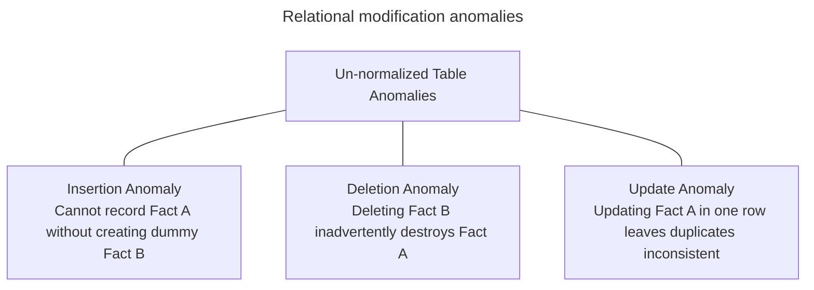
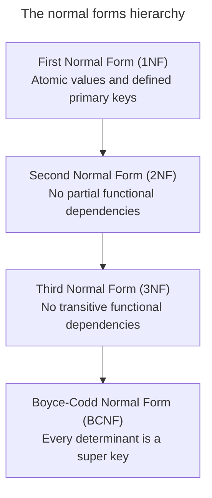
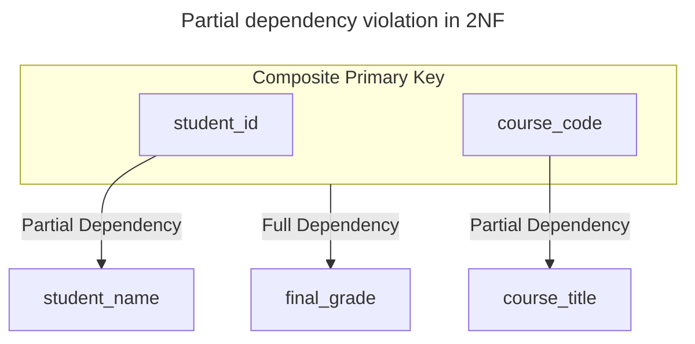
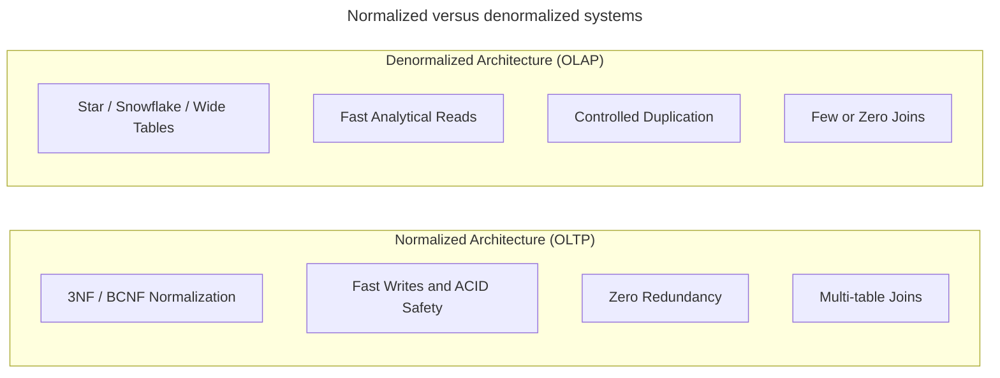

# Database normalization

## Overview

Database normalization organizes relations and attributes in a relational database to minimize data redundancy, eliminate modification anomalies, and enforce data integrity. Formulated by Edgar F. `Codd`, normalization decomposes non-normalized relations into smaller, well-structured tables linked by foreign keys, applying the principle of Don't Repeat Yourself (DRY) to database schemas.

This guide explains:

- The three modification anomalies that plague poorly structured schemas.
- Foundational relational concepts, such as functional dependencies, candidate keys, and attribute classifications.
- Progressive normal forms: first normal form, second normal form, third normal form, and Boyce-Codd Normal Form (BCNF).
- Advanced normal forms: fourth normal form and fifth normal form.
- Strategic `denormalization` for analytical data warehouses.
- A step-by-step example progressing from an un-normalized dataset to BCNF and star schemas.
- Common design pitfalls, dependency preservation trade-offs, and modern semi-structured data storage.

## The three modification anomalies

When a database schema combines multiple distinct business facts in a single table, structural defects introduce three major modification anomalies.



### Insertion anomalies

An insertion anomaly occurs when a system can't record a new piece of data without simultaneously inserting unrelated or unavailable dummy data.

For example, if a table combines student data, course information, and department details, an administrator can't register a newly approved course in the catalog until at least one student enrolls in it. To insert the course earlier, the system must invent artificial `NULL` values or placeholder student identifiers, corrupting data integrity.

### Deletion anomalies

A deletion anomaly occurs when deleting one specific fact inadvertently and irreversibly destroys unrelated business facts.

For example, if an advanced seminar has only one student enrolled and that student drops out, deleting the enrollment row permanently removes the course description, department code, and room assignment from the database.

### Update anomalies

An update anomaly, also called a modification anomaly, occurs when a system stores a single attribute value redundantly across multiple rows. Modifying that attribute requires updating every duplicate occurrence across the entire table.

For example, if an instructor teaches 50 students and changes offices, the database must execute 50 individual row updates. If the operation aborts midway or misses rows, the database enters an inconsistent state where the instructor appears to occupy two offices simultaneously.

## Foundations of relational normalization

Relational normalization relies on mathematical rules governing attribute relationships within tables.


### Functional dependencies

A functional dependency describes a relationship between attributes in a relation. An attribute set $X$ functionally determines attribute set $Y$, written as $X \rightarrow Y$, if each distinct value of $X$ associates with exactly one value of $Y$.

In the functional dependency $X \rightarrow Y$:

- **$X$** acts as the determinant.
- **$Y$** acts as the dependent attribute.

For example, `student_id` $\rightarrow$ `student_email` represents a functional dependency because each unique student identifier maps to exactly one student email address.

### Key concepts and attribute classifications

Relational design classifies attributes based on their relationship to candidate keys:

| Term | Definition |
| :--- | :--- |
| Super key | Any combination of columns that uniquely identifies every tuple in a relation, including redundant columns. |
| Candidate key | A minimal super key with no redundant attributes. Removing any attribute destroys uniqueness. |
| Primary key | The candidate key selected by the database architect as the official row identifier. |
| Prime attribute | An attribute that belongs to at least one candidate key. |
| Non-prime attribute | An attribute that belongs to no candidate key. |

## Progressive normal forms

Normal forms represent hierarchical stages of schema design. To achieve any target normal form, a relation must satisfy all conditions of the preceding stages.



### First normal form

A relation satisfies first normal form, or 1NF, if it meets three core structural requirements:

1. **Atomicity**: each column contains only atomic, indivisible scalar values. Repeating groups, arrays, delimited string lists, and nested objects violate 1NF.
2. **Defined primary key**: every row contains a distinct identifier that uniquely separates it from other rows.
3. **Consistent data types**: every entry in a column shares a single, static data type.

A relation in 1NF also treats row ordering and column ordering as irrelevant to the semantic meaning of the data.

### Second normal form

A relation satisfies second normal form, or 2NF, if it meets two criteria:

1. The relation satisfies first normal form.
2. The relation contains no partial functional dependencies.

A partial functional dependency occurs when a non-prime attribute depends on a proper subset of a composite candidate key rather than the complete key.



Relations with single-column primary keys can't contain partial dependencies. A table with a single-column primary key automatically achieves 2NF once it satisfies 1NF.

### Third normal form

A relation satisfies third normal form, or 3NF, if it meets two criteria:

1. The relation satisfies second normal form.
2. The relation contains no transitive functional dependencies.

A transitive dependency occurs when non-prime attribute $Z$ depends on non-prime attribute $Y$, which in turn depends on primary key $X$, expressed as $X \rightarrow Y$ and $Y \rightarrow Z$.


Formal relational theory defines 3NF as follows: for every non-trivial functional dependency $X \rightarrow Y$:

- $X$ is a super key, OR
- $Y$ is a prime attribute.

Database theorist Bill Kent summarized 3NF with the classic phrase: "Each non-key attribute must depend on the key, the whole key, and nothing but the key."

### `Boyce-Codd` normal form

Boyce-Codd Normal Form (BCNF), often called 3.5NF, resolves edge cases in tables that possess multiple overlapping candidate keys.

Formal definition: a relation satisfies BCNF if and only if, for every non-trivial functional dependency $X \rightarrow Y$, determinant $X$ is a super key.

#### Comparison of normal forms

In 3NF, the rule allows an exception: if $Y$ is a prime attribute, determinant $X$ doesn't need to be a super key. BCNF eliminates this exception entirely. Every determinant in BCNF must serve as a super key, preventing update anomalies in schemas with overlapping composite keys.

### Higher normal forms

While 3NF and BCNF cover most operational app needs, advanced relational theory defines higher levels of normalization:

- Fourth normal form (4NF) eliminates non-trivial multi-valued dependencies ($X \twoheadrightarrow Y$). A multi-valued dependency occurs when attribute $X$ determines a set of independent values for attribute $Y$ and attribute $Z$. Storing independent multi-valued attributes in a single table produces Cartesian row multiplication. Splitting the independent attributes into separate tables achieves 4NF.
- Fifth normal form (5NF, or project-join normal form) eliminates join dependencies and ensures lossless decomposition. A table satisfies 5NF if it cannot be decomposed into smaller tables without altering the original relation upon reconstruction.

## Strategic `denormalization` for analytics

While operational databases rely on 3NF and BCNF to maintain transaction safety, analytical reporting systems deliberately introduce `denormalization`.

`Denormalization` is the intentional, controlled introduction of data redundancy into a normalized database to optimize read queries and reduce multi-table joins.



### Architectural comparison

| Architectural dimension | Normalized design | `Denormalized` star and wide table design |
| :--- | :--- | :--- |
| **Primary workload** | Online Transaction Processing (OLTP) | Online Analytical Processing (OLAP) |
| **Design objective** | Write speed, transactional safety, and zero redundancy | Read speed, fast aggregations, and business usability |
| **Data redundancy** | Zero | Controlled duplication of dimensional attributes |
| **Join overhead** | High: queries require multi-table joins | Low: queries scan wide tables with few joins |
| **Write maintenance cost** | Cheap: updates modify a single row in one table | Expensive: batch pipelines refresh multi-row replicas |
| **Storage footprint** | Compact | Expansive |

### Workload separation

Operational systems of record rely on Atomicity, Consistency, Isolation, and Durability (ACID) transactions. Normalizing to 3NF minimizes row size, reduces lock contention during concurrent writes, and prevents update anomalies.

Analytical systems, such as data warehouses and data lakes, prioritize aggregate throughput across millions of rows. Analytical engines scan columnar data far faster when dimension attributes sit directly beside facts in wide tables or star schemas.

### Pre-calculated structures and caches

`Denormalization` manifests in production systems through several derived structures:

- Materialized views pre-compute expensive joins and store results on disk for rapid querying.
- Summary aggregation tables store pre-calculated metrics, such as daily revenue totals, monthly active counts, or customer lifetime spend.
- Lookup caches duplicate textual descriptive names directly inside high-throughput transactional records to eliminate runtime joins.

## Step-by-step normalization example

The following end-to-end example tracks a university course registration dataset across each normal form: un-normalized form, 1NF, 2NF, 3NF, BCNF, and an analytical star schema. Each step presents the conceptual challenge, the tabular state before and after transformation, and production SQL schemas.

### Scenario entities and business rules

The registration system tracks students, courses, instructors, and student grades:

- Each student has a unique student ID and a name.
- Each course has a unique course code, a title, and an assigned instructor.
- Each instructor has an assigned campus office.
- A student completes a course and earns a final letter grade.

### Step 0 - un-normalized relation

In un-normalized form, an operational spreadsheet or legacy system often records course enrollments with repeating groups or non-atomic arrays:

| `student_id` | `student_name` | `enrolled_courses` |
| :--- | :--- | :--- |
| 101 | Alice | `[{"code": "CS101", "title": "CompSci", "instructor": "Dr. Turing", "office": "Turing Hall", "grade": "A"}, {"code": "MATH201", "title": "Calculus", "instructor": "Dr. Gauss", "office": "Gauss Hall", "grade": "B"}]` |
| 102 | Bob | `[{"code": "CS101", "title": "CompSci", "instructor": "Dr. Turing", "office": "Turing Hall", "grade": "A"}]` |
| 103 | Charlie | `[{"code": "PHYS101", "title": "Physics", "instructor": "Dr. Curie", "office": "Curie Hall", "grade": "A"}, {"code": "MATH201", "title": "Calculus", "instructor": "Dr. Gauss", "office": "Gauss Hall", "grade": "C"}]` |

#### Structural flaws in un-normalized records

This un-normalized structure creates operational hurdles:

- Embedding JSON arrays or comma-delimited strings prevents database engines from performing index searches, filtering, or aggregations on individual course fields.
- Parsing nested strings to compute average student grades or locate instructor offices increases query complexity and compute costs.

### Step 1 - conversion to first normal form

To achieve 1NF, database designers enforce two core rules:

1. Every column must hold atomic, indivisible values.
2. The relation must define a primary key that uniquely identifies each record.

Flattening the repeating nested arrays produces the unified tabular relation `student_course_records`.

#### Relation in first normal form

| `student_id` | `course_code` | `student_name` | `course_title` | `instructor_name` | `instructor_office` | `grade` |
| :--- | :--- | :--- | :--- | :--- | :--- | :--- |
| 101 | `CS101` | Alice | CompSci | Dr. Turing | Turing Hall | A |
| 101 | `MATH201` | Alice | Calculus | Dr. Gauss | Gauss Hall | B |
| 102 | `CS101` | Bob | CompSci | Dr. Turing | Turing Hall | A |
| 103 | `PHYS101` | Charlie | Physics | Dr. Curie | Curie Hall | A |
| 103 | `MATH201` | Charlie | Calculus | Dr. Gauss | Gauss Hall | C |

#### Primary key identification

To establish record uniqueness, evaluate candidate columns:

- `student_id` repeats across multiple course enrollments.
- `course_code` repeats across multiple enrolled students.
- `grade` repeats across multiple students and courses.

The minimal combination that uniquely distinguishes each row is the composite key `{student_id, course_code}`.

Attribute classification:

- Prime attributes: `student_id`, `course_code`.
- Non-prime attributes: `student_name`, `course_title`, `instructor_name`, `instructor_office`, `grade`.

#### Functional dependency mapping

Analyzing this 1NF relation uncovers four distinct dependencies:

1. `{student_id, course_code}` $\rightarrow$ `grade`: a full functional dependency. Determining a student grade requires both the student identifier and the specific course identifier.
2. `student_id` $\rightarrow$ `student_name`: a partial functional dependency. `student_name` depends on only a subset of the composite primary key.
3. `course_code` $\rightarrow$ `course_title`, `instructor_name`: a partial functional dependency. `course_title` and `instructor_name` depend solely on `course_code`, which forms only part of the composite primary key.
4. `instructor_name` $\rightarrow$ `instructor_office`: a dependency between two non-prime attributes. Because `course_code` determines `instructor_name`, `instructor_office` transitively depends on `course_code`.

### Step 2 - conversion to second normal form

A relation satisfies second normal form when:

1. The relation meets all criteria for 1NF.
2. The relation contains no partial functional dependencies: every non-prime attribute must depend on the full composite primary key.

> [!NOTE]
> Any relation with a single-column primary key automatically satisfies 2NF once it achieves 1NF because a single column can't contain a proper sub-key.

#### The partial dependency violation

In the 1NF table, two partial dependencies violate 2NF:

- `student_name` depends solely on `student_id`.
- `course_title`, `instructor_name`, and `instructor_office` depend solely on `course_code`.

Only `grade` depends on the full composite key `{student_id, course_code}`.

#### Decomposition into second normal form tables

To achieve 2NF, designers decompose the single table into three relations based on their direct determinants:

1. **`students`**: isolates attributes that depend purely on `student_id`.
2. **`courses`**: isolates attributes that depend purely on `course_code`.
3. **`enrollments`**: retains attributes that require both key components.

**Students table**:

| `student_id` Primary Key | `student_name` |
| :--- | :--- |
| 101 | Alice |
| 102 | Bob |
| 103 | Charlie |

**Courses table**:

| `course_code` Primary Key | `course_title` | `instructor_name` | `instructor_office` |
| :--- | :--- | :--- | :--- |
| `CS101` | CompSci | Dr. Turing | Turing Hall |
| `MATH201` | Calculus | Dr. Gauss | Gauss Hall |
| `PHYS101` | Physics | Dr. Curie | Curie Hall |

**Enrollments table**:

| `student_id` Foreign Key | `course_code` Foreign Key | `grade` |
| :--- | :--- | :--- |
| 101 | `CS101` | A |
| 101 | `MATH201` | B |
| 102 | `CS101` | A |
| 103 | `PHYS101` | A |
| 103 | `MATH201` | C |

#### Second normal form SQL schema

```sql
-- Table 2A: Students (Primary key: student_id)
CREATE TABLE students (
    student_id   INTEGER PRIMARY KEY,
    student_name VARCHAR(50) NOT NULL
);

-- Table 2B: Courses (Primary key: course_code)
CREATE TABLE courses (
    course_code       VARCHAR(10) PRIMARY KEY,
    course_title      VARCHAR(50) NOT NULL,
    instructor_name   VARCHAR(50) NOT NULL,
    instructor_office VARCHAR(50) NOT NULL
);

-- Table 2C: Enrollments (Composite primary key: student_id, course_code)
CREATE TABLE enrollments (
    student_id  INTEGER NOT NULL,
    course_code VARCHAR(10) NOT NULL,
    grade       VARCHAR(2) NOT NULL,
    PRIMARY KEY (student_id, course_code),
    CONSTRAINT fk_enrollments_student
        FOREIGN KEY (student_id) REFERENCES students (student_id),
    CONSTRAINT fk_enrollments_course
        FOREIGN KEY (course_code) REFERENCES courses (course_code)
);
```

#### Why second normal form leaves an anomaly

All three decomposed tables satisfy 2NF:

- `students` has a single-column primary key: 2NF satisfied.
- `enrollments` has a composite primary key, and `grade` depends on both components: 2NF satisfied.
- `courses` has a single-column primary key: 2NF satisfied.

However, inspect the `courses` table closely. Inside `courses`:

- `course_code` $\rightarrow$ `instructor_name`
- `instructor_name` $\rightarrow$ `instructor_office`

Here, `instructor_name` and `instructor_office` are both non-prime attributes. `instructor_office` doesn't depend directly on the primary key `course_code`; it depends on `instructor_name`. This chain represents a **transitive dependency**: $X \rightarrow Y$ and $Y \rightarrow Z$.

This transitive dependency introduces operational anomalies in the 2NF `courses` table:

- An insertion anomaly occurs because the university can't record Dr. Lovelace and her office `Lovelace Hall` until the department assigns her to teach an active course.
- A deletion anomaly occurs because if the department cancels `PHYS101` and Dr. Curie teaches no other course, deleting `PHYS101` deletes Dr. Curie and her office location from the system.
- An update anomaly occurs because if Dr. Gauss teaches multiple courses and moves offices, staff must locate and update every course taught by Dr. Gauss. Any missed row creates data divergence.

### Step 3 - conversion to third normal form

A relation satisfies third normal form when:

1. The relation meets all criteria for 2NF.
2. The relation contains no transitive dependencies: no non-prime attribute may depend on another non-prime attribute.

#### Decomposition into third normal form tables

In the 2NF schema, `students` and `enrollments` already satisfy 3NF. To resolve the transitive dependency in `courses`, designers extract the instructor attributes into a dedicated `instructors` table.

**Instructors table**:

| `instructor_name` Primary Key | `instructor_office` |
| :--- | :--- |
| Dr. Turing | Turing Hall |
| Dr. Gauss | Gauss Hall |
| Dr. Curie | Curie Hall |

**Courses table**:

| `course_code` Primary Key | `course_title` | `instructor_name` Foreign Key |
| :--- | :--- | :--- |
| `CS101` | CompSci | Dr. Turing |
| `MATH201` | Calculus | Dr. Gauss |
| `PHYS101` | Physics | Dr. Curie |

`students` and `enrollments` remain unchanged from 2NF.

#### Third normal form SQL schema

```sql
-- Table 3A: Students (Primary key: student_id)
CREATE TABLE students (
    student_id   INTEGER PRIMARY KEY,
    student_name VARCHAR(50) NOT NULL
);

-- Table 3B: Instructors (Primary key: instructor_name)
CREATE TABLE instructors (
    instructor_name   VARCHAR(50) PRIMARY KEY,
    instructor_office VARCHAR(50) NOT NULL
);

-- Table 3C: Courses (Primary key: course_code)
CREATE TABLE courses (
    course_code     VARCHAR(10) PRIMARY KEY,
    course_title    VARCHAR(50) NOT NULL,
    instructor_name VARCHAR(50) NOT NULL,
    CONSTRAINT fk_courses_instructor
        FOREIGN KEY (instructor_name) REFERENCES instructors (instructor_name)
);

-- Table 3D: Enrollments (Composite primary key: student_id, course_code)
CREATE TABLE enrollments (
    student_id  INTEGER NOT NULL,
    course_code VARCHAR(10) NOT NULL,
    grade       VARCHAR(2) NOT NULL,
    PRIMARY KEY (student_id, course_code),
    CONSTRAINT fk_enrollments_student
        FOREIGN KEY (student_id) REFERENCES students (student_id),
    CONSTRAINT fk_enrollments_course
        FOREIGN KEY (course_code) REFERENCES courses (course_code)
);
```

#### Verification of third normal form

In the revised schema:

- Every non-prime attribute in `instructors` depends solely on `instructor_name`.
- Every non-prime attribute in `courses` depends solely on `course_code`.
- Every non-prime attribute in `students` depends solely on `student_id`.
- Every non-prime attribute in `enrollments` depends solely on `{student_id, course_code}`.

All non-prime attributes now depend on the key, the whole key, and nothing but the key. The database eliminates all three modification anomalies for this workload.

### Step 4 - resolution of `Boyce-Codd` normal form

While 3NF handles most relational requirements, edge cases occur when a table contains multiple overlapping candidate keys.

Recall the formal definition of 3NF: for every functional dependency $X \rightarrow Y$, determinant $X$ must be a super key OR dependent attribute $Y$ must be a prime attribute. Boyce-Codd Normal Form (BCNF) eliminates that alternative condition: every determinant $X$ must serve as a super key.

#### Scenario with overlapping candidate keys

Extend the academic model with a student advising program governed by three business rules:

1. A student can have multiple advisors for different subject areas.
2. Each advisor specializes in and advises for exactly one subject area.
3. For a specific subject area, a student has at most one assigned advisor.

Consider the relation `student_advising`:

- Attributes: `student_id`, `subject_name`, `advisor_name`.
- Functional dependencies:
  1. `{student_id, subject_name}` $\rightarrow$ `advisor_name`
  2. `advisor_name` $\rightarrow$ `subject_name`

**Candidate key derivation**:

- Because `{student_id, subject_name}` determines `advisor_name`, `{student_id, subject_name}` forms a candidate key.
- Because `advisor_name` determines `subject_name`, substituting `advisor_name` yields a second candidate key: `{student_id, advisor_name}`.

Because all three columns belong to at least one candidate key, every attribute in `student_advising` is a prime attribute.

**Student advising relation before BCNF decomposition**:

| `student_id` | `subject_name` | `advisor_name` |
| :--- | :--- | :--- |
| 101 | Math | Dr. Ramanujan |
| 102 | Math | Dr. Ramanujan |
| 101 | Physics | Dr. Feynman |
| 103 | Physics | Dr. Feynman |

#### Evaluation against third normal form and `BCNF`

- Inspect dependency 1: `{student_id, subject_name}` $\rightarrow$ `advisor_name`. Determinant `{student_id, subject_name}` is a candidate key. This dependency satisfies both 3NF and BCNF.
- Inspect dependency 2: `advisor_name` $\rightarrow$ `subject_name`. Determinant `advisor_name` isn't a candidate key on its own. However, dependent attribute `subject_name` is a prime attribute. Because `subject_name` is prime, this dependency satisfies 3NF.
- Despite passing 3NF, the relation violates BCNF because determinant `advisor_name` isn't a super key.

This BCNF violation causes two anomalies:

- An insertion anomaly occurs because the administration can't record that Dr. Lovelace advises Computer Science until staff assigns a student to her.
- An update anomaly occurs because if Dr. Ramanujan switches departments, administrators must update multiple rows.

#### Decomposition into `Boyce-Codd` normal form tables

To achieve BCNF, decompose the table so that every determinant acts as a super key in its respective relation:

1. **`advisor_specialties`**: stores each advisor and their subject area.
2. **`student_advisors`**: records student advisor assignments.

**Advisor specialties table**:

| `advisor_name` Primary Key | `subject_name` |
| :--- | :--- |
| Dr. Ramanujan | Math |
| Dr. Feynman | Physics |

**Student advisors table**:

| `student_id` | `advisor_name` Foreign Key |
| :--- | :--- |
| 101 | Dr. Ramanujan |
| 102 | Dr. Ramanujan |
| 101 | Dr. Feynman |
| 103 | Dr. Feynman |

#### `Boyce-Codd` normal form SQL schema

```sql
-- Table 4A: AdvisorSpecialties (Primary key: advisor_name)
CREATE TABLE advisor_specialties (
    advisor_name VARCHAR(50) PRIMARY KEY,
    subject_name VARCHAR(50) NOT NULL
);

-- Table 4B: StudentAdvisors (Composite primary key: student_id, advisor_name)
CREATE TABLE student_advisors (
    student_id   INTEGER NOT NULL,
    advisor_name VARCHAR(50) NOT NULL,
    PRIMARY KEY (student_id, advisor_name),
    CONSTRAINT fk_student_advisors_advisor
        FOREIGN KEY (advisor_name) REFERENCES advisor_specialties (advisor_name)
);
```

#### Functional dependency preservation trade-off

Decomposing into BCNF eliminates all redundancy, but introduces a trade-off. The original dependency `{student_id, subject_name}` $\rightarrow$ `advisor_name` now spans two distinct tables. Enforcing the rule that a student can't have two advisors for the same subject requires an app lock, a trigger, or an explicit join view. Relational database engines can't enforce this cross-table dependency with a simple unique constraint.

### Step 5 - dimensional `denormalization` for analytics

While the 3NF and BCNF schemas protect transactional integrity, executing aggregate analytical queries across five normalized tables incurs high join costs.

In the analytical warehouse layer, data engineers `denormalize` this structure into a dimensional star schema:

**DimCourses dimension table**:

| `course_key` Primary Key | `course_code` | `course_title` | `instructor_name` | `instructor_office` |
| :--- | :--- | :--- | :--- | :--- |
| 1 | `CS101` | CompSci | Dr. Turing | Turing Hall |
| 2 | `MATH201` | Calculus | Dr. Gauss | Gauss Hall |
| 3 | `PHYS101` | Physics | Dr. Curie | Curie Hall |

**FactEnrollments fact table**:

| `enrollment_key` Primary Key | `student_key` | `course_key` | `date_key` | `letter_grade` | `tuition_fee` |
| :--- | :--- | :--- | :--- | :--- | :--- |
| 5001 | 101 | 1 | 20260901 | A | 450.00 |
| 5002 | 101 | 2 | 20260901 | B | 500.00 |
| 5003 | 102 | 1 | 20260901 | A | 450.00 |
| 5004 | 103 | 3 | 20260901 | A | 475.00 |
| 5005 | 103 | 2 | 20260901 | C | 500.00 |

#### Dimensional star schema tables

```sql
-- Denormalized dimension: DimCourses
CREATE TABLE dim_courses (
    course_key        INTEGER GENERATED ALWAYS AS IDENTITY PRIMARY KEY,
    course_code       VARCHAR(10) NOT NULL,
    course_title      VARCHAR(50) NOT NULL,
    instructor_name   VARCHAR(50) NOT NULL, -- Denormalized attribute
    instructor_office VARCHAR(50) NOT NULL  -- Denormalized attribute
);

-- Fact table: FactEnrollments
CREATE TABLE fact_enrollments (
    enrollment_key INTEGER GENERATED ALWAYS AS IDENTITY PRIMARY KEY,
    student_key    INTEGER NOT NULL,
    course_key     INTEGER NOT NULL REFERENCES dim_courses (course_key),
    date_key       INTEGER NOT NULL,
    letter_grade   VARCHAR(2) NOT NULL,
    tuition_fee    NUMERIC(8, 2) NOT NULL -- Additive numeric fact
);
```

## Common design pitfalls

### Join overhead of excessive normalization

Aggressive normalization into 3NF and BCNF shatters business models into dozens of small tables. Basic user queries then require 8- to 12-way joins. Relational query planners can struggle with join permutations. This can lead to suboptimal execution plans and high query latency.

### Loss of dependency preservation in BCNF

Decomposing certain schemas into BCNF causes dependency loss. When dependency loss occurs, a database engine can't enforce a valid business rule using standard single-table constraints.

In the advising example, decomposing into BCNF makes it impossible to enforce `(student_id, subject_name)` $\rightarrow$ `advisor_name` with a simple primary key or unique constraint. Enforcing the rule requires expensive multi-table triggers or app locks. For this reason, engineers frequently stop at 3NF rather than pursuing BCNF when functional dependency preservation takes precedence over rare anomalies.

### Data synchronization failures in `denormalized` tables

Introducing duplicate data creates a synchronization burden. Modifying a source attribute requires propagating updates to every `denormalized` replica.

Without automated Change Data Capture (CDC) pipelines, event logs, or transactional sync jobs, `denormalized` reporting tables and caches inevitably experience data drift, corrupting downstream analytical reports.

### The 3NF anti-pattern in data warehousing

Exposing normalized 3NF schemas directly to business intelligence tools creates severe usability and performance bottlenecks.

As dimensional modeling pioneer Ralph `Kimball` highlighted, querying deep 3NF structures resembles navigating a complex highway interchange. Business analysts struggle to formulate queries across deep join paths, while analytical columnar engines perform significantly faster scanning wide, `denormalized` tables.

### Semi-structured data and 1NF nuances

Strictly interpreting 1NF rules can discourage teams from storing semi-structured data formats, such as JSON payloads, key-value maps, or arrays.

Modern cloud warehouses, including Snowflake and BigQuery, alongside relational engines such as PostgreSQL with `` `JSONB` ``, provide high-performance columnar shredding and indexing for nested data. For rapidly shifting event streams or sparse payloads, storing structured JSON attributes inside a single column often provides greater operational flexibility than creating numerous relational child tables.

## Key takeaways

- Use normalization to eliminate insertion, deletion, and update anomalies in operational databases.
- Require atomic values and unique keys to achieve first normal form.
- Eliminate partial dependencies on composite keys to achieve second normal form.
- Eliminate transitive dependencies between non-prime attributes to achieve third normal form.
- Enforce that every determinant is a super key to achieve Boyce-Codd normal form.
- Weigh the trade-off between BCNF normalization and functional dependency preservation.
- Use 3NF and BCNF for write-intensive operational databases, reserving `denormalization` for read-intensive analytical data warehouses.

## What's next

- Explore enterprise bus matrices and dimensional modeling in
  [Dimensional modeling methodology](/modeling/dimensional-modeling-methodology).
- Compare star schemas, snowflake schemas, and wide flat tables in
  [Schema architectures](/modeling/schema-architectures).
- Learn relational algebra and join execution in
  [Fundamental joins](/sql/fundamental-joins).
