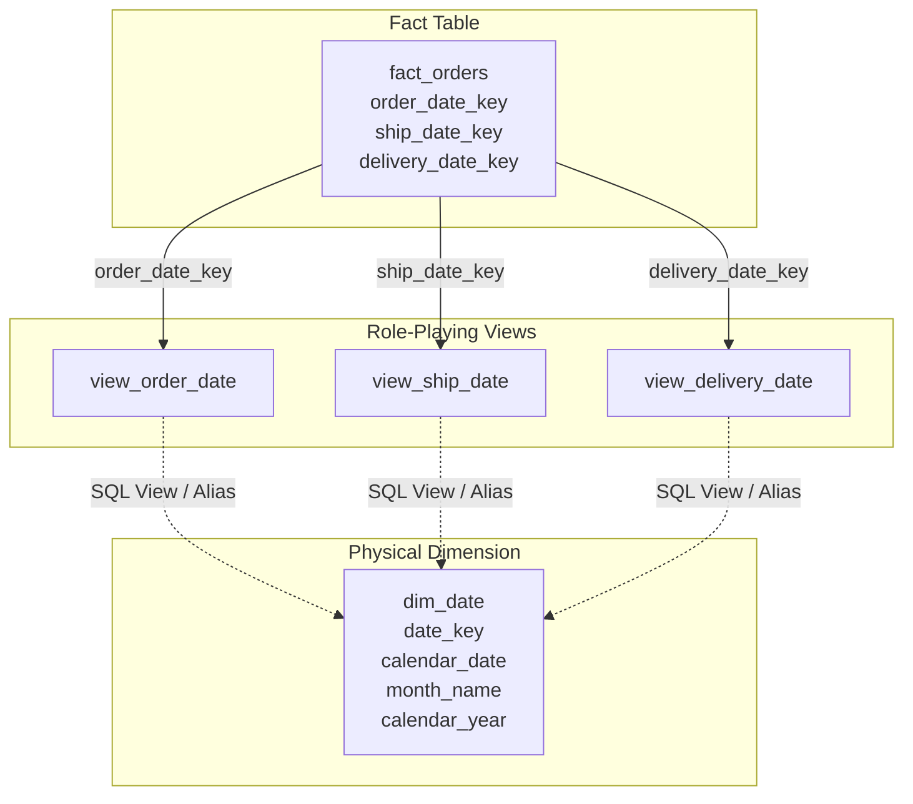
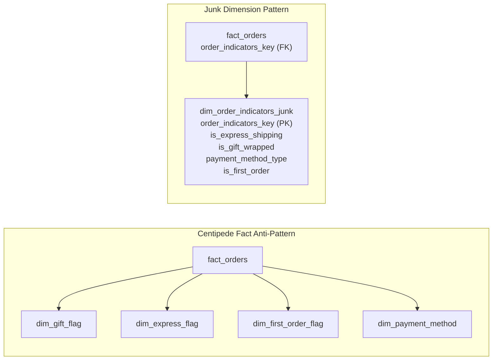

# Dimensional design patterns

Dimension design patterns provide standardized structural techniques in Kimball
dimensional modeling. They organize descriptive context, enforce consistency
across data marts, simplify schema maintenance, and improve query performance
in enterprise data warehouses.

Standard star schemas join central fact tables directly to flat, denormalized
dimension tables. Real-world business systems, however, introduce complex
relationships: multiple business processes sharing the same entities, single
events referencing the same entity in different contexts, low-cardinality flags
cluttering transaction tables, and secondary attributes with divergent update
cycles. Four primary design patterns resolve these architectural challenges:
conformed dimensions, role-playing dimensions, outrigger dimensions, and junk
dimensions.

## Conformed dimensions

A conformed dimension is a standardized dimension table that shares identical
surrogate keys, column names, business definitions, and domain values across
multiple star schemas or data marts in an enterprise.

Conformed dimensions form the foundation of Ralph Kimball's Data Warehouse Bus
Architecture. Instead of building disconnected data marts for separate business
units, teams use conformed dimensions to establish a shared analytical
framework across the entire organization.

### Operational forms of conformed dimensions

Conformed dimensions operate in three distinct structural forms:

| Form | Structure | Example | Use case |
| :--- | :--- | :--- | :--- |
| Identical dimension | The exact same physical table or logical view connects to multiple fact tables | A shared `dim_date` table joined to `fact_orders` and `fact_inventory` | Ensures identical calendar definitions and keys across all business processes |
| Conformed roll-up subset | A dimension table at a coarser grain that contains a strict subset of columns from an atomic dimension | A `dim_brand` table at the brand grain derived from atomic `dim_product` at the SKU grain | Allows high-level corporate forecasts to join against low-level atomic sales facts |
| Conformed row subset | A dimension table at the same grain that contains a strict subset of rows based on an attribute filter | A `dim_appliance_product` table containing only appliance category rows from `dim_product` | Restricts domain visibility for specialized departmental marts while maintaining global keys |

### Drill-across queries using conformed dimensions

The primary operational advantage of conformed dimensions is enabling
drill-across queries. A drill-across query executes multi-pass SQL against two or
more separate fact tables and merges the results side by side along shared
conformed dimension keys.

For example, comparing monthly sales revenue against end-of-month inventory
levels requires separate aggregations because sales transactions and inventory
snapshots exist at different grains. A multi-pass query aggregates each fact
table separately to the conformed `product_key` and `date_key` grain, and then
joins the two intermediate result sets with a `FULL OUTER JOIN`:

```sql
WITH sales_summary AS (
    SELECT 
        product_key,
        date_key,
        SUM(net_sales_amount) AS total_sales_amount
    FROM fact_sales
    GROUP BY product_key, date_key
),
inventory_summary AS (
    SELECT 
        product_key,
        date_key,
        SUM(on_hand_quantity) AS total_on_hand_quantity
    FROM fact_inventory_snapshot
    GROUP BY product_key, date_key
)
SELECT 
    p.product_name,
    d.calendar_date,
    COALESCE(s.total_sales_amount, 0.00) AS sales_amount,
    COALESCE(i.total_on_hand_quantity, 0) AS on_hand_units
FROM sales_summary s
FULL OUTER JOIN inventory_summary i
    ON s.product_key = i.product_key
    AND s.date_key = i.date_key
JOIN dim_product p 
    ON COALESCE(s.product_key, i.product_key) = p.product_key
JOIN dim_date d 
    ON COALESCE(s.date_key, i.date_key) = d.date_key;
```

Without conformed dimensions, the two business processes would use incompatible
keys or differing product descriptions, preventing reliable cross-process
correlation.

### Governance and organizational alignment

Creating conformed dimensions requires organizational discipline rather than
purely technical implementation. Individual departments often use conflicting
definitions for common terms, such as what constitutes an active customer or
when a sales lead qualifies as an opportunity.

To maintain conformed dimensions across an enterprise:

- Establish a central dimension authority or data governance group responsible
  for approving dimension schemas and surrogate key generation pipelines.
- Publish a standardized corporate bus matrix mapping business processes
  against shared conformed dimensions.
- Prevent local business units from adding non-standard keys or mutating shared
  definitions without global review.

## Role-playing dimensions

A role-playing dimension is a single physical dimension table that expresses
multiple distinct semantic meanings within the same fact table.

Consider an e-commerce order transaction. A single row in `fact_orders` records
multiple temporal milestones: the date the customer placed the order, the date
the warehouse shipped the items, and the date the carrier delivered the parcel.
Each date milestone requires independent filtering and grouping in reports. An
analyst might examine orders placed in December that shipped in January and arrived
in February.



### Implementation using semantic SQL views

Don't duplicate the physical table for each role. Creating physical copies
such as `dim_order_date`, `dim_ship_date`, and `dim_delivery_date` increases
storage requirements, creates redundant ETL pipelines, and breaks dimension
conformity when underlying calendar logic updates.

Instead, maintain a single physical `dim_date` table and declare separate
relational SQL views or query aliases for each semantic role. Prefix each view
column with the specific role name so downstream queries and business
intelligence tools present clear, unambiguous attribute labels:

```sql
-- Role view: Order date
CREATE VIEW view_order_date AS 
SELECT 
    date_key         AS order_date_key,
    calendar_date    AS order_date,
    day_of_week      AS order_day_of_week,
    month_name       AS order_month,
    calendar_quarter AS order_quarter,
    calendar_year    AS order_year
FROM dim_date;

-- Role view: Ship date
CREATE VIEW view_ship_date AS 
SELECT 
    date_key         AS ship_date_key,
    calendar_date    AS ship_date,
    day_of_week      AS ship_day_of_week,
    month_name       AS ship_month,
    calendar_quarter AS ship_quarter,
    calendar_year    AS ship_year
FROM dim_date;

-- Role view: Delivery date
CREATE VIEW view_delivery_date AS 
SELECT 
    date_key         AS delivery_date_key,
    calendar_date    AS delivery_date,
    day_of_week      AS delivery_day_of_week,
    month_name       AS delivery_month,
    calendar_quarter AS delivery_quarter,
    calendar_year    AS delivery_year
FROM dim_date;
```

This prefixing prevents column name collisions in business intelligence tools,
allowing analysts to drag `order_year` and `ship_year` onto the same report
canvas without ambiguity.

## Outrigger dimensions

An outrigger dimension is a secondary dimension table that joins to a primary
dimension table rather than joining directly to a central fact table.

Kimball dimensional modeling prioritizes flat, denormalized dimension tables
to optimize scan performance, simplify join paths, and minimize query
complexity. Outrigger dimensions introduce a controlled degree of snowflaking.
They're permissible only in specific architectural scenarios where strict
denormalization introduces severe maintenance issues or unacceptable data
redundancy.

### Permissible use cases for outriggers

Use outrigger dimensions in the following situations:

| Scenario | Architectural challenge | Outrigger solution |
| :--- | :--- | :--- |
| Divergent granularity or update schedules | Low-cardinality demographic or regional attributes update on an independent cadence from individual entities | Maintain a separate `outrigger_county_demographics` table joined to `dim_customer` and `dim_store` |
| Reused attribute clusters across entities | Multiple primary dimensions share identical address structures with dozens of standardized postal attributes | Maintain a shared `outrigger_postal_geography` table referenced by `dim_customer`, `dim_vendor`, and `dim_store` |
| Secondary date lookups inside dimensions | A customer record tracks static dates such as date of birth or original sign-up date | Reference `dim_date` as an outrigger view from `dim_customer` rather than embedding redundant calendar logic |

### The snowflake trap

Avoid using outrigger dimensions as a default modeling habit. Connecting
multiple layers of secondary dimensions creates a deep normalized snowflake
schema that resembles third normal form.

Over-normalizing dimension hierarchies introduces several performance and
usability penalties:

- Increases the number of table joins required for standard analytical queries,
  slowing down execution in distributed execution engines.
- Complicates ad-hoc query authoring and self-service exploration in BI tools.
- Prevents database optimizers from using star join bitmap index
  optimizations and dictionary vector filtering.

As a general rule, outriggers must remain the rare exception. When dimension
attributes share the same grain and update cadence as the primary entity,
denormalize them directly into the primary dimension table.

## Junk dimensions

A junk dimension, also called an indicator or flag dimension, consolidates
multiple low-cardinality flags, indicators, and status codes into a single
lookup table.

Transactional systems produce dozens of miscellaneous status indicators and
binary flags. In an e-commerce order pipeline, an order header often contains
flags such as `is_gift_wrapped`, `is_express_shipping`, `is_first_order`,
and `payment_method_type`. Leaving these miscellaneous flags unmanaged compromises
the star schema design.

### Alternatives to junk dimensions

Data modelers usually consider three approaches when handling miscellaneous
indicators:

| Approach | Mechanics | Consequence |
| :--- | :--- | :--- |
| Keep flags in the fact table | Store raw string codes or boolean flags directly in each fact row | Fact tables often contain hundreds of millions of rows. Storing multiple text columns bloats fact table storage and increases memory scan volume |
| Create separate dimension tables | Build a dedicated two-column dimension table for each individual flag | A schema with eight flags requires eight additional foreign keys and joins, turning the model into a centipede fact table that overwhelms query planners |
| Consolidate into a junk dimension | Replace multiple indicator columns in the fact table with a single foreign key pointing to a unified combination table | Minimizes foreign key footprint in the fact table while maintaining clean descriptive attributes for reporting |



### Population strategies and cardinality management

You can populate a junk dimension using one of two methods:

- Pre-populating with a full Cartesian product: generate all theoretical
  combinations of indicator values during initial warehouse setup. For ten
  binary flags, the table contains exactly $2^{10} = 1,024$ rows.
- Dynamic ETL insertion: insert new combinations of flags into the junk
  dimension as the ingestion pipeline encounters them in source transaction
  data. This strategy avoids creating unused combinations for flags with
  asymmetric distributions.

Monitor indicator cardinality carefully. Never include high-cardinality or
uncorrelated attributes in a junk dimension. Combining five flags that each
have 100 distinct values produces a theoretical Cartesian product of:

$$100^5 = 10,000,000,000\text{ rows}$$

This combinatorial explosion destroys warehouse performance. Restrict junk
dimensions to low-cardinality attributes so the final row count remains small,
typically fewer than 100,000 rows.

## Comparison of dimensional patterns

The following matrix summarizes the design goals, structural implementations,
and operational trade-offs for each pattern:

| Pattern | Primary purpose | Structural mechanics | Operational trade-off |
| :--- | :--- | :--- | :--- |
| Conformed dimension | Enforces enterprise-wide consistency and enables cross-process drill-across queries | Shared surrogate keys, column names, and values used across multiple fact tables | Requires central data governance, formal change management, and cross-team alignment |
| Role-playing dimension | Allows a single physical dimension to fill multiple distinct semantic contexts in one fact table | A single physical table queried through prefixed SQL views or table aliases | Omitting separate aliases causes syntax failures or impossible join conditions |
| Outrigger dimension | Connects secondary lookup attributes to a primary dimension without fact table modification | Secondary dimension-to-dimension foreign key relationship as permissible snowflaking | Overuse produces deep 3NF hierarchies that degrade analytical query performance |
| Junk dimension | Consolidates miscellaneous low-cardinality flags and indicators into a single lookup table | Abstract table holding distinct indicator combinations referenced by one fact key | High-cardinality attributes cause combinatorial row explosion |

## Production schema implementation

The following PostgreSQL schema models an e-commerce order management system
that integrates all four dimensional design patterns into a unified star
schema.

### Relational table definitions

```sql
-- ============================================================================
-- 1. OUTRIGGER DIMENSION: County Demographics
-- Joined to dim_customer as a permissible snowflake.
-- ============================================================================
CREATE TABLE outrigger_county_demographics (
    county_demographics_key INT PRIMARY KEY,
    county_name             VARCHAR(50) NOT NULL,
    state_code              CHAR(2) NOT NULL,
    median_income_bracket   VARCHAR(30) NOT NULL,
    population_density_tier VARCHAR(30) NOT NULL
);

-- ============================================================================
-- 2. CONFORMED DIMENSIONS: Product, Customer, and Date
-- Shared across sales, shipping, and inventory fact tables.
-- ============================================================================
CREATE TABLE dim_product (
    product_key     INT PRIMARY KEY,
    sku_number      VARCHAR(30) NOT NULL,
    product_name    VARCHAR(100) NOT NULL,
    brand_name      VARCHAR(50) NOT NULL,
    category_name   VARCHAR(50) NOT NULL,
    department_name VARCHAR(50) NOT NULL
);

CREATE TABLE dim_customer (
    customer_key            INT PRIMARY KEY,
    customer_id             INT NOT NULL,
    full_name               VARCHAR(100) NOT NULL,
    email                   VARCHAR(100) NOT NULL,
    city                    VARCHAR(50) NOT NULL,
    county_demographics_key INT REFERENCES outrigger_county_demographics(county_demographics_key)
);

CREATE TABLE dim_date (
    date_key         INT PRIMARY KEY,
    calendar_date    DATE NOT NULL,
    day_of_week      VARCHAR(10) NOT NULL,
    month_name       VARCHAR(15) NOT NULL,
    calendar_quarter VARCHAR(5) NOT NULL,
    calendar_year    INT NOT NULL
);

-- ============================================================================
-- 3. JUNK DIMENSION: Order Indicators
-- Consolidates low-cardinality boolean flags and payment indicators.
-- ============================================================================
CREATE TABLE dim_order_indicators_junk (
    order_indicators_key INT PRIMARY KEY,
    is_express_shipping  CHAR(1) NOT NULL CHECK (is_express_shipping IN ('Y', 'N')),
    is_gift_wrapped      CHAR(1) NOT NULL CHECK (is_gift_wrapped IN ('Y', 'N')),
    payment_method_type  VARCHAR(20) NOT NULL,
    is_first_order       CHAR(1) NOT NULL CHECK (is_first_order IN ('Y', 'N'))
);

-- ============================================================================
-- 4. ROLE-PLAYING DIMENSION VIEWS
-- Expose dim_date under distinct semantic roles with prefixed column aliases.
-- ============================================================================
CREATE VIEW view_order_date AS
SELECT 
    date_key         AS order_date_key,
    calendar_date    AS order_date,
    day_of_week      AS order_day_of_week,
    month_name       AS order_month,
    calendar_quarter AS order_quarter,
    calendar_year    AS order_year
FROM dim_date;

CREATE VIEW view_ship_date AS
SELECT 
    date_key         AS ship_date_key,
    calendar_date    AS ship_date,
    day_of_week      AS ship_day_of_week,
    month_name       AS ship_month,
    calendar_quarter AS ship_quarter,
    calendar_year    AS ship_year
FROM dim_date;

CREATE VIEW view_delivery_date AS
SELECT 
    date_key         AS delivery_date_key,
    calendar_date    AS delivery_date,
    day_of_week      AS delivery_day_of_week,
    month_name       AS delivery_month,
    calendar_quarter AS delivery_quarter,
    calendar_year    AS delivery_year
FROM dim_date;

-- ============================================================================
-- 5. CENTRAL FACT TABLE: Orders Fact Table
-- References conformed dimensions, role-playing dates, and the junk dimension.
-- ============================================================================
CREATE TABLE fact_orders (
    order_number_dd      VARCHAR(30) NOT NULL,
    order_line_number    INT NOT NULL,
    
    -- Role-playing date foreign keys
    order_date_key       INT NOT NULL REFERENCES dim_date(date_key),
    ship_date_key        INT NOT NULL REFERENCES dim_date(date_key),
    delivery_date_key    INT NOT NULL REFERENCES dim_date(date_key),
    
    -- Conformed dimension foreign keys
    product_key          INT NOT NULL REFERENCES dim_product(product_key),
    customer_key         INT NOT NULL REFERENCES dim_customer(customer_key),
    
    -- Junk dimension foreign key
    order_indicators_key INT NOT NULL REFERENCES dim_order_indicators_junk(order_indicators_key),
    
    -- Numeric metrics
    order_quantity       INT NOT NULL,
    net_sales_amount     NUMERIC(10, 2) NOT NULL,
    
    PRIMARY KEY (order_number_dd, order_line_number)
);
```

### Multi-dimensional analytical query

The following analytical query filters orders by the role-playing order date,
constrains transactions using flags in the junk dimension, navigates through the
customer outrigger to slice by demographic bracket, and aggregates sales across
conformed product categories:

```sql
SELECT 
    p.category_name,
    j.payment_method_type,
    demo.median_income_bracket,
    SUM(f.net_sales_amount) AS total_express_revenue
FROM fact_orders f
-- Conformed dimension join
JOIN dim_product p 
    ON f.product_key = p.product_key
-- Conformed dimension join with outrigger traversal
JOIN dim_customer c 
    ON f.customer_key = c.customer_key
JOIN outrigger_county_demographics demo 
    ON c.county_demographics_key = demo.county_demographics_key
-- Junk dimension join
JOIN dim_order_indicators_junk j 
    ON f.order_indicators_key = j.order_indicators_key
-- Role-playing view join
JOIN view_order_date ord_d 
    ON f.order_date_key = ord_d.order_date_key
WHERE ord_d.order_year = 2026
  AND j.is_express_shipping = 'Y'
  AND j.is_gift_wrapped = 'Y'
GROUP BY 
    p.category_name,
    j.payment_method_type,
    demo.median_income_bracket
ORDER BY total_express_revenue DESC;
```

## Query engine optimization and operational considerations

Modern columnar data warehouses optimize these dimensional patterns using
distributed query planning, partition pruning, and dictionary encoding.

### Partition pruning on role-playing dates

Fact tables often partition on a single primary temporal key, typically
`order_date_key`. When queries filter on secondary role-playing keys such as
`ship_date_key` or `delivery_date_key`, the query engine can't prune partition
blocks unless you configure secondary clustering or indexing. When queries
frequently filter on multiple date roles, cluster the fact table on secondary
date keys to maintain scan efficiency.

### Broadcast joins for junk and outrigger tables

Modern distributed query engines use broadcast hash joins for small dimension
tables. Because well-designed junk dimensions and outrigger tables contain few
rows, typically fewer than 100,000 rows, the query optimizer replicates them to
every worker node, eliminating expensive data shuffle operations across the
network.

### Columnar compression and storage footprint

Consolidating flags into a single junk dimension reduces row width in the
central fact table. In columnar storage architectures, storing a single integer
surrogate key uses less disk space and memory bandwidth than storing multiple
discrete string indicator columns across billions of fact records.

## Common pitfalls

Applying dimensional design patterns requires balancing normalization trade-offs
against query simplicity. Review these frequent pitfalls when building schemas:

### Direct multi-join syntax failures

Joining a physical dimension table to a fact table multiple times without
aliases forces SQL query planners to evaluate conflicting equality constraints.
For example, writing `JOIN dim_date ON f.order_date_key = dim_date.date_key AND f.ship_date_key = dim_date.date_key`
forces the query engine to evaluate `order_date_key = ship_date_key`. This
evaluates to false for any order shipped after its creation date, returning zero
rows. Always use distinct table aliases or relational views for each
participating role.

### Physical table multiplication

Creating separate physical tables for each semantic role duplicates storage and
maintenance overhead. If an organization maintains physically separate
`dim_order_date`, `dim_ship_date`, and `dim_delivery_date` tables, teams must apply
changes to fiscal calendars or holidays across every copy. Use semantic
views over a single physical dimension to preserve a single source of truth.

### Combinatorial row explosion in junk tables

Attempting to pack unrelated, high-cardinality attributes into a junk dimension
produces unmanageably large tables. If an engineer combines multiple attributes
with dozens of distinct values, the Cartesian product can reach millions or
billions of rows, destroying join performance. Restrict junk dimensions strictly
to low-cardinality flags and indicators.

### Stovepipe data mart drift

Allowing business units to build isolated dimension tables without corporate
conformance creates inconsistent metrics. If the marketing team defines an
active customer differently from the finance team, executive dashboards
report conflicting metrics for the same accounting period. Use a corporate
bus matrix and a centralized dimension governance authority to enforce conformed
surrogate keys and definitions.

### Excessive outrigger normalization

Chaining multiple outrigger tables creates a deep snowflake schema that degrades
query performance. When dimensions contain three or four levels of outriggers,
queries require numerous joins before reaching descriptive attributes. Unless
attributes have divergent update cadences or represent reusable shared
structures across multiple primary entities, denormalize them directly into the
primary dimension.

## What's next

- Review foundational star schema structures and grain definitions in
  [Dimensional modeling methodology](/modeling/dimensional-modeling-methodology).
- Explore transaction, periodic snapshot, and accumulating snapshot designs in
  [Fact table design and types](/modeling/fact-table-design-and-types).
- Learn how to handle non-events, parent-child documents, and line-item fees in
  [Specialized fact designs](/modeling/specialized-fact-designs).
- Review SQL join mechanics and anti-semi-join optimization in
  [Fundamental joins](/sql/fundamental-joins).
