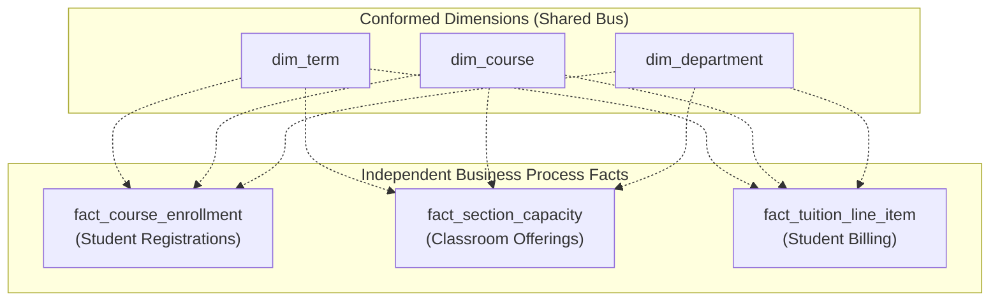

# Dimensional modeling methodology

Analytical data architectures separate Online Transaction Processing (OLTP)
systems from Online Analytical Processing (OLAP) environments. Running complex
aggregations and multi-year queries directly against operational production
databases degrades transaction throughput, introduces lock contention, and
slows user response times.

Two foundational methodologies historically shaped analytical data
warehousing:

1. **Bill `Inmon's` Enterprise Data Warehouse (EDW)**: a top-down, centralized
   approach centered on a normalized Third Normal Form relational core.
2. **Ralph `Kimball`'s Dimensional Modeling**: an iterative, bottom-up
   approach organizing analytical data around business processes, conformed
   dimensions, and star schemas.

Understanding both approaches helps you evaluate trade-offs between centralized
normalization and dimensional accessibility in modern data platforms.

## When to use each methodology

Use the following decision matrix to compare analytical modeling
methodologies:

| Methodology | Primary scenario | Core design | Integration mechanism | Architectural trade-off |
| :--- | :--- | :--- | :--- | :--- |
| **Bill `Inmon` top-down model** | Large enterprises with centralized data governance teams | Normalized 3NF central warehouse feeding departmental marts | Enterprise-wide normalized entity-relationship model | High upfront modeling time and two-stage pipeline overhead |
| **Ralph `Kimball` dimensional bus** | Fast-moving organizations needing iterative business value | Dimensional star schemas organized around business processes | Conformed dimensions and standardized facts across an enterprise bus matrix | Requires disciplined governance to avoid stovepipe data marts |
| **Modern `` `lakehouse` `` pattern** | Modern platforms using tools such as `` `dbt` `` and `BigQuery` | Normalized staging tables feeding star schemas in the presentation layer | Common data models and transformation pipelines | Requires maintaining multi-layer storage and transformation infrastructure |

## `Inmon` top-down enterprise warehouse methodology

Formulated in 1990 by Bill `Inmon`, this methodology approaches analytical data
from an enterprise-wide perspective. `Inmon` defines a data warehouse using
four core criteria:

- Subject-oriented: data organizes around major business subjects, such as
  students, faculty, and academic programs, rather than operational software
  features.
- Integrated: the warehouse unifies inconsistent data formats, codes, and
  keys across multiple operational source systems into an enterprise standard.
- Non-volatile: once written, the engine preserves historical data without
  in-place modifications or row mutations.
- Time-variant: every record includes explicit temporal attributes, such as
  effective dates or term keys, to track historical states.

### Two-stage pipeline architecture

`Inmon` structures data movement through two distinct layers:

1. **Sources to central 3NF warehouse**: data pipelines extract raw
   transactional records from operational source systems, standardize formats,
   and load them into a normalized 3NF central repository. This database serves
   as the enterprise single source of truth.
2. **Central 3NF warehouse to departmental data marts**: business analysts
   don't query the normalized 3NF core directly. Instead, secondary pipelines
   extract data from the 3NF warehouse to populate dedicated departmental data
   marts. These marts use star schemas or pre-aggregated tables tailored to
   specific business units, such as admissions, or financial aid.

## `Kimball` dimensional modeling and bus architecture

Developed by Ralph `Kimball` and `Margy Ross`, dimensional modeling is an
iterative, business-process-driven methodology designed around query
simplicity, fast analytical performance, and intuitive business navigation.

### Core principles

`Kimball` dimensional modeling follows four foundational principles:

- The presentation area models business events directly from operational
  measurements, such as course registrations, rather than entity-relationship
  diagrams.
- Fact tables store records at atomic grain (the lowest physical grain captured
  by operational systems, such as an individual course registration line). Atomic
  detail allows the warehouse to answer unexpected questions without requiring
  new pipeline modifications.
- The presentation layer avoids normalized 3NF schemas. Multi-table 3NF joins
  confuse analysts and overwhelm database join optimizers.
- Queries navigate dimensions to slice numeric measurements by intuitive
  business dimensions answering who, what, where, and when.

### Enterprise bus architecture and conformed dimensions

Rather than attempting to model the entire enterprise upfront, `Kimball` builds
modular, business-process-specific data marts linked by an enterprise data
warehouse bus architecture:



The enterprise data warehouse bus architecture relies on several core concepts:

- Pipelines map to operational activities and business processes, such as course
  registration or tuition billing, rather than organizational silos.
- Dimension tables shared across multiple business processes use identical surrogate
  keys, column names, and definitions (conformed dimensions). For example,
  `dim_course` serves both course registration analysis and classroom capacity
  planning.
- Numeric measures, such as enrolled units or tuition fees, maintain identical
  mathematical definitions and units of measurement across separate fact tables
  (conformed facts).
- Conformed dimensions enable drill-across querying: queries calculate summary
  metrics from separate fact tables independently and combine results using an
  outer join on shared dimension attributes.

## Multi-pass drill-across query execution

A central strength of the `Kimball` bus architecture is drill-across querying.
When university administrators want to compare total student enrolled units
against scheduled classroom seating capacity across academic departments,
querying both fact tables in a single SQL statement requires a multi-pass
technique.

### The chasm trap in single-pass joins

Joining two fact tables directly on a shared dimension in a single query pass
causes a chasm trap. Because multiple enrollment rows and multiple course
section rows match a single course record, the relational join multiplies rows
between both facts. This Cartesian fan-out produces severely inflated metric
totals.

To avoid metric inflation, execute a multi-pass query using Common Table
Expressions, known as `` `CTEs` ``. Each query block aggregates its respective fact
table down to the shared dimension grain before joining the summarized results:

```sql
WITH EnrollmentSummary AS (
    -- First pass: aggregate student enrollments by department
    SELECT 
        c.department_key,
        SUM(e.enrollment_count) AS total_enrolled_students,
        SUM(e.enrolled_units)   AS total_enrolled_units
    FROM fact_course_enrollment AS e
    JOIN dim_course AS c
        ON e.course_key = c.course_key
    WHERE e.term_key = 202601 -- Autumn 2026
    GROUP BY c.department_key
),
CapacitySummary AS (
    -- Second pass: aggregate scheduled classroom capacity by department
    SELECT 
        c.department_key,
        COUNT(s.section_key)      AS total_sections_offered,
        SUM(s.seating_capacity)   AS total_seating_capacity
    FROM fact_section_capacity AS s
    JOIN dim_course AS c
        ON s.course_key = c.course_key
    WHERE s.term_key = 202601 -- Autumn 2026
    GROUP BY c.department_key
)
-- Third pass: combine independent aggregates using a full outer join
SELECT 
    d.department_name,
    COALESCE(e.total_enrolled_students, 0) AS enrolled_students,
    COALESCE(e.total_enrolled_units, 0)    AS enrolled_units,
    COALESCE(c.total_sections_offered, 0)  AS sections_offered,
    COALESCE(c.total_seating_capacity, 0)  AS seating_capacity
FROM dim_department AS d
LEFT JOIN EnrollmentSummary AS e
    ON d.department_key = e.department_key
LEFT JOIN CapacitySummary AS c
    ON d.department_key = c.department_key
WHERE e.total_enrolled_students IS NOT NULL 
   OR c.total_sections_offered IS NOT NULL
ORDER BY enrolled_students DESC;
```

## Schema implementation for the university scenario

The following schemas contrast an `Inmon` 3NF normalized structure with a
`Kimball` conformed dimensional model for university course operations.

### Normalized relational enterprise schema

```sql
-- Inmon 3NF: Department master relation
CREATE TABLE edw_departments (
    department_id   INT PRIMARY KEY,
    department_code VARCHAR(10) NOT NULL UNIQUE,
    department_name VARCHAR(100) NOT NULL,
    school_name     VARCHAR(100) NOT NULL
);

-- Inmon 3NF: Course master relation
CREATE TABLE edw_courses (
    course_id       INT PRIMARY KEY,
    course_code     VARCHAR(20) NOT NULL UNIQUE,
    course_title    VARCHAR(100) NOT NULL,
    department_id   INT NOT NULL REFERENCES edw_departments(department_id),
    unit_credits    INT NOT NULL
);

-- Inmon 3NF: Student master relation
CREATE TABLE edw_students (
    student_id      INT PRIMARY KEY,
    first_name      VARCHAR(50) NOT NULL,
    last_name       VARCHAR(50) NOT NULL,
    email           VARCHAR(100) NOT NULL UNIQUE,
    entry_year      INT NOT NULL
);

-- Inmon 3NF: Course enrollment associative relation
CREATE TABLE edw_enrollments (
    enrollment_id   BIGINT PRIMARY KEY,
    student_id      INT NOT NULL REFERENCES edw_students(student_id),
    course_id       INT NOT NULL REFERENCES edw_courses(course_id),
    term_code       VARCHAR(10) NOT NULL,
    enrollment_date DATE NOT NULL,
    final_grade     VARCHAR(5),
    grade_points    DECIMAL(3,2)
);
```

### `Kimball` conformed star schema

```sql
-- Kimball Conformed Dimension: Course
CREATE TABLE dim_course (
    course_key      INT PRIMARY KEY, -- Surrogate key
    course_code     VARCHAR(20) NOT NULL,
    course_title    VARCHAR(100) NOT NULL,
    department_key  INT NOT NULL REFERENCES dim_department(department_key),
    unit_credits    INT NOT NULL
);

-- Kimball Conformed Dimension: Department
CREATE TABLE dim_department (
    department_key  INT PRIMARY KEY, -- Surrogate key
    department_code VARCHAR(10) NOT NULL,
    department_name VARCHAR(100) NOT NULL,
    school_name     VARCHAR(100) NOT NULL
);

-- Kimball Fact: Student course enrollments
CREATE TABLE fact_course_enrollment (
    enrollment_id    BIGINT NOT NULL,
    term_key         INT NOT NULL REFERENCES dim_term(term_key),
    student_key      INT NOT NULL REFERENCES dim_student(student_key),
    course_key       INT NOT NULL REFERENCES dim_course(course_key),
    enrollment_count INT NOT NULL DEFAULT 1,
    enrolled_units   INT NOT NULL,
    PRIMARY KEY (enrollment_id)
);

-- Kimball Fact: Scheduled course section capacity
CREATE TABLE fact_section_capacity (
    section_key      INT NOT NULL,
    term_key         INT NOT NULL REFERENCES dim_term(term_key),
    course_key       INT NOT NULL REFERENCES dim_course(course_key),
    classroom_key    INT NOT NULL REFERENCES dim_classroom(classroom_key),
    seating_capacity INT NOT NULL,
    PRIMARY KEY (section_key)
);
```

## Operational considerations and engine optimization

When choosing and deploying analytical modeling methodologies, consider the
following technical factors:

- In distributed cloud engines such as `BigQuery`, joining normalized 3NF tables
  across multiple parent-child tiers triggers network shuffle operations. Conformed
  star schemas with wide dimensions allow engines to broadcast dimension tables
  directly to worker nodes, accelerating query speeds.
- Maintaining conformed dimensions across independent teams requires formal data
  governance. You must coordinate changes to attribute definitions in `dim_course`
  across both registration and facility scheduling pipelines.
- Drill-across queries execute multiple independent table scans. In cloud data
  warehouses billed on processed bytes, partition fact tables on term, date, or
  process keys to minimize query costs.

## Common pitfalls

When implementing dimensional and enterprise warehouse methodologies, watch
for these common mistakes:

### The chasm trap in drill-across queries

Attempting to join two fact tables directly on a dimension key without
aggregating each table first multiplies rows and inflates metric sums. Always
aggregate facts to a common dimension grain within separate `` `subqueries` ``
or Common Table Expression blocks before joining their summaries.

### Building isolated stovepipe marts

Building departmental star schemas without shared conformed dimensions creates
disconnected data silos. When the registrar and financial aid offices define
student attributes independently, enterprise reporting fails due to conflicting
metrics.

### `Inmon` analysis paralysis

Attempting to design an enterprise-wide 3NF schema before delivering any
business reporting often leads to months of stalled planning. Use iterative,
business-process-driven delivery to produce tangible value rapidly.

### Premature aggregation losing atomic detail

Creating fact tables at monthly or departmental summary levels limits
analytical capabilities. Business users can't drill down into specific courses,
dates, or instructors. Always capture data at the lowest atomic grain.

## What's next

- Explore star and snowflake structures in
  [Schema architectures](/modeling/schema-architectures).
- Learn about transaction, periodic snapshot, and accumulating snapshot designs in
  [Fact table design and types](/modeling/fact-table-design-and-types).
- Master multi-table aggregations and query patterns in
  [Common table expressions](/sql/common-table-expressions).
