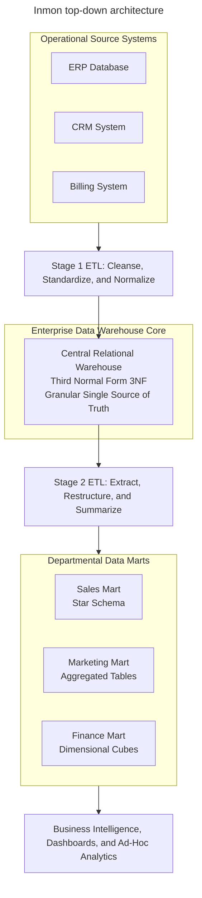
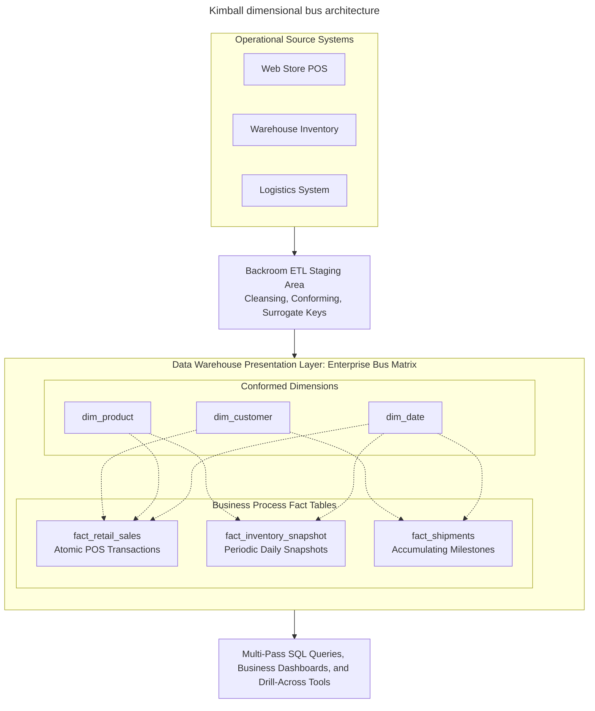
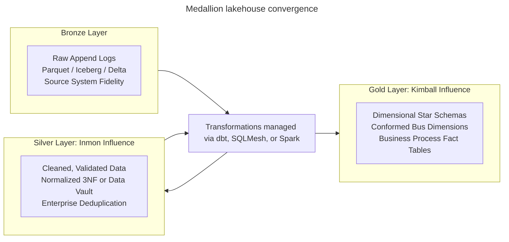

# Dimensional modeling methodology

## Overview

Data warehousing architectures separate operational transaction processing,
or OLTP, from analytical querying, or OLAP. Running complex aggregations and
historical analyses directly against transactional production databases
degrades app throughput, causes lock contention, and slows response times.

Two foundational methodologies historically shaped analytical data
architecture:

1. **Bill Inmon's Enterprise Data Warehouse (EDW)**: a top-down, centralized
   approach centering on a normalized third normal form, or 3NF, relational core.
2. **Ralph Kimball's Dimensional Modeling**: an iterative, bottom-up
   approach organizing analytical data around business processes, conformed
   dimensions, and star schemas.

This guide provides a comprehensive technical reference for both
methodologies. It details their core philosophies, architectural data flows,
relational schemas, conformed bus mechanics, step-by-step multi-pass
drill-across queries, operational failure modes, and modern lakehouse
convergence patterns.

## Inmon enterprise data warehouse top-down methodology

Formulated in 1990 by Bill Inmon, this methodology approaches analytical data
from an enterprise-wide perspective. Inmon defines a data warehouse as a
subject-oriented, integrated, non-volatile, and time-variant collection of
data in support of management decisions.



### Core architectural characteristics

- **Subject-oriented**: data focuses on major business entities such as
  customers, products, and parts, rather than app features.
- **Integrated**: the central warehouse unifies inconsistent data across
  multiple operational source systems into a single enterprise standard. Inmon
  considers integration the most critical requirement of a warehouse.
- **Non-volatile**: once written, the engine preserves historical data without
  in-place updates or row mutations.
- **Time-variant**: every table includes explicit temporal attributes, such as
  snapshot dates or effective intervals, to record historical changes.

### Two-stage pipeline mechanics

Inmon structures data movement through two separate pipeline layers:

1. **Stage 1 - sources to central 3NF EDW**: raw transactional records are
   extracted, cleansed, validated, and normalized into a centralized 3NF
   database. This database serves as the enterprise single source of truth.
2. **Stage 2 - central 3NF EDW to departmental data marts**: business
   analysts don't query the normalized 3NF core directly. Instead, secondary
   pipelines extract data from the 3NF warehouse to populate dedicated
   departmental data marts. These marts use denormalized star schemas or
   pre-aggregated summary tables tailored to specific business units.

## Kimball dimensional modeling and bus architecture

Developed by Ralph Kimball and Margy Ross, dimensional modeling is an
iterative, business-process-driven methodology designed around query
simplicity, fast analytical performance, and intuitive business navigation.



### Core philosophical principles

- **Model business events**: the presentation area directly mirrors
  operational measurements rather than entity relationship graphs.
- **Atomic grain first**: fact tables must record data at the lowest possible
  physical grain, such as individual retail receipt lines. Atomic detail
  ensures the warehouse can answer unanticipated ad-hoc questions without
  requiring new pipeline transformations.
- **No normalized presentation layer**: Kimball prohibits normalized 3NF
  schemas in the user-facing presentation area. Multi-table 3NF joins
  confuse business analysts and overwhelm database join optimizers.
- **Dimensional navigation**: queries slice numeric measurements by intuitive
  business dimensions answering who, what, where, when, and why.

### Enterprise bus architecture and conformed dimensions

Rather than attempting to model the entire enterprise upfront, Kimball builds
modular, business-process-specific data marts linked by the enterprise data
warehouse bus architecture:

- **Business processes instead of departments**: pipelines map to business
  activities such as retail sales, invoicing, and inventory storage, rather
  than organizational units such as the marketing department.
- **Conformed dimensions**: dimension tables shared across multiple business
  processes use identical surrogate keys, column names, definitions, and domain
  values. For example, `dim_product` serves both retail sales and warehouse
  inventory.
- **Conformed facts**: numeric measures, such as gross profit or net revenue,
  maintain identical mathematical formulas and dimensional granularity across
  separate fact tables.
- **Drill-across capability**: because teams conform dimensions across the
  enterprise, separate queries calculate summary facts independently and
  combine results using an outer join on shared dimension attributes.

## Methodology comparison matrix

| Architectural Dimension | Bill Inmon - Top-Down EDW | Ralph Kimball - Dimensional Bus |
| :--- | :--- | :--- |
| Primary philosophy | Enterprise-first and centralized | Business-process-first and iterative |
| Core warehouse model | Highly normalized 3NF relational schema | Dimensional star schemas on a bus matrix |
| Presentation layer | Downstream departmental data marts | Star schemas in the presentation area |
| Data redundancy | Strictly minimized in the central 3NF core | Controlled redundancy in dimension tables |
| Pipeline complexity | High: two-stage ETL pipeline | Moderate: single staging to star pipeline |
| Initial time to value | Slower: requires broad upfront enterprise modeling | Faster: delivers value through discrete business processes |
| Integration mechanism | Enforced at the central normalized schema | Enforced through conformed dimensions and facts |
| Analytical query model | Star joins in marts or complex joins in 3NF | Star joins with selective dimension constraints |

## Concrete implementation: e-commerce case study

To contrast how both methodologies structure analytical databases, consider
an online retail business tracking customer orders, product catalogs, and
warehouse inventory.

### Approach A - Inmon normalized schema with downstream mart

In Inmon's methodology, operational data first populates an enterprise-wide,
normalized 3NF relational schema.

#### Central normalized 3NF enterprise warehouse

```sql
-- Category master relation
CREATE TABLE edw_categories (
  category_id   INTEGER PRIMARY KEY,
  category_name VARCHAR(50) NOT NULL
);

-- Supplier master relation
CREATE TABLE edw_suppliers (
  supplier_id   INTEGER PRIMARY KEY,
  supplier_name VARCHAR(100) NOT NULL,
  country_code  VARCHAR(3) NOT NULL
);

-- Normalized product entity
CREATE TABLE edw_products (
  product_id    INTEGER PRIMARY KEY,
  sku           VARCHAR(20) NOT NULL UNIQUE,
  product_name  VARCHAR(100) NOT NULL,
  category_id   INTEGER NOT NULL REFERENCES edw_categories(category_id),
  supplier_id   INTEGER NOT NULL REFERENCES edw_suppliers(supplier_id)
);

-- Customer entity
CREATE TABLE edw_customers (
  customer_id     INTEGER PRIMARY KEY,
  email           VARCHAR(100) NOT NULL UNIQUE,
  first_name      VARCHAR(50) NOT NULL,
  last_name       VARCHAR(50) NOT NULL,
  registration_dt TIMESTAMP NOT NULL
);

-- Order header relation
CREATE TABLE edw_orders (
  order_id        BIGINT PRIMARY KEY,
  customer_id     INTEGER NOT NULL REFERENCES edw_customers(customer_id),
  order_date      DATE NOT NULL,
  order_status    VARCHAR(20) NOT NULL
);

-- Order line items relation (associative entity)
CREATE TABLE edw_order_line_items (
  order_id        BIGINT NOT NULL REFERENCES edw_orders(order_id),
  product_id      INTEGER NOT NULL REFERENCES edw_products(product_id),
  quantity        INTEGER NOT NULL,
  unit_price      NUMERIC(10, 2) NOT NULL,
  discount_amount NUMERIC(10, 2) NOT NULL DEFAULT 0.00,
  PRIMARY KEY (order_id, product_id)
);
```

#### Downstream marketing data mart: star schema

A secondary pipeline extracts, denormalizes, and loads data from the 3NF core
into a dimensional sales mart:

```sql
-- Denormalized dimension table for marketing analysis
CREATE TABLE dm_marketing_product (
  product_key   INTEGER PRIMARY KEY,
  sku           VARCHAR(20) NOT NULL,
  product_name  VARCHAR(100) NOT NULL,
  category_name VARCHAR(50) NOT NULL,
  supplier_name VARCHAR(100) NOT NULL
);

-- Marketing sales fact table
CREATE TABLE dm_marketing_sales_fact (
  order_date_key INTEGER NOT NULL,
  customer_key   INTEGER NOT NULL,
  product_key    INTEGER NOT NULL REFERENCES dm_marketing_product(product_key),
  total_sales    NUMERIC(10, 2) NOT NULL,
  total_units    INTEGER NOT NULL
);
```

### Approach B - Kimball bus architecture with conformed dimensions

In Kimball's methodology, the ETL staging pipeline directly builds conformed
dimensions and atomic star schemas.

#### Conformed dimension tables

```sql
-- Conformed date dimension shared across all business processes
CREATE TABLE dim_date (
  date_key        INTEGER PRIMARY KEY, -- Format: YYYYMMDD
  calendar_date   DATE NOT NULL UNIQUE,
  day_of_week     VARCHAR(10) NOT NULL,
  month_name      VARCHAR(15) NOT NULL,
  calendar_year   INTEGER NOT NULL,
  is_weekend_flag BOOLEAN NOT NULL
);

-- Conformed product dimension denormalized across categories and suppliers
CREATE TABLE dim_product (
  product_key   INTEGER PRIMARY KEY, -- Surrogate key
  sku_number    VARCHAR(20) NOT NULL, -- Natural key
  product_name  VARCHAR(100) NOT NULL,
  brand_name    VARCHAR(50) NOT NULL,
  category_name VARCHAR(50) NOT NULL,
  supplier_name VARCHAR(100) NOT NULL
);

-- Conformed customer dimension
CREATE TABLE dim_customer (
  customer_key   INTEGER PRIMARY KEY, -- Surrogate key
  customer_id    INTEGER NOT NULL,    -- Natural key
  full_name      VARCHAR(100) NOT NULL,
  email          VARCHAR(100) NOT NULL,
  city           VARCHAR(50) NOT NULL,
  state_province VARCHAR(50) NOT NULL
);
```

#### Business process 1: retail sales transaction fact

```sql
CREATE TABLE fact_retail_sales (
  date_key        INTEGER NOT NULL REFERENCES dim_date(date_key),
  product_key     INTEGER NOT NULL REFERENCES dim_product(product_key),
  customer_key    INTEGER NOT NULL REFERENCES dim_customer(customer_key),
  order_number_dd VARCHAR(20) NOT NULL, -- Degenerate dimension

  -- Additive numerical facts
  sales_quantity  INTEGER NOT NULL,
  gross_sales_amt NUMERIC(10, 2) NOT NULL,
  discount_amt    NUMERIC(10, 2) NOT NULL,
  net_sales_amt   NUMERIC(10, 2) NOT NULL
);
```

#### Business process 2: warehouse inventory snapshot fact

Notice that `fact_inventory_snapshot` shares the identical conformed
`dim_date` and `dim_product` tables from the bus matrix:

```sql
CREATE TABLE fact_inventory_snapshot (
  date_key          INTEGER NOT NULL REFERENCES dim_date(date_key),
  product_key       INTEGER NOT NULL REFERENCES dim_product(product_key),
  warehouse_key     INTEGER NOT NULL,

  -- Semi-additive facts
  quantity_on_hand  INTEGER NOT NULL,
  inventory_val_amt NUMERIC(12, 2) NOT NULL
);
```

## Multi-pass drill-across query execution

Because teams conform `dim_product` across business processes, queries can
extract metrics from both retail sales and warehouse inventory independently,
then join the summarized datasets on the shared category attribute.

### Sample data states

#### `dim_product` rows

| `product_key` | `sku_number` | `product_name` | `category_name` |
| :--- | :--- | :--- | :--- |
| `1` | `SKU-LAPTOP` | UltraBook Pro | Electronics |
| `2` | `SKU-DESK` | Standing Desk | Furniture |
| `3` | `SKU-CHAIR` | Ergonomic Chair | Furniture |

#### `fact_retail_sales` records for calendar year 2026

| `product_key` | `net_sales_amt` |
| :--- | :--- |
| `1` - Electronics | `45000.00` |
| `2` - Furniture | `15000.00` |
| `3` - Furniture | `12000.00` |

#### `fact_inventory_snapshot` records as of 2026-10-01

| `product_key` | `quantity_on_hand` |
| :--- | :--- |
| `1` - Electronics | `85` |
| `2` - Furniture | `140` |
| `3` - Furniture | `60` |

### Multi-pass query execution

```sql
WITH SalesSummary AS (
  SELECT
    p.category_name,
    SUM(s.net_sales_amt) AS total_sales_usd
  FROM fact_retail_sales AS s
  INNER JOIN dim_product AS p
    ON s.product_key = p.product_key
  INNER JOIN dim_date AS d
    ON s.date_key = d.date_key
  WHERE d.calendar_year = 2026
  GROUP BY p.category_name
),
InventorySummary AS (
  SELECT
    p.category_name,
    SUM(i.quantity_on_hand) AS total_units_in_stock
  FROM fact_inventory_snapshot AS i
  INNER JOIN dim_product AS p
    ON i.product_key = p.product_key
  INNER JOIN dim_date AS d
    ON i.date_key = d.date_key
  WHERE d.calendar_date = '2026-10-01'
  GROUP BY p.category_name
)
SELECT
  COALESCE(s.category_name, i.category_name) AS product_category,
  s.total_sales_usd,
  i.total_units_in_stock
FROM SalesSummary AS s
FULL OUTER JOIN InventorySummary AS i
  ON s.category_name = i.category_name
ORDER BY product_category;
```

### Resultant output table

| `product_category` | `total_sales_usd` | `total_units_in_stock` |
| :--- | :--- | :--- |
| Electronics | `45000.00` | `85` |
| Furniture | `27000.00` | `200` |

Multi-pass querying avoids row multiplication errors. Slicing independent
business processes at a common conformed grain preserves exact aggregations.

## Common pitfalls and failure modes

### Kimball failure modes

- **The stovepipe data mart trap**: if teams build departmental dimensional
  marts without strictly conforming dimension keys and column definitions, the
  architecture degenerates into disconnected silos that produce conflicting
  business metrics.
- **Enterprise governance contention**: agreeing on consistent enterprise
  definitions, such as defining an active customer or product line, requires
  substantial cross-functional collaboration.
- **Streaming latency**: dimensional models assume batch ETL processing.
  Real-time streaming ingestion with high-frequency Type-2 slowly changing
  dimension updates strains warehouse storage engines.

### Inmon failure modes

- **Analysis paralysis**: designing an enterprise-wide normalized 3NF data
  model upfront requires months or years of design review, delaying initial
  time to value.
- **Double ETL overhead**: transforming data twice—from sources to 3NF, and
  from 3NF to data marts—demands additional engineering effort, compute
  resources, and pipeline orchestration.
- **Rigid schema modification**: modifying centralized 3NF relations to
  support changing product features requires extensive enterprise reviews,
  slowing development velocity.

## Modern industry convergence: lakehouse and medallion architecture

Modern cloud data platforms, such as Snowflake, BigQuery, and Databricks,
rarely implement either methodology in its purest historical form. Instead,
modern architectures combine both approaches within a layered medallion
framework:



- **Bronze layer**: ingests raw event streams and change data capture logs
  directly from operational systems.
- **Silver layer: Inmon influence**: cleanses, validates, and stores data in a
  normalized 3NF or Data Vault structure to establish an audited corporate
  source of truth.
- **Gold layer: Kimball influence**: transforms silver data into dimensional
  star schemas using tools such as dbt, providing business analysts with fast,
  intuitive presentation models.

## Key takeaways

- Inmon uses a top-down architecture centered on a normalized 3NF enterprise
  core that feeds downstream departmental marts.
- Kimball uses a bottom-up architecture centered on business processes, atomic
  star schemas, and conformed dimensions across a bus matrix.
- Conformed dimensions share identical surrogate keys, column names, and
  domain values across distinct business processes.
- Drill-across analysis uses multi-pass queries to aggregate separate fact
  tables independently before combining results via outer joins on conformed
  dimensions.
- Modern cloud data lakehouses combine both approaches: normalized or raw
  silver staging layers feed Kimball-style dimensional star schemas in the gold
  serving layer.

