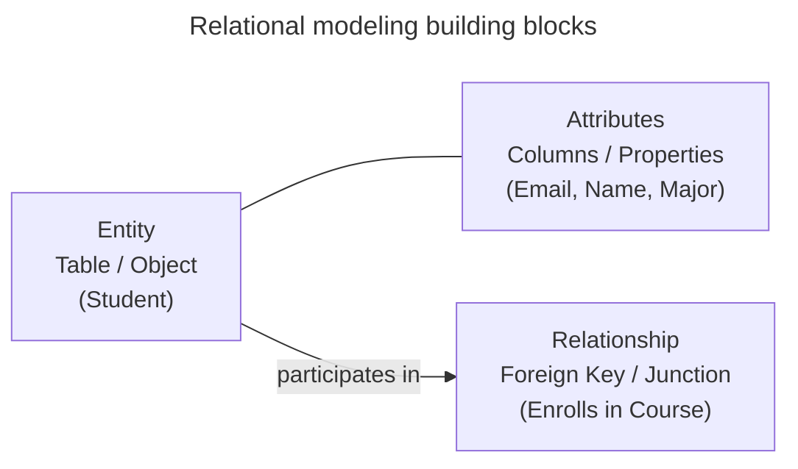
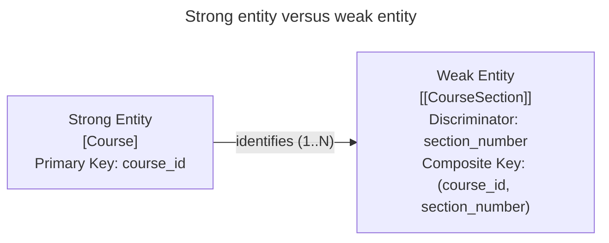
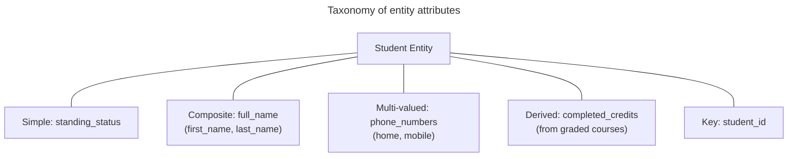
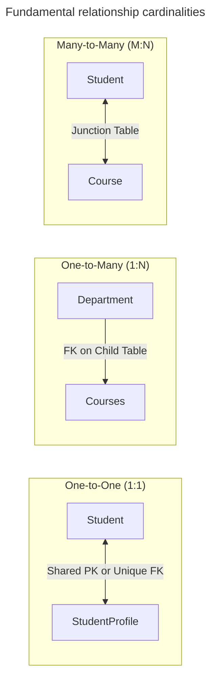
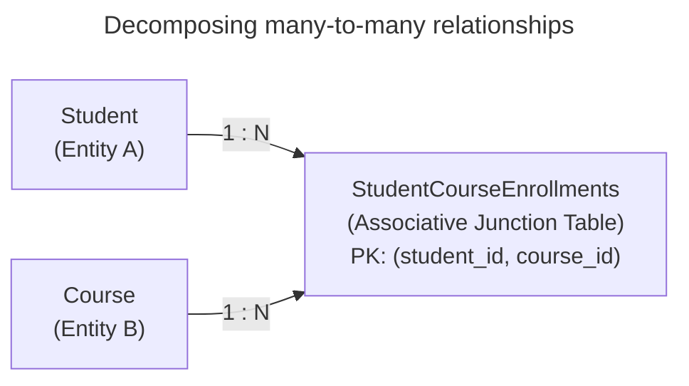
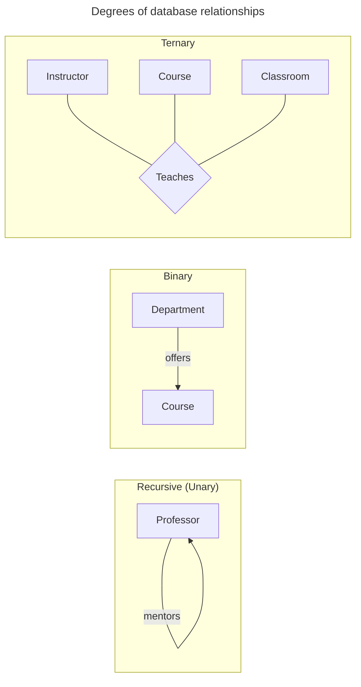
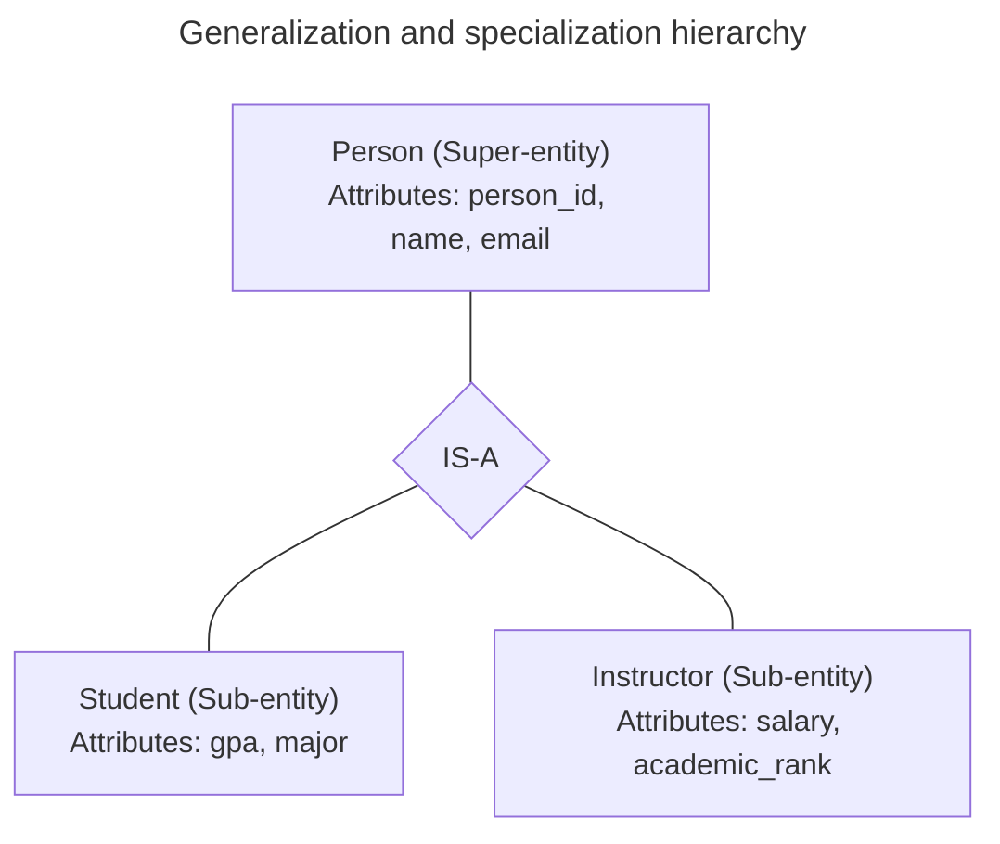
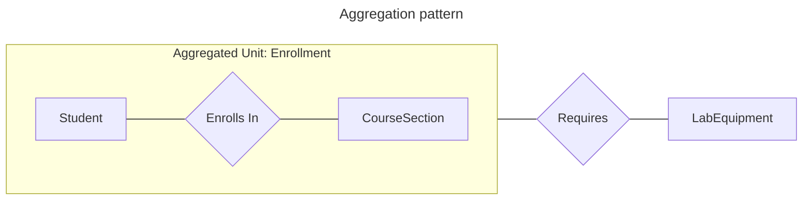
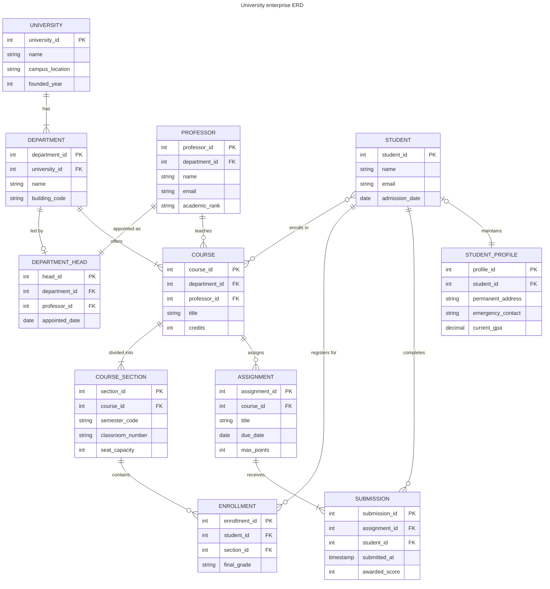
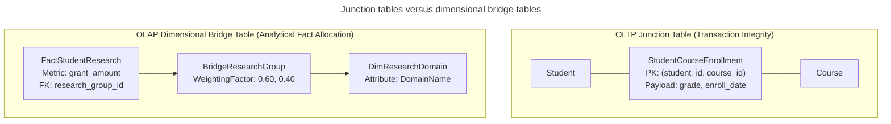

# Entities, attributes, and relationships

## Overview

Entities, attributes, and relationships form the foundational building blocks of database modeling. They define how systems structure real-world business domains, capture transactional activity, and map entity interactions across relational engines and analytical data warehouses.

This guide explains:

- Entity types, attribute classifications, and relational keys.
- Relationship cardinality rules: 1:1, 1:N, and many-to-many.
- Relationship degrees, participation constraints, and Crow's foot notation.
- Enhanced entity-relationship concepts, such as generalization, specialization, and aggregation.
- Online Transaction Processing (OLTP) junction tables versus dimensional bridge tables.
- Weighting factors and ragged hierarchy navigation in analytical warehouses.
- Common join anomalies, including row explosion, the fan trap, the chasm trap, and relational shredding.

## Core building blocks

Every relational schema organizes data using three primary abstractions: entities, attributes, and relationships.



### Entities and entity sets

An entity is a discrete, identifiable real-world object, concept, or event about which a system stores data. In a Relational Database Management System (RDBMS), an entity maps to a table where each row represents a unique instance of that entity.

A collection of similar entities forms an entity set. For example, all students in a university constitute a student entity set.

Data modeling distinguishes two categories of entities:

- Strong entities exist independently of other domain entities. A strong entity possesses a distinct primary key that uniquely identifies every instance (such as a student, instructor, or department).
- Weak entities depend on the existence of an identifying parent entity for identity and lack a primary key of their own. A weak entity relies on a partial key (or discriminator) combined with the primary key of the parent entity to establish uniqueness (such as a course section that cannot exist without its parent course).



### Attributes and data characteristics

An attribute describes a property, characteristic, or measurement belonging to an entity. In a physical database, attributes map to columns with assigned data types.

Attributes fall into distinct structural classifications:

| Attribute type | Structural rule | Example |
| :--- | :--- | :--- |
| Simple (atomic) | Stores indivisible values that cannot divide into smaller semantic units. | Status code, account balance, department code |
| Composite | Consists of multiple logical sub-elements flattened into separate columns. | Street address decomposed into street, city, state, and postal code |
| Multi-valued | Holds multiple values for a single entity instance, normalized into independent child tables. | Multiple phone numbers, emergency contacts, research tags |
| Derived | Calculated values computed from stored attributes or queries rather than static disk values. | Age derived from `birth_date`, grade points derived from `credits * grade_points` |
| Key | Uniquely identifies individual entity instances within an entity set. | `student_id`, `course_code` |



### Relational keys

In relational modeling, keys enforce row identity, establish referential integrity, and maintain uniqueness constraints:

| Key type | Relational definition |
| :--- | :--- |
| Super key | Any combination of columns that uniquely identifies a row in a table, including redundant columns. |
| Candidate key | A minimal super key with no redundant columns. Removing any column destroys uniqueness. |
| Primary key | The minimal candidate key selected by the database architect as the official entity identifier. |
| Alternate key | Candidate keys not chosen as the primary key, enforced using `UNIQUE` constraints. |
| Composite key | Primary keys or candidate keys consisting of two or more columns. |
| Foreign key | Columns that reference a primary key or unique key in another table to enforce referential integrity. |

## Cardinality and multiplicity

The relationship between two entities defines their cardinality rule, or multiplicity. Cardinality specifies the numerical constraints governing how many instances of one entity can associate with instances of another entity.



### One-to-one relationships

In a one-to-one relationship, exactly one instance of entity A associates with at most one instance of entity B, and vice versa.

#### Implementation strategies

Relational engines implement one-to-one relationships using two physical designs:

1. **Single consolidated table**: when two entities share the same lifecycle, creation time, and access patterns, combine them into one table. Combining entities eliminates join overhead.
2. **Split tables with a shared primary key or unique foreign key**: separate the child entity into its own table when it contains optional attributes, security-sensitive columns, or large data payloads.

The child table references the parent table through one of two mechanisms:

- Shared primary key: the child table declares its primary key column as both its `PRIMARY KEY` and a `FOREIGN KEY` referencing the parent table.
- Unique foreign key: the child table declares a foreign key column with a `UNIQUE` constraint and a `NOT NULL` constraint.

```sql
-- Split table implementation using a shared primary key
CREATE TABLE students (
    student_id    INTEGER GENERATED ALWAYS AS IDENTITY PRIMARY KEY,
    student_name  VARCHAR(100) NOT NULL,
    email         VARCHAR(255) NOT NULL UNIQUE,
    enrolled_at   TIMESTAMPTZ NOT NULL DEFAULT CURRENT_TIMESTAMP
);

CREATE TABLE student_profiles (
    student_id        INTEGER PRIMARY KEY, -- Shared PK and FK
    date_of_birth     DATE,
    emergency_contact VARCHAR(100),
    medical_notes     TEXT,
    CONSTRAINT fk_student_profiles_student
        FOREIGN KEY (student_id)
        REFERENCES students (student_id)
        ON DELETE CASCADE
);
```

### One-to-many relationships

In a one-to-many relationship, one instance of entity A associates with zero, one, or multiple instances of entity B. However, each instance of entity B references at most one instance of entity A. The reverse association forms a many-to-one relationship.

#### Implementation strategy

Relational databases implement one-to-many relationships by placing the primary key of the parent entity as a foreign key column in the child entity table.

Common examples include:

- A department has multiple courses, where each course stores a `department_id` foreign key.
- A faculty member advises multiple students, where each student references an `advisor_id`.
- A course divides into multiple sections, where each section references a `course_id`.

```sql
CREATE TABLE departments (
    department_id   INTEGER GENERATED ALWAYS AS IDENTITY PRIMARY KEY,
    department_name VARCHAR(100) NOT NULL UNIQUE
);

CREATE TABLE courses (
    course_id       INTEGER GENERATED ALWAYS AS IDENTITY PRIMARY KEY,
    course_title    VARCHAR(100) NOT NULL,
    credits         INTEGER NOT NULL CHECK (credits > 0),
    department_id   INTEGER NOT NULL, -- Foreign key establishes 1:N
    CONSTRAINT fk_courses_dept
        FOREIGN KEY (department_id)
        REFERENCES departments (department_id)
        ON DELETE RESTRICT
);

-- Index foreign key to support efficient parent searches and joins
CREATE INDEX idx_courses_department_id ON courses(department_id);
```

### Many-to-many relationships

In a many-to-many relationship, multiple instances of entity A associate with multiple instances of entity B, and multiple instances of entity B associate with multiple instances of entity A.

Common examples include:

- Students enroll in multiple courses, and each course contains multiple students.
- Instructors teach across multiple departments, and each department employs multiple instructors.
- Researchers collaborate across multiple university research grants.

#### Relational constraint

A relational table can't link a many-to-many relationship directly using a single foreign key column. Storing comma-separated identifiers in a single column violates first normal form, prevents index searches, and destroys referential integrity. Storing repeated parent rows causes massive data redundancy and update anomalies.

Relational databases resolve many-to-many relationships by decomposing them into two one-to-many relationships using an intermediate associative table.



## Relationship degrees and participation

Beyond basic cardinality, relationships possess structural properties that govern how entities interact.

### Relationship degrees

The degree of a relationship indicates the number of participating entities:

| Relationship degree | Entity count | Structural rule and example |
| :--- | :--- | :--- |
| Recursive (unary) | 1 | A single entity associates with itself, such as a faculty member mentoring a junior colleague or course prerequisite trees. |
| Binary | 2 | Two distinct entities interact, representing most relational operations (such as departments offering courses). |
| Ternary | 3 | Three distinct entities link simultaneously, such as an instructor, a course section, and a classroom in a teaching assignment. |
| N-ary | 4+ | Four or more entities link simultaneously, typically decomposed into binary associations via junction tables. |



### Participation constraints

Participation constraints specify whether an entity instance must participate in a relationship:

- Total participation requires every instance of an entity to participate in the relationship, creating an existence dependency (represented by double lines in an ER diagram). For example, every `course_section` must link to an existing `course`.
- Partial participation allows some instances of an entity to exist without participating in the relationship (represented by a single line). For example, an instructor can exist on research sabbatical without teaching an active course section.

### Crow's foot notation

Crow's foot notation uses visual symbols at relationship line endpoints to represent minimum and maximum cardinality:

| Symbol | Notation name | Structural rule |
| :--- | :--- | :--- |
| `\|\|` | Mandatory one | Minimum one, maximum one: exactly one instance |
| `\|o` | Optional one | Minimum zero, maximum one: zero or one instance |
| `>\|` | Mandatory many | Minimum one, maximum many: one or more instances |
| `>o` | Optional many | Minimum zero, maximum many: zero, one, or more instances |

## Enhanced entity-relationship concepts

Enhanced Entity-Relationship (EER) modeling provides abstraction techniques for complex corporate hierarchies and entity specialization.

- Generalization is a bottom-up modeling process that identifies shared attributes and behaviors across multiple specialized entities and unifies them into a generalized super-entity (such as unifying `UndergraduateStudent` and `GraduateStudent` into `Student`).
- Specialization is a top-down modeling process that partitions a generalized entity into distinct sub-entities based on business conditions (such as specializing an `Account` entity into `CheckingAccount` and `SavingsAccount`).



### Attribute inheritance

In an EER hierarchy, specialized sub-entities inherit all attributes, primary keys, and relationships from their parent super-entity. A sub-entity table stores only attributes unique to its specialization, using the parent primary key as its own primary key and foreign key.

### Aggregation

Aggregation models a relationship between two entities as a higher-level entity set. This allows the relationship itself to establish associations with third entities without introducing messy ternary cross-products.

For example, when a student enrolls in a specialized laboratory course section, that operational pairing can require dedicated lab equipment. Aggregation treats the `Enrollment` relationship between `Student` and `CourseSection` as a distinct unit, linking it directly to `LabEquipmentReservation`.



## Real-world university enterprise schema

The following Entity Relationship Diagram (ERD) demonstrates a comprehensive enterprise schema containing 11 entities, diverse cardinality rules, composite keys, and inheritance relationships:



### University schema relationships

The enterprise model illustrates fundamental relational principles:

1. **`UNIVERSITY` to `DEPARTMENT` with `||--|{`**: mandatory one-to-many. A university must establish at least one academic department, and each department belongs to a single parent university.
2. **`DEPARTMENT` to `DEPARTMENT_HEAD` with `||--o|`**: optional one-to-one. A department has at most one head, but a newly established department can operate temporarily without an appointed head.
3. **`PROFESSOR` to `DEPARTMENT_HEAD` with `||--||`**: mandatory one-to-one. A department head must hold an active faculty appointment as a professor.
4. **`PROFESSOR` to `COURSE` with `||--o{`**: optional one-to-many. A professor teaches zero, one, or multiple courses, accommodating faculty on sabbatical.
5. **`COURSE` to `COURSE_SECTION` with `||--|{`**: mandatory one-to-many. A course divides into one or more classroom sections for semester scheduling.
6. **`STUDENT` to `STUDENT_PROFILE` with `o|--||`**: optional-to-mandatory one-to-one. A profile requires a valid student, but incoming students can delay completing profile details.

## Junction tables versus dimensional bridge tables

Relational transactional systems and analytical data warehouses both use intermediate tables to resolve many-to-many relationships, but they serve different operational goals.

| Feature / Dimension | Relational junction table | Dimensional bridge table |
| :--- | :--- | :--- |
| **System environment** | Online Transaction Processing (OLTP) | Online Analytical Processing (OLAP) |
| **Core purpose** | Enforce normalization and referential integrity | Connect facts to multi-valued dimensions |
| **Primary key** | Composite key of foreign keys | Bridge group surrogate key or composite key |
| **Payload attributes** | Relationship properties, such as start dates, role titles, or grades | Numerical weighting factors and path levels |
| **Aggregation method** | Direct joins with standard aggregates | Weighted allocations and multi-pass queries |



### Relational junction tables

In transactional databases, an associative junction table converts an unconstrained many-to-many relationship into two one-to-many relationships.

#### Structural characteristics

A junction table has three core structural characteristics:

- Foreign key references contain foreign key columns referencing the primary keys of both participating tables.
- A composite primary key spans both foreign keys (such as `PRIMARY KEY (student_id, course_id)`), preventing duplicate relationship pairings.
- Relationship payload attributes store values belonging strictly to the association itself rather than either entity independently (such as `enrollment_date` and `final_grade`).

### Dimensional bridge tables

In analytical data warehouses following dimensional modeling practices, standard star schemas connect fact tables to single-valued dimensions. A fact table record contains foreign keys that resolve to one student, one date, and one course.

However, real-world business events frequently associate with an open-ended collection of dimension values simultaneously:

- A student research project links to two academic concentrations: artificial intelligence and robotics.
- An interdisciplinary research grant distributes funds across multiple academic departments.
- A university fellowship links to multiple faculty co-advisors.

A dimensional bridge table, or helper table, bridges the gap between a single fact record and a multi-valued dimension.

#### Weighting factors

When an analytical query joins a fact table directly to a multi-valued dimension through an unweighted bridge table, the database replicates the fact row for every matching dimension member. Standard aggregates such as `SUM(grant_amount)` double-count funding.

To solve double-counting, bridge tables include a numerical weighting factor. A weighting factor is a fractional decimal between 0.01 and 1.00, where the weights for all members in a given group sum to 1.00.

Weighting factors enable two distinct analytical reporting patterns:

- Correctly weighted reports multiply the additive fact metric by the weighting factor: `SUM(fact_amount * weighting_factor)`, distributing grant funding or costs accurately across dimension members without double-counting.
- Impact analysis reports omit the weighting factor and aggregate the raw fact metric: `SUM(fact_amount)`, revealing the total transaction volume touched by any specific dimension member.

#### Ragged hierarchies

Bridge tables also resolve ragged, variable-depth recursive hierarchies without requiring expensive recursive queries. Examples include university departmental organization structures and curriculum prerequisite paths.

A hierarchy bridge table stores one row for every ancestor-descendant pairing in the tree. Each row includes a depth indicator and a flag marking leaf nodes. Reporting queries join directly to the bridge table to aggregate entire sub-trees with standard filtering.

## Practical database implementation

The following schema demonstrates one-to-one, one-to-many, an OLTP junction table, and an analytical dimensional bridge table with weighting factors:

```sql
-- 1. BASE ENTITY: Students
CREATE TABLE students (
    student_id   INTEGER GENERATED ALWAYS AS IDENTITY PRIMARY KEY,
    full_name    VARCHAR(100) NOT NULL,
    email        VARCHAR(255) NOT NULL UNIQUE
);

-- 2. ONE-TO-ONE (1:1): StudentProfiles (Shared PK/FK with UNIQUE constraint)
CREATE TABLE student_profiles (
    student_id        INTEGER PRIMARY KEY,
    emergency_contact VARCHAR(100) NOT NULL,
    medical_notes     TEXT,
    CONSTRAINT fk_profile_student
        FOREIGN KEY (student_id)
        REFERENCES students (student_id)
        ON DELETE CASCADE
);

-- 3. ONE-TO-MANY (1:N): Departments to Courses
CREATE TABLE departments (
    department_id   INTEGER GENERATED ALWAYS AS IDENTITY PRIMARY KEY,
    department_name VARCHAR(100) NOT NULL UNIQUE
);

CREATE TABLE courses (
    course_id     INTEGER GENERATED ALWAYS AS IDENTITY PRIMARY KEY,
    course_title  VARCHAR(100) NOT NULL,
    credits       INTEGER NOT NULL CHECK (credits > 0),
    department_id INTEGER NOT NULL, -- Foreign key establishes 1:N
    CONSTRAINT fk_courses_dept
        FOREIGN KEY (department_id)
        REFERENCES departments (department_id)
        ON DELETE RESTRICT
);

CREATE INDEX idx_courses_department_id ON courses(department_id);

-- 4. MANY-TO-MANY (M:N) JUNCTION TABLE: StudentCourseEnrollments
CREATE TABLE student_course_enrollments (
    student_id      INTEGER NOT NULL,
    course_id       INTEGER NOT NULL,
    enrollment_date DATE NOT NULL DEFAULT CURRENT_DATE,
    grade           VARCHAR(2),
    PRIMARY KEY (student_id, course_id),
    CONSTRAINT fk_enrollment_student
        FOREIGN KEY (student_id)
        REFERENCES students (student_id)
        ON DELETE CASCADE,
    CONSTRAINT fk_enrollment_course
        FOREIGN KEY (course_id)
        REFERENCES courses (course_id)
        ON DELETE CASCADE
);

-- Index reverse searches on the junction table
CREATE INDEX idx_enrollments_course_id ON student_course_enrollments(course_id);

-- 5. DIMENSIONAL BRIDGE TABLE: Multi-valued research domains with weighting factors
CREATE TABLE dim_research_domains (
    domain_key  INTEGER GENERATED ALWAYS AS IDENTITY PRIMARY KEY,
    domain_code VARCHAR(20) NOT NULL UNIQUE,
    domain_name VARCHAR(100) NOT NULL
);

-- Bridge table connecting research groups to individual domains
CREATE TABLE bridge_research_group (
    research_group_id INTEGER NOT NULL,
    domain_key        INTEGER NOT NULL,
    weighting_factor  NUMERIC(3, 2) NOT NULL CHECK (weighting_factor > 0.00 AND weighting_factor <= 1.00),
    PRIMARY KEY (research_group_id, domain_key),
    CONSTRAINT fk_bridge_research_domain
        FOREIGN KEY (domain_key)
        REFERENCES dim_research_domains (domain_key)
);

CREATE INDEX idx_bridge_domain_key ON bridge_research_group(domain_key);

-- Fact table referencing research_group_id
CREATE TABLE fact_student_research (
    project_id        BIGINT GENERATED ALWAYS AS IDENTITY PRIMARY KEY,
    student_key       INTEGER NOT NULL,
    research_group_id INTEGER NOT NULL, -- References the multi-valued bridge group
    grant_amount      NUMERIC(10, 2) NOT NULL CHECK (grant_amount >= 0.00)
);

CREATE INDEX idx_fact_research_group_id ON fact_student_research(research_group_id);
```

### Analytical reporting query

The following SQL statement demonstrates how weighting factors prevent double-counting while supporting total impact analysis:

```sql
SELECT 
    d.domain_name,
    -- Correctly weighted funding: prevents double-counting across multi-valued domains
    SUM(f.grant_amount * b.weighting_factor) AS weighted_grant_funding,
    -- Full impact funding: shows total grant volume touched by each domain
    SUM(f.grant_amount)                      AS total_impact_volume
FROM fact_student_research f
JOIN bridge_research_group b ON f.research_group_id = b.research_group_id
JOIN dim_research_domains d  ON b.domain_key = d.domain_key
GROUP BY d.domain_name
ORDER BY weighted_grant_funding DESC;
```

## Common design pitfalls

### Row explosion in many-to-many joins

Joining two tables on non-unique keys or joining through unconstrained many-to-many associations produces a Cartesian cross-product of matching rows.

For example, if 5 records on the left table match 10 records on the right table with duplicate keys, the database generates 50 output rows. In large enterprise workloads, unconstrained many-to-many joins exhaust database working memory and disk temporary space, causing query failure.

### Inflated metric calculations across bridge tables

Joining an analytical fact table to a multi-valued dimension through a bridge table replicates fact records for each associated dimension member.

Running a basic `SUM(grant_amount)` without incorporating `weighting_factor` counts each grant multiple times. When designing bridge tables, analysts must either multiply additive facts by the weighting factor or aggregate metrics in an isolated Common Table Expression (CTE) query before joining the bridge table.

### The fan trap and chasm trap

- The fan trap occurs when a query joins two "Many" child tables along a single relational path where the master table joins to child A, which then joins to child B. Aggregating across the path produces inflated sums because rows in child A multiply against matching rows in child B.
- The chasm trap occurs when a query joins two independent "Many" child tables through a shared "One" parent dimension (such as querying `student_tuition_payments` and `student_course_grades` simultaneously through `students`). The relational engine produces a Cartesian product between payments and course enrollments for each student, corrupting numeric aggregations.

#### Resolve the chasm trap with multi-pass queries

To resolve the chasm trap, execute multi-pass SQL. Aggregate each child relationship independently inside separate Common Table Expression (CTE) queries, and merge the summarized results using a `FULL OUTER JOIN` on the common dimension key:

```sql
WITH payment_summary AS (
    SELECT 
        student_id,
        COUNT(payment_id)   AS total_payments,
        SUM(tuition_amount) AS total_paid
    FROM student_tuition_payments
    GROUP BY student_id
),
grade_summary AS (
    SELECT 
        student_id,
        COUNT(enrollment_id) AS total_courses,
        AVG(grade_points)    AS cumulative_gpa
    FROM student_course_grades
    GROUP BY student_id
)
SELECT 
    COALESCE(p.student_id, g.student_id)       AS student_id,
    COALESCE(p.total_payments, 0)              AS total_payments,
    COALESCE(p.total_paid, 0.00)               AS total_paid,
    COALESCE(g.total_courses, 0)               AS total_courses,
    ROUND(COALESCE(g.cumulative_gpa, 0.00), 2) AS cumulative_gpa
FROM payment_summary p
FULL OUTER JOIN grade_summary g ON p.student_id = g.student_id;
```

### Missing indexes on junction table foreign keys

A composite primary key on a junction table, such as `PRIMARY KEY (student_id, course_id)`, automatically creates an index on the leading column `(student_id)`.

However, queries that filter or join by the second column, such as finding all students enrolled in a specific course, can't utilize the leading index prefix. Without a dedicated secondary index on `(course_id)`, reverse searches trigger expensive full table scans across the entire junction table.

### Relational shredding versus document store data locality

Normalizing every one-to-many association into dedicated child tables shreds cohesive business documents into multiple physical tables. Reconstructing a complex domain object requires multi-way joins that increase query latency.

For strictly hierarchical, self-contained objects, such as a user profile containing school degrees and work history, document databases store nested structures in a single record with high data locality. However, when domain requirements evolve to require true many-to-many associations across records, document databases require manual app joins or uncontrolled duplication. Relational schemas with explicit junction tables remain far more resilient to structural domain shifts.

## Key takeaways

- Use 1:1 split tables with shared primary keys to separate security-sensitive or optional columns.
- Place foreign keys in the child table to implement 1:N relationships.
- Decompose many-to-many relationships into two 1:N associations using associative junction tables.
- Declare composite primary keys on junction tables to prevent duplicate relationship pairings.
- Create explicit secondary indexes on the second column of junction tables to support efficient reverse searches.
- Implement dimensional bridge tables with weighting factors to prevent double-counting across multi-valued dimensions.
- Use multi-pass CTE queries to prevent Cartesian row multiplication in fan traps and chasm traps.

## What's next

- Master anomalies, functional dependencies, and normal forms in
  [Database normalization](/modeling/database-normalization).
- Explore star schemas and enterprise bus matrices in
  [Dimensional modeling methodology](/modeling/dimensional-modeling-methodology).
- Master relational join execution and anti-semi-joins in
  [Fundamental joins](/sql/fundamental-joins).
