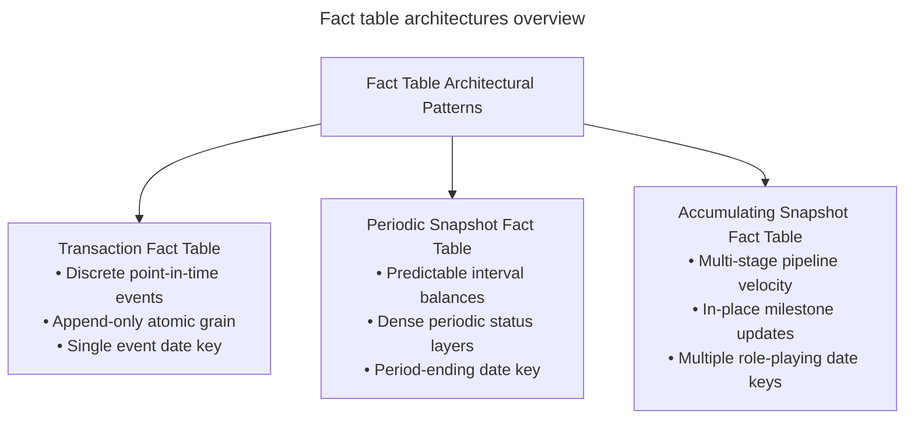
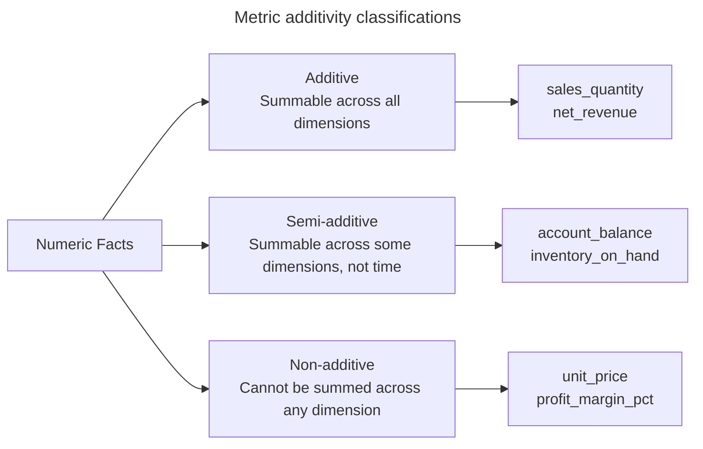

# Fact table design and types

## Overview

Fact tables form the central core of Ralph Kimball's dimensional modeling
methodology in analytical data warehousing. While dimension tables supply the
descriptive context, answering who, what, where, when, and why, fact tables
store the numeric performance measurements generated by operational business
events.

In a dimensional model, fact tables represent business process events at a
defined level of detail. They contain foreign keys linking to surrounding
dimension tables alongside numeric measurements such as sales quantities,
monetary amounts, durations, and account balances.



Selecting an appropriate fact table pattern determines how data pipelines
load records, how analytical queries compute aggregations, and how database
engines manage storage over time.

## Core principles of fact table design

Designing robust fact tables requires adherence to four foundational principles:
grain declaration, referential integrity, additivity classification, and
sparsity management.

### Grain declaration

The grain is the fundamental declaration of what a single row in the fact table
represents. Every fact row in a given table must adhere to the exact same level
of detail.

Kimball emphasizes declaring the grain at the lowest possible atomic level,
such as an individual item on a customer receipt or a single sensor reading.
Atomic grain provides distinct operational advantages:

- **Maximum analytical flexibility**: queries can slice and dice data across
  all dimensions without constraints from premature aggregation.
- **True dimensionality**: higher-level summary tables lose foreign key links
  to detailed dimensions such as specific customer addresses or store registers.
- **Future-proof metrics**: teams can answer unexpected business questions
  directly by aggregating raw atomic measurements.

### Composite keys and referential integrity

A fact table contains foreign keys referencing the primary keys of surrounding
dimension tables. The combination of these foreign key columns forms a
composite primary key that enforces row uniqueness and referential integrity.

Many data engineering teams also introduce a synthetic single-column surrogate
primary key, such as a sequence or hash-generated `fact_key`, to simplify row
identification in ETL audit logs, distributed partitioning, and database
indexing.

### Metric additivity types

Numeric facts fall into three distinct mathematical additivity classifications,
which dictate how SQL queries may aggregate them:



- **Additive facts**: measurements that allow summation across all dimensions in
  the data warehouse. Examples include `sales_quantity`, `gross_amount`, and
  `discount_amount`. Additive metrics represent the most flexible and common
  measures in dimensional models.
- **Semi-additive facts**: measurements that allow summation across some
  dimensions, such as store or product, but not across the time dimension.
  Examples include `inventory_on_hand` and `account_balance`. Summing
  yesterday's ending balance of \$500 with today's ending balance of \$600
  yields \$1,100, which is a mathematically invalid balance. Time-based
  summaries require taking point-in-time snapshots or calculating averages.
- **Non-additive facts**: measurements that prevent summation across any
  dimension. Examples include unit prices, percentages, ratios, and profit
  margins. Queries must compute non-additive facts dynamically by calculating
  the ratio between aggregated additive components, such as
  `SUM(gross_margin_amount) / SUM(net_sales_amount)`.

### Sparsity versus density

Fact tables exhibit two contrasting data population patterns based on their
operational triggers:

- **Sparse tables**: transaction fact tables record rows only when an event
  occurs. If a customer doesn't make a purchase or a product remains unsold on
  a particular day, the pipeline writes no row to the table. Most transaction
  fact tables are highly sparse across their dimensional coordinate space.
- **Dense tables**: periodic snapshot fact tables record rows for every active
  entity at each scheduled interval, regardless of activity. If a warehouse
  holds 10,000 distinct items, a daily snapshot writes 10,000 rows every night,
  even if stock levels for 9,000 items remained completely unchanged.

## The three fundamental fact table types

Ralph Kimball established three canonical fact table designs to address
different analytical needs across the enterprise value chain.

### 1. Transaction fact tables

Transaction fact tables represent operational events occurring at an
instantaneous point in time. The grain is one row per transaction event, or one
row per transaction line item.

#### Key characteristics

- **Append-only ingestion**: the pipeline inserts rows when an event occurs and
  never modifies them once committed.
- **Single date key**: driven by a single transaction date or timestamp key
  referencing the calendar dimension.
- **High dimensional sparsity**: records exist only for completed transactions.
- **Additive metrics**: primarily consists of fully additive counts and amounts.

#### Common operational use cases

- Point-of-sale retail store line items
- Bank ATM cash withdrawals and card swipes
- Web clickstream events and pageviews
- Insurance claim payment events

### 2. Periodic snapshot fact tables

Periodic snapshot fact tables capture the cumulative state, balance, or
performance level of an ongoing business process across uniform time intervals,
such as daily, weekly, or monthly. The grain is one row per entity per period.

#### Key characteristics

- **High data density**: the pipeline generates records for all monitored
  entities at the conclusion of each period, regardless of whether account
  activity occurred.
- **Semi-additive metrics**: primarily tracks point-in-time balances and stock
  levels alongside periodic summary totals.
- **Standardized period-ending date key**: linked to a single period-end date
  dimension record, such as `month_end_date_key`.

#### Common operational use cases

- Monthly customer bank account balance histories
- Daily retail warehouse inventory stock levels
- Monthly general ledger trial balances
- Weekly student attendance status records

### 3. Accumulating snapshot fact tables

Accumulating snapshot fact tables model the progress, milestones, and velocity
of an entity moving through a multi-stage process with a defined beginning and
completion. The grain is one row per complete lifecycle of the entity or
pipeline item.


#### Key characteristics

- **In-place destructive updates**: unlike transaction tables, the engine
  revisits and updates existing rows as the entity reaches successive milestones.
- **Multiple role-playing date keys**: incorporates foreign keys for each
  pipeline milestone, such as `order_date_key`, `allocated_date_key`,
  `shipped_date_key`, and `delivered_date_key`.
- **Lag and duration metrics**: contains numeric measures computing the elapsed
  duration between milestone dates to measure process efficiency.

#### Common operational use cases

- E-commerce order fulfillment and shipping pipelines
- Mortgage and commercial loan approvals
- Healthcare patient intake, treatment, and insurance billing lifecycles
- University admissions tracking

## Fact table comparison matrix

The following table contrasts the operational and structural properties of the
three canonical fact table architectures:

| Architectural Dimension | Transaction Fact Table | Periodic Snapshot Fact Table | Accumulating Snapshot Fact Table |
| :--- | :--- | :--- | :--- |
| **Time period represented** | Instantaneous point in time | Predictable recurring intervals such as daily or monthly | Indeterminate time span over finite lifetime |
| **Grain** | One row per transaction event or line item | One row per entity per period | One row per complete lifecycle of pipeline item |
| **Data load pattern** | Append-only insert | Append-only insert of stacked periodic layers | Insert on creation, update on milestone completion |
| **Fact row updates** | Never revisited | Never revisited | Revisited and updated repeatedly until completion |
| **Date dimension keys** | Single transaction date key | Single period-ending date key | Multiple milestone role-playing date keys |
| **Primary metric types** | Additive quantities and monetary amounts | Semi-additive balances and periodic summary totals | Additive quantities and milestone duration lags |
| **Table density** | Highly sparse across dimensional coordinates | Highly dense across tracked entities | Moderate density tracking active pipeline items |

## Comprehensive implementation: E-commerce order lifecycle

To illustrate how these three fact table patterns complement one another,
consider an e-commerce enterprise value chain. The business processes orders,
tracks warehouse inventory levels, and monitors order fulfillment speed.

The following SQL schema demonstrates all three architectures operating in
tandem:

### 1. Transaction fact table for point-of-sale order lines

The transaction table records individual product purchases at the exact moment
the customer completes checkout:

```sql
-- Transaction Fact Table: Point-of-Sale Order Lines
-- Grain: One row per order line item at transaction time
CREATE TABLE fact_order_transaction (
    order_id            BIGINT        NOT NULL,
    order_line_number   INT           NOT NULL,
    order_date_key      INT           NOT NULL REFERENCES dim_date(date_key),
    customer_key        INT           NOT NULL REFERENCES dim_customer(customer_key),
    product_key         INT           NOT NULL REFERENCES dim_product(product_key),
    store_key           INT           NOT NULL REFERENCES dim_store(store_key),
    
    -- Fully Additive Metrics
    order_quantity      INT           NOT NULL,
    gross_amount        DECIMAL(10, 2) NOT NULL,
    discount_amount     DECIMAL(10, 2) NOT NULL,
    net_amount          DECIMAL(10, 2) NOT NULL,
    
    PRIMARY KEY (order_id, order_line_number)
);
```

### 2. Periodic snapshot fact table for monthly warehouse inventory

The periodic snapshot table captures closing warehouse stock levels and monthly
movement totals at the end of each calendar month:

```sql
-- Periodic Snapshot Fact Table: Monthly Warehouse Inventory Balances
-- Grain: One row per product per warehouse per month-end
CREATE TABLE fact_inventory_monthly_snapshot (
    month_end_date_key   INT NOT NULL REFERENCES dim_date(date_key),
    product_key          INT NOT NULL REFERENCES dim_product(product_key),
    warehouse_key        INT NOT NULL REFERENCES dim_warehouse(warehouse_key),
    
    -- Semi-additive Balances (valid across products, not across dates)
    quantity_on_hand     INT NOT NULL,
    quantity_on_order    INT NOT NULL,
    
    -- Additive Monthly Activity Aggregates
    monthly_shipped_qty  INT NOT NULL,
    monthly_received_qty INT NOT NULL,
    
    PRIMARY KEY (month_end_date_key, product_key, warehouse_key)
);
```

### 3. Accumulating snapshot fact table for order fulfillment pipelines

The accumulating snapshot table tracks each order item from initial receipt
through final customer delivery:

```sql
-- Accumulating Snapshot Fact Table: Order Fulfillment Pipeline
-- Grain: One row per order line item tracking its entire lifecycle
CREATE TABLE fact_order_fulfillment_accumulating (
    order_id              BIGINT        NOT NULL,
    order_line_number     INT           NOT NULL,
    customer_key          INT           NOT NULL REFERENCES dim_customer(customer_key),
    product_key           INT           NOT NULL REFERENCES dim_product(product_key),
    
    -- Role-Playing Milestone Date Keys
    order_date_key        INT           NOT NULL REFERENCES dim_date(date_key),
    allocated_date_key    INT           NOT NULL REFERENCES dim_date(date_key),
    shipped_date_key      INT           NOT NULL REFERENCES dim_date(date_key),
    delivered_date_key    INT           NOT NULL REFERENCES dim_date(date_key),
    
    -- Measures and Milestone Lag Facts
    order_quantity        INT           NOT NULL,
    order_amount          DECIMAL(10, 2) NOT NULL,
    days_order_to_ship    INT,          -- Computed milestone lag fact
    days_ship_to_deliver  INT,          -- Computed milestone lag fact
    
    PRIMARY KEY (order_id, order_line_number)
);
```

## Key caveats and operational failure modes

Architectural flaws in fact table implementations degrade query performance,
corrupt analytical calculations, and increase database storage overhead.

### 1. The null foreign key anti-pattern

Data pipelines sometimes populate SQL `NULL` values in fact table foreign key
columns when an attribute is unknown or not yet applicable, such as setting
`shipped_date_key = NULL` for an unfulfilled order.

In standard relational SQL, equality comparisons against null values evaluate to
`UNKNOWN` because `NULL = NULL` yields `UNKNOWN`. Consequently, standard inner
joins between the fact table and the date dimension silently drop incomplete
orders from query results.

To maintain referential integrity and avoid query errors, data warehouses
must use non-null integer surrogate keys that reference designated placeholder
dimension rows, including `-1` for `Not Applicable` or `-2` for `To Be Determined`.

### 2. Centipede fact tables with excessive dimensions

A centipede fact table occurs when schema designers split correlated or
hierarchical attributes into dozens of small lookup dimensions, resulting in
25 to 50 or more foreign key columns in a single fact table.

Centipede fact tables bloat table row width, exceed optimizer join thresholds,
and make query generation excessively complex for business intelligence tools.
Designers should collapse correlated dimensional attributes into wider,
denormalized dimensions.

### 3. Fact normalization and row multiplication

Fact normalization occurs when engineers attempt to normalize a fact table
by replacing distinct numeric columns with a generic `fact_type_key` and a
single `fact_amount` value column.

This pattern multiplies the row count of the fact table by the number of
measured metrics. Calculating basic intra-row formulas, such as
`net_amount = gross_amount - discount_amount`, requires self-joins or complex
conditional aggregations, severely degrading query performance.

### 4. Storing calculated ratios or to-date metrics

Storing calculated percentages, such as `profit_margin_pct`, or cumulative
totals, such as `year_to_date_sales`, directly in fact table rows violates
atomic grain integrity.

Because SQL `SUM()` operations aggregate across rows, summing pre-computed
percentages across multiple products produces mathematically nonsensical
totals. Engineers must always compute ratios and year-to-date metrics
dynamically in SQL queries by aggregating the underlying additive base measures.

### 5. Storage fragmentation in accumulating snapshots

Because accumulating snapshot fact tables update existing rows as milestones
occur, high-volume updates in traditional row-oriented relational engines cause
page splits, disk block fragmentation, and severe write amplification.

To mitigate update penalties, database teams should partition accumulating
snapshot tables by their initial milestone date using `order_date_key` and schedule
periodic database table maintenance and re-indexing.
