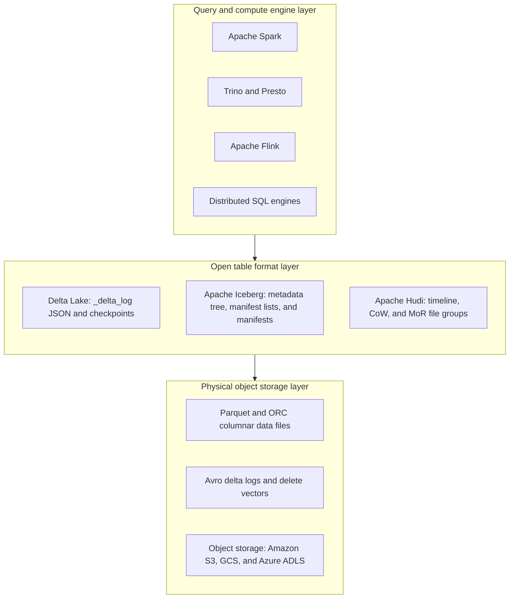

# Modern lakehouse architecture

Modern data analytics architectures have evolved across three primary paradigms:
enterprise data warehouses, data lakes, and data lakehouses. While traditional
warehouses deliver high performance for structured business intelligence, they
rely on proprietary storage that's costly for unstructured data. Data lakes
introduced low-cost cloud object storage for massive raw datasets, but their lack
of transactional ACID protections frequently turned them into unmanageable data
swamps.

The data lakehouse unites both approaches. By pairing open columnar storage
formats with transactional metadata management layers, lakehouses bring ACID
transactions, schema enforcement, time travel, and high-performance querying
directly to cloud object storage.

```mermaid
flowchart LR
    subgraph DW["Data warehouse"]
        direction TB
        A1["Schema-on-write"]
        A2["Proprietary storage"]
        A3["BI and SQL analytics"]
        A4["ACID transactions"]
    end

    subgraph DL["Data lake"]
        direction TB
        B1["Schema-on-read"]
        B2["Open object storage"]
        B3["ML and raw files"]
        B4["No ACID guarantees"]
    end

    subgraph LH["Data lakehouse"]
        direction TB
        C1["Schema enforcement"]
        C2["Open storage formats"]
        C3["Unified BI and ML"]
        C4["ACID table formats"]
    end

    DW --> DL --> LH
```



## Warehouse, lake, and lakehouse paradigms

Choosing an analytics platform requires understanding how each architectural
generation handles storage, compute, and schema definition.

### Data warehouse

Originating in the 1990s, data warehouses provide centralized analytics
repositories optimized for online analytical processing (OLAP).

- Data handling and schema: operates on a schema-on-write model. Ingestion
  pipelines extract data from operational sources, clean, and transform records
  through ETL processes, and load structured rows into dimensional star schemas
  or normalized 3NF models before making tables queryable.
- Storage and compute: historically coupled within Massively Parallel Processing
  (MPP) appliances. Modern cloud data warehouses separate compute from storage
  mechanisms, yet they still persist records inside proprietary columnar formats
  managed by vendor-controlled engines.
- Strengths: provides sub-second query latency for structured SQL, fine-grained
  column-level and row-level access control, ACID transaction support, and high
  concurrency for business intelligence dashboards.
- Limitations: raw data storage costs remain high compared to raw cloud storage.
  Warehouses can't natively store or process raw media such as images, audio,
  or video, and exporting data to external machine learning frameworks incurs
  costly serialization overhead.

### Data lake

Data lakes emerged with the distributed big data era, first on HDFS and
subsequently transitioning to cloud object storage, including Amazon S3, GCS,
and Azure ADLS.

- Data handling and schema: operates on a schema-on-read model. Ingestion jobs
  dump structured, semi-structured JSON, and unstructured media directly into
  object storage buckets in raw format without upfront validation. Query engines
  apply schemas only when reading files.
- Storage and compute: decouples compute from storage completely. On-demand
  compute engines such as Apache Spark, Trino, Presto, and Flink spin up to
  process files stored in open formats including Apache Parquet, ORC, and Avro.
- Strengths: provides virtually limitless scalability at low storage costs while
  supporting advanced machine learning, audio analysis, and computer vision
  workflows.
- Limitations: lacks native ACID transactions, transactional isolation, and
  schema enforcement. Direct updates and deletes require rewriting entire
  partition directories. Without strict catalog governance, data lakes
  deteriorate into unmanageable data swamps with orphaned files and inconsistent
  snapshots.

### Data lakehouse

A data lakehouse implements a metadata and transaction management layer on top of
open columnar files in cloud object storage.

- Data handling and schema: combines the flexibility of object storage with the
  governance of traditional data warehouses. Lakehouses enforce schemas on write
  while supporting backward-compatible schema evolution.
- Storage and compute: keeps data in open formats like Parquet and ORC. Query
  engines including Spark, Trino, and native database connectors access the
  underlying files directly without reserialization or vendor lock-in.
- Core capabilities: provides ACID transactions, historical time travel,
  efficient row-level upserts and deletes, partition evolution, and unified
  support for SQL analytics, streaming pipelines, and machine learning models.

## Open table format layer

Open table formats sit between physical storage files and execution engines. They
translate a collection of individual Parquet or ORC files into a single
transactional table entity.



### Delta Lake

Created by Databricks and hosted by the Linux Foundation, Delta Lake provides an
ACID table abstraction on top of cloud object storage.

- Architecture: tracks table mutations using an append-only JSON transaction log
  stored in the `_delta_log` directory alongside Parquet data files. Every write,
  update, delete, or schema change commits an incremental JSON file (`000000.json`,
  `000001.json`). Every 10 commits, Delta writes a consolidated Parquet checkpoint
  file to accelerate state reconstruction.
- Concurrency and isolation: uses optimistic concurrency control (OCC). Writers
  verify that underlying files haven't changed before committing a new version.
- Key capabilities: supports ACID transactions, schema enforcement to prevent
  corrupt writes, schema evolution via explicit merge options, time travel by
  version or timestamp, and change data feed (CDF) emission for downstream
  consumers.

### Apache Iceberg

Originally developed by Netflix and Apple, Apache Iceberg is an open table format
engineered for petabyte-scale datasets.

- Architecture: tracks state using a hierarchical metadata tree rather than
  relying on cloud storage directory listings:
  1. Metadata file: contains table schema, partition specification, and a list of
     historical snapshots.
  2. Manifest list: snapshot-level file pointing to individual manifest files and
     tracking file-level partition boundaries.
  3. Manifest file: lists specific Parquet, ORC, or Avro data files with column-level
     minimum and maximum metrics.
- Hidden partitioning: users query tables using business columns without
  specifying artificial directory paths like `/year=2026/month=10/`. Iceberg applies
  partition transforms automatically and rewrites query plans to skip irrelevant
  partitions.
- Partition evolution: lets data engineers update partition schemes without
  rewriting historical data files. Historical files remain partitioned by the old
  spec, while new writes adopt the new spec directly.

### Apache Hudi

Developed at Uber, Apache Hudi, short for Hadoop Update Delete Incremental, focuses on
high-frequency streaming ingestion, Change Data Capture (CDC), and incremental
batch processing.

Hudi organizes tables using two primary storage models:

- Copy-on-write, or CoW: updates trigger a synchronous rewrite of existing Parquet
  files containing modified records. CoW produces zero read overhead, making it
  optimal for read-heavy analytical reporting where updates arrive in scheduled
  batches.
- Merge-on-read, or MoR: writes append updates to compact, row-oriented Avro delta
  files without rewriting large Parquet files immediately. Background compaction
  services merge Avro log files into new Parquet files asynchronously. MoR
  minimizes write amplification, making it ideal for streaming CDC pipelines.

## Architectural comparison matrix

The following matrix compares the core characteristics of data warehouses, data
lakes, and modern lakehouse table formats:

| Architectural dimension | Data warehouse | Data lake | Modern data lakehouse |
| :--- | :--- | :--- | :--- |
| Primary storage layer | Proprietary columnar storage | Object storage or HDFS | Object storage: S3, GCS, ADLS |
| Storage format | Vendor-specific binary files | CSV, JSON, Parquet, ORC, Avro | Open formats: Parquet, ORC, Avro |
| Schema mechanics | Schema-on-write enforced upfront | Schema-on-read unenforced at write | Schema enforcement and evolution |
| ACID transaction support | Native engine-level ACID | None, relies on partition overwrites | Full ACID table formats with OCC |
| Data types supported | Structured and semi-structured | Structured, semi-structured, and unstructured | Structured, semi-structured, and unstructured |
| ML and analytics integration | Requires API extraction or connectors | Direct file access via Spark and Python | Direct zero-copy reads for BI, SQL, and ML |
| Update and delete mechanics | Native SQL row-level mutations | Full file or directory rewrites | Row-level merge, upsert, and delete vectors |
| Time travel support | Engine-dependent snapshot retention | Manual file archiving | Native metadata-driven snapshot queries |

## Production CDC pipeline with PySpark and Delta Lake

In lakehouse architectures, change data capture (CDC) pipelines stream inserts,
updates, and deletes directly into silver-tier tables without manual directory
restructuring.

The following PySpark script builds an end-to-end lakehouse pipeline:

1. Configures a local SparkSession with Delta Lake extensions.
2. Writes an initial baseline silver customer table to object storage.
3. Applies a CDC batch using an ACID `MERGE` operation.
4. Queries an earlier snapshot using time travel.

```python
from delta.tables import DeltaTable
from pyspark.sql import SparkSession
from pyspark.sql.functions import col

# 1. Initialize SparkSession with Delta Lake catalog extensions
spark = (
    SparkSession.builder.appName("LakehouseCDCPipeline")
    .config("spark.sql.extensions", "io.delta.sql.DeltaSparkSessionExtension")
    .config(
        "spark.sql.catalog.spark_catalog",
        "org.apache.spark.sql.delta.catalog.DeltaCatalog",
    )
    .master("local[*]")
    .getOrCreate()
)

# Define storage path on local disk or cloud bucket
lakehouse_table_path = "/tmp/lakehouse/silver_customers"

# 2. Seed initial silver customer table
initial_data = [
    (1001, "Alice Smith", "alice@example.com", "Gold", "2026-01-01"),
    (1002, "Bob Jones", "bob@example.com", "Silver", "2026-01-01"),
]
columns = ["customer_id", "full_name", "email", "loyalty_tier", "updated_at"]

df_initial = spark.createDataFrame(initial_data, columns)

# Write out as an ACID Delta table directly to storage
df_initial.write.format("delta").mode("overwrite").save(lakehouse_table_path)

print("--- INITIAL TABLE STATE (SNAPSHOT VERSION 0) ---")
spark.read.format("delta").load(lakehouse_table_path).show()

# 3. Simulate incoming CDC batch
# Bob updates email and loyalty tier; Charlie is a new customer insertion
cdc_batch_data = [
    (1002, "Bob Jones", "bob.j@newdomain.com", "Gold", "2026-10-19"),
    (1003, "Charlie Brown", "charlie@example.com", "Bronze", "2026-10-19"),
]

df_cdc_batch = spark.createDataFrame(cdc_batch_data, columns)

# 4. Perform ACID MERGE (Upsert) on object storage
target_delta_table = DeltaTable.forPath(spark, lakehouse_table_path)

(
    target_delta_table.alias("target")
    .merge(
        source=df_cdc_batch.alias("source"),
        condition="target.customer_id = source.customer_id",
    )
    .whenMatchedUpdate(
        set={
            "email": col("source.email"),
            "loyalty_tier": col("source.loyalty_tier"),
            "updated_at": col("source.updated_at"),
        }
    )
    .whenNotMatchedInsert(
        values={
            "customer_id": col("source.customer_id"),
            "full_name": col("source.full_name"),
            "email": col("source.email"),
            "loyalty_tier": col("source.loyalty_tier"),
            "updated_at": col("source.updated_at"),
        }
    )
    .execute()
)

print("--- UPDATED TABLE STATE AFTER ACID CDC MERGE (VERSION 1) ---")
spark.read.format("delta").load(lakehouse_table_path).show()

# 5. Execute time travel query to read the original version 0 snapshot
df_version_0 = (
    spark.read.format("delta")
    .option("versionAsOf", 0)
    .load(lakehouse_table_path)
)

print("--- TIME TRAVEL: VERSION 0 SNAPSHOT BEFORE CDC MERGE ---")
df_version_0.show()

spark.stop()
```

### Pipeline execution mechanics

Understanding how Delta Lake processes this CDC pipeline highlights the core
differences between lakehouses and vanilla data lakes:

- Atomic commits: when the `.merge()` operation executes, Delta checks whether
  existing Parquet files contain matching `customer_id` keys. The engine writes
  new Parquet files containing updated and inserted rows, then commits a new JSON
  file in `_delta_log/000001.json`. Readers querying the table concurrently
  either see version 0 or version 1. They never see incomplete, partially written
  batches.
- Metadata time travel: reading with `.option("versionAsOf", 0)` directs the reader
  to parse the transaction log up to commit 0. The reader ignores files created
  in version 1, retrieving historical table state without manual data restores.

## Storage optimization strategies in modern lakehouses

Maintaining high query performance on cloud object storage requires deliberate
file layout and compaction procedures.

### File compaction and clustering

Streaming ingestion pipelines often create thousands of small Parquet files.
Query engines incur excessive network latency opening and reading metadata for
files smaller than 10 MB. Lakehouse formats resolve this through compaction:

- Delta Lake compaction: run `OPTIMIZE silver_customers ZORDER BY (customer_id)`
  to merge small files into 128 MB or 512 MB files while co-locating related keys
  in the same Parquet blocks.
- Apache Iceberg compaction: trigger the `rewrite_data_files` Spark procedure to
  bin-pack small files into target sizes without changing snapshot commit history.

### Snapshot expiration and vacuuming

Because open table formats preserve older file versions for time travel queries,
abandoned files accumulate in object storage over time:

- Delta Lake: run `VACUUM silver_customers RETAIN 168 HOURS` to permanently delete
  unreferenced physical data files older than seven days.
- Apache Iceberg: call `expire_snapshots` to remove metadata references older
  than your retention window, followed by orphan file removal procedures.

## Common pitfalls

When designing and maintaining modern lakehouse tables, watch for these common
engineering pitfalls:

### The small file problem and compaction overhead

Streaming ingestion tasks that write micro-batches every two minutes generate
thousands of tiny Parquet files every day. Query engines spend more time reading
file metadata from cloud object storage APIs than processing actual columnar
records. Schedule automated background compaction jobs to continuously consolidate
micro-batch outputs into 128 MB to 512 MB files.

### Metadata accumulation and vacuuming neglect

Retaining historical snapshots indefinitely protects against accidental deletes,
but unpruned transaction logs and orphaned data files drive up cloud storage bills.
Failing to run routine vacuum processes leaves unreferenced historical files in
storage buckets long after analytical retention policies expire. Establish automated
snapshot expiration policies paired with scheduled vacuum runs.

### Copy-on-write amplification during streaming ingestion

Configuring tables as Copy-on-Write for high-velocity streaming feeds forces the
engine to rewrite entire 500 MB Parquet files just to update a single record.
This causes severe I/O write amplification and slows down ingestion pipelines.
For high-frequency CDC streaming, choose Merge-on-Read table configurations or
delta delete vectors to log changes quickly before asynchronous batch compaction.

### Optimistic concurrency commit conflicts

When multiple distributed pipelines attempt to commit mutations to the same table
partition simultaneously, optimistic concurrency control checks fail. One job
commits successfully while competing jobs fail and retry, causing pipeline lag.
Partition tables by natural ingestion boundaries, such as event date or tenant ID,
to ensure parallel writers commit to isolated physical partitions.

### Data swamp degradation from unenforced schema governance

Allowing distributed teams to append loose, unvalidated JSON payloads without
formal schema enforcement degrades lakehouses into unsearchable data swamps.
Configure table formats with strict schema validation on write. When upstream
applications alter field structures, require explicit schema evolution flags
such as `.option("mergeSchema", "true")` rather than permitting silent type
coercions.

## What's next

- Explore dimension table design techniques in
  [Dimensional design patterns](/modeling/dimensional-design-patterns).
- Learn about primary, surrogate, and hash keys in
  [Primary and key management](/modeling/primary-and-key-management).
- Study baseline historical tracking in
  [Slowly changing dimensions core](/modeling/slowly-changing-dimensions-core).
- Review star schema and snowflake architectures in
  [Schema architectures](/modeling/schema-architectures).
- Understand columnar execution and pruning in
  [Database storage engine internals](/sql/database-storage-engine-internals).
