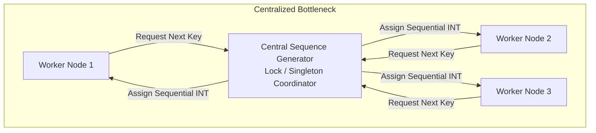

# Primary and key management

Key management is an architectural decision in data warehousing that affects
pipeline complexity, query join performance, historical tracking, and system
scalability across distributed massively parallel processing (MPP) engines.

Relational databases rely on primary keys to enforce entity uniqueness and
foreign keys to preserve referential integrity. In an analytical warehouse,
however, operational keys from source systems often prove insufficient for
tracking history, joining wide tables, or distributing workloads across parallel
nodes. Modern warehouse architectures use three distinct key strategies:
natural business keys, traditional integer surrogate keys, and deterministic
hash keys.

## Natural and business keys

A natural key, also called a business key, is an operational identifier assigned
by a source transaction system to track a real-world entity.

Natural keys originate in operational environments such as customer relationship
management (CRM) tools, enterprise resource planning (ERP) platforms, point of
sale (POS) systems, and transactional web databases. Common examples include
stock keeping unit (SKU) numbers, customer account identifiers, Social Security
numbers, and system-generated UUIDs.

In a data warehouse, natural keys provide the logical link connecting warehouse
records back to operational source transactions. In Data Vault architectures,
natural business keys form the core identifier stored inside hub entities.

### Trade-offs of natural keys

Using natural keys directly in analytical tables presents distinct advantages
and operational risks:

| Advantage or risk | Category | Impact on analytical workflows |
| :--- | :--- | :--- |
| Immediate business recognition | Advantage | Business analysts and developers recognize operational codes directly without translating keys in queries |
| Direct operational lookups | Advantage | Point queries from source applications match warehouse tables directly without joining mapping tables |
| Vulnerability to source recycling | Risk | Operational systems often alter, recycle, or reuse codes after dormancy, which corrupts historical entity mappings |
| Key collisions during system mergers | Risk | Merging two operational systems during corporate acquisitions introduces duplicate natural keys across distinct entities |
| Inability to support historical versions | Risk | A single natural key can't distinguish multiple historical revisions of an entity in slowly changing dimension Type 2 patterns |
| Query join latency | Risk | Natural keys are frequently wide alphanumeric strings. Joining fact tables to dimensions using wide text columns increases memory usage and disk scan volume |

## Surrogate keys

A surrogate key is an artificial, meaningless integer generated sequentially
inside the data warehouse staging or transformation layer. It's the primary key
for dimension tables and the corresponding foreign key in fact tables.

Ralph Kimball recommended integer surrogate keys as the standard joining
mechanism for dimensional star schemas. In traditional single-node relational
databases and row-oriented data warehouses, data architectures implement
surrogate keys as four-byte `INT` or eight-byte `BIGINT` columns generated by
database identity sequences or ETL pipeline counters.

### Advantages of integer surrogate keys

Integer surrogate keys resolve many of the operational limitations of natural
keys:

- Insulates the warehouse from source changes: buffers analytical models
  against source schema modifications, operational key recycling, and key
  collisions caused by enterprise system consolidations.
- Enables historical tracking: allows a single natural business key to have
  multiple distinct surrogate records over time, accurately partitioning fact
  measurements across slowly changing dimension Type 2 historical profiles.
- Handles missing or unknown data: maps missing, delayed, or invalid source
  references to reserved negative integer keys, such as `-1` for unknown or `-2`
  for not applicable, preventing SQL `NULL` join failures.
- Optimizes join performance and storage: a four-byte integer supports over two
  billion unique values while minimizing fact table row width, memory buffer
  consumption, and network transfer volume during query joins.

### Scaling limitations in distributed environments

Despite their efficiency in traditional relational databases, sequential integer
surrogate keys introduce architectural bottlenecks in distributed cloud
warehouses:



Generating sequential integers requires a central coordinator or lock manager to
prevent duplicate numbers. In distributed processing engines such as Apache
Spark, Google BigQuery, and Snowflake, this centralization breaks pipeline
parallelism by forcing independent worker nodes to synchronize with a single
coordinator. Staging pipelines must also maintain a centralized master dimension
cross-reference table to look up existing surrogate keys before assigning new
ones, slowing down high-volume ingestion pipelines.

## Hash keys in modern cloud architectures

A hash key is a deterministic, fixed-length hexadecimal or binary key generated
by passing one or more natural business keys through a cryptographic hashing
algorithm, such as MD5 or SHA-256.

Hash keys are central to the Data Vault 2.0 modeling architecture and modern
cloud ELT workflows orchestrated with tools such as dbt. Instead of relying on a
centralized sequence generator or lookup table, the transformation layer computes
the key mathematically from the natural business key.

### Standard hash key calculation

To prevent mismatched hash values across distributed systems, preprocessing
logic must standardize all business key inputs before hashing. A standard hash
key computation follows this pattern:

$$\text{HashKey} = \text{MD5}(\text{UPPER}(\text{TRIM}(\text{COALESCE}(\text{BusinessKey}, ''))))$$

When computing hash keys across composite business keys, include a consistent
delimiter between columns to avoid concatenation collisions:

```sql
MD5(CONCAT(
    COALESCE(UPPER(TRIM(tenant_id)), ''),
    '#',
    COALESCE(UPPER(TRIM(customer_id)), '')
)) AS customer_hash_key
```

Without strict string formatting, slight differences in whitespace, letter case,
or null representations produce completely different hash values for identical
entities.

### Advantages of hash keys

Hash keys eliminate the centralized coordination required by sequential integer
keys:

- Deterministic and stateless: the same natural key always produces the exact
  same hash key regardless of which cluster node, processing engine, or pipeline
  stage executes the computation.
- Parallel ingestion without lookups: independent staging pipelines can load
  parent hub tables, child link tables, and fact tables simultaneously in
  parallel. Fact tables calculate foreign keys directly from raw natural keys
  without waiting for dimension tables to finish loading.
- Unified multi-source integration: eliminates cross-system key collisions by
  combining the source system identifier with the operational key before
  hashing.

### Trade-offs and resource considerations

While hash keys remove pipeline dependencies, they introduce physical storage
and operational trade-offs:

- Storage and memory overhead: an MD5 hash requires 32 hexadecimal characters
  as a string or 16 bytes in binary format. SHA-256 requires 64 characters or
  32 bytes. In fact tables containing billions of rows, wide hash keys consume
  significantly more memory and disk bandwidth during joins than four-byte
  integers.
- Theoretical hash collisions: cryptographic hashing carries an infinitesimal
  probability of two distinct inputs producing the same hash value. For MD5, the
  probability of a collision across millions of business keys is negligible, but
  organizations with extreme scale or regulatory requirements often prefer
  SHA-256 or retain verified lookups.
- Debugging complexity: long hexadecimal strings are difficult to inspect and
  verify visually during manual pipeline debugging.

## Key management comparison matrix

The following matrix compares natural keys, traditional surrogate keys, and
cryptographic hash keys across architectural dimensions:

| Feature | Natural and business keys | Traditional surrogate keys | MD5 or SHA-256 hash keys |
| :--- | :--- | :--- | :--- |
| Generation origin | Operational source applications | Staging or transformation pipeline | Transformation layer in SQL or dbt |
| Data type and size | Variable alphanumeric string or integer | 4-byte `INT` or 8-byte `BIGINT` | `CHAR(32)` or `BINARY(16)` for MD5 |
| Determinism | Assigned by source system | Non-deterministic: load order dependent | Fully deterministic and stateless |
| Parallel loading | Dependent on source extract | Low: requires centralized locking or lookups | High: distributed across cluster nodes |
| SCD Type 2 support | Can't support multiple historical records | High: new surrogate key per version | High: hash of business key plus effective date |
| Join efficiency | Lower for wide alphanumeric strings | Highest: compact integer joins | Moderate: slower than integer but faster than wide strings |
| Primary architectural fit | Source systems and staging raw ingestion | Single-node relational databases and traditional star schemas | Data Vault 2.0, cloud lakehouses, and distributed MPP |

## Production schema implementation

The following PostgreSQL schema demonstrates how natural keys, traditional
surrogate keys, and modern hash keys manage customer profile updates and
historical address changes.

### Operational source table

Operational transactions record customer profiles using natural business keys:

```sql
-- Operational source table using natural keys
CREATE TABLE src_customers (
    customer_id VARCHAR(20) PRIMARY KEY,
    full_name   VARCHAR(100) NOT NULL,
    city        VARCHAR(50) NOT NULL,
    updated_at  TIMESTAMP NOT NULL
);
```

### Traditional Kimball dimension with SCD Type 2

In a Kimball star schema, an auto-incrementing surrogate key preserves
historical versions when a customer relocates:

```sql
CREATE TABLE dim_customer_kimball (
    customer_key    INT GENERATED ALWAYS AS IDENTITY PRIMARY KEY,
    customer_id     VARCHAR(20) NOT NULL,
    full_name       VARCHAR(100) NOT NULL,
    city            VARCHAR(50) NOT NULL,
    
    -- SCD Type 2 tracking attributes
    effective_date  DATE NOT NULL,
    expiration_date DATE,
    is_current      BOOLEAN NOT NULL DEFAULT TRUE
);

-- Initial ingestion for customer CUST-1001
INSERT INTO dim_customer_kimball (
    customer_id, full_name, city, effective_date, expiration_date, is_current
) VALUES (
    'CUST-1001', 'Alice Smith', 'New York', '2025-01-01', NULL, TRUE
);

-- Customer relocates to Los Angeles: SCD Type 2 update
-- Step 1: Expire previous version
UPDATE dim_customer_kimball 
SET expiration_date = '2026-01-15', is_current = FALSE 
WHERE customer_id = 'CUST-1001' AND is_current = TRUE;

-- Step 2: Insert new record with fresh surrogate key
INSERT INTO dim_customer_kimball (
    customer_id, full_name, city, effective_date, expiration_date, is_current
) VALUES (
    'CUST-1001', 'Alice Smith', 'Los Angeles', '2026-01-15', NULL, TRUE
);
```

### Modern Data Vault implementation with hash keys

In Data Vault 2.0, hubs record the business key, while satellites track
descriptive history using cryptographic hashes:

```sql
-- Hub entity: stores the unique business key and its deterministic hash
CREATE TABLE hub_customer (
    customer_hash_key CHAR(32) PRIMARY KEY,
    customer_id       VARCHAR(20) NOT NULL,
    load_date         TIMESTAMP NOT NULL,
    record_source     VARCHAR(50) NOT NULL
);

-- Satellite entity: stores descriptive attributes and a hash difference for change detection
CREATE TABLE sat_customer_details (
    customer_hash_key CHAR(32) REFERENCES hub_customer(customer_hash_key),
    load_date         TIMESTAMP NOT NULL,
    full_name         VARCHAR(100) NOT NULL,
    city              VARCHAR(50) NOT NULL,
    hash_diff         CHAR(32) NOT NULL,
    PRIMARY KEY (customer_hash_key, load_date)
);

-- Populate Hub customer deterministically
INSERT INTO hub_customer (customer_hash_key, customer_id, load_date, record_source)
VALUES (
    MD5(UPPER(TRIM('CUST-1001'))), 
    'CUST-1001', 
    '2025-01-01 10:00:00', 
    'CRM_DB'
);

-- Insert initial snapshot into Satellite
INSERT INTO sat_customer_details (
    customer_hash_key, load_date, full_name, city, hash_diff
) VALUES (
    MD5(UPPER(TRIM('CUST-1001'))), 
    '2025-01-01 10:00:00', 
    'Alice Smith', 
    'New York',
    MD5('Alice Smith|New York')
);

-- Customer relocates: insert new Satellite snapshot asynchronously without locking
INSERT INTO sat_customer_details (
    customer_hash_key, load_date, full_name, city, hash_diff
) VALUES (
    MD5(UPPER(TRIM('CUST-1001'))), 
    '2026-01-15 14:30:00', 
    'Alice Smith', 
    'Los Angeles',
    MD5('Alice Smith|Los Angeles')
);
```

### Distributed fact table loading

Because hash keys are deterministic, fact tables compute the foreign key
directly from the incoming transaction payload without querying dimension
tables:

```sql
CREATE TABLE fact_sales_mpp (
    order_id          BIGINT NOT NULL,
    customer_hash_key CHAR(32) NOT NULL,
    sales_amount      NUMERIC(10, 2) NOT NULL
);

-- Parallel insert without looking up dimension surrogate keys
INSERT INTO fact_sales_mpp (order_id, customer_hash_key, sales_amount)
VALUES (
    9901, 
    MD5(UPPER(TRIM('CUST-1001'))), 
    250.00
);
```

## Operational considerations and architectural alignment

Selecting and managing keys requires balancing ingestion throughput against
query performance. Align your key strategy with your underlying storage and
compute architecture:

### Date dimension integer key exception

Ralph Kimball identified the date dimension as the single exception where
surrogate keys should carry readable meaning. Instead of using arbitrary
sequential integers, date dimension keys should follow an eight-digit numeric
format:

$$\text{DateKey} = \text{YYYYMMDD}$$

For example, October 19, 2026 maps to `20261019`. This integer format allows
query engines and columnar storage systems to execute range filters and partition
pruning directly against the fact table's date foreign key without joining the
calendar dimension table.

### Storage engine and platform alignment

Data architectures select key patterns based on their database engine:

- Use sequential integer surrogate keys when building traditional star schemas
  on single-node relational databases or row-oriented storage engines, where
  compact integer keys optimize buffer cache utilization.
- Use deterministic hash keys when building Data Vault architectures or ELT
  pipelines on distributed cloud MPP platforms such as Snowflake, Google
  BigQuery, and Databricks, where eliminating central coordination bottlenecks
  maximizes parallel loading speed.

## Common pitfalls

When designing and implementing key architectures, watch for these common mistakes:

### Embedding business logic into smart keys

Embedding business logic or categorical hierarchies into surrogate keys, known
as smart keys, creates severe maintenance failures. For example, encoding a
department code into digits three through five of an employee surrogate key
breaks when organizational restructuring moves teams across departments.
Surrogate keys must remain completely artificial and devoid of intrinsic business
meaning.

### Storing null values for missing foreign keys

Never leave unassigned foreign keys as SQL `NULL` values in fact tables. In SQL,
equality comparisons against `NULL` evaluate to `UNKNOWN`, where `NULL = NULL`
yields `UNKNOWN`. Standard inner joins discard records with `NULL` keys, silently
dropping revenue or event metrics from reports.

Always map missing, unassigned, or pending dimension references to explicit
dummy surrogate keys:

| Reserved key | Meaning | Description |
| :--- | :--- | :--- |
| `-1` | Unknown | Source record arrived with missing or corrupted identifier |
| `-2` | Not applicable | Fact event occurred in a context where this dimension doesn't apply |
| `-3` | Late-arriving | Transaction arrived before the source system created the operational entity |

### Generating sequential integers in distributed pipelines

Using auto-incrementing sequential integers, such as `IDENTITY` columns or
database sequences, in distributed processing engines such as Apache Spark,
Snowflake, or Google BigQuery creates a major serialization bottleneck.
Generating monotonic integers forces distributed worker nodes to route requests
through a single coordinator lock. Staging pipelines must also maintain a
centralized master cross-reference lookup table, which stalls high-volume
parallel ingestion. Use deterministic cryptographic hash keys, such as `MD5` or
`SHA-256`, to enable stateless, parallel key generation across worker nodes.

### Inconsistent string standardization before hashing

Failing to strictly standardize business key strings before applying
cryptographic hash functions generates conflicting hash keys for the same
real-world entity. Differences in whitespace padding, letter casing, or `NULL`
representations alter the resulting hash output completely. For example,
`' CUST-1001'` and `'cust-1001'` produce completely different hash values.
Always apply `TRIM()`, enforce consistent casing with `UPPER()` or `LOWER()`,
and handle missing values with `COALESCE` before hashing.

### Joining wide alphanumeric natural keys in large fact tables

Using raw natural business keys directly as fact-to-dimension join keys degrades
query performance on large tables. Natural keys are often wide alphanumeric
strings, such as 20-character account numbers or 36-character UUIDs. Storing wide
string keys across billions of fact table rows balloons memory buffer pool
consumption, increases disk I/O, and slows down hash join probing compared to
compact four-byte integer keys.

## What's next

- Explore star schema and snowflake schema foundations in
  [Schema architectures](/modeling/schema-architectures).
- Review slowly changing dimension patterns and historical tracking in
  [Dimensional modeling methodology](/modeling/dimensional-modeling-methodology).
- Learn how transaction, periodic snapshot, and accumulating snapshot tables use keys in
  [Fact table design and types](/modeling/fact-table-design-and-types).
- Study join execution strategies and join hashing algorithms in
  [Advanced query optimization](/sql/advanced-query-optimization).
