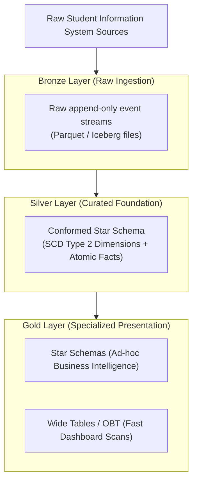

# Schema architectures

In analytical database design and data warehousing, choosing an appropriate
schema architecture determines query execution efficiency, storage utilization,
and maintenance overhead. The three primary schema architectures occupy distinct
positions along the normalization spectrum: star schemas, snowflake schemas, and
wide `` `denormalized` `` tables.

Each architecture offers distinct trade-offs among join complexity, storage
compression efficiency, update workflows, and enterprise data governance.
Understanding how these designs behave inside modern query engines helps you
structure tables that scale with growing analytical workloads.

## When to use each schema architecture

Use the following decision matrix to choose the appropriate schema architecture
for your analytical data model:

| Pattern | Scenario | Key challenge | Design solution | Analytical trade-off |
| :--- | :--- | :--- | :--- | :--- |
| **Star schema** | Enterprise data warehouses, business intelligence self-service | Balancing query speed, model simplicity, and dimension governance | Combine atomic fact tables with wide, `` `denormalized` `` dimension tables | Dimension tables introduce minor attribute repetition |
| **Snowflake schema** | Specialized outrigger dimensions, low-cardinality reference data | Attributes update at different frequencies or represent distinct grains | Normalize dimension hierarchies into Third Normal Form tables | Multi-level cascading joins increase query latency and complexity |
| **Wide flat table** | Sub-second dashboards, machine learning feature stores | Eliminating join bottlenecks across high-concurrency analytical queries | Pre-join facts and dimensions into a single wide table | Updating dimensions requires rewriting large volumes of historical rows |

## Star schema

The star schema is the foundational design pattern of Ralph `Kimball`'s
dimensional modeling methodology. It organizes analytical data around
discrete business measurement events, cleanly separating numeric facts from
descriptive contextual dimensions.

### Star schema structure

A star schema consists of two distinct table classifications arranged in a
radial pattern:

1. **Central fact table**: a narrow, append-only table recording numeric
   measurements at an atomic grain, such as student course registrations. The
   fact table contains numeric measures alongside integer surrogate foreign
   keys referencing surrounding dimension tables.
2. **Flat dimension tables**: wide tables representing the business entities
   participating in the event, such as students, instructors, courses, and
   academic terms. The schema collapses hierarchical relationships directly into
   each record. For example, `dim_course` stores the course code, department
   name, and school name within the same record, rather than splitting them into
   separate tables.

### Query performance and storage trade-offs

- Queries require only a single level of joins between the central fact table and surrounding dimensions. Relational optimizers and distributed query engines use star-join heuristics: the engine filters the smaller dimension tables first, applies hash filters or evaluates bitmap intersections on surrogate keys, and probes the fact table in a single pass.
- Repeating textual department and school names across course records introduces slight attribute redundancy. However, dimension tables typically account for less than 5% of total warehouse storage, while fact tables account for more than 95%. Flattened dimension tables produce negligible storage costs while eliminating join overhead.

## Snowflake schema

The snowflake schema normalizes dimension hierarchies into multiple relational
tables adhering to 3NF.

### Snowflake schema structure

In a snowflake schema, the central fact table remains identical to its star
schema equivalent, but the surrounding dimensions branch out into secondary and
tertiary lookup tables:

1. **Normalized dimension trees**: rather than storing redundant department and
   school names within `dim_course`, the schema extracts these attributes into
   dedicated tables. `dim_course` holds a foreign key to `dim_department`, which
   in turn holds a foreign key to `dim_school`.
2. **Fact table uniformity**: the grain and structure of the central fact table
   remain unchanged. Only the dimensional hierarchies undergo normalization.

### Query performance and storage trade-offs

- Aggregating facts across dimensional hierarchies requires multi-level cascading joins. Calculating course enrollments by school requires joining the enrollment fact table to `dim_course`, then to `dim_department`, and finally to `dim_school`. These cascading joins increase query plan complexity and prevent engines from using star-join bitmap filters.
- Normalizing eliminates repeating text strings in dimension tables, reducing uncompressed storage. However, because dimension data represents a minor fraction of total database volume, the storage savings are marginal compared to the join penalties introduced.

### Permissible dimension outriggers

Ralph `Kimball` noted that partial normalization is permissible for dimension
outriggers. An outrigger is a secondary dimension joined to a primary dimension
when secondary attributes represent a distinct grain or update frequency.
Examples include:

- Attaching county census demographic data to a student home address dimension.
- Attaching accreditation ratings to an academic institution dimension.

## Wide flat tables and unified models

Wide flat tables, known as One Big Table (OBT), combine business measurements
with all descriptive attributes into a single flat structure.

### Wide flat table structure

1. **Pre-joined records at transformation time**: data transformation pipelines
   join transactional events with all dimension attributes during data loading.
   The resulting table contains dozens or hundreds of columns.
2. **Semi-structured data support**: modern columnar formats such as `Parquet`
   allow wide tables to store nested structures and repeated arrays. Pipelines
   can store multi-line course sections or prerequisites as repeated records
   within a single parent row.
3. **Columnar storage alignment**: because columnar database engines store and
   compress each column separately on disk, a query scanning three columns in a
   100-column table bypasses the remaining unselected columns entirely.

### Query performance and storage trade-offs

- Queries execute without table joins. This design eliminates CPU-intensive hash join operations and avoids distributed network shuffle bottlenecks across worker nodes.
- While raw uncompressed data exhibits repetition, columnar engines compress sorted values efficiently using run-length encoding and dictionary encoding.

## Architectural comparison matrix

The following table summarizes the structural, operational, and performance
characteristics of the three schema architectures:

| Architectural dimension | Star schema | Snowflake schema | Wide flat table (OBT) |
| :--- | :--- | :--- | :--- |
| **Normalization level** | Normalized fact, `` `denormalized` `` dimensions | Normalized fact, 3NF normalized dimensions | Fully `` `denormalized` `` flat table |
| **Join complexity** | Single-level joins between fact and dimensions | Multi-level cascading joins | Zero joins because all columns are pre-joined |
| **Query scan latency** | Fast through star-join optimizations | Moderate to slow due to join overhead | Fast scan and filter performance |
| **Storage consumption** | Balanced with slight dimension redundancy | Lowest raw storage footprint | High raw redundancy, but compressed efficiently in columnar formats |
| **Data pipeline cost** | Moderate because surrogate keys require maintenance | Complex due to hierarchical key management | High compute cost at write and build time |
| **Dimension update handling** | Clean support for Slowly Changing Dimension (SCD) patterns | Clean because updates occur in isolated lookup tables | Complex because updating dimension values requires rewriting fact rows |
| **Enterprise governance** | High with reusable conformed dimensions | High with centralized relational integrity | Moderate to low because isolated tables risk metric drift |
| **Primary target workload** | Enterprise data warehouses and BI self-service | Secondary outrigger tables and specialized master data | High-concurrency dashboards, customer service endpoints, and feature stores |

## Schema implementation for the university scenario

To evaluate the mechanical differences among the three architectures, consider
calculating total student enrollments and tuition revenue grouped by academic
school for the 2026 academic year.

### Star schema implementation

The star schema flattens department and school hierarchies directly into
`dim_course_star`:

```sql
-- 1. Star Schema: Denormalized dimension tables
CREATE TABLE dim_course_star (
    course_key      INT PRIMARY KEY,
    course_code     VARCHAR(20)  NOT NULL,
    course_title    VARCHAR(100) NOT NULL,
    department_name VARCHAR(50)  NOT NULL,
    school_name     VARCHAR(50)  NOT NULL,
    unit_credits    INT          NOT NULL
);

CREATE TABLE dim_student_star (
    student_key     INT PRIMARY KEY,
    student_id      INT          NOT NULL,
    full_name       VARCHAR(100) NOT NULL,
    major_name      VARCHAR(50)  NOT NULL,
    class_standing  VARCHAR(20)  NOT NULL
);

-- Star Schema: Central fact table
CREATE TABLE fact_course_enrollment_star (
    enrollment_id   BIGINT        NOT NULL,
    term_key        INT           NOT NULL,
    course_key      INT           NOT NULL REFERENCES dim_course_star(course_key),
    student_key     INT           NOT NULL REFERENCES dim_student_star(student_key),
    enrollment_count INT          NOT NULL DEFAULT 1,
    tuition_amount  DECIMAL(10,2) NOT NULL,
    PRIMARY KEY (enrollment_id)
);
```

#### Analytical query in star schema

The query joins the fact table directly to `dim_course_star` in a single step:

```sql
SELECT 
    c.school_name,
    SUM(f.enrollment_count) AS total_enrollments,
    SUM(f.tuition_amount)   AS total_tuition_revenue
FROM fact_course_enrollment_star AS f
JOIN dim_course_star AS c
    ON f.course_key = c.course_key
WHERE f.term_key = 202601 -- Autumn 2026
GROUP BY c.school_name
ORDER BY total_tuition_revenue DESC;
```

### Snowflake schema implementation

The snowflake schema normalizes schools and departments into dedicated lookup
tables:

```sql
-- 2. Snowflake Schema: Normalized dimension hierarchy
CREATE TABLE dim_school_snow (
    school_id       INT PRIMARY KEY,
    school_name     VARCHAR(50) NOT NULL
);

CREATE TABLE dim_department_snow (
    department_id   INT PRIMARY KEY,
    department_name VARCHAR(50) NOT NULL,
    school_id       INT NOT NULL REFERENCES dim_school_snow(school_id)
);

CREATE TABLE dim_course_snow (
    course_key      INT PRIMARY KEY,
    course_code     VARCHAR(20)  NOT NULL,
    course_title    VARCHAR(100) NOT NULL,
    unit_credits    INT          NOT NULL,
    department_id   INT NOT NULL REFERENCES dim_department_snow(department_id)
);

-- Snowflake Schema: Central fact table
CREATE TABLE fact_course_enrollment_snow (
    enrollment_id   BIGINT        NOT NULL,
    term_key        INT           NOT NULL,
    course_key      INT           NOT NULL REFERENCES dim_course_snow(course_key),
    student_key     INT           NOT NULL,
    enrollment_count INT          NOT NULL DEFAULT 1,
    tuition_amount  DECIMAL(10,2) NOT NULL,
    PRIMARY KEY (enrollment_id)
);
```

#### Analytical query in snowflake schema

The query requires two cascading joins to navigate from course to school:

```sql
SELECT 
    s.school_name,
    SUM(f.enrollment_count) AS total_enrollments,
    SUM(f.tuition_amount)   AS total_tuition_revenue
FROM fact_course_enrollment_snow AS f
JOIN dim_course_snow AS c
    ON f.course_key = c.course_key
JOIN dim_department_snow AS d
    ON c.department_id = d.department_id
JOIN dim_school_snow AS s
    ON d.school_id = s.school_id
WHERE f.term_key = 202601 -- Autumn 2026
GROUP BY s.school_name
ORDER BY total_tuition_revenue DESC;
```

### Wide table implementation

The wide table pattern flattens all course, student, and department attributes
into a single table at load time:

```sql
-- 3. Wide Table (OBT)
CREATE TABLE course_enrollment_obt (
    enrollment_id   BIGINT        NOT NULL,
    term_key        INT           NOT NULL,
    student_id      INT           NOT NULL,
    student_name    VARCHAR(100)  NOT NULL,
    major_name      VARCHAR(50)   NOT NULL,
    class_standing  VARCHAR(20)   NOT NULL,
    course_code     VARCHAR(20)   NOT NULL,
    course_title    VARCHAR(100)  NOT NULL,
    department_name VARCHAR(50)   NOT NULL,
    school_name     VARCHAR(50)   NOT NULL,
    enrollment_count INT          NOT NULL DEFAULT 1,
    tuition_amount  DECIMAL(10,2) NOT NULL
);
```

#### Analytical query in wide table

The query executes as a direct columnar scan without table joins:

```sql
SELECT 
    school_name,
    SUM(enrollment_count) AS total_enrollments,
    SUM(tuition_amount)   AS total_tuition_revenue
FROM course_enrollment_obt
WHERE term_key = 202601 -- Autumn 2026
GROUP BY school_name
ORDER BY total_tuition_revenue DESC;
```

## Modern data lake and medallion convergence

Modern cloud data platforms reconcile these three architectures within a
layered medallion framework:



- The Bronze layer captures raw immutable event feeds without schema
  modification.
- The Silver layer models enterprise data using a conformed star schema. This
  layer manages surrogate keys, tracks historical attribute mutations using SCD
  Type 2, and enforces consistency across the enterprise.
- The Gold layer exposes specialized presentation structures, generating both
  star schemas for self-service SQL queries and wide tables for high-speed
  dashboard queries.

## Operational considerations and engine optimization

When evaluating schema architectures in distributed data warehouses such as
`BigQuery`, consider the following technical factors:

- Wide tables require columnar storage. On row-oriented relational engines such as
  `PostgreSQL`, scanning two columns from a 100-column table loads all 100 columns
  into the buffer pool cache, saturating memory and disk I/O. Columnar formats read
  only the requested byte ranges.
- In distributed query engines, joining large fact tables to normalized snowflake
  dimensions forces the engine to rehash and partition data across cluster network
  switches (`ShuffleHashJoin`). Single-level star joins and pre-joined wide tables
  eliminate or minimize these network transfers.
- Updating a student major or course accreditation in a star schema requires
  updating a single dimension record. In a wide table containing millions of rows,
  updating that same attribute forces the engine to rewrite or merge millions of
  historical transaction records across physical files.

## Common pitfalls

When designing analytical schemas, watch for these common mistakes:

### Normalizing dimension hierarchies to save disk space

Engineers accustomed to transactional database design frequently normalize
dimensions to eliminate text repetition. Because dimension tables represent
less than 5% of warehouse data, normalizing them saves negligible disk space
while degrading query performance and dashboard response times.

### Tracking slowly changing dimensions in wide tables

Attempting to track historical dimension mutations using SCD Type 2 directly
inside wide tables causes severe write amplification. Keep wide tables immutable
or rebuild them as downstream materialized views derived from a silver-layer
star schema.

### Metric drift from isolated wide tables

When separate engineering teams build independent wide tables without shared
conformed dimensions, metric definitions diverge. One team might calculate
tuition revenue based on billing date, while another calculates it based on
term enrollment date. Always build presentation tables from a single curated
star schema foundation.

## What's next

- Learn about dimensional design and surrogate keys in
  [Dimensional modeling methodology](/modeling/dimensional-modeling-methodology).
- Explore transaction, periodic snapshot, and accumulating snapshot designs in
  [Fact table design and types](/modeling/fact-table-design-and-types).
- Review distributed join execution and hash join algorithms in
  [Fundamental joins](/sql/fundamental-joins).
