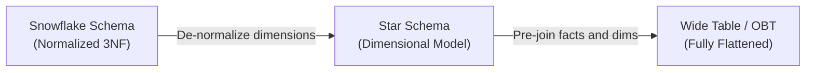
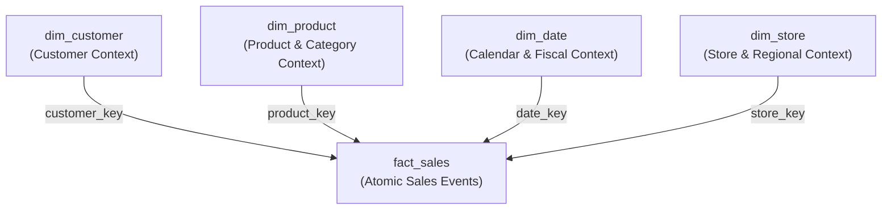
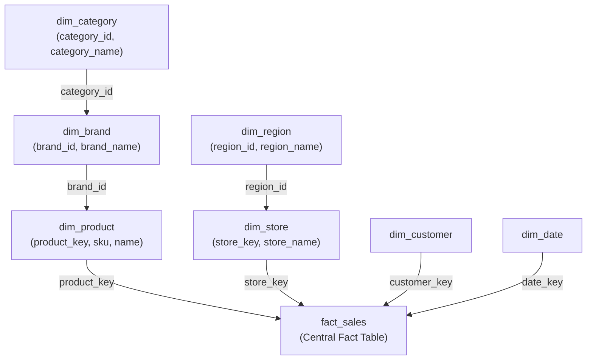
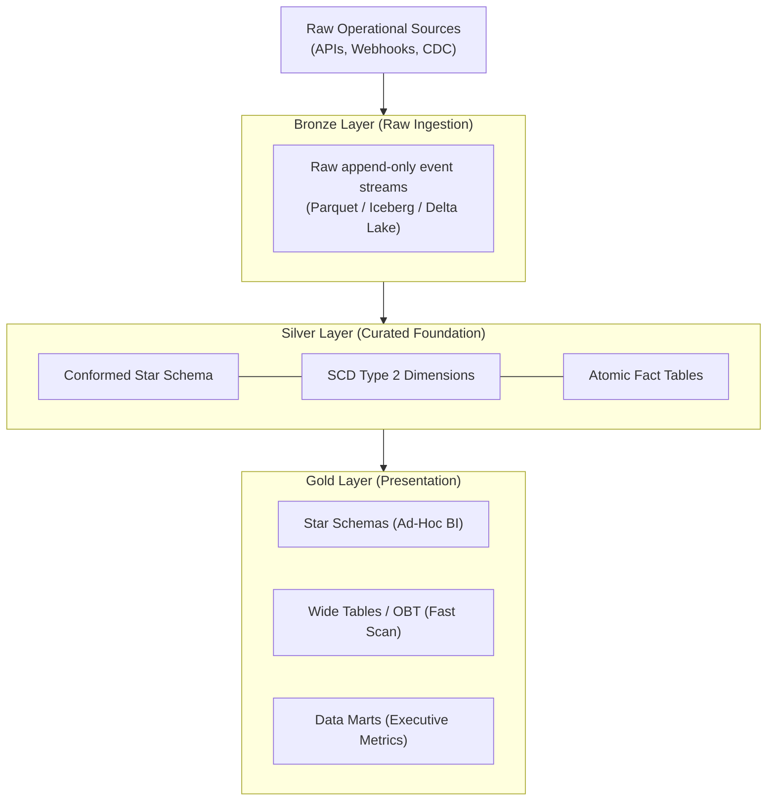

# Schema architectures

## Overview

In analytical database design (OLAP) and data warehousing, choosing an
appropriate schema architecture determines query efficiency, storage
costs, and data model maintainability. The three primary schema architectures
occupy distinct positions along the normalization versus denormalization
spectrum:

1. **Star schema**: denormalized dimension tables surrounding a central
   normalized fact table.
2. **Snowflake schema**: normalized dimension hierarchies in Third Normal Form
   surrounding a central fact table.
3. **Wide denormalized tables**: fully denormalized single tables combining
   measurements and all descriptive attributes into one flat structure.



Each architecture offers distinct trade-offs between join complexity, storage
compression efficiency, update mechanics, and enterprise governance.

## Star schema

The star schema is the foundational design pattern of Ralph Kimball's
dimensional modeling methodology. It organizes analytical data around
discrete business measurement events, cleanly separating numeric facts from
descriptive contextual dimensions.

### Architecture and mechanics

A star schema consists of two distinct table classifications arranged in a
radial pattern:



1. **Central fact table**: a deep, narrow, append-only table recording numeric
   measurements at the lowest atomic grain, such as individual sales invoice
   line items. The fact table contains numeric additive measures (`quantity`,
   `sales_amount`, `cost_amount`) and integer surrogate foreign keys referencing
   the surrounding dimension tables.
2. **Flat dimension tables**: wide tables representing the entities involved in
   the business process, answering who, what, where, when, and why. Natural
   hierarchical relationships are deliberately collapsed into a single record.
   For example, `dim_product` stores the product SKU, brand name, subcategory
   name, and category name directly within the same record, rather than
   splitting them into separate lookup tables.

### Query performance and storage trade-offs

* **Query execution**: analytical queries require only a single level of joins
  (`fact_sales` joined directly to `dim_product` or `dim_customer`). Relational
  query optimizers and massively parallel processing (MPP) engines take
  advantage of star-join heuristics. The engine filters the smaller dimension
  tables first, applies bitmap index intersections on the surrogate keys, and
  probes the large fact table in a single pass.
* **Storage footprint**: repeating textual category and brand names across
  thousands of dimension rows introduces moderate attribute redundancy.
  However, dimension tables typically account for less than 1% to 10% of total
  warehouse storage, while fact tables account for more than 90%. Consequently,
  denormalizing dimension tables introduces a negligible storage cost while
  eliminating join overhead.

## Snowflake schema

The snowflake schema is a variant of the dimensional model where the database
design normalizes dimension hierarchies into relational tables adhering to Third
Normal Form.

### Architecture and mechanics

In a snowflake schema, the central fact table remains identical to its star
schema equivalent, but the surrounding dimensions branch out into secondary
and tertiary lookup structures:



1. **Normalized dimension trees**: rather than storing redundant brand and
   category strings within `dim_product`, the schema extracts attributes into
   dedicated normalized tables. `dim_product` holds a foreign key to
   `dim_brand`, which in turn holds a foreign key to `dim_category`.
2. **Fact table uniformity**: the grain and structure of the central fact table
   remain unchanged. Only the dimensional entities undergo normalization.

### Query performance and storage trade-offs

* **Query execution**: aggregating facts across dimensional hierarchies requires
  multi-level cascading joins. For example, calculating revenue by category
  requires joining `fact_sales` to `dim_product`, then to `dim_brand`, and
  finally to `dim_category`. These cascading joins increase query execution
  plan complexity, degrade interactive dashboard response times, and prevent
  query engines from using star-join bitmap index filters.
* **Storage footprint**: normalizing eliminates repeating text strings in
  dimension tables, reducing raw uncompressed disk usage. However, because
  dimension data represents a tiny fraction of total database volume, the
  storage savings are marginal compared to the operational complexity and
  query degradation introduced.

### Permissible snowflaking for dimension outriggers

Ralph Kimball noted that partial snowflaking is permissible for dimension
outriggers. An outrigger is a secondary dimension joined to a primary
dimension when the secondary attributes represent a distinct grain or update
frequency. Examples include:

* Attaching county-level census demographic data to a `dim_customer` table.
* Attaching dynamic foreign exchange currency conversion rates to an
  international billing dimension.

## Wide denormalized tables

Wide denormalized tables, known as One Big Table or OBT, combine business
measurements with all descriptive attributes into a single flat structure.

The following table illustrates a pre-joined `sales_obt` relation storing
facts alongside dimensional attributes:

| `order_id` | `order_date` | `customer_name` | `city` | `sku` | `brand` | `category` | `quantity` | `sale_amt` |
| :--- | :--- | :--- | :--- | :--- | :--- | :--- | :--- | :--- |
| 1001 | 2026-01-15 | Alice Smith | New York | P-100 | Apex | Audio | 2 | 120.00 |
| 1002 | 2026-01-15 | Bob Jones | Chicago | P-200 | Nova | Display | 1 | 350.00 |
| 1003 | 2026-01-16 | Charlie Brown | Dallas | P-100 | Apex | Audio | 1 | 60.00 |

OBT has gained widespread adoption alongside modern cloud columnar data
platforms including BigQuery, ClickHouse, Databricks, and Snowflake.

### Architecture and mechanics

1. **Pre-joined records at transformation time**: data transformation
   pipelines using tools such as dbt or SQLMesh join transactional events with
   all dimension attributes during batch or streaming loads. The resulting
   table contains dozens, hundreds, or thousands of columns.
2. **Semi-structured data support**: modern columnar formats such as Parquet
   and ORC allow wide tables to store nested arrays and JSON structs.
   Transformation pipelines store multi-line transactional orders as repeated
   nested records within a single parent order row, eliminating junction tables
   entirely.
3. **Columnar storage alignment**: because columnar database engines store and
   compress each column separately on disk, a query scanning three columns in a
   200-column table bypasses the remaining omitted columns completely.

### Query performance and storage trade-offs

* **Query execution**: analytical queries run without table joins. This design
  eliminates CPU-intensive hash join operations and avoids distributed network
  shuffle bottlenecks (`ShuffleHashJoin`) across worker nodes.
* **Storage footprint and compression**: while raw uncompressed data exhibits
  redundancy, columnar storage engines compress repetitive, sorted values with
  high efficiency using run-length encoding and dictionary encoding. Sparse
  columns containing null values require almost no physical disk space.

## Architectural comparison matrix

The following table summarizes the structural, operational, and performance
characteristics of the three schema architectures:

| Architectural Dimension | Star Schema | Snowflake Schema | Wide denormalized table (OBT) |
| :--- | :--- | :--- | :--- |
| **Normalization level** | Normalized fact, denormalized dimensions | Normalized fact, 3NF normalized dimensions | Fully denormalized flat table |
| **Join complexity** | Single-level joins between fact and dimensions | Multi-level cascading joins | Zero joins because all columns are pre-joined |
| **Query scan latency** | Fast through star-join optimizations and bitmap indexes | Moderate to slow due to join overhead and optimizer traps | Fast scan and filter performance |
| **Storage consumption** | Balanced with slight dimension redundancy | Lowest raw storage footprint | High raw redundancy, but compressed efficiently in columnar formats |
| **Data pipeline cost** | Moderate because surrogate keys and dimensions require maintenance | Complex due to hierarchical key management and sequencing | High compute cost at write and build time |
| **SCD and update handling** | Clean support for Type 1, Type 2, and Type 3 SCDs | Clean because updates occur in isolated lookup tables | Complex because mutating dimension values requires rewriting fact rows |
| **Enterprise governance** | High with reusable conformed dimensions across a bus matrix | High with centralized relational integrity | Moderate to low because isolated tables risk metric drift |
| **Primary target workload** | Enterprise data warehouses and BI self-service | Secondary outrigger tables and specialized master data | High-concurrency dashboards, customer APIs, and ML feature tables |

## Practical case study: E-commerce analytics

To evaluate the mechanical differences among the three architectures, consider
an e-commerce sales reporting scenario. The analytical workload requires
calculating total revenue by product category for sales occurring in 2026.

### 1. Star schema implementation

The star schema flattens product hierarchies into `dim_product_star`.

#### Data definition language

```sql
-- Star Schema: Denormalized Dimension Tables
CREATE TABLE dim_product_star (
    product_key   INT PRIMARY KEY,
    sku           VARCHAR(20) NOT NULL,
    product_name  VARCHAR(100) NOT NULL,
    brand_name    VARCHAR(50) NOT NULL,
    category_name VARCHAR(50) NOT NULL
);

CREATE TABLE dim_customer_star (
    customer_key  INT PRIMARY KEY,
    customer_id   INT NOT NULL,
    customer_name VARCHAR(100) NOT NULL,
    city          VARCHAR(50) NOT NULL,
    state         VARCHAR(50) NOT NULL
);

-- Star Schema: Central Fact Table
CREATE TABLE fact_sales_star (
    order_id      BIGINT NOT NULL,
    date_key      INT NOT NULL,
    product_key   INT NOT NULL REFERENCES dim_product_star(product_key),
    customer_key  INT NOT NULL REFERENCES dim_customer_star(customer_key),
    quantity      INT NOT NULL,
    sales_amount  DECIMAL(10, 2) NOT NULL
);
```

#### Sample records

```sql
INSERT INTO dim_product_star VALUES
(1, 'SKU-001', 'Noise-Cancelling Headphones', 'AcousticPro', 'Audio'),
(2, 'SKU-002', 'Wireless Earbuds',             'AcousticPro', 'Audio'),
(3, 'SKU-003', '4K Ultra-Wide Monitor',        'ViewSonic',   'Display');

INSERT INTO dim_customer_star VALUES
(101, 5001, 'Alice Smith', 'Seattle', 'WA'),
(102, 5002, 'Bob Jones',   'Austin',  'TX');

INSERT INTO fact_sales_star VALUES
(9001, 20260115, 1, 101, 2, 300.00),
(9002, 20260116, 2, 102, 1, 150.00),
(9003, 20260118, 3, 101, 1, 450.00);
```

#### Analytical query

```sql
-- Star Schema: Single-level join
SELECT
    p.category_name,
    SUM(f.sales_amount) AS total_revenue
FROM fact_sales_star AS f
JOIN dim_product_star AS p
    ON f.product_key = p.product_key
WHERE f.date_key >= 20260101
GROUP BY p.category_name
ORDER BY total_revenue DESC;
```

#### Query result

| `category_name` | `total_revenue` |
| :--- | :--- |
| Audio | 450.00 |
| Display | 450.00 |

### 2. Snowflake schema implementation

The snowflake schema normalizes categories and brands into dedicated lookup
tables.

#### Data definition language

```sql
-- Snowflake Schema: Normalized Dimension Tables
CREATE TABLE dim_category_snow (
    category_id   INT PRIMARY KEY,
    category_name VARCHAR(50) NOT NULL
);

CREATE TABLE dim_brand_snow (
    brand_id      INT PRIMARY KEY,
    brand_name    VARCHAR(50) NOT NULL,
    category_id   INT NOT NULL REFERENCES dim_category_snow(category_id)
);

CREATE TABLE dim_product_snow (
    product_key   INT PRIMARY KEY,
    sku           VARCHAR(20) NOT NULL,
    product_name  VARCHAR(100) NOT NULL,
    brand_id      INT NOT NULL REFERENCES dim_brand_snow(brand_id)
);

-- Snowflake Schema: Central Fact Table
CREATE TABLE fact_sales_snow (
    order_id      BIGINT NOT NULL,
    date_key      INT NOT NULL,
    product_key   INT NOT NULL REFERENCES dim_product_snow(product_key),
    quantity      INT NOT NULL,
    sales_amount  DECIMAL(10, 2) NOT NULL
);
```

#### Sample records

```sql
INSERT INTO dim_category_snow VALUES
(10, 'Audio'),
(20, 'Display');

INSERT INTO dim_brand_snow VALUES
(100, 'AcousticPro', 10),
(200, 'ViewSonic',   20);

INSERT INTO dim_product_snow VALUES
(1, 'SKU-001', 'Noise-Cancelling Headphones', 100),
(2, 'SKU-002', 'Wireless Earbuds',             100),
(3, 'SKU-003', '4K Ultra-Wide Monitor',        200);

INSERT INTO fact_sales_snow VALUES
(9001, 20260115, 1, 2, 300.00),
(9002, 20260116, 2, 1, 150.00),
(9003, 20260118, 3, 1, 450.00);
```

#### Analytical query

```sql
-- Snowflake Schema: Multi-level cascading join
SELECT
    c.category_name,
    SUM(f.sales_amount) AS total_revenue
FROM fact_sales_snow AS f
JOIN dim_product_snow AS p
    ON f.product_key = p.product_key
JOIN dim_brand_snow AS b
    ON p.brand_id = b.brand_id
JOIN dim_category_snow AS c
    ON b.category_id = c.category_id
WHERE f.date_key >= 20260101
GROUP BY c.category_name
ORDER BY total_revenue DESC;
```

#### Query result

| `category_name` | `total_revenue` |
| :--- | :--- |
| Audio | 450.00 |
| Display | 450.00 |

### 3. Wide denormalized table implementation

The wide table pattern flattens all product and customer attributes into a
single table at load time.

#### Data definition language

```sql
-- Wide Denormalized Table (Columnar Table)
CREATE TABLE sales_obt (
    order_id        BIGINT NOT NULL,
    order_date      DATE NOT NULL,
    customer_id     INT NOT NULL,
    customer_name   VARCHAR(100) NOT NULL,
    city            VARCHAR(50) NOT NULL,
    state           VARCHAR(50) NOT NULL,
    product_sku     VARCHAR(20) NOT NULL,
    product_name    VARCHAR(100) NOT NULL,
    brand_name      VARCHAR(50) NOT NULL,
    category_name   VARCHAR(50) NOT NULL,
    quantity        INT NOT NULL,
    sales_amount    DECIMAL(10, 2) NOT NULL
);
```

#### Sample records

```sql
INSERT INTO sales_obt VALUES
(9001, '2026-01-15', 5001, 'Alice Smith', 'Seattle', 'WA', 'SKU-001', 'Noise-Cancelling Headphones', 'AcousticPro', 'Audio',   2, 300.00),
(9002, '2026-01-16', 5002, 'Bob Jones',   'Austin',  'TX', 'SKU-002', 'Wireless Earbuds',             'AcousticPro', 'Audio',   1, 150.00),
(9003, '2026-01-18', 5001, 'Alice Smith', 'Seattle', 'WA', 'SKU-003', '4K Ultra-Wide Monitor',        'ViewSonic',   'Display', 1, 450.00);
```

#### Analytical query

```sql
-- Wide Denormalized Table: Direct columnar scan with zero joins
SELECT
    category_name,
    SUM(sales_amount) AS total_revenue
FROM sales_obt
WHERE order_date >= '2026-01-01'
GROUP BY category_name
ORDER BY total_revenue DESC;
```

#### Query result

| `category_name` | `total_revenue` |
| :--- | :--- |
| Audio | 450.00 |
| Display | 450.00 |

All three queries produce identical business results. However, the query
optimizer pathways, execution overhead, and storage profiles differ
substantially.

## Common pitfalls

### The disk space illusion of snowflaking

Engineers accustomed to online transaction processing (OLTP) normalization
frequently normalize dimensional structures to eliminate attribute repetition.
However, because dimension tables typically constitute less than 5% of
warehouse storage, normalizing them saves minimal disk capacity.

In return, normalizing degrades dimension navigation, forces complex SQL
queries with multiple joins, and prevents the query engine from applying
star-join bitmap filters across low-cardinality attributes.

### Network shuffle overhead in distributed clusters

In distributed query engines including Apache Spark, Trino, and Presto, joining
fact tables to normalized dimension tables requires moving data across worker
nodes:

* **Broadcast join**: if a dimension table is small enough to fit within an
  individual worker node memory, the engine broadcasts it to all workers,
  executing the join locally.
* **Shuffle hash join**: when normalized dimension trees or large lookup tables
  exceed the broadcast threshold, the distributed engine must partition and
  rehash both datasets across cluster network switches (`ShuffleHashJoin`).

Cascading snowflake joins multiply the probability of network shuffle
bottlenecks, significantly increasing query execution latency.

### Slowly changing dimension update bottlenecks in wide tables

Updating dimension attributes or tracking historical versions through SCD
Type 2 creates severe write amplification in wide tables:

* **Star schema update**: if a customer changes their delivery address, the
  data warehouse updates or inserts a single row in `dim_customer`. Existing
  historical fact rows remain untouched.
* **Wide table update**: in a wide table containing 500 million records,
  updating a single customer attribute forces the engine to rewrite or merge
  millions of historical transaction records across physical storage files.

Wide tables should represent finalized, immutable measurement events, or be
rebuilt as downstream materialized projections.

### Loss of conformed dimensions and metric drift

When independent business units construct isolated wide tables without a
shared enterprise data bus, dimensional consistency degrades:

* The marketing team defines `customer_segment` based on email engagement.
* The finance team defines `customer_segment` based on lifetime invoiced revenue.

Without Kimball's conformed dimensions, different departments generate
conflicting business metrics from separate wide tables, undermining data trust
across the organization.

### Storage engine mismatch between row and column stores

Deploying wide denormalized tables on traditional row-oriented relational
engines such as PostgreSQL or MySQL creates severe performance bottlenecks:

* **Row-oriented engines**: storage engines read entire data rows off physical
  disk pages into the buffer pool cache. Querying two columns from a 150-column
  table loads all 150 columns into memory, causing disk I/O thrashing and memory
  saturation.
* **Column-oriented engines**: formats such as Parquet, ORC, and cloud columnar
  tables read only the byte ranges corresponding to requested columns, ignoring
  unselected attributes entirely.

Data teams must restrict wide denormalized tables to column-oriented
architectures.

## Modern lakehouse and medallion convergence

Modern cloud data platforms reconcile these three architectures within a
layered medallion framework, combining the strengths of each pattern:



### Architectural roles across layers

1. **Bronze raw ingestion layer**: captures raw, immutable event feeds and
   change data capture streams without schema modification.
2. **Silver curated foundation layer**: models enterprise data using a conformed
   star schema. This layer manages surrogate keys, tracks historical attribute
   mutations using SCD Type 2, and enforces enterprise consistency across the
   Kimball bus matrix.
3. **Gold presentation layer**: exposes specialized consumption structures:
   * **Star schemas**: provided for interactive SQL analysts requiring flexible
     drill-down across conformed dimensions.
   * **Wide denormalized tables**: generated as transformed models through dbt
     or materialized views to power high-speed customer-facing dashboards,
     sub-second API endpoints, and machine learning feature stores.

## Key takeaways

* Star schemas balance query speed and simplicity by pairing atomic fact tables with denormalized dimensions for single-level joins and star-join optimizations.
* Snowflake schemas eliminate redundant dimension strings at the cost of cascading joins, complex query planning, and deactivated bitmap index pruning.
* Restrict snowflake normalization to dimension outriggers where secondary attributes represent distinct grains or update frequencies.
* Wide denormalized tables, known as One Big Table, eliminate query joins completely, maximizing scan and filter speeds in modern columnar platforms.
* Deploy wide tables exclusively on column-oriented engines to avoid the severe memory and disk I/O thrashing inherent to wide row-store tables.
* Avoid tracking frequent Slowly Changing Dimension updates directly in wide tables to prevent massive write amplification and file partition rewrites.
* Combine all three architectures within a medallion lakehouse: raw event logs in Bronze, conformed star schemas in Silver, and dual star schema and OBT presentations in Gold.
