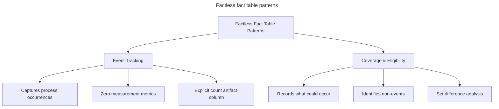
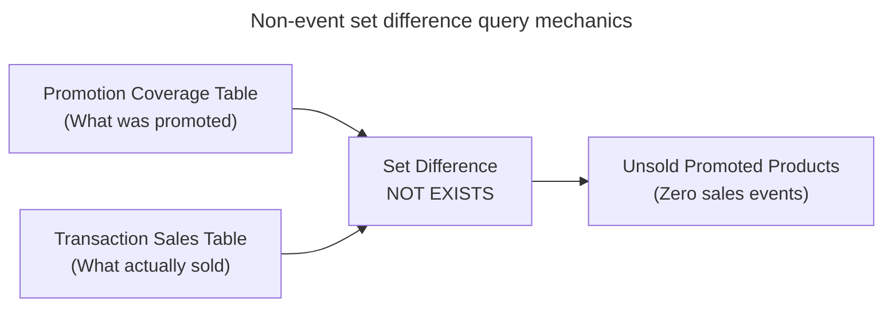
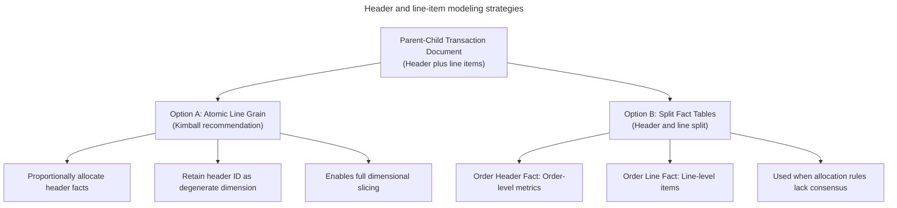

# Specialized fact table designs

## Overview

Specialized fact table designs extend foundational dimensional modeling to
address complex real-world operational scenarios. These scenarios include
recording events that produce no numeric metrics, managing multi-level
parent-child business documents, and preserving strict grain consistency across
analytical reporting layers.

While standard transaction fact tables capture numeric measures alongside
foreign keys, enterprise processes frequently require capturing interactions,
eligibility conditions, and multi-tiered document hierarchies that fall outside
standard measurement schemas.



## Factless fact tables

A factless fact table contains no numeric measurement metrics, such as sales
revenue, unit cost, or quantity ordered. Instead, it consists entirely of
composite foreign keys referencing participating dimension tables. Its purpose
is to record the logical association or collision of dimensions at a specific
point in time and space.

Factless fact tables fall into two primary architectural patterns: event
tracking tables and coverage tables.

### Event tracking factless tables

Event tracking factless tables record the occurrence of an event involving
multiple business entities where the process produces no numeric measurement.

#### Typical operational examples

- University student course registrations linking student, course, term, and
  instructor.
- Classroom employee attendance tracking linking employee, facility, and date.
- Hospital patient admissions linking patient, clinic, physician, and date.
- Safety incident reports linking facility, equipment, operator, and date.

#### Architectural design pattern

The table structure consists of foreign keys referencing each participating
dimension:

```sql
CREATE TABLE factless_student_registration (
    term_key           INT NOT NULL REFERENCES dim_term(term_key),
    student_key        INT NOT NULL REFERENCES dim_student(student_key),
    course_key         INT NOT NULL REFERENCES dim_course(course_key),
    instructor_key     INT NOT NULL REFERENCES dim_instructor(instructor_key),
    registration_count INT NOT NULL DEFAULT 1,
    PRIMARY KEY (term_key, student_key, course_key)
);
```

#### The count artifact column

To simplify SQL queries and support straightforward aggregations in business
intelligence tools, designers frequently include an explicit integer column
assigned the constant value `1`, including `registration_count = 1` or
`event_count = 1`.

This artifact column allows business analysts to calculate total event volumes
using standard `SUM(registration_count)` queries rather than ambiguous
`COUNT(student_key)` or computationally expensive `COUNT(DISTINCT student_key)`
queries.

### Coverage and non-event factless tables

Coverage factless tables record relationships that could or should occur,
enabling data teams to discover activity that never occurred.

#### Typical operational examples

- Products placed on active promotion in retail stores across specific calendar
  dates.
- Sales representative territory assignments defining regional coverage.
- Facility room reservation schedules recording booking availability.

#### Query mechanics for non-event analysis

Standard transactional sales fact tables record rows only when an event
occurs. If a product on promotion fails to sell, a transaction fact table writes
no row for that item.

To identify promoted products that generated zero sales, analytical queries
perform a set difference between the promotion coverage table and the
transaction sales table using a `NOT EXISTS` clause or a `LEFT JOIN ... WHERE
sales.key IS NULL` condition:



## Header and line-item fact models

Operational source systems frequently generate parent-child transaction
documents, such as sales orders, warehouse shipments, and purchase
requisitions. These source documents combine header-level attributes and
measures with line-item-level attributes and measures:

- **Header attributes and metrics**: order date, customer identifier, payment
  method, overall freight shipping fee, and order-level sales tax.
- **Line-item attributes and metrics**: product SKU, unit price, ordered
  quantity, discount percentage, and extended net amount.



### Option A - line-item grain with allocated header facts

Option A is the preferred dimensional modeling strategy recommended by Ralph
Kimball.

#### Mechanics

1. **Atomic line-item grain**: the parent-child document collapses into a single
   fact table declared at the atomic line-item grain.
2. **Proportional header allocation**: the data pipeline pushes down and
   proportionally allocates header-level metrics (such as freight, shipping
   charges, or order-level taxes) to individual line items based on a clear
   business weighting metric, such as line-item extended dollar value, physical
   weight, or unit quantity.
3. **Degenerate dimensions**: operational control numbers, such as
   `order_number` or `invoice_number`, reside directly in the fact table row as
   degenerate dimensions without referencing a separate dimension table. This
   preserves document line groupings for downstream reporting.

#### Advantages

Allocating header costs down to the line-item level allows business users to
slice and dice all financial metrics—including shipping costs and net
profit—across all dimensions such as product category and brand.

### Option B - separate header and line-item fact tables

If organizational stakeholders fail to reach agreement on a rational formula to
allocate header charges down to line items, the data architecture must maintain
two distinct fact tables:

1. **Order header fact table**: declared at the grain of one row per order. It
   contains customer, date, shipping charges, and total tax, but excludes the
   `product_key`.
2. **Order line-item fact table**: declared at the grain of one row per line item.
   It contains product references, quantities, and extended net amounts, but
   excludes unallocated header metrics.

#### Trade-offs

This design introduces analytical limitations. Analysts are unable to evaluate
product profitability because shipping costs reside exclusively in the parent
header table, disconnected from individual product keys.

## Grain definition consistency

Declaring the grain is the critical second step in Kimball's four-step
dimensional design process. The grain is the binding contractual declaration of
what an individual fact table row represents.

### Core rules for maintaining grain consistency

1. **Uniform fact granularity**: every numeric metric stored in a row must
   strictly represent the declared grain. Storing order-level summary totals,
   such as unallocated header shipping costs, in an atomic line-item fact row
   violates grain consistency. When queried across date intervals or store
   hierarchies, standard SQL `SUM()` aggregations overcount higher-level facts
   by the number of line items, generating inflated totals.
2. **Uniform dimension granularity**: every foreign key in the fact table must
   take on a single, discrete value for each measurement event. If adding a new
   dimension attribute introduces multiple values for a single measurement event,
   the designer must either re-declare the fact table grain at a lower level or
   extract the multi-valued attribute into a separate bridge table.
3. **Atomic data focus**: dimensional models must store data at the lowest,
   most atomic level of detail captured by the operational source process. Atomic
   data provides resilience against unanticipated ad-hoc queries.

## Comprehensive implementation and schema definitions

The following PostgreSQL schema implements an allocated line-item order fact
table, a promotion coverage factless table, and an event tracking factless table
within a unified retail model:

### Schema definitions

```sql
-- 1. Line-Item Order Fact Table
-- Header Facts Allocated + Degenerate Dimensions
-- Declared Grain: One row per order line item
CREATE TABLE fact_order_line (
    order_number            VARCHAR(30)   NOT NULL, -- Degenerate Dimension
    order_line_number       INT           NOT NULL, -- Degenerate Dimension
    order_date_key          INT           NOT NULL REFERENCES dim_date(date_key),
    customer_key            INT           NOT NULL REFERENCES dim_customer(customer_key),
    product_key             INT           NOT NULL REFERENCES dim_product(product_key),
    promotion_key           INT           NOT NULL REFERENCES dim_promotion(promotion_key),
    
    -- Atomic Line-Item Facts
    order_quantity          INT           NOT NULL,
    extended_net_amount     DECIMAL(10, 2) NOT NULL,
    
    -- Proportionally Allocated Header Fact
    allocated_shipping_cost DECIMAL(10, 2) NOT NULL,
    
    PRIMARY KEY (order_number, order_line_number)
);

-- 2. Promotion Coverage Factless Fact Table
-- Declared Grain: One row per product on active promotion per store per date
CREATE TABLE factless_promotion_coverage (
    date_key                INT           NOT NULL REFERENCES dim_date(date_key),
    store_key               INT           NOT NULL REFERENCES dim_store(store_key),
    product_key             INT           NOT NULL REFERENCES dim_product(product_key),
    promotion_key           INT           NOT NULL REFERENCES dim_promotion(promotion_key),
    
    PRIMARY KEY (date_key, store_key, product_key, promotion_key)
);

-- 3. Student Registration Event Factless Fact Table
-- Declared Grain: One row per student course registration per term
CREATE TABLE factless_student_registration (
    term_key                INT           NOT NULL REFERENCES dim_term(term_key),
    student_key             INT           NOT NULL REFERENCES dim_student(student_key),
    course_key              INT           NOT NULL REFERENCES dim_course(course_key),
    instructor_key          INT           NOT NULL REFERENCES dim_instructor(instructor_key),
    
    -- Constant Artifact Column for Explicit SQL Aggregations
    registration_count      INT           NOT NULL DEFAULT 1,
    
    PRIMARY KEY (term_key, student_key, course_key)
);
```

### Non-event analysis query

The following analytical query identifies products on active promotion on
October 15, 2026, that recorded zero transaction sales:

```sql
-- Identify promoted products that generated zero sales on a specific date
SELECT 
    p.product_name,
    pr.promotion_name
FROM factless_promotion_coverage AS cov
JOIN dim_product AS p
    ON cov.product_key = p.product_key
JOIN dim_promotion AS pr
    ON cov.promotion_key = pr.promotion_key
WHERE cov.date_key = 20261015
  AND NOT EXISTS (
      -- Verify whether transactions exist for this product and promotion
      SELECT 1 
      FROM fact_order_line AS sales
      WHERE sales.product_key = cov.product_key
        AND sales.promotion_key = cov.promotion_key
        AND sales.order_date_key = cov.date_key
  );
```

## Common pitfalls

### Grain mismatch and overcounting errors

Placing unallocated header-level facts, such as full order shipping charges,
directly into atomic line-item rows creates severe overcounting errors.

If an order contains five distinct line items and a \$50 shipping fee, storing
\$50 on every line results in a calculated shipping cost of \$250 when an analyst
runs a standard `SUM(shipping_fee)` query. Header metrics must always be
proportionally allocated or maintained in a separate header-grain fact table.

### Unsanctioned allocation rules and governance disputes

When data engineering teams arbitrarily invent allocation formulas without
formal business approval, financial reporting discrepancies inevitably trigger
disputes between department leaders.

Allocation rules must be formally owned, documented, and approved by finance or
executive leadership before implementation in automated transformation
pipelines.

### Explicit row generation for non-events in transaction tables

Attempting to track non-events by inserting explicit zero-value rows, such as
`order_quantity = 0`, into a standard transaction fact table introduces massive
storage bloat.

Because transaction tables are sparse, populating zero-activity rows across
every possible product, store, and date combination causes table volume to
expand exponentially. Non-event analysis must rely on coverage factless tables
and set difference queries rather than synthetic zero-value event records.

### Ambiguous aggregation queries on factless tables

Analysts querying factless tables without an explicit count column often confuse
`COUNT(student_key)` with `COUNT(DISTINCT student_key)`.

In an event factless table where students register for multiple courses,
`COUNT(student_key)` calculates total course enrollments, while
`COUNT(DISTINCT student_key)` calculates the number of unique participating
students. Populating an explicit `registration_count = 1` column clarifies query
intent and enables unambiguous `SUM(registration_count)` calculations across
reporting dashboards.

## Key takeaways

- Use event tracking factless fact tables to record dimension associations that produce no numerical measures.
- Include an explicit count column assigned the constant integer `1` in event factless tables to enable simple and unambiguous `SUM()` aggregations.
- Use coverage factless tables to record the universe of active conditions or promotions, enabling non-event discovery through set difference queries against transaction tables.
- Flatten parent-child transaction documents to atomic line-item grain by proportionally allocating header-level charges based on explicit business weighting factors.
- Retain operational document identifiers as degenerate dimensions directly inside line-item fact tables without creating unnecessary physical dimension tables.
- Maintain strict grain consistency by ensuring every fact and foreign key aligns with the declared level of detail, never mixing header totals into atomic lines.
- Require finance or executive leadership to define and approve allocation formulas before implementing them in transformation pipelines.
