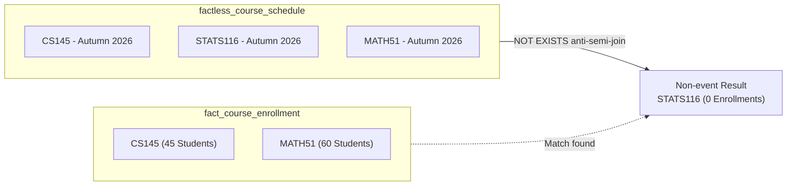

# Specialized fact designs

Specialized fact table designs extend dimensional modeling to handle complex
analytical patterns that standard transaction fact tables don't represent
directly. These patterns include recording interactions that produce no numeric
metrics, managing parent-child operational documents such as invoices, and
discovering activities that failed to occur.

While standard transaction fact tables record numeric measurements such as unit
prices and quantities alongside foreign keys, enterprise workflows frequently
require tracking appointments, course schedules, or multi-tiered documents.
Applying specialized fact designs helps you capture these events while
preserving strict grain consistency and preventing reporting errors.

## When to use specialized fact patterns

Use the following decision matrix to choose the appropriate specialized fact
table pattern for your data model:

| Pattern | Scenario | Key challenge | Design solution | Analytical trade-off |
| :--- | :--- | :--- | :--- | :--- |
| **Event tracking `factless` table** | Student advising sessions, course attendance | The interaction produces no direct numeric measurement | Combine foreign keys with a constant counter column, such as `event_count = 1` | Queries compute volumes by summing the counter rather than counting keys |
| **Coverage `factless` table** | Scheduled course offerings, room reservations | Need to detect non-events, such as scheduled courses with zero enrollments | Record the universe of scheduled conditions across dimensions | Requires set difference queries with `NOT EXISTS` against transaction tables |
| **Allocated line-item fact table** | Student tuition invoices with general campus fees | Parent documents contain metrics at both header and line-item levels | Allocate header fees down to individual line items using a business formula | Requires agreed-upon allocation rules among stakeholders |
| **Separate header and line-item tables** | Financial billing where legal rules prohibit allocation | Stakeholders don't agree on an allocation formula | Build two distinct fact tables: one at header grain, one at line grain | Users can't slice header fees by line-item dimensions, such as course |

## `Factless` fact tables

A `factless` fact table contains foreign keys that reference participating
dimension tables, but contains no independent numeric measurement metrics. The
table captures the relationship or collision among business entities at a
specific point in time.

Dimensional architectures use two distinct types of `factless` fact tables:
event tracking tables and coverage tables.

### Event tracking tables

Event tracking tables record occurrences where the event itself is the metric.

Consider student academic advising sessions at Stanford University. When a
student meets with an academic advisor, the interaction involves several
entities: the student, the faculty advisor, the academic department, and the
appointment date. The meeting produces no direct numerical metric such as dollar
amounts or hours billed, yet university leaders need to analyze advising
frequencies across departments and student cohorts.

#### Design pattern

The table structure consists of foreign keys linking to each participating
dimension:

```sql
CREATE TABLE factless_advising_session (
    advising_session_key INT NOT NULL,
    date_key             INT NOT NULL REFERENCES dim_date(date_key),
    student_key          INT NOT NULL REFERENCES dim_student(student_key),
    advisor_key          INT NOT NULL REFERENCES dim_instructor(instructor_key),
    department_key       INT NOT NULL REFERENCES dim_department(department_key),
    session_count        INT NOT NULL DEFAULT 1,
    PRIMARY KEY (advising_session_key)
);
```

#### The count artifact column

To simplify queries in business intelligence tools, include an explicit integer
column assigned the constant value `1`, such as `session_count = 1` or
`event_count = 1`.

This column lets analysts calculate total event volumes using standard
`SUM(session_count)` queries. Relying on `COUNT(student_key)` or
`COUNT(DISTINCT student_key)` can produce unexpected results:

- `COUNT(student_key)` counts rows, but if an outer join introduces null values,
  it excludes those records or misleads report builders.
- `COUNT(DISTINCT student_key)` calculates the number of unique participating
  students rather than the total number of advising sessions.
- In distributed analytical engines, `SUM()` operations run as fast, streaming
  aggregations, whereas `COUNT(DISTINCT)` requires expensive global shuffle
  operations.

### Coverage and non-event tables

Standard transaction fact tables record rows only when an event occurs. If the
university schedules a course for the Autumn quarter but no students register
for it, a transactional registration table contains no record for that course.

To identify what failed to happen, you must use a coverage table. A coverage
`factless` table records the complete universe of planned or possible events.

In the Stanford University scenario, the registrar publishes a master course
schedule before registration opens. The coverage table records every course
offering assigned to a classroom, an instructor, and a term:

```sql
CREATE TABLE factless_course_schedule (
    schedule_key   INT NOT NULL,
    term_key       INT NOT NULL REFERENCES dim_term(term_key),
    course_key     INT NOT NULL REFERENCES dim_course(course_key),
    instructor_key INT NOT NULL REFERENCES dim_instructor(instructor_key),
    classroom_key  INT NOT NULL REFERENCES dim_classroom(classroom_key),
    PRIMARY KEY (schedule_key)
);
```

#### Query non-events with anti-joins

To identify courses that received zero student registrations, compare the
coverage schedule table against the transactional course enrollment table using a
set difference query.

The following Mermaid diagram shows how the query engine isolates non-events by
comparing the scheduled coverage against recorded enrollments:



## Header and line-item models

Operational source systems frequently generate parent-child transaction
documents, such as student tuition invoices, laboratory supply purchase orders,
and research grant expense sheets. These documents group metrics at two distinct
levels:

- Header metrics include total invoice balance, campus health service fees, student
  union facility fees, and overall technology charges.
- Line-item metrics include specific enrolled course tuition fees, course credit
  units, lab material fees, and course-level fee discounts.

Ralph `Kimball` outlines two primary approaches for modeling parent-child
transactions: line-item grain with allocated parent metrics, and separate
fact tables.

### Line-item grain with allocated parent metrics

The primary method collapses the entire transaction document into a single fact
table declared at the atomic line-item grain.

#### Tuition allocation methods

When you declare the grain as one row per document line item, you can't place
unallocated header fees directly into the line rows. Instead, you must allocate
header fees down to each line item using an explicit business weighting metric,
such as course credit units, or line tuition amounts.

Consider a Stanford student tuition invoice:

- Total campus health service fee at header level: \$600.00
- Course 1, CS145: 4 credit units
- Course 2, STATS116: 3 credit units
- Course 3, ENGR10: 3 credit units
- Total registered units: 10 credit units

The data pipeline calculates the proportional fee allocation for each line:

$$\text{Allocated Fee} = \text{Header Fee} \times \left( \frac{\text{Line Credit Units}}{\text{Total Credit Units}} \right)$$

Applying this formula assigns:

- CS145 receives $600 \times (4 / 10) = \$240.00$
- STATS116 receives $600 \times (3 / 10) = \$180.00$
- ENGR10 receives $600 \times (3 / 10) = \$180.00$

#### Degenerate dimensions

The document identifier, such as `invoice_number`, stays directly in the fact
table without linking to a separate dimension table. In dimensional modeling,
architects call this attribute a degenerate dimension. It acts as an operational
grouping key, allowing queries and reporting tools to reconstruct the original
invoice document without requiring an extra join.

### Separate header and line-item tables

If university finance leaders don't agree on an allocation rule, you must build
two separate fact tables:

1. `fact_tuition_invoice_header`: declared at the grain of one row per student
   invoice. Contains `student_key`, `date_key`, and the unallocated campus health
   fees.
2. `fact_tuition_invoice_line`: declared at the grain of one row per course line
   item. Contains `course_key`, `credit_units`, and course tuition charges.

#### Trade-offs

Maintaining two tables prevents duplicate metric counting, but restricts
analytical capability. Analysts can't evaluate the total cost or margin of
teaching a specific course or department because campus health fees reside
exclusively in the header table, disconnected from individual course keys.

## Maintain grain consistency

Declaring the grain is the foundational step in dimensional modeling. The grain
defines exactly what a single record in the fact table represents.

To maintain grain consistency across analytical queries:

1. **Every numeric metric must align with the declared grain**. Storing an
   unallocated \$600 header fee across all three course lines violates the grain.
   When an analyst runs a query summing fees across a department, the engine
   sums \$600 three times, returning \$1,800 instead of \$600.
2. **Every foreign key must have a single value per measurement**. If adding a
   dimension introduces multiple values for a single line item, such as multiple
   instructors co-teaching a single course section, extract that relationship
   into a bridge table or adjust the grain declaration.
3. **Store data at the most atomic grain available**. Storing atomic course-line
   data lets you aggregate upward to departments, schools, and academic years
   without losing operational detail.

## Schema implementation for the university scenario

The following schema implements an allocated tuition line fact table, an advising
session tracking table, and a course schedule coverage table.

### Schema definitions

```sql
-- 1. Line-item tuition fact table with allocated header fees
-- Grain: One row per course enrollment line on a student tuition invoice
CREATE TABLE fact_tuition_line_item (
    invoice_number       VARCHAR(32)   NOT NULL, -- Degenerate dimension
    line_number          INT           NOT NULL, -- Degenerate dimension
    invoice_date_key     INT           NOT NULL REFERENCES dim_date(date_key),
    student_key          INT           NOT NULL REFERENCES dim_student(student_key),
    course_key           INT           NOT NULL REFERENCES dim_course(course_key),
    department_key       INT           NOT NULL REFERENCES dim_department(department_key),
    
    -- Atomic line measures
    enrolled_units       INT           NOT NULL,
    course_tuition_fee   DECIMAL(10,2) NOT NULL,
    
    -- Proportionally allocated header fee
    allocated_health_fee DECIMAL(10,2) NOT NULL,
    
    PRIMARY KEY (invoice_number, line_number)
);

-- 2. Course schedule coverage factless table
-- Grain: One row per scheduled course section per term
CREATE TABLE factless_course_schedule (
    schedule_key         INT NOT NULL,
    term_key             INT NOT NULL REFERENCES dim_term(term_key),
    course_key           INT NOT NULL REFERENCES dim_course(course_key),
    instructor_key       INT NOT NULL REFERENCES dim_instructor(instructor_key),
    classroom_key        INT NOT NULL REFERENCES dim_classroom(classroom_key),
    PRIMARY KEY (schedule_key)
);

-- 3. Student enrollment transaction fact table
-- Grain: One row per completed student course registration
CREATE TABLE fact_course_enrollment (
    enrollment_key       INT NOT NULL,
    term_key             INT NOT NULL REFERENCES dim_term(term_key),
    student_key          INT NOT NULL REFERENCES dim_student(student_key),
    course_key           INT NOT NULL REFERENCES dim_course(course_key),
    enrollment_count     INT NOT NULL DEFAULT 1,
    final_grade_points   DECIMAL(3,2),
    PRIMARY KEY (enrollment_key)
);
```

### Query scheduled courses with zero enrollments

The following query identifies courses scheduled for the Autumn 2026 quarter
that received zero student enrollments:

```sql
SELECT 
    c.course_code,
    c.course_title,
    d.department_name
FROM factless_course_schedule AS sched
JOIN dim_course AS c
    ON sched.course_key = c.course_key
JOIN dim_department AS d
    ON c.department_key = d.department_key
WHERE sched.term_key = 202601 -- Autumn 2026
  AND NOT EXISTS (
      -- Check if any student registered for this course offering
      SELECT 1 
      FROM fact_course_enrollment AS enr
      WHERE enr.term_key = sched.term_key
        AND enr.course_key = sched.course_key
  );
```

### Query tuition revenue with allocated fees

The following query calculates total tuition revenue and allocated health fees
grouped by academic department:

```sql
SELECT 
    d.department_name,
    SUM(line.enrolled_units)       AS total_enrolled_units,
    SUM(line.course_tuition_fee)   AS total_tuition_revenue,
    SUM(line.allocated_health_fee) AS total_allocated_health_fees
FROM fact_tuition_line_item AS line
JOIN dim_department AS d
    ON line.department_key = d.department_key
WHERE line.invoice_date_key BETWEEN 20260901 AND 20261231
GROUP BY d.department_name
ORDER BY total_tuition_revenue DESC;
```

## Operational considerations and engine optimization

When implementing specialized fact tables in modern columnar data warehouses
such as BigQuery, consider the following technical factors:

- When processing non-event queries with `NOT EXISTS`, query optimizers execute an
  anti-semi-join. The engine stops scanning the enrollment table upon matching the
  first row for that course, reducing data processing costs.
- Avoid populating synthetic zero rows (such as `enrollment_count = 0`) in
  transaction tables to track non-events. In columnar storage systems, storing
  millions of empty combinations inflates metadata, degrades compression ratios,
  and degrades full-table scan speeds. Use coverage tables instead.
- Data engineering teams must avoid inventing ad hoc fee allocation formulas in
  isolation. Document and verify the allocation methodology with finance and
  registrar stakeholders before coding the transformation logic into your data pipeline.

## Common pitfalls

When designing specialized fact tables, watch for these common mistakes:

### Placing unallocated parent metrics on line items

Duplicating an entire header metric on every line item causes serious metric
inflation. If an invoice with five line items contains a single \$500 fee,
storing \$500 on every row causes `SUM(fee)` queries to calculate \$2,500.
Always allocate header metrics proportionally or maintain a separate
header-grain table.

### Relying on distinct counts for event totals

Omitting a constant count column from `factless` tables encourages analysts to
write `COUNT(DISTINCT student_key)` to calculate event volumes. In a table
tracking multiple advising sessions per student, this counts unique students,
not sessions. Use an explicit `session_count = 1` column to support clean
`SUM()` aggregations.

### Materializing synthetic non-event records

Writing synthetic zero rows into standard event tables causes severe table
bloat. If a university offers 2,000 courses across 50 terms, tracking non-events
by generating empty records for every student-course pair yields hundreds of
millions of unnecessary rows. Always capture non-events through set difference
logic against coverage tables.

### Normalizing degenerate dimensions into separate tables

Extracting control numbers like `invoice_number` into a standalone dimension
table adds join overhead with zero analytical benefit. When an attribute has no
additional context beyond its operational identifier, store it directly in the
fact row as a degenerate dimension.

## What's next

- Explore transaction, periodic snapshot, and accumulating snapshot designs in
  [Fact table design and types](/modeling/fact-table-design-and-types).
- Learn about primary keys, foreign keys, and bridge tables in
  [Dimensional modeling methodology](/modeling/dimensional-modeling-methodology).
- Review SQL join operations and anti-semi-join optimization in
  [Fundamental joins](/sql/fundamental-joins).
