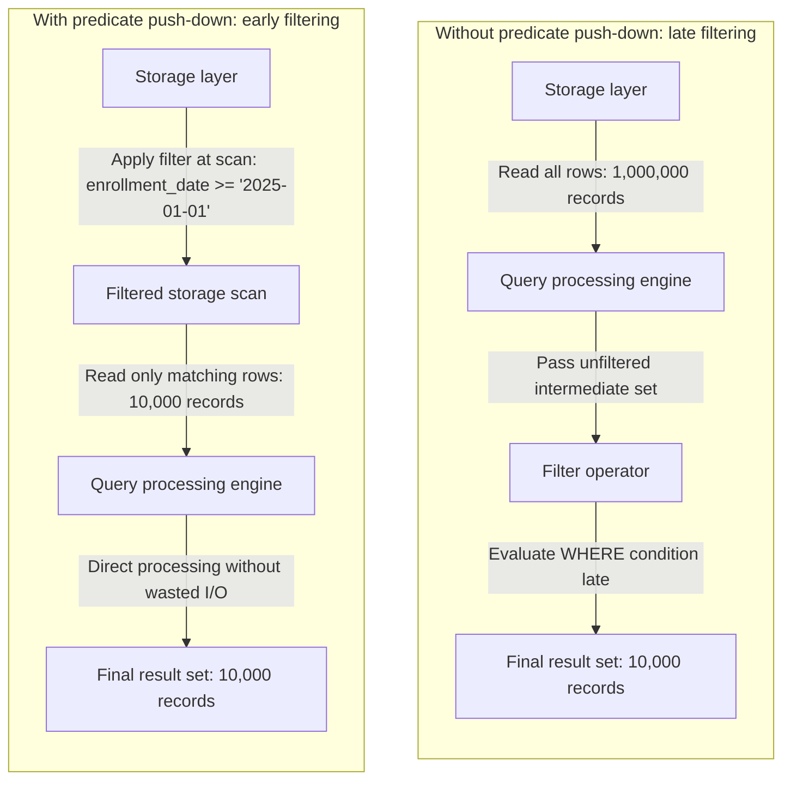
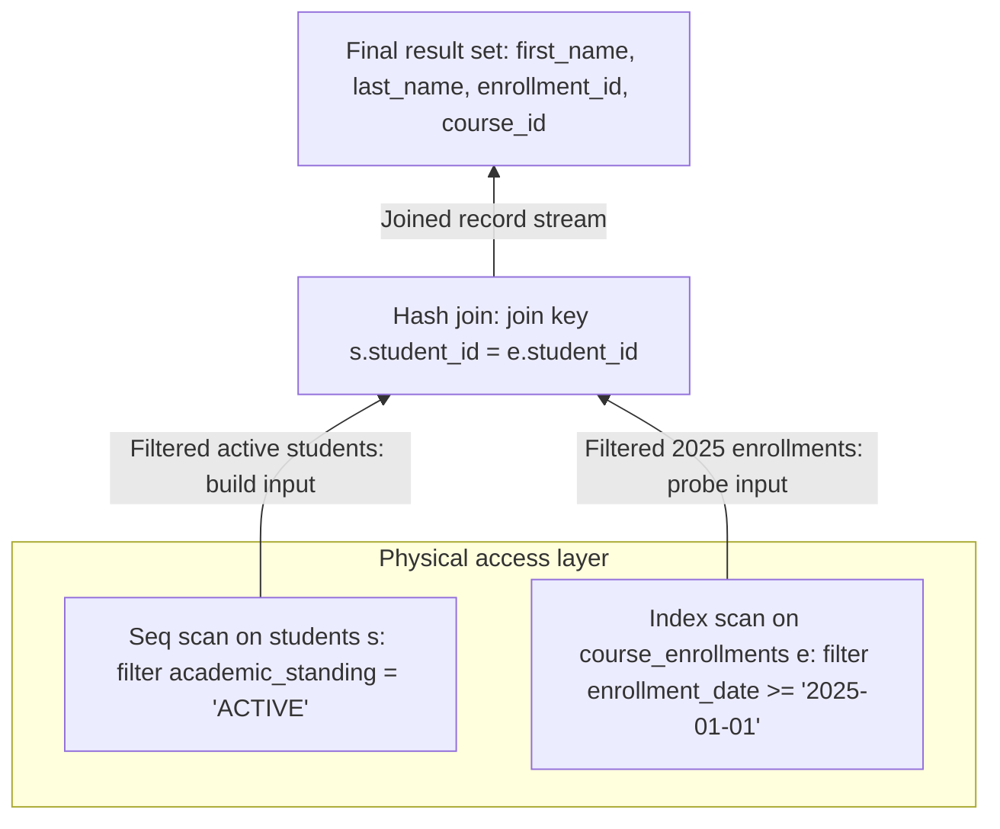

# Advanced query optimization

## Overview

Query optimization transforms a declarative Structured Query Language, or `SQL`,
statement into an efficient physical execution plan. The query optimizer
evaluates alternative access paths, join strategies, and filter placements to
reduce disk I/O, memory consumption, and network traffic.

This guide introduces core optimization mechanisms that govern query performance
in relational database engines using the Stanford University student enrollment
database.

## Predicate push-down

Predicate push-down moves filtering conditions as early as possible in the
execution pipeline. The database applies the filter directly at the storage scan
layer instead of reading and materializing unneeded intermediate rows.



When the database evaluates predicates early, it discards non-matching rows before
constructing large intermediate result sets. This minimizes memory buffer
pressure and eliminates wasted CPU cycles.

### Why predicate push-down matters

Predicate push-down succeeds when the engine can delegate a condition directly
to the underlying storage engine, index scanner, or connector before records
reach the query processing layer.

This optimization pattern accelerates queries with filters such as:

- `WHERE enrollment_date >= '2025-01-01'`
- `WHERE academic_standing = 'ACTIVE'`
- `WHERE department_id = 10`

### Benefits

- Fewer tuples traverse the execution pipeline.
- Lower memory consumption and CPU overhead.
- Reduced data transfer volumes across distributed nodes.
- Improved index scan pruning and partition elimination.

## Index scans compared with sequential scans

When reading records from a table, the query engine selects an access path.
The two primary options are a sequential scan and an index scan.

### Sequential scan

A sequential scan reads table pages in physical disk order. It works well when
a query requests a large fraction of the table or when the table is small enough
that a complete sequential read costs less than random index access.

### Index scan and seek

An index scan or index seek navigates a B-tree or similar index structure to
locate tuples matching a filter predicate. This strategy reduces read volume
when predicates are highly selective.

| Dimension | Sequential scan | Index scan or seek |
| :--- | :--- | :--- |
| **Access pattern** | Contiguous physical I/O | Tree traversal with targeted page reads |
| **Data selectivity** | Low selectivity with many matching rows | High selectivity with few matching rows |
| **Lookup complexity** | Linear scan: $O(N)$ | Logarithmic search: $O(\log N)$ |
| **Memory utilization** | Streams large page buffers | Concentrates cache on active tree nodes |

### When to choose each access path

Choose a sequential scan when:

- The table occupies few physical disk pages.
- The query needs a large percentage of table records.
- The optimizer calculates that a sequential read costs less than random index access.

Choose an index scan when:

- A filter predicate is highly selective.
- The query filters on a narrow key range.
- The engine can satisfy projections directly through a covering index.

## Join algorithms

When a query combines data from multiple relations, the optimizer selects a join
strategy based on row counts, sort orders, available buffer memory, and
predicate operators.

| Join algorithm | Primary operational strength | Typical use case |
| :--- | :--- | :--- |
| **Nested loop join** | Efficient for small outer row sets | Highly selective searches and index-assisted joins |
| **Hash join** | Scalable for large unsorted inputs | Large equality join comparisons |
| **Merge join** | High throughput for sorted streams | Ordered joins and pre-sorted index inputs |

### Nested loop join

A nested loop join scans rows from an outer input relation and executes a search
against the inner input relation for each outer row. This algorithm is optimal
when the outer relation contains few tuples and the inner relation provides a
supporting index on the join key.

### Hash join

A hash join reads the smaller relation to construct an in-memory hash table keyed
on join attributes. The engine then scans the larger relation, probing the hash
table for matching tuples. This algorithm operates efficiently on large, unsorted
datasets with equality join predicates.

### Merge join

When both input streams arrive sorted by the join key, a merge join provides
exceptional performance. The engine reads both sorted streams simultaneously,
advancing pointers, and emitting matches without constructing an in-memory hash
table.

### Join algorithm selection criteria

The optimizer estimates query costs and chooses a join algorithm by evaluating:

- Cardinality estimates and row counts.
- Available buffer pool and work memory.
- Existing sort orders and index availability.
- Join predicate comparison operators.

## Complete example

Consider a query analyzing active student course enrollments for the 2025
academic year:

```sql
SELECT
  s.first_name,
  s.last_name,
  e.enrollment_id,
  e.course_id
FROM students AS s
JOIN course_enrollments AS e
  ON s.student_id = e.student_id
WHERE e.enrollment_date >= '2025-01-01'
  AND s.academic_standing = 'ACTIVE';
```

The optimizer constructs a cost-effective plan that applies filters early and
selects an optimal join operator:



This plan demonstrates several optimization principles:

- The engine evaluates `s.academic_standing = 'ACTIVE'` directly during the scan
  of `students`.
- The engine uses an index on `enrollment_date` to prune non-matching enrollment
  records.
- The optimizer chooses a hash join, building the hash table on the smaller,
  filtered `students` dataset.
- The engine filters records before executing the join operator, minimizing
  joined tuple volume.

### Optimizer evaluation lifecycle

1. **Syntax parsing and semantic binding**: verifies query grammar and resolves
   attribute names against catalog metadata.
2. **Logical plan generation**: constructs an initial operator tree representing
   requested joins, projections, and filters.
3. **Cardinality and selectivity estimation**: consults table statistics to estimate
   intermediate row volumes.
4. **Access path evaluation**: compares costs between sequential page scans and
   index traversals.
5. **Join order and algorithm enumeration**: evaluates permutations of nested loops,
   hash joins, and merge joins to find the lowest-cost execution tree.
6. **Physical plan compilation**: translates the chosen logical operators into
   executable engine iterators.

## Common pitfalls

### Predicate push-down limitations

The optimizer can't always push predicates down to the storage scan layer.
Complex expressions, non-deterministic functions, and user-defined operations can
create optimization fences that force the engine to evaluate filters late in the
pipeline.

### Inaccurate access path estimation

The optimizer selects between sequential scans and index traversals based on
selectivity estimates. If an index predicate matches a large fraction of table
rows, random disk page seeks can exceed the cost of a sequential scan.

### Stale table statistics

Cost-based optimizers depend on accurate table statistics. If statistics become
stale, the optimizer can miscalculate row counts, resulting in suboptimal
join orders and inappropriate access paths. Run `ANALYZE` regularly after bulk
data modifications.

### Broad or non-sargable filters

Wrapping indexed columns inside functions, such as `WHERE YEAR(enrollment_date) = 2025`,
prevents the optimizer from using index seeks. Rephrase predicates into
search-argument-compatible expressions: `WHERE enrollment_date >= '2025-01-01' AND enrollment_date < '2026-01-01'`.

### Unsuitable join algorithms for skewed data

A nested loop join can execute rapidly for a single point lookup, but performance
degrades severely when applied to large outer relations. Conversely, hash joins
require sufficient memory to prevent spooling hash partitions to temporary disk
storage.

## Key takeaways

- Query optimization translates declarative `SQL` into an efficient physical
  plan.
- Early predicate push-down minimizes intermediate row volumes and reduces
  memory consumption.
- The optimizer balances sequential scans against index scans based on estimated
  selectivity and page access costs.
- Join algorithm selection depends on relation row counts, memory limits,
  sort orders, and predicate types.
- Maintain accurate catalog statistics so the cost-based optimizer can evaluate
  reliable execution plans.

## What's next

- Explore data modeling tiers and conceptual-to-physical schemas in
  [Data modeling fundamentals](/modeling/data-modeling-fundamentals).
- Master functional dependencies and normal forms in
  [Database normalization](/modeling/database-normalization).
- Review database storage architectures and slotted pages in
  [Database storage engine internals](/sql/database-storage-engine-internals).
