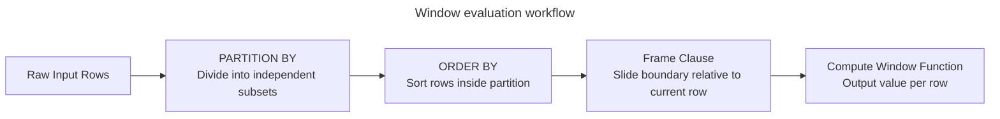
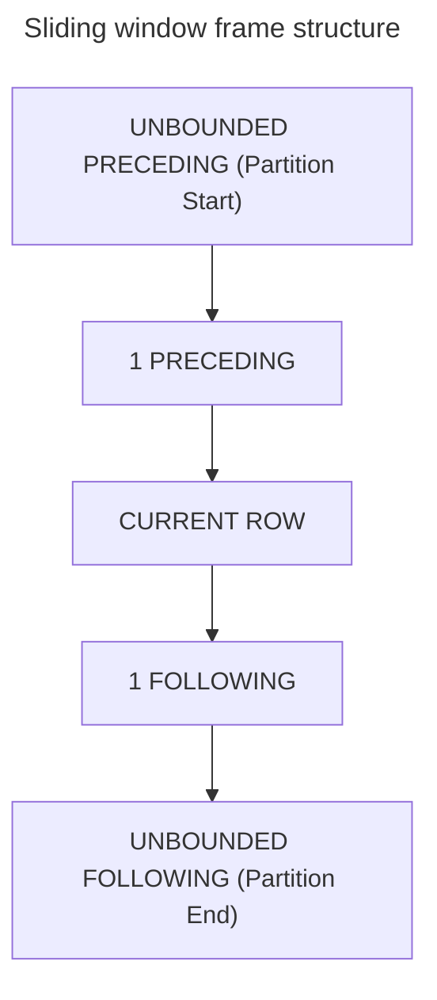

# Analytical and window functions

## Overview

Window functions perform calculations across a set of table rows that relate to
the current query row. Unlike standard `GROUP BY` aggregations, which collapse
multiple rows into a single summary row, window functions preserve the
individual row identity and return a computed value alongside every input
record.

This guide provides an end-to-end operational reference for window functions,
covering the `OVER` clause, partitioning, ordering, ranking functions, the
sliding frame clause, and real-world query execution mechanics.

## Example dataset

The queries in this guide use the following `EmployeeSales` table, which
includes intentional duplicate sales amounts and duplicate dates to illustrate
tie-breaking and frame behavior:

| `EmployeeID` | `EmployeeName` | `Department` | `SalesAmount` | `HireDate` |
| :--- | :--- | :--- | :--- | :--- |
| 101 | Alice | Sales | 10000 | 2024-01-15 |
| 102 | Bob | Sales | 8000 | 2024-03-01 |
| 103 | Charlie | Sales | 8000 | 2024-03-01 |
| 104 | Diana | Sales | 5000 | 2024-06-10 |
| 201 | Evan | Engineering | 12000 | 2023-11-01 |
| 202 | Fiona | Engineering | 9000 | 2024-02-15 |
| 203 | George | Engineering | 9000 | 2024-04-20 |
| 204 | Hannah | Engineering | 7500 | 2024-05-12 |

## Window syntax and the `OVER` clause

A window specification defines the subset of rows and their ordering for each
row calculation. It appears inside the `OVER` clause:

```sql
function_name([arguments]) OVER (
  [PARTITION BY partition_column, ...]
  [ORDER BY sort_column [ASC | DESC], ...]
  [ROWS | RANGE frame_specification]
)
```

The `OVER` clause instructs the query processor to evaluate the function as a
window function rather than a standard scalar or grouped aggregate function.



### Global window aggregates without partitions

When the `OVER` clause contains no `PARTITION BY` clause, the window
encompasses the entire result set returned by the query:

```sql
SELECT
  EmployeeID,
  EmployeeName,
  Department,
  SalesAmount,
  SUM(SalesAmount) OVER () AS CompanyTotalSales,
  ROUND(SalesAmount * 100.0 / SUM(SalesAmount) OVER (), 2) AS PctOfCompanySales
FROM EmployeeSales;
```

#### Global window sales output

| `EmployeeID` | `EmployeeName` | `Department` | `SalesAmount` | `CompanyTotalSales` | `PctOfCompanySales` |
| :--- | :--- | :--- | :--- | :--- | :--- |
| 101 | Alice | Sales | 10000 | 68500 | 14.60 |
| 102 | Bob | Sales | 8000 | 68500 | 11.68 |
| 103 | Charlie | Sales | 8000 | 68500 | 11.68 |
| 104 | Diana | Sales | 5000 | 68500 | 7.30 |
| 201 | Evan | Engineering | 12000 | 68500 | 17.52 |
| 202 | Fiona | Engineering | 9000 | 68500 | 13.14 |
| 203 | George | Engineering | 9000 | 68500 | 13.14 |
| 204 | Hannah | Engineering | 7500 | 68500 | 10.95 |

The query calculates `CompanyTotalSales` across all eight rows without
collapsing them, allowing each employee row to retain its individual sales
percentage.

### Partitioned window: departmental aggregates

The `PARTITION BY` clause divides the row stream into logical partitions.
The database calculates the window function independently for each partition:

```sql
SELECT
  EmployeeID,
  EmployeeName,
  Department,
  SalesAmount,
  SUM(SalesAmount) OVER (
    PARTITION BY Department
  ) AS DepartmentTotalSales,
  ROUND(SalesAmount * 100.0 / SUM(SalesAmount) OVER (
    PARTITION BY Department
  ), 2) AS PctOfDeptSales
FROM EmployeeSales;
```

#### Departmental partitioned sales output

| `EmployeeID` | `EmployeeName` | `Department` | `SalesAmount` | `DepartmentTotalSales` | `PctOfDeptSales` |
| :--- | :--- | :--- | :--- | :--- | :--- |
| 201 | Evan | Engineering | 12000 | 37500 | 32.00 |
| 202 | Fiona | Engineering | 9000 | 37500 | 24.00 |
| 203 | George | Engineering | 9000 | 37500 | 24.00 |
| 204 | Hannah | Engineering | 7500 | 37500 | 20.00 |
| 101 | Alice | Sales | 10000 | 31000 | 32.26 |
| 102 | Bob | Sales | 8000 | 31000 | 25.81 |
| 103 | Charlie | Sales | 8000 | 31000 | 25.81 |
| 104 | Diana | Sales | 5000 | 31000 | 16.13 |

Rows in `Engineering` calculate their share against the departmental total of
`37500`, while rows in `Sales` calculate against `31000`.

## Window ordering and running values

Adding `ORDER BY` to an `OVER` clause defines the sequence in which the engine
processes rows inside each partition.

For aggregate window functions, adding `ORDER BY` without a frame clause
changes the calculation from a static group total into a cumulative running
total.

```sql
SELECT
  EmployeeID,
  EmployeeName,
  Department,
  HireDate,
  SalesAmount,
  SUM(SalesAmount) OVER (
    PARTITION BY Department
    ORDER BY HireDate
  ) AS CumulativeDeptSales
FROM EmployeeSales;
```

### The default frame trap: `RANGE` versus `ROWS`

In standard SQL specifications, omitting an explicit frame clause when
`ORDER BY` is present triggers an implicit default:

```sql
RANGE BETWEEN UNBOUNDED PRECEDING AND CURRENT ROW
```

This default introduces subtle bugs when duplicate values exist in the
`ORDER BY` expression. `RANGE` evaluates peer rows—rows that share the
identical sort value—as a single combined unit.

Notice how Bob and Charlie share the exact same `HireDate` on 2024-03-01:

```sql
SELECT
  EmployeeName,
  SalesAmount,
  HireDate,
  -- Default implicit RANGE frame:
  SUM(SalesAmount) OVER (
    ORDER BY HireDate
    RANGE BETWEEN UNBOUNDED PRECEDING AND CURRENT ROW
  ) AS RangeRunningTotal,
  -- Explicit physical ROWS frame:
  SUM(SalesAmount) OVER (
    ORDER BY HireDate, EmployeeID
    ROWS BETWEEN UNBOUNDED PRECEDING AND CURRENT ROW
  ) AS RowsRunningTotal
FROM EmployeeSales
WHERE Department = 'Sales';
```

#### Comparison of `RANGE` versus `ROWS` execution

| `EmployeeName` | `SalesAmount` | `HireDate` | `RangeRunningTotal` | `RowsRunningTotal` |
| :--- | :--- | :--- | :--- | :--- |
| Alice | 10000 | 2024-01-15 | 10000 | 10000 |
| Bob | 8000 | 2024-03-01 | **26000** | 18000 |
| Charlie | 8000 | 2024-03-01 | **26000** | 26000 |
| Diana | 5000 | 2024-06-10 | 31000 | 31000 |

The database groups Bob and Charlie together under `RANGE` because their
hire dates tie. The running total jumps directly to `26000`, summing 10000,
8000, and 8000 for both rows. Under `ROWS`, the engine advances row by row,
producing `18000` then `26000`.

> [!NOTE]
> Always declare an explicit frame using
> `ROWS BETWEEN UNBOUNDED PRECEDING AND CURRENT ROW` and supply a unique
> tie-breaker column when computing deterministic running totals.

## Ranking functions

Ranking functions assign an ordinal rank, index, or bucket number to each row
inside a partition.

The four primary ranking functions handle duplicate values and ties
differently:

1. `ROW_NUMBER()`: assigns a unique, strictly incrementing integer such as
   `1, 2, 3, 4` to each row in the partition.
2. `RANK()`: assigns the same rank to identical sort values, but skips
   subsequent rank numbers to account for ties, producing sequences such as
   `1, 2, 2, 4`.
3. `DENSE_RANK()`: assigns the same rank to identical sort values without
   leaving gaps in the numbering sequence, producing sequences such as
   `1, 2, 2, 3`.
4. `NTILE(n)`: divides the ordered rows in each partition into `n` roughly equal
   buckets, returning the bucket index from `1` through `n`.

### Ranking comparison query

The following query compares all four ranking functions on the `Sales`
department records:

```sql
SELECT
  EmployeeName,
  SalesAmount,
  ROW_NUMBER() OVER (
    ORDER BY SalesAmount DESC, EmployeeID
  ) AS RowNumber,
  RANK() OVER (
    ORDER BY SalesAmount DESC
  ) AS StandardRank,
  DENSE_RANK() OVER (
    ORDER BY SalesAmount DESC
  ) AS DenseRank,
  NTILE(2) OVER (
    ORDER BY SalesAmount DESC, EmployeeID
  ) AS PerformanceHalf
FROM EmployeeSales
WHERE Department = 'Sales';
```

#### Side-by-side ranking result

| `EmployeeName` | `SalesAmount` | `RowNumber` | `StandardRank` | `DenseRank` | `PerformanceHalf` |
| :--- | :--- | :--- | :--- | :--- | :--- |
| Alice | 10000 | 1 | 1 | 1 | 1 |
| Bob | 8000 | 2 | 2 | 2 | 1 |
| Charlie | 8000 | 3 | 2 | 2 | 2 |
| Diana | 5000 | 4 | 4 | 3 | 2 |

#### Analysis of tie handling

- **Tie condition**: sales amounts for Bob and Charlie tie at `8000`.
- **Row numbering**: `ROW_NUMBER()` breaks the tie using `EmployeeID`, giving
  Bob `2` and Charlie `3`.
- **Standard ranking**: `RANK()` assigns both employees rank `2`. Because two
  rows tied for rank `2`, the engine skips rank `3`, and Diana receives rank
  `4`.
- **Dense ranking**: `DENSE_RANK()` assigns both employees rank `2`. It doesn't
  skip values, so Diana receives rank `3`.
- **Bucketing**: `NTILE(2)` splits the four rows into two equal buckets,
  assigning Alice and Bob to bucket `1` and Charlie and Diana to bucket `2`.

## Sliding window frame specifications

A frame clause defines a dynamic window subset that slides relative to the
current row.

### Frame boundary keywords

- `UNBOUNDED PRECEDING`: starts at the first row of the partition.
- `n PRECEDING`: starts `n` rows before the current row.
- `CURRENT ROW`: limits the boundary to the active evaluation row.
- `n FOLLOWING`: extends `n` rows after the current row.
- `UNBOUNDED FOLLOWING`: extends through the final row of the partition.



### Centered moving average calculation

To smooth volatility in time-series data, engineers frequently compute a 3-row
centered moving average: the previous row, the current row, and the following
row.

```sql
SELECT
  EmployeeName,
  Department,
  HireDate,
  SalesAmount,
  ROUND(AVG(SalesAmount) OVER (
    PARTITION BY Department
    ORDER BY HireDate
    ROWS BETWEEN 1 PRECEDING AND 1 FOLLOWING
  ), 2) AS MovingAverageSales
FROM EmployeeSales
WHERE Department = 'Sales';
```

#### Moving average result

| `EmployeeName` | `HireDate` | `SalesAmount` | Frame rows included | `MovingAverageSales` |
| :--- | :--- | :--- | :--- | :--- |
| Alice | 2024-01-15 | 10000 | Alice, Bob | 9000.00 |
| Bob | 2024-03-01 | 8000 | Alice, Bob, Charlie | 8666.67 |
| Charlie | 2024-03-01 | 8000 | Bob, Charlie, Diana | 7000.00 |
| Diana | 2024-06-10 | 5000 | Charlie, Diana | 6500.00 |

On the first row, Alice has no preceding row, so the engine sums 10000 and 8000
and divides by 2 to yield 9000.00. On the second row, the frame includes Alice,
Bob, and Charlie: summing 10000, 8000, and 8000 and dividing by 3 yields
8666.67.

## Filtering window results with common table expressions and `QUALIFY`

Because of the SQL logical query processing order, window functions evaluate
after `WHERE` and `HAVING` clauses finish filtering.

Attempting to filter window output directly in `WHERE` raises a syntax error:

```sql
-- INVALID: The database rejects window functions in WHERE clauses
SELECT EmployeeName, SalesAmount
FROM EmployeeSales
WHERE ROW_NUMBER() OVER (ORDER BY SalesAmount DESC) <= 3;
```

### Top-N filtering with common table expressions

To filter window results, wrap the calculation in a common table expression
and apply the filter in the outer query:

```sql
WITH RankedDepartmentSales AS (
  SELECT
    Department,
    EmployeeID,
    EmployeeName,
    SalesAmount,
    DENSE_RANK() OVER (
      PARTITION BY Department
      ORDER BY SalesAmount DESC
    ) AS DeptRank
  FROM EmployeeSales
)
SELECT
  Department,
  DeptRank,
  EmployeeName,
  SalesAmount
FROM RankedDepartmentSales
WHERE DeptRank <= 2
ORDER BY Department, DeptRank;
```

#### Top-2 employees per department result

| `Department` | `DeptRank` | `EmployeeName` | `SalesAmount` |
| :--- | :--- | :--- | :--- |
| Engineering | 1 | Evan | 12000 |
| Engineering | 2 | Fiona | 9000 |
| Engineering | 2 | George | 9000 |
| Sales | 1 | Alice | 10000 |
| Sales | 2 | Bob | 8000 |
| Sales | 2 | Charlie | 8000 |

Notice that because Fiona and George tie for rank `2` in `Engineering`, and
Bob and Charlie tie in `Sales`, `DENSE_RANK()` preserves both tied performers in
the top tier.

### The modern `QUALIFY` clause

Several analytical database engines, including Google BigQuery, Snowflake, and
`Databricks`, support the concise `QUALIFY` clause to filter window functions
without nested queries:

```sql
SELECT
  Department,
  EmployeeName,
  SalesAmount,
  DENSE_RANK() OVER (
    PARTITION BY Department
    ORDER BY SalesAmount DESC
  ) AS DeptRank
FROM EmployeeSales
QUALIFY DeptRank <= 2
ORDER BY Department, DeptRank;
```

The database engine evaluates `QUALIFY` after window functions calculate,
eliminating boilerplate nested queries.

## Common pitfalls

### Unintended running totals from implicit `RANGE`

Adding `ORDER BY` to an aggregate window function converts a static group sum
into a running sum. Omitting the explicit frame causes peer rows with identical
timestamps to combine unpredictably.

```sql
-- Risky: Implicit RANGE causes tied dates to produce combined sums
SUM(SalesAmount) OVER (PARTITION BY Department ORDER BY HireDate)

-- Predictable: Explicit ROWS advances strictly one record at a time
SUM(SalesAmount) OVER (
  PARTITION BY Department
  ORDER BY HireDate, EmployeeID
  ROWS BETWEEN UNBOUNDED PRECEDING AND CURRENT ROW
)
```

### Non-deterministic pagination with `ROW_NUMBER`

When sorting by a column with duplicate values, database engines don't ensure
which row receives which row number between query runs.

```sql
-- Non-deterministic: Bob and Charlie can swap row numbers on re-execution
ROW_NUMBER() OVER (ORDER BY SalesAmount DESC)

-- Deterministic: Unique tie-breaker guarantees identical sequence
ROW_NUMBER() OVER (ORDER BY SalesAmount DESC, EmployeeID ASC)
```

### Missing null ordering definitions

Different SQL engines position `NULL` values differently by default. PostgreSQL
and Oracle treat `NULL` as larger than any value, placing it first in descending
order, while MySQL and SQL Server treat `NULL` as smaller than any value,
placing it last in descending order.

Declare null placement explicitly when you need consistency across platforms:

```sql
ORDER BY SalesAmount DESC NULLS LAST
```

## Key takeaways

- Use `OVER` to calculate values across related rows without collapsing the
  underlying record detail.
- Use `PARTITION BY` to restart window calculations independently for discrete
  subsets.
- Use `ORDER BY` to establish the sequence for ranking and cumulative
  calculations.
- Distinguish between `ROW_NUMBER` for unique sequential indexing, `RANK` for
  competition ranking with gaps, and `DENSE_RANK` for consecutive tier ranking
  without gaps.
- Declare `ROWS BETWEEN` frames explicitly to prevent implicit `RANGE` peer
  coalescing on duplicate values.
- Filter window function results using outer queries, common table expressions,
  or engine-native `QUALIFY` clauses.
