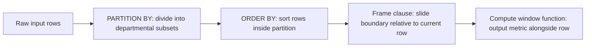
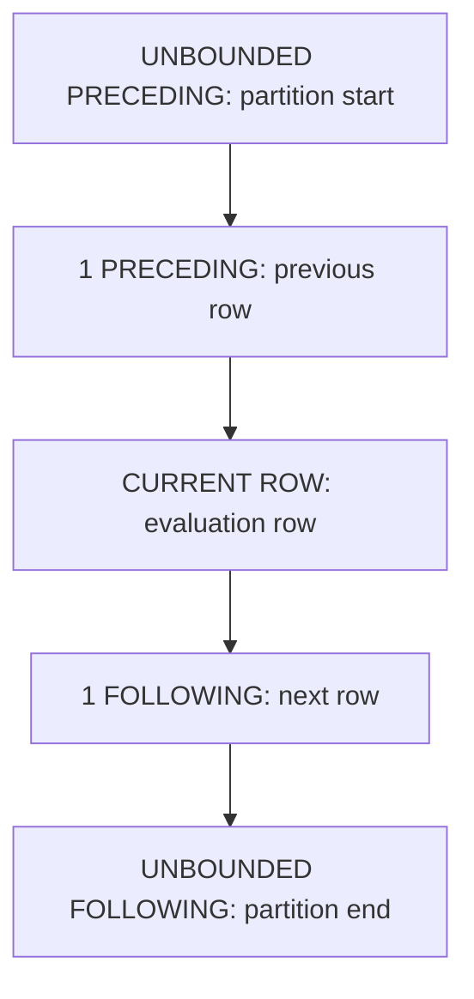

# Analytical and window functions

## Overview

Window functions perform calculations across a set of table rows that relate to
the current query row. Unlike standard `GROUP BY` aggregations, which collapse
multiple rows into a single summary row, window functions preserve individual
row identity and return a computed value alongside every input record.

This guide provides an end-to-end operational reference for window functions,
covering the `OVER` clause, partitioning, ordering, ranking functions, sliding
window frames, and query execution flow using the Stanford University faculty
research database.

## Reference schema and dataset

The examples in this guide use the `faculty_research_grants` relation, which
records research grant distributions across academic departments. The data
includes duplicate grant amounts and duplicate award dates to illustrate
tie-breaking and frame behavior:

```sql
CREATE TABLE faculty_research_grants (
  instructor_id   INTEGER PRIMARY KEY,
  first_name      VARCHAR(50) NOT NULL,
  last_name       VARCHAR(50) NOT NULL,
  department_name VARCHAR(50) NOT NULL,
  grant_amount    NUMERIC(10, 2) NOT NULL,
  award_date      DATE NOT NULL
);
```

### Table contents

| `instructor_id` | `first_name` | `last_name` | `department_name` | `grant_amount` | `award_date` |
| :--- | :--- | :--- | :--- | :--- | :--- |
| `101` | David | Clark | Computer Science | `100000.00` | 2024-01-15 |
| `102` | Marcus | Miller | Computer Science | `80000.00` | 2024-03-01 |
| `103` | Andrea | Taylor | Computer Science | `80000.00` | 2024-03-01 |
| `104` | Sarah | Wilson | Computer Science | `50000.00` | 2024-06-10 |
| `201` | Evan | Wright | Electrical Engineering | `120000.00` | 2023-11-01 |
| `202` | Fiona | Adams | Electrical Engineering | `90000.00` | 2024-02-15 |
| `203` | George | Baker | Electrical Engineering | `90000.00` | 2024-04-20 |
| `204` | Hannah | Scott | Electrical Engineering | `75000.00` | 2024-05-12 |

## Window syntax and the `OVER` clause

A window specification defines the subset of rows and their ordering for each
row calculation. It appears inside the `OVER` clause:

```sql
function_name([arguments]) OVER (
  [PARTITION BY partition_column, ...]
  [ORDER BY sort_column [ASC | DESC], ...]
  [ROWS | RANGE frame_specification]
)
```

The `OVER` clause instructs the query processor to evaluate the function as a
window function rather than a standard scalar or grouped aggregate function.



### Global window aggregates without partitions

When the `OVER` clause contains no `PARTITION BY` sub-clause, the window
encompasses the entire result set returned by the query:

```sql
SELECT
  instructor_id,
  first_name,
  last_name,
  department_name,
  grant_amount,
  SUM(grant_amount) OVER () AS university_total_grants,
  ROUND(grant_amount * 100.0 / SUM(grant_amount) OVER (), 2) AS pct_of_university_grants
FROM faculty_research_grants;
```

#### Global window grant output

| `instructor_id` | `first_name` | `last_name` | `department_name` | `grant_amount` | `university_total_grants` | `pct_of_university_grants` |
| :--- | :--- | :--- | :--- | :--- | :--- | :--- |
| `101` | David | Clark | Computer Science | `100000.00` | `685000.00` | `14.60` |
| `102` | Marcus | Miller | Computer Science | `80000.00` | `685000.00` | `11.68` |
| `103` | Andrea | Taylor | Computer Science | `80000.00` | `685000.00` | `11.68` |
| `104` | Sarah | Wilson | Computer Science | `50000.00` | `685000.00` | `7.30` |
| `201` | Evan | Wright | Electrical Engineering | `120000.00` | `685000.00` | `17.52` |
| `202` | Fiona | Adams | Electrical Engineering | `90000.00` | `685000.00` | `13.14` |
| `203` | George | Baker | Electrical Engineering | `90000.00` | `685000.00` | `13.14` |
| `204` | Hannah | Scott | Electrical Engineering | `75000.00` | `685000.00` | `10.95` |

The query calculates `university_total_grants` across all eight rows without
collapsing them, allowing each faculty row to retain its individual grant
percentage.

### Partitioned window: departmental aggregates

The `PARTITION BY` clause divides the row stream into logical partitions.
The database calculates the window function independently for each partition:

```sql
SELECT
  instructor_id,
  first_name,
  last_name,
  department_name,
  grant_amount,
  SUM(grant_amount) OVER (
    PARTITION BY department_name
  ) AS dept_total_grants,
  ROUND(grant_amount * 100.0 / SUM(grant_amount) OVER (
    PARTITION BY department_name
  ), 2) AS pct_of_dept_grants
FROM faculty_research_grants;
```

#### Departmental partitioned grant output

| `instructor_id` | `first_name` | `last_name` | `department_name` | `grant_amount` | `dept_total_grants` | `pct_of_dept_grants` |
| :--- | :--- | :--- | :--- | :--- | :--- | :--- |
| `101` | David | Clark | Computer Science | `100000.00` | `310000.00` | `32.26` |
| `102` | Marcus | Miller | Computer Science | `80000.00` | `310000.00` | `25.81` |
| `103` | Andrea | Taylor | Computer Science | `80000.00` | `310000.00` | `25.81` |
| `104` | Sarah | Wilson | Computer Science | `50000.00` | `310000.00` | `16.13` |
| `201` | Evan | Wright | Electrical Engineering | `120000.00` | `375000.00` | `32.00` |
| `202` | Fiona | Adams | Electrical Engineering | `90000.00` | `375000.00` | `24.00` |
| `203` | George | Baker | Electrical Engineering | `90000.00` | `375000.00` | `24.00` |
| `204` | Hannah | Scott | Electrical Engineering | `75000.00` | `375000.00` | `20.00` |

Rows in Electrical Engineering calculate their share against the departmental
total of `375000.00`, while rows in Computer Science calculate against
`310000.00`.

## Window ordering and running values

Adding `ORDER BY` to an `OVER` clause defines the sequence in which the engine
processes rows inside each partition.

For aggregate window functions, adding `ORDER BY` without an explicit frame
clause changes the calculation from a static group total into a cumulative
running total:

```sql
SELECT
  instructor_id,
  first_name,
  last_name,
  department_name,
  award_date,
  grant_amount,
  SUM(grant_amount) OVER (
    PARTITION BY department_name
    ORDER BY award_date
  ) AS cumulative_dept_grants
FROM faculty_research_grants;
```

### The default frame trap: `RANGE` compared with `ROWS`

In standard `SQL` specifications, omitting an explicit frame clause when
`ORDER BY` is present triggers an implicit default:

```sql
RANGE BETWEEN UNBOUNDED PRECEDING AND CURRENT ROW
```

This default introduces subtle bugs when duplicate values exist in the
`ORDER BY` expression. `RANGE` evaluates peer rows, rows that share identical
sort values, as a single combined unit.

Notice how Marcus Miller and Andrea Taylor share the exact same `award_date`
on 2024-03-01:

```sql
SELECT
  first_name,
  last_name,
  grant_amount,
  award_date,
  -- Default implicit RANGE frame:
  SUM(grant_amount) OVER (
    ORDER BY award_date
    RANGE BETWEEN UNBOUNDED PRECEDING AND CURRENT ROW
  ) AS range_running_total,
  -- Explicit physical ROWS frame:
  SUM(grant_amount) OVER (
    ORDER BY award_date, instructor_id
    ROWS BETWEEN UNBOUNDED PRECEDING AND CURRENT ROW
  ) AS rows_running_total
FROM faculty_research_grants
WHERE department_name = 'Computer Science';
```

#### Comparison of `RANGE` versus `ROWS` execution

| `first_name` | `last_name` | `grant_amount` | `award_date` | `range_running_total` | `rows_running_total` |
| :--- | :--- | :--- | :--- | :--- | :--- |
| David | Clark | `100000.00` | 2024-01-15 | `100000.00` | `100000.00` |
| Marcus | Miller | `80000.00` | 2024-03-01 | `260000.00` | `180000.00` |
| Andrea | Taylor | `80000.00` | 2024-03-01 | `260000.00` | `260000.00` |
| Sarah | Wilson | `50000.00` | 2024-06-10 | `310000.00` | `310000.00` |

The database groups Marcus Miller and Andrea Taylor together under `RANGE`
because their award dates tie. The running total jumps directly to `260000.00`,
summing `100000.00`, `80000.00`, and `80000.00` for both rows. Under `ROWS`,
the engine advances row by row, producing `180000.00` then `260000.00`.

> [!NOTE]
> Always declare an explicit frame using
> `ROWS BETWEEN UNBOUNDED PRECEDING AND CURRENT ROW` and supply a unique
> tie-breaker column when computing deterministic running totals.

## Ranking functions

Ranking functions assign an ordinal rank, index, or bucket number to each row
inside a partition.

The four primary ranking functions handle duplicate values and ties
differently:

1. `ROW_NUMBER()`: assigns a unique, strictly incrementing integer such as
   `1, 2, 3, 4` to each row in the partition.
2. `RANK()`: assigns the same rank to identical sort values, but skips
   subsequent rank numbers to account for ties, producing sequences such as
   `1, 2, 2, 4`.
3. `DENSE_RANK()`: assigns the same rank to identical sort values without
   leaving gaps in the numbering sequence, producing sequences such as
   `1, 2, 2, 3`.
4. `NTILE(n)`: divides the ordered rows in each partition into `n` roughly equal
   buckets, returning the bucket index from `1` through `n`.

### Ranking comparison query

The following query compares all four ranking functions on Computer Science
records:

```sql
SELECT
  first_name,
  last_name,
  grant_amount,
  ROW_NUMBER() OVER (
    ORDER BY grant_amount DESC, instructor_id
  ) AS row_num,
  RANK() OVER (
    ORDER BY grant_amount DESC
  ) AS standard_rank,
  DENSE_RANK() OVER (
    ORDER BY grant_amount DESC
  ) AS dense_rank_val,
  NTILE(2) OVER (
    ORDER BY grant_amount DESC, instructor_id
  ) AS grant_half
FROM faculty_research_grants
WHERE department_name = 'Computer Science';
```

#### Side-by-side ranking result

| `first_name` | `last_name` | `grant_amount` | `row_num` | `standard_rank` | `dense_rank_val` | `grant_half` |
| :--- | :--- | :--- | :--- | :--- | :--- | :--- |
| David | Clark | `100000.00` | `1` | `1` | `1` | `1` |
| Marcus | Miller | `80000.00` | `2` | `2` | `2` | `1` |
| Andrea | Taylor | `80000.00` | `3` | `2` | `2` | `2` |
| Sarah | Wilson | `50000.00` | `4` | `4` | `3` | `2` |

#### Analysis of tie handling

- The grant amounts for Marcus Miller and Andrea Taylor tie at `80000.00`.
- The `ROW_NUMBER()` function breaks the tie using `instructor_id`, giving Marcus Miller `2` and Andrea Taylor `3`.
- The `RANK()` function assigns both faculty members rank `2`. Because two rows tied for rank `2`, the engine skips rank `3`, and Sarah Wilson receives rank `4`.
- The `DENSE_RANK()` function assigns both faculty members rank `2` without skipping values, so Sarah Wilson receives rank `3`.
- The `NTILE(2)` function splits the four rows into two equal buckets, assigning David Clark and Marcus Miller to bucket `1` and Andrea Taylor and Sarah Wilson to bucket `2`.

## Sliding window frame specifications

A frame clause defines a dynamic window subset that slides relative to the
current row.

### Frame boundary keywords

- `UNBOUNDED PRECEDING`: starts at the first row of the partition.
- `n PRECEDING`: starts `n` rows before the current row.
- `CURRENT ROW`: limits the boundary to the active evaluation row.
- `n FOLLOWING`: extends `n` rows after the current row.
- `UNBOUNDED FOLLOWING`: extends through the final row of the partition.



### Centered moving average calculation

To smooth volatility across award chronologies, engineers frequently compute a
3-row centered moving average: the previous row, the current row, and the
following row:

```sql
SELECT
  first_name,
  last_name,
  award_date,
  grant_amount,
  ROUND(AVG(grant_amount) OVER (
    PARTITION BY department_name
    ORDER BY award_date
    ROWS BETWEEN 1 PRECEDING AND 1 FOLLOWING
  ), 2) AS moving_avg_grant
FROM faculty_research_grants
WHERE department_name = 'Computer Science';
```

#### Moving average result

| `first_name` | `last_name` | `award_date` | `grant_amount` | Frame rows included | `moving_avg_grant` |
| :--- | :--- | :--- | :--- | :--- | :--- |
| David | Clark | 2024-01-15 | `100000.00` | Clark, Miller | `90000.00` |
| Marcus | Miller | 2024-03-01 | `80000.00` | Clark, Miller, Taylor | `86666.67` |
| Andrea | Taylor | 2024-03-01 | `80000.00` | Miller, Taylor, Wilson | `70000.00` |
| Sarah | Wilson | 2024-06-10 | `50000.00` | Taylor, Wilson | `65000.00` |

On the first row, David Clark has no preceding row, so the engine averages
`100000.00` and `80000.00` to yield `90000.00`. On the second row, the frame
includes David Clark, Marcus Miller, and Andrea Taylor: averaging `100000.00`,
`80000.00`, and `80000.00` yields `86666.67`.

## Filtering window results with common table expressions and `QUALIFY`

Because of the `SQL` logical query processing order, window functions evaluate
after `WHERE` and `HAVING` clauses finish filtering.

Attempting to filter window output directly in `WHERE` raises a syntax error:

```sql
-- INVALID: The database rejects window functions in WHERE clauses
SELECT first_name, last_name, grant_amount
FROM faculty_research_grants
WHERE ROW_NUMBER() OVER (ORDER BY grant_amount DESC) <= 3;
```

### Top-N filtering with common table expressions

To filter window results, wrap the calculation in a Common Table Expression, or
`CTE`, and apply the filter in the outer query:

```sql
WITH ranked_department_grants AS (
  SELECT
    department_name,
    instructor_id,
    first_name,
    last_name,
    grant_amount,
    DENSE_RANK() OVER (
      PARTITION BY department_name
      ORDER BY grant_amount DESC
    ) AS dept_rank
  FROM faculty_research_grants
)
SELECT
  department_name,
  dept_rank,
  first_name,
  last_name,
  grant_amount
FROM ranked_department_grants
WHERE dept_rank <= 2
ORDER BY department_name, dept_rank;
```

#### Top-2 recipients per department result

| `department_name` | `dept_rank` | `first_name` | `last_name` | `grant_amount` |
| :--- | :--- | :--- | :--- | :--- |
| Computer Science | `1` | David | Clark | `100000.00` |
| Computer Science | `2` | Marcus | Miller | `80000.00` |
| Computer Science | `2` | Andrea | Taylor | `80000.00` |
| Electrical Engineering | `1` | Evan | Wright | `120000.00` |
| Electrical Engineering | `2` | Fiona | Adams | `90000.00` |
| Electrical Engineering | `2` | George | Baker | `90000.00` |

Notice that because Marcus Miller and Andrea Taylor tie for rank `2` in
Computer Science, and Fiona Adams and George Baker tie in Electrical Engineering,
`DENSE_RANK()` preserves both tied recipients in the top tier.

### The modern `QUALIFY` clause

Several analytical database engines, including Google BigQuery, Snowflake, and
`Databricks`, support the concise `QUALIFY` clause to filter window functions
without nested queries:

```sql
SELECT
  department_name,
  first_name,
  last_name,
  grant_amount,
  DENSE_RANK() OVER (
    PARTITION BY department_name
    ORDER BY grant_amount DESC
  ) AS dept_rank
FROM faculty_research_grants
QUALIFY dept_rank <= 2
ORDER BY department_name, dept_rank;
```

The database engine evaluates `QUALIFY` after window functions calculate,
eliminating boilerplate sub-queries.

## Common pitfalls

### Unintended running totals from implicit `RANGE`

Adding `ORDER BY` to an aggregate window function converts a static group sum
into a running sum. Omitting the explicit frame causes peer rows with identical
timestamps to combine unpredictably:

```sql
-- Risky: Implicit RANGE causes tied dates to produce combined sums
SUM(grant_amount) OVER (PARTITION BY department_name ORDER BY award_date)

-- Predictable: Explicit ROWS advances strictly one record at a time
SUM(grant_amount) OVER (
  PARTITION BY department_name
  ORDER BY award_date, instructor_id
  ROWS BETWEEN UNBOUNDED PRECEDING AND CURRENT ROW
)
```

### Non-deterministic pagination with `ROW_NUMBER`

When sorting by a column with duplicate values, database engines don't ensure
which row receives which row number between query runs:

```sql
-- Non-deterministic: Marcus Miller and Andrea Taylor can swap row numbers on re-execution
ROW_NUMBER() OVER (ORDER BY grant_amount DESC)

-- Deterministic: Unique tie-breaker guarantees identical sequence
ROW_NUMBER() OVER (ORDER BY grant_amount DESC, instructor_id ASC)
```

### Missing null ordering definitions

Different `SQL` engines position `NULL` values differently by default. `PostgreSQL`
and `Oracle` treat `NULL` as larger than any value, placing it first in descending
order, while `MySQL` and `SQL Server` treat `NULL` as smaller than any value,
placing it last in descending order.

Declare null placement explicitly when you need consistency across platforms:

```sql
ORDER BY grant_amount DESC NULLS LAST
```

## Key takeaways

- Use `OVER` to calculate metrics across related records without collapsing
  the underlying detail rows.
- Use `PARTITION BY` to restart window calculations independently across subsets.
- Use `ORDER BY` to establish sequences for ranking and running metrics.
- Distinguish between `ROW_NUMBER` for unique sequential numbering, `RANK` for
  competition ranking with gaps, and `DENSE_RANK` for consecutive ranking without gaps.
- Declare `ROWS BETWEEN` frames explicitly to prevent implicit `RANGE` peer
  coalescing on duplicate timestamps or metrics.
- Filter window function results using Common Table Expressions or engine-native
  `QUALIFY` clauses.

## What's next

- Navigate relative row offsets with `LAG`, `LEAD`, and centered moving averages in
  [Value and frame navigation](/sql/value-and-frame-navigation).
- Cleanly encapsulate analytical window calculations with
  [Common table expressions](/sql/common-table-expressions).
- Learn multidimensional aggregation with `ROLLUP` and `CUBE` in
  [Multidimensional aggregation](/sql/multidimensional-aggregation).
