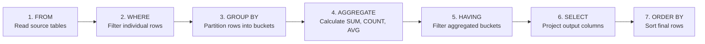

# Basic aggregations and grouping

SQL aggregation functions summarize multiple rows of data into computed
metrics such as counts, sums, averages, minimums, and maximums. When combined
with the `GROUP BY` clause, aggregation partitions row streams into discrete
groups, while the `HAVING` clause filters the aggregated results.

This guide provides an end-to-end operational reference for aggregate
functions, multi-column grouping, the logical query execution pipeline, and the
fundamental differences between `WHERE` and `HAVING` using the canonical
Stanford University course enrollment dataset.

## Reference dataset

The queries in this guide use the following `course_enrollments` table, which
includes enrollments across multiple academic departments, registration dates,
and a null tuition fee representing an audited course:

| `enrollment_id` | `student_id` | `department_name` | `tuition_fee` | `enrollment_date` |
| :--- | :--- | :--- | :--- | :--- |
| `101` | `S1` | Computer Science | `1200.00` | `2026-01-10` |
| `102` | `S2` | Computer Science | `1500.00` | `2026-01-15` |
| `103` | `S1` | Mathematics | `800.00` | `2026-01-20` |
| `104` | `S3` | Mathematics | `NULL` | `2026-02-01` |
| `105` | `S2` | Statistics | `900.00` | `2025-12-28` |
| `106` | `S4` | Statistics | `950.00` | `2026-02-14` |

## Global aggregate functions

When a query omits the `GROUP BY` clause, the database treats all matching rows
as a single global group:

```sql
SELECT 
    COUNT(*)                        AS total_enrollments,
    COUNT(tuition_fee)              AS paid_enrollments,
    SUM(tuition_fee)                AS total_tuition_revenue,
    ROUND(AVG(tuition_fee), 2)      AS average_tuition_fee,
    MIN(tuition_fee)                AS lowest_tuition_fee,
    MAX(tuition_fee)                AS highest_tuition_fee
FROM course_enrollments;
```

### Global aggregation output table

| `total_enrollments` | `paid_enrollments` | `total_tuition_revenue` | `average_tuition_fee` | `lowest_tuition_fee` | `highest_tuition_fee` |
| :--- | :--- | :--- | :--- | :--- | :--- |
| `6` | `5` | `5350.00` | `1070.00` | `800.00` | `1500.00` |

### Aggregate function calculations

- `COUNT(*)`: returns `6`, counting every record in the table regardless of null
  values.
- `COUNT(tuition_fee)`: returns `5`, skipping enrollment `104` because its fee is
  null.
- `SUM(tuition_fee)`: calculates `1200 + 1500 + 800 + 900 + 950 = 5350.00`,
  ignoring null values.
- `AVG(tuition_fee)`: divides `5350.00` by `5` rather than `6`, computing
  `1070.00`.
- `MIN(tuition_fee)` and `MAX(tuition_fee)`: evaluate the smallest and largest
  non-null values, returning `800.00` and `1500.00`.

## Grouping with `GROUP BY`

The `GROUP BY` clause divides the row stream into buckets sharing identical
values in the grouping columns. The engine computes aggregates independently
for each bucket:

```sql
SELECT 
    department_name,
    COUNT(*)                                   AS enrollment_count,
    COUNT(tuition_fee)                         AS paid_count,
    COALESCE(SUM(tuition_fee), 0.00)           AS total_revenue,
    ROUND(COALESCE(AVG(tuition_fee), 0.00), 2) AS average_revenue
FROM course_enrollments
GROUP BY department_name
ORDER BY total_revenue DESC;
```

### Grouped output table

| `department_name` | `enrollment_count` | `paid_count` | `total_revenue` | `average_revenue` |
| :--- | :--- | :--- | :--- | :--- |
| Computer Science | `2` | `2` | `2700.00` | `1350.00` |
| Statistics | `2` | `2` | `1850.00` | `925.00` |
| Mathematics | `2` | `1` | `800.00` | `800.00` |

### The mandatory `GROUP BY` projection rule

Every column in the `SELECT` projection list must satisfy one of two rules:

1. The column appears in the `GROUP BY` clause.
2. The column resides inside an aggregate function.

Selecting an un-grouped column causes a relational ambiguity error:

```sql
-- INVALID: The database rejects this query in standard SQL
SELECT department_name, enrollment_date, SUM(tuition_fee)
FROM course_enrollments
GROUP BY department_name;
```

Because Computer Science contains two distinct dates on 2026-01-10 and
2026-01-15, the engine can't decide which date to display for the
consolidated row.

## Logical execution pipeline: `WHERE` versus `HAVING`

Understanding how `WHERE`, `GROUP BY`, and `HAVING` interact requires inspecting
the internal logical query processing order:



### End-to-end pipeline demonstration

Consider this query filtering by registration date and aggregate revenue:

```sql
SELECT 
    department_name,
    COUNT(*)         AS total_enrollments,
    SUM(tuition_fee) AS total_revenue
FROM course_enrollments
WHERE enrollment_date >= '2026-01-01'
GROUP BY department_name
HAVING SUM(tuition_fee) > 1000.00
ORDER BY total_revenue DESC;
```

#### Step 1: `WHERE` filters raw rows

The engine evaluates `enrollment_date >= '2026-01-01'`. Enrollment `105` has a
date of `2025-12-28`, so the engine eliminates it immediately. Five rows
remain:

| `enrollment_id` | `department_name` | `tuition_fee` | `enrollment_date` |
| :--- | :--- | :--- | :--- |
| `101` | Computer Science | `1200.00` | `2026-01-10` |
| `102` | Computer Science | `1500.00` | `2026-01-15` |
| `103` | Mathematics | `800.00` | `2026-01-20` |
| `104` | Mathematics | `NULL` | `2026-02-01` |
| `106` | Statistics | `950.00` | `2026-02-14` |

#### Step 2: `GROUP BY` forms intermediate buckets

The engine groups the surviving rows by `department_name`:

- Computer Science: enrollments 101 and 102
- Mathematics: enrollments 103 and 104
- Statistics: enrollment 106

#### Step 3: calculation of aggregate values

- Computer Science: `COUNT(*) = 2`, `SUM(tuition_fee) = 2700.00`
- Mathematics: `COUNT(*) = 2`, `SUM(tuition_fee) = 800.00`
- Statistics: `COUNT(*) = 1`, `SUM(tuition_fee) = 950.00`

#### Step 4: `HAVING` filters aggregate buckets

The engine evaluates `SUM(tuition_fee) > 1000.00`:

- Computer Science with `2700.00 > 1000.00`: passes.
- Statistics with `950.00 > 1000.00`: fails, so the engine discards it.
- Mathematics with `800.00 > 1000.00`: fails, so the engine discards it.

#### Step 5: `SELECT` and `ORDER BY` produce the final output

| `department_name` | `total_enrollments` | `total_revenue` |
| :--- | :--- | :--- |
| Computer Science | `2` | `2700.00` |

## Common pitfalls

When writing aggregate queries, watch for these common mistakes:

### Placing row filters in `HAVING` instead of `WHERE`

A `HAVING` clause can technically filter by un-aggregated columns if they appear
in `GROUP BY`, but doing so forces the database to group unnecessary data
before discarding it:

```sql
-- Inefficient: groups all rows before discarding departments
SELECT department_name, SUM(tuition_fee)
FROM course_enrollments
GROUP BY department_name
HAVING department_name = 'Computer Science';

-- Efficient: filters rows before performing the group and aggregate pass
SELECT department_name, SUM(tuition_fee)
FROM course_enrollments
WHERE department_name = 'Computer Science'
GROUP BY department_name;
```

Filtering with `WHERE` reduces memory consumption and uses table indexes.

### Placing aggregate expressions in `WHERE`

Attempting to filter by an aggregate in `WHERE` triggers a syntax error:

```sql
-- INVALID: Aggregates are forbidden in WHERE
SELECT department_name, SUM(tuition_fee)
FROM course_enrollments
WHERE SUM(tuition_fee) > 1000.00
GROUP BY department_name;
```

Because `WHERE` executes before groups exist, the engine hasn't calculated the
aggregate value yet. Always place aggregate thresholds in `HAVING`.

## What's next

- Explore relational join types and grouping across tables in
  [Fundamental joins](/sql/fundamental-joins).
- Learn window functions, partitions, and moving averages in
  [Analytical and window functions](/sql/analytical-and-window-functions).
- Master multi-level grouping and cube operations in
  [Multidimensional aggregation](/sql/multidimensional-aggregation).
