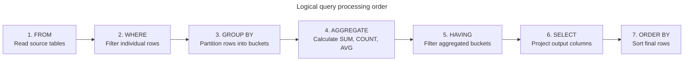

# Basic aggregations and grouping

## Overview

SQL aggregation functions summarize multiple rows of data into computed metrics such as counts, sums, averages, minimums, and maximums. When combined with the `GROUP BY` clause, aggregation partitions row streams into discrete groups, while the `HAVING` clause filters the aggregated results.

This guide provides an end-to-end operational reference for aggregate functions, multi-column grouping, the logical query execution pipeline, and the fundamental differences between `WHERE` and `HAVING`.

## Example dataset

The queries in this guide use the following `Orders` table, which includes orders across multiple categories, historical dates, and a null order amount:

| `OrderID` | `CustomerID` | `Category` | `OrderAmount` | `OrderDate` |
| :--- | :--- | :--- | :--- | :--- |
| 101 | C1 | Electronics | 300.00 | 2026-01-10 |
| 102 | C2 | Electronics | 700.00 | 2026-01-15 |
| 103 | C1 | Books | 40.00 | 2026-01-20 |
| 104 | C3 | Books | `NULL` | 2026-02-01 |
| 105 | C2 | Clothing | 150.00 | 2025-12-28 |
| 106 | C4 | Clothing | 250.00 | 2026-02-14 |

## Global aggregate functions

When a query omits the `GROUP BY` clause, the database treats all matching rows as a single global group:

```sql
SELECT
  COUNT(*) AS TotalOrders,
  COUNT(OrderAmount) AS OrdersWithAmounts,
  SUM(OrderAmount) AS TotalRevenue,
  ROUND(AVG(OrderAmount), 2) AS AverageRevenue,
  MIN(OrderAmount) AS SmallestOrder,
  MAX(OrderAmount) AS LargestOrder
FROM Orders;
```

### Global aggregation output table

| `TotalOrders` | `OrdersWithAmounts` | `TotalRevenue` | `AverageRevenue` | `SmallestOrder` | `LargestOrder` |
| :--- | :--- | :--- | :--- | :--- | :--- |
| 6 | 5 | 1440.00 | 288.00 | 40.00 | 700.00 |

### Mechanics of individual aggregate functions

- `COUNT(*)`: returns `6`, counting every record in the table regardless of null values.
- `COUNT(OrderAmount)`: returns `5`, skipping order `104` because its amount is `NULL`.
- `SUM(OrderAmount)`: calculates `300 + 700 + 40 + 150 + 250 = 1440.00`, ignoring null values.
- `AVG(OrderAmount)`: divides `1440.00` by `5` rather than `6`, computing `288.00`.
- `MIN(OrderAmount)` and `MAX(OrderAmount)`: evaluate the smallest and largest non-null values, returning `40.00` and `700.00`.

## Grouping with `GROUP BY`

The `GROUP BY` clause divides the row stream into buckets sharing identical values in the grouping columns. The engine computes aggregates independently for each bucket.

```sql
SELECT
  Category,
  COUNT(*) AS OrderCount,
  COUNT(OrderAmount) AS PaidOrderCount,
  COALESCE(SUM(OrderAmount), 0.00) AS CategoryRevenue,
  ROUND(COALESCE(AVG(OrderAmount), 0.00), 2) AS CategoryAvg
FROM Orders
GROUP BY Category
ORDER BY CategoryRevenue DESC;
```

### Grouped output table

| `Category` | `OrderCount` | `PaidOrderCount` | `CategoryRevenue` | `CategoryAvg` |
| :--- | :--- | :--- | :--- | :--- |
| Electronics | 2 | 2 | 1000.00 | 500.00 |
| Clothing | 2 | 2 | 400.00 | 200.00 |
| Books | 2 | 1 | 40.00 | 40.00 |

### The mandatory `GROUP BY` projection rule

Every column in the `SELECT` projection list must satisfy one of two rules:

1. The column appears in the `GROUP BY` clause.
2. The column resides inside an aggregate function.

Selecting a bare column that isn't grouped causes a relational ambiguity error:

```sql
-- INVALID: The database rejects this query in standard SQL
SELECT Category, OrderDate, SUM(OrderAmount)
FROM Orders
GROUP BY Category;
```

Because `Electronics` contains two distinct dates on 2026-01-10 and 2026-01-15, the engine can't decide which date to display for the consolidated row.

## Logical execution pipeline: `WHERE` versus `HAVING`

Understanding how `WHERE`, `GROUP BY`, and `HAVING` interact requires inspecting the internal logical query processing order.



### End-to-end pipeline demonstration

Consider this query filtering by date and aggregate revenue:

```sql
SELECT
  Category,
  COUNT(*) AS TotalOrders,
  SUM(OrderAmount) AS TotalRevenue
FROM Orders
WHERE OrderDate >= '2026-01-01'
GROUP BY Category
HAVING SUM(OrderAmount) > 100.00
ORDER BY TotalRevenue DESC;
```

#### Step 1: `WHERE` filters raw rows

The engine evaluates `OrderDate >= '2026-01-01'`. Order `105` has a date of `2025-12-28`, so the engine eliminates it immediately. Five rows remain:

| `OrderID` | `Category` | `OrderAmount` | `OrderDate` |
| :--- | :--- | :--- | :--- |
| 101 | Electronics | 300.00 | 2026-01-10 |
| 102 | Electronics | 700.00 | 2026-01-15 |
| 103 | Books | 40.00 | 2026-01-20 |
| 104 | Books | `NULL` | 2026-02-01 |
| 106 | Clothing | 250.00 | 2026-02-14 |

#### Step 2: `GROUP BY` forms intermediate buckets

The engine groups the surviving rows by `Category`:

- **Electronics bucket**: orders 101, 102
- **Books bucket**: orders 103, 104
- **Clothing bucket**: order 106

#### Step 3: calculation of aggregate values

- Electronics: `COUNT(*) = 2`, `SUM(OrderAmount) = 1000.00`
- Books: `COUNT(*) = 2`, `SUM(OrderAmount) = 40.00`
- Clothing: `COUNT(*) = 1`, `SUM(OrderAmount) = 250.00`

#### Step 4: `HAVING` filters aggregate buckets

The engine evaluates `SUM(OrderAmount) > 100.00`:

- Electronics with `1000.00 > 100.00`: passes.
- Clothing with `250.00 > 100.00`: passes.
- Books with `40.00 > 100.00`: fails, so the engine discards it.

#### Step 5: `SELECT` and `ORDER BY` produce the final output

| `Category` | `TotalOrders` | `TotalRevenue` |
| :--- | :--- | :--- |
| Electronics | 2 | 1000.00 |
| Clothing | 1 | 250.00 |

## Common pitfalls

### Placing row filters in `HAVING` instead of `WHERE`

A `HAVING` clause can technically filter by un-aggregated columns if they're present in `GROUP BY`, but doing so forces the database to group unnecessary data before discarding it:

```sql
-- Inefficient: groups all rows before discarding categories
SELECT Category, SUM(OrderAmount)
FROM Orders
GROUP BY Category
HAVING Category = 'Electronics';

-- Efficient: filters rows before performing the group and aggregate pass
SELECT Category, SUM(OrderAmount)
FROM Orders
WHERE Category = 'Electronics'
GROUP BY Category;
```

Filtering with `WHERE` reduces memory consumption and leverages table indexes.

### Placing aggregate expressions in `WHERE`

Attempting to filter by an aggregate in `WHERE` triggers a compilation error:

```sql
-- INVALID: Aggregates are forbidden in WHERE
SELECT Category, SUM(OrderAmount)
FROM Orders
WHERE SUM(OrderAmount) > 500.00
GROUP BY Category;
```

Because `WHERE` executes before groups exist, the engine hasn't calculated the aggregate value yet. Always place aggregate thresholds in `HAVING`.

## Key takeaways

- Use global aggregate functions to compute summary metrics across an entire table.
- `COUNT(*)` counts rows, while `COUNT(column)` and `AVG(column)` skip null values.
- Every non-aggregated column in the `SELECT` list must appear in the `GROUP BY` clause.
- `WHERE` filters input records before grouping occurs.
- `HAVING` filters aggregated group records after grouping completes.
- Always apply row filters in `WHERE` rather than `HAVING` to minimize memory pressure and query run times.
