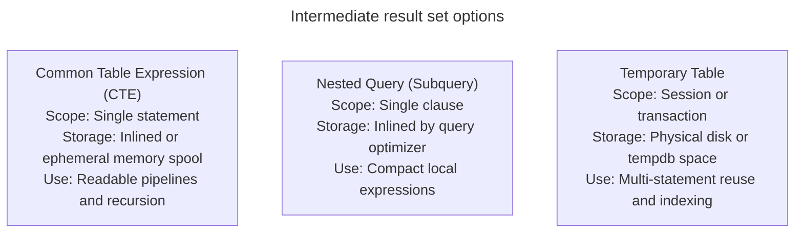

# Common table expressions

## Overview

A common table expression is a temporary, named result set defined within the execution scope of a single SQL statement. Introduced using the `WITH` clause, common table expressions improve query modularity, readability, and maintainability by decomposing complex multi-table joins and aggregations into sequential, logical steps.

This guide provides an operational reference for common table expressions, comparing them with nested queries and temporary tables, exploring optimizer `inlining` versus materialization boundaries, and analyzing query performance.

## Example datasets

The queries in this guide use the following `Departments` and `Orders` tables:

### `Departments` table

| `DepartmentID` | `DepartmentName` |
| :--- | :--- |
| 10 | Engineering |
| 20 | Marketing |
| 30 | Operations |

### `Orders` table

| `OrderID` | `DepartmentID` | `OrderAmount` |
| :--- | :--- | :--- |
| 101 | 10 | 60000.00 |
| 102 | 10 | 50000.00 |
| 103 | 20 | 45000.00 |
| 104 | 30 | 20000.00 |
| 105 | 30 | 30000.00 |

## Structure and chaining of common table expressions

A common table expression definition precedes the main `SELECT`, `INSERT`, `UPDATE`, or `DELETE` statement:

```sql
WITH cte_name AS (
  SELECT column1, column2
  FROM source_table
)
SELECT column1, column2
FROM cte_name;
```

### Sequential pipeline chaining

You can declare multiple comma-separated expressions within a single `WITH` block. Downstream expressions can reference any previously defined expression, creating a clean linear data pipeline:

```sql
WITH DepartmentTotals AS (
  -- Step 1: Calculate total sales and average order per department
  SELECT
    DepartmentID,
    SUM(OrderAmount) AS TotalSales,
    ROUND(AVG(OrderAmount), 2) AS AvgOrderValue
  FROM Orders
  GROUP BY DepartmentID
),
HighVolumeDepartments AS (
  -- Step 2: Filter for departments exceeding 50,000 in revenue
  SELECT
    DepartmentID,
    TotalSales,
    AvgOrderValue
  FROM DepartmentTotals
  WHERE TotalSales > 50000.00
)
-- Step 3: Join filtered results with department metadata
SELECT
  d.DepartmentName,
  h.TotalSales,
  h.AvgOrderValue
FROM HighVolumeDepartments AS h
INNER JOIN Departments AS d
  ON h.DepartmentID = d.DepartmentID
ORDER BY h.TotalSales DESC;
```

#### Query output table

| `DepartmentName` | `TotalSales` | `AvgOrderValue` |
| :--- | :--- | :--- |
| Engineering | 110000.00 | 55000.00 |

#### Step-by-step pipeline execution

1. `DepartmentTotals` aggregates `Orders`, yielding:
   - Department 10: `TotalSales = 110000.00`, `AvgOrderValue = 55000.00`
   - Department 20: `TotalSales = 45000.00`, `AvgOrderValue = 45000.00`
   - Department 30: `TotalSales = 50000.00`, `AvgOrderValue = 25000.00`
2. `HighVolumeDepartments` evaluates `TotalSales > 50000.00`, retaining only Department 10.
3. The outer query joins Department 10 with `Departments`, projecting `Engineering`.

## Architectural comparison: common table expressions, nested queries, and temporary tables

SQL offers three distinct approaches for managing intermediate result sets:



### Feature comparison matrix

| Characteristic | Common table expression | Nested query | Temporary table |
| :--- | :--- | :--- | :--- |
| **Lifecycle** | Single statement | Single clause | Session or transaction |
| **Cross-statement reuse** | No | No | Yes |
| **Code readability** | High: top-to-bottom pipeline | Low: deeply nested brackets | Moderate: separated SQL steps |
| **Explicit indexing** | No | No | Yes: create clustered or secondary indexes |
| **Database statistics** | Derived from source tables | Derived from source tables | Engine computes standalone statistics |
| **Physical cleanup** | Automatic at statement completion | Automatic at clause completion | Explicit `DROP TABLE` or session disconnect |

### Implementing the same requirement across all three methods

#### Approach 1 - nested query

```sql
SELECT
  d.DepartmentName,
  totals.TotalSales,
  totals.AvgOrderValue
FROM Departments AS d
INNER JOIN (
  SELECT
    DepartmentID,
    SUM(OrderAmount) AS TotalSales,
    ROUND(AVG(OrderAmount), 2) AS AvgOrderValue
  FROM Orders
  GROUP BY DepartmentID
  HAVING SUM(OrderAmount) > 50000.00
) AS totals
  ON d.DepartmentID = totals.DepartmentID;
```

#### Approach 2 - common table expression

```sql
WITH TargetDepartmentSales AS (
  SELECT
    DepartmentID,
    SUM(OrderAmount) AS TotalSales,
    ROUND(AVG(OrderAmount), 2) AS AvgOrderValue
  FROM Orders
  GROUP BY DepartmentID
  HAVING SUM(OrderAmount) > 50000.00
)
SELECT
  d.DepartmentName,
  s.TotalSales,
  s.AvgOrderValue
FROM Departments AS d
INNER JOIN TargetDepartmentSales AS s
  ON d.DepartmentID = s.DepartmentID;
```

#### Approach 3 - temporary table

```sql
CREATE TEMPORARY TABLE TempTargetSales AS
SELECT
  DepartmentID,
  SUM(OrderAmount) AS TotalSales,
  ROUND(AVG(OrderAmount), 2) AS AvgOrderValue
FROM Orders
GROUP BY DepartmentID
HAVING SUM(OrderAmount) > 50000.00;

CREATE INDEX idx_temp_dept ON TempTargetSales (DepartmentID);

SELECT
  d.DepartmentName,
  t.TotalSales,
  t.AvgOrderValue
FROM Departments AS d
INNER JOIN TempTargetSales AS t
  ON d.DepartmentID = t.DepartmentID;

DROP TABLE TempTargetSales;
```

All three methods return the exact same output record: `Engineering | 110000.00 | 55000.00`.

## Engine execution: `inlining` versus materialization

How the database engine executes a common table expression depends on its cost-based query optimizer.

### Query `inlining`

In modern database engines, including Google BigQuery, Snowflake, and PostgreSQL 12+, the query optimizer `inlines` non-recursive common table expressions by default.

The optimizer expands the expression definition directly into the parent query, treating it like an internal view. This allows the engine to:

- Push outer `WHERE` predicates down directly into the underlying table scan.
- Reorder join operations across the boundary.
- Leverage underlying table indexes.

### Materialization boundaries

When an expression contains non-deterministic functions, complex window calculations, or when a query references it multiple times, the engine might choose to materialize the intermediate result.

The engine evaluates the expression once, writes the intermediate rows to an in-memory or on-disk spool, and reads from that spool during subsequent references.

In PostgreSQL, you can explicitly guide the optimizer:

```sql
-- Force the engine to materialize the result once:
WITH CachedResults AS MATERIALIZED (
  SELECT ...
)

-- Force the optimizer to inline the query:
WITH InlineResults AS NOT MATERIALIZED (
  SELECT ...
)
```

## Common pitfalls

### Assuming a common table expression materializes only once

Don't assume the database computes an expression only once if you reference it multiple times in the outer query. In query engines that inline expressions, referencing `MyCTE` three times in joins or unions can execute the underlying query three separate times.

Verify the execution plan. If multiple evaluations incur heavy I/O or CPU costs, materialize the result into a temporary table first.

### Predicate `pushdown` failure across materialization fences

When an engine materializes an expression, it creates an optimization fence. If the outer query filters by `DepartmentID = 10`, but the materialized expression aggregates the entire table first, the database processes millions of unnecessary rows before applying the filter.

Always place restrictive filters directly inside the common table expression rather than relying solely on outer queries.

### Session leaks with temporary tables

Temporary tables persist across database connection lifetimes. When using connection pooling in backend services, forgetting to drop a temporary table leaves the relation alive in the connection pool. Subsequent requests can experience table name collisions or exhaust temporary memory space.

Always include explicit `DROP TABLE IF EXISTS` calls in execution cleanup blocks.

## Key takeaways

- Use common table expressions to decompose complex queries into readable, sequential pipelines.
- Prefer common table expressions over deeply nested queries to simplify code reviews and maintenance.
- Use temporary tables when intermediate results require dedicated indexes, updated statistics, or multi-statement reuse.
- Understand that modern optimizers inline non-recursive common table expressions by default, enabling predicate `pushdown`.
- Inspect query execution plans to verify whether the optimizer `inlines` or materializes intermediate expressions.
- Place row filters as close to the raw source tables as possible to prevent processing unneeded data.
