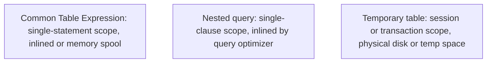

# Common table expressions

## Overview

A Common Table Expression, or `CTE`, is a temporary, named result set defined
within the execution scope of a single Structured Query Language, or `SQL`,
statement. Introduced using the `WITH` clause, common table expressions improve
query modularity, readability, and maintainability by decomposing complex
multi-table joins and aggregations into sequential, logical steps.

This guide provides an operational reference for common table expressions,
comparing them with nested queries and temporary tables, exploring optimizer
`inlining` versus materialization boundaries, and analyzing query performance
using the Stanford University research grant database.

## Reference schema and datasets

The queries in this guide run against two core relations from the Stanford
University academic administration schema: `departments` and
`research_project_grants`.

### Table schemas

```sql
CREATE TABLE departments (
  department_id   INTEGER PRIMARY KEY,
  department_name VARCHAR(50) NOT NULL,
  building        VARCHAR(50) NOT NULL
);

CREATE TABLE research_project_grants (
  grant_id        INTEGER PRIMARY KEY,
  department_id   INTEGER NOT NULL REFERENCES departments(department_id),
  grant_amount    NUMERIC(10, 2) NOT NULL
);
```

### Sample data

#### `departments` table

| `department_id` | `department_name` | `building` |
| :--- | :--- | :--- |
| `10` | Computer Science | Gates Building |
| `20` | Electrical Engineering | Packard Building |
| `30` | Linguistics | Memorial Hall |

#### `research_project_grants` table

| `grant_id` | `department_id` | `grant_amount` |
| :--- | :--- | :--- |
| `101` | `10` | `60000.00` |
| `102` | `10` | `50000.00` |
| `103` | `20` | `45000.00` |
| `104` | `30` | `20000.00` |
| `105` | `30` | `30000.00` |

## Structure and chaining of common table expressions

A common table expression definition precedes the main `SELECT`, `INSERT`,
`UPDATE`, or `DELETE` statement:

```sql
WITH cte_name AS (
  SELECT column1, column2
  FROM source_table
)
SELECT column1, column2
FROM cte_name;
```

### Sequential pipeline chaining

You can declare multiple comma-separated expressions within a single `WITH`
block. Downstream expressions can reference any previously defined expression,
creating a linear data pipeline:

```sql
WITH department_funding_totals AS (
  -- Step 1: Calculate total research funding and average grant per department
  SELECT
    department_id,
    SUM(grant_amount) AS total_funding,
    ROUND(AVG(grant_amount), 2) AS avg_grant_amount
  FROM research_project_grants
  GROUP BY department_id
),
high_funding_departments AS (
  -- Step 2: Filter for departments exceeding 50,000 in funding
  SELECT
    department_id,
    total_funding,
    avg_grant_amount
  FROM department_funding_totals
  WHERE total_funding > 50000.00
)
-- Step 3: Join filtered results with department metadata
SELECT
  d.department_name,
  h.total_funding,
  h.avg_grant_amount
FROM high_funding_departments AS h
INNER JOIN departments AS d
  ON h.department_id = d.department_id
ORDER BY h.total_funding DESC;
```

#### Query output table

| `department_name` | `total_funding` | `avg_grant_amount` |
| :--- | :--- | :--- |
| Computer Science | `110000.00` | `55000.00` |

#### Step-by-step pipeline execution

1. `department_funding_totals` aggregates `research_project_grants`, yielding:
   - Department `10`: `total_funding = 110000.00`, `avg_grant_amount = 55000.00`
   - Department `20`: `total_funding = 45000.00`, `avg_grant_amount = 45000.00`
   - Department `30`: `total_funding = 50000.00`, `avg_grant_amount = 25000.00`
2. `high_funding_departments` evaluates `total_funding > 50000.00`, retaining
   only Department `10`.
3. The outer query joins Department `10` with `departments`, projecting
   Computer Science.

## Architectural comparison: intermediate result sets

`SQL` provides three approaches for managing intermediate result sets:



### Feature comparison matrix

| Characteristic | Common table expression | Nested query | Temporary table |
| :--- | :--- | :--- | :--- |
| **Lifecycle** | Single statement | Single clause | Session or transaction |
| **Cross-statement reuse** | No | No | Yes |
| **Code readability** | High: top-to-bottom pipeline | Low: deeply nested brackets | Moderate: separated `SQL` steps |
| **Explicit indexing** | No | No | Yes: create clustered or secondary indexes |
| **Database statistics** | Derived from source tables | Derived from source tables | Engine computes standalone statistics |
| **Physical cleanup** | Automatic at statement completion | Automatic at clause completion | Explicit `DROP TABLE` or session disconnect |

### Implementing the same requirement across all three methods

#### Approach 1: nested query

```sql
SELECT
  d.department_name,
  totals.total_funding,
  totals.avg_grant_amount
FROM departments AS d
INNER JOIN (
  SELECT
    department_id,
    SUM(grant_amount) AS total_funding,
    ROUND(AVG(grant_amount), 2) AS avg_grant_amount
  FROM research_project_grants
  GROUP BY department_id
  HAVING SUM(grant_amount) > 50000.00
) AS totals
  ON d.department_id = totals.department_id;
```

#### Approach 2: common table expression

```sql
WITH target_department_funding AS (
  SELECT
    department_id,
    SUM(grant_amount) AS total_funding,
    ROUND(AVG(grant_amount), 2) AS avg_grant_amount
  FROM research_project_grants
  GROUP BY department_id
  HAVING SUM(grant_amount) > 50000.00
)
SELECT
  d.department_name,
  f.total_funding,
  f.avg_grant_amount
FROM departments AS d
INNER JOIN target_department_funding AS f
  ON d.department_id = f.department_id;
```

#### Approach 3: temporary table

```sql
CREATE TEMPORARY TABLE temp_target_funding AS
SELECT
  department_id,
  SUM(grant_amount) AS total_funding,
  ROUND(AVG(grant_amount), 2) AS avg_grant_amount
FROM research_project_grants
GROUP BY department_id
HAVING SUM(grant_amount) > 50000.00;

CREATE INDEX idx_temp_dept ON temp_target_funding (department_id);

SELECT
  d.department_name,
  t.total_funding,
  t.avg_grant_amount
FROM departments AS d
INNER JOIN temp_target_funding AS t
  ON d.department_id = t.department_id;

DROP TABLE temp_target_funding;
```

All three methods return the identical record for Computer Science, with
`110000.00` total funding and `55000.00` average grant amount.

## Engine execution: `inlining` versus materialization

How the database engine executes a common table expression depends on its
cost-based query optimizer.

### Query inline expansion

In modern database engines, including Google BigQuery, Snowflake, and PostgreSQL,
the query optimizer `inlines` non-recursive common table expressions by default.

The optimizer expands the expression definition directly into the parent query,
treating it like an internal view. This allows the engine to:

- Push outer `WHERE` predicates down directly into the underlying table scan.
- Reorder join operations across the boundary.
- Leverage underlying table indexes.

### Materialization boundaries

When an expression contains non-deterministic functions, complex window
calculations, or when a query references it multiple times, the engine might
choose to materialize the intermediate result.

The engine evaluates the expression once, writes the intermediate rows to an
in-memory or on-disk spool, and reads from that spool during subsequent
references.

In PostgreSQL, you can explicitly guide the optimizer:

```sql
-- Force the engine to materialize the result once:
WITH cached_results AS MATERIALIZED (
  SELECT ...
)

-- Force the optimizer to inline the query:
WITH inline_results AS NOT MATERIALIZED (
  SELECT ...
)
```

## Common pitfalls

### Assuming a common table expression materializes only once

Don't assume the database computes an expression only once if you reference it
multiple times in the outer query. In query engines that inline expressions,
referencing a `CTE` three times in joins or unions can execute the underlying
query three separate times.

Verify the execution plan. If multiple evaluations incur heavy I/O or CPU costs,
materialize the result into a temporary table first.

### Predicate push-down failure across materialization fences

When an engine materializes an expression, it creates an optimization fence. If
the outer query filters by `department_id = 10`, but the materialized expression
aggregates the entire table first, the database processes millions of unnecessary
rows before applying the filter.

Always place restrictive filters directly inside the common table expression
rather than relying solely on outer queries.

### Session leaks with temporary tables

Temporary tables persist across database connection lifetimes. When using
connection pooling in backend services, forgetting to drop a temporary table
leaves the relation alive in the connection pool. Subsequent requests can
experience table name collisions or exhaust temporary memory space.

Always include explicit `DROP TABLE IF EXISTS` calls in execution cleanup blocks.

## Key takeaways

- Use common table expressions to decompose complex queries into readable,
  sequential pipelines.
- Prefer common table expressions over deeply nested queries to simplify code
  reviews and maintenance.
- Use temporary tables when intermediate results require dedicated indexes,
  updated statistics, or multi-statement reuse.
- Understand that modern optimizers `inline` non-recursive common table expressions
  by default, enabling predicate push-down.
- Inspect query execution plans to verify whether the optimizer `inlines` or
  materializes intermediate expressions.
- Place row filters as close to the raw source tables as possible to prevent
  processing unneeded data.

## What's next

- Master recursive queries and graph cycle detection in
  [Recursive queries and graph traversals](/sql/recursive-queries-and-graph-traversals).
- Explore multidimensional aggregation with `ROLLUP` and `CUBE` in
  [Multidimensional aggregation](/sql/multidimensional-aggregation).
- Learn buffer pool management, page layouts, and write-ahead log recovery in
  [Database storage engine internals](/sql/database-storage-engine-internals).
