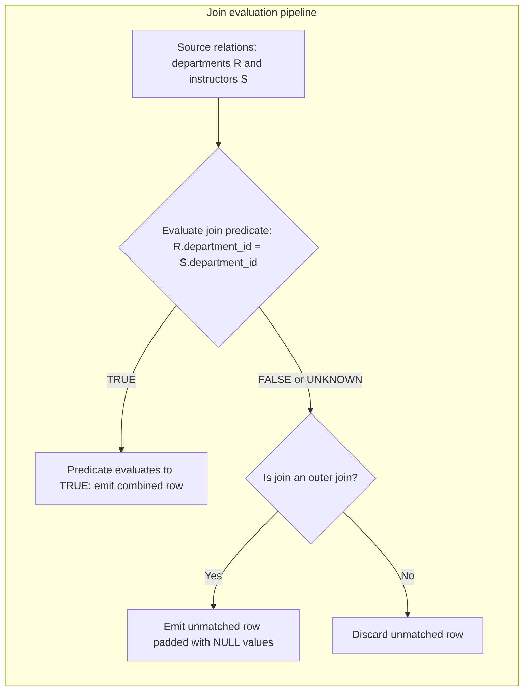

# Fundamental joins

## Overview

`SQL` joins combine attributes from two or more
relations by evaluating logical relationships between key attributes. In
relational algebra, a join reduces an unconstrained Cartesian product, $\times$,
into a filtered subset through projection, $\pi$, and selection, $\sigma$.

This guide details join semantics using the Stanford University academic database.
It walks through row-level engine evaluation pipelines, null-extension rules,
equality and non-equality operators, multi-table fan-out traps, and performance
implications.

## Reference schema and datasets

The examples in this guide run against three core relations from the Stanford
University registrar schema: `departments`, `instructors`, and
`faculty_salary_bands`.

### Table schemas

```sql
CREATE TABLE departments (
  department_id   INTEGER PRIMARY KEY,
  department_name VARCHAR(50) NOT NULL,
  building        VARCHAR(50) NOT NULL
);

CREATE TABLE instructors (
  instructor_id   INTEGER PRIMARY KEY,
  first_name      VARCHAR(50) NOT NULL,
  last_name       VARCHAR(50) NOT NULL,
  department_id   INTEGER REFERENCES departments(department_id),
  mentor_id       INTEGER REFERENCES instructors(instructor_id),
  salary          NUMERIC(10, 2) NOT NULL
);

CREATE TABLE faculty_salary_bands (
  band_name       VARCHAR(30) PRIMARY KEY,
  min_salary      NUMERIC(10, 2) NOT NULL,
  max_salary      NUMERIC(10, 2) NOT NULL
);
```

### Sample data

#### `departments` table

| `department_id` | `department_name` | `building` |
| :--- | :--- | :--- |
| `10` | Computer Science | Gates Building |
| `20` | Electrical Engineering | Packard Building |
| `30` | Linguistics | Memorial Hall |

#### `instructors` table

| `instructor_id` | `first_name` | `last_name` | `department_id` | `mentor_id` | `salary` |
| :--- | :--- | :--- | :--- | :--- | :--- |
| `101` | David | Clark | `10` | `NULL` | `140000.00` |
| `102` | Marcus | Miller | `10` | `101` | `125000.00` |
| `103` | Andrea | Taylor | `20` | `101` | `110000.00` |
| `104` | Sarah | Wilson | `NULL` | `102` | `95000.00` |

#### `faculty_salary_bands` table

| `band_name` | `min_salary` | `max_salary` |
| :--- | :--- | :--- |
| Assistant Professor | `80000.00` | `99999.99` |
| Associate Professor | `100000.00` | `119999.99` |
| Full Professor | `120000.00` | `160000.00` |

## How joins work in relational algebra

The database engine processes joins by testing candidate tuple pairs between a
left relation, $R$, and a right relation, $S$.



## Core join types and execution traces

### Inner join

An inner join returns rows only when the join condition in the `ON` clause
evaluates to `TRUE`. Unmatched rows from both tables drop out:

```sql
SELECT
  d.department_name,
  i.first_name,
  i.last_name,
  i.salary
FROM departments AS d
INNER JOIN instructors AS i
  ON d.department_id = i.department_id;
```

#### Row evaluation trace

| Department tuple | Instructor tuple | Evaluation of `d.department_id = i.department_id` | Status |
| :--- | :--- | :--- | :--- |
| `10` Computer Science | `101` David Clark, dept `10` | `10 = 10` $\rightarrow$ `TRUE` | Emitted |
| `10` Computer Science | `102` Marcus Miller, dept `10` | `10 = 10` $\rightarrow$ `TRUE` | Emitted |
| `20` Electrical Eng | `103` Andrea Taylor, dept `20` | `20 = 20` $\rightarrow$ `TRUE` | Emitted |
| `30` Linguistics | No match | No right-side tuple matches `30` | Discarded |
| No match | `104` Sarah Wilson, dept `NULL` | `d.department_id = NULL` $\rightarrow$ `UNKNOWN` | Discarded |

#### Result set

| `department_name` | `first_name` | `last_name` | `salary` |
| :--- | :--- | :--- | :--- |
| Computer Science | David | Clark | `140000.00` |
| Computer Science | Marcus | Miller | `125000.00` |
| Electrical Engineering | Andrea | Taylor | `110000.00` |

### Left outer join

A left outer join preserves all rows from the left relation. When a left-side
tuple has no matching right-side tuple, the engine supplies `NULL` for every
right-side column:

```sql
SELECT
  d.department_name,
  i.first_name,
  i.last_name,
  i.salary
FROM departments AS d
LEFT JOIN instructors AS i
  ON d.department_id = i.department_id;
```

#### Result set

Department `30`, Linguistics, has no assigned instructors. The query preserves
Linguistics and sets instructor attributes to `NULL`:

| `department_name` | `first_name` | `last_name` | `salary` |
| :--- | :--- | :--- | :--- |
| Computer Science | David | Clark | `140000.00` |
| Computer Science | Marcus | Miller | `125000.00` |
| Electrical Engineering | Andrea | Taylor | `110000.00` |
| Linguistics | `NULL` | `NULL` | `NULL` |

### Right outer join

A right outer join preserves all rows from the right relation. When a right-side
tuple has no matching left-side tuple, the engine supplies `NULL` for every
left-side column:

```sql
SELECT
  d.department_name,
  i.first_name,
  i.last_name,
  i.salary
FROM departments AS d
RIGHT JOIN instructors AS i
  ON d.department_id = i.department_id;
```

#### Result set

Instructor `104`, Sarah Wilson, holds a visiting fellowship with a `NULL`
department reference. The query preserves Sarah Wilson and pads department
columns with `NULL`:

| `department_name` | `first_name` | `last_name` | `salary` |
| :--- | :--- | :--- | :--- |
| Computer Science | David | Clark | `140000.00` |
| Computer Science | Marcus | Miller | `125000.00` |
| Electrical Engineering | Andrea | Taylor | `110000.00` |
| `NULL` | Sarah | Wilson | `95000.00` |

### Full outer join

A full outer join preserves all records from both relations. It outputs matched
pairs and applies `NULL` padding for unmatched records on either side:

```sql
SELECT
  d.department_name,
  i.first_name,
  i.last_name,
  i.salary
FROM departments AS d
FULL OUTER JOIN instructors AS i
  ON d.department_id = i.department_id;
```

#### Result set

Both Linguistics, a department without faculty, and Sarah Wilson, faculty
without a department, appear in the output:

| `department_name` | `first_name` | `last_name` | `salary` |
| :--- | :--- | :--- | :--- |
| Computer Science | David | Clark | `140000.00` |
| Computer Science | Marcus | Miller | `125000.00` |
| Electrical Engineering | Andrea | Taylor | `110000.00` |
| Linguistics | `NULL` | `NULL` | `NULL` |
| `NULL` | Sarah | Wilson | `95000.00` |

### Cross join

A cross join generates the Cartesian product, $R \times S$. Every row from the
left relation pairs with every row from the right relation:

```sql
SELECT
  d.department_name,
  b.band_name,
  b.min_salary,
  b.max_salary
FROM departments AS d
CROSS JOIN faculty_salary_bands AS b;
```

With 3 departments and 3 salary bands, the engine yields $3 \times 3 = 9$ rows:

| `department_name` | `band_name` | `min_salary` | `max_salary` |
| :--- | :--- | :--- | :--- |
| Computer Science | Assistant Professor | `80000.00` | `99999.99` |
| Computer Science | Associate Professor | `100000.00` | `119999.99` |
| Computer Science | Full Professor | `120000.00` | `160000.00` |
| Electrical Engineering | Assistant Professor | `80000.00` | `99999.99` |
| Electrical Engineering | Associate Professor | `100000.00` | `119999.99` |
| Electrical Engineering | Full Professor | `120000.00` | `160000.00` |
| Linguistics | Assistant Professor | `80000.00` | `99999.99` |
| Linguistics | Associate Professor | `100000.00` | `119999.99` |
| Linguistics | Full Professor | `120000.00` | `160000.00` |

### Self join

A self join correlates records within the same physical relation by applying
distinct table aliases. This design queries hierarchical relationships, such
as academic faculty mentoring trees:

```sql
SELECT
  mentee.first_name || ' ' || mentee.last_name AS faculty_member,
  mentor.first_name || ' ' || mentor.last_name AS faculty_mentor
FROM instructors AS mentee
LEFT JOIN instructors AS mentor
  ON mentee.mentor_id = mentor.instructor_id;
```

#### Result set

David Clark has a `NULL` mentor reference. The `LEFT JOIN` preserves David
Clark with a `NULL` mentor value:

| `faculty_member` | `faculty_mentor` |
| :--- | :--- |
| David Clark | `NULL` |
| Marcus Miller | David Clark |
| Andrea Taylor | David Clark |
| Sarah Wilson | Marcus Miller |

## Advanced join patterns

### Anti-join for missing record detection

An anti-join selects rows from the left relation that have no corresponding
record in the right relation. In `SQL`, construct an anti-join using a `LEFT JOIN`
paired with an `IS NULL` check on the right relation primary key:

```sql
SELECT
  d.department_id,
  d.department_name
FROM departments AS d
LEFT JOIN instructors AS i
  ON d.department_id = i.department_id
WHERE i.instructor_id IS NULL;
```

#### Execution steps

1. The `LEFT JOIN` scans `departments` and pairs matching rows from `instructors`.
2. For department `30`, Linguistics, the engine emits `NULL` for `i.instructor_id`.
3. The `WHERE` clause tests `i.instructor_id IS NULL`.
4. Departments `10` and `20` fail the check and drop out.
5. Department `30` satisfies the filter and enters the result set:

| `department_id` | `department_name` |
| :--- | :--- |
| `30` | Linguistics |

### Non-equi range joins

Joins can match records using range boundaries and comparison operators
rather than exact equality:

```sql
SELECT
  i.first_name,
  i.last_name,
  i.salary,
  b.band_name
FROM instructors AS i
INNER JOIN faculty_salary_bands AS b
  ON i.salary BETWEEN b.min_salary AND b.max_salary;
```

#### Range evaluation trace

| Faculty member | Salary | Matching salary band | Assigned band |
| :--- | :--- | :--- | :--- |
| David Clark | `140000.00` | `120000.00` to `160000.00` | Full Professor |
| Marcus Miller | `125000.00` | `120000.00` to `160000.00` | Full Professor |
| Andrea Taylor | `110000.00` | `100000.00` to `119999.99` | Associate Professor |
| Sarah Wilson | `95000.00` | `80000.00` to `99999.99` | Assistant Professor |

## Engine evaluation lifecycle: `ON` compared with `WHERE`

Placing a filter predicate in the `ON` clause versus the `WHERE` clause changes
query output when running outer joins:

- `ON` predicate: filters right-side tuples before performing null extension.
  The engine always preserves unmatched left-side rows.
- `WHERE` predicate: filters combined tuples after relation construction and
  null extension. Unmatched rows evaluating to `UNKNOWN` or `FALSE` drop out.

### Silent inner join trap

Suppose an analyst queries all academic departments and seeks to list faculty
members named Marcus:

#### Flawed query with `WHERE` filter

```sql
SELECT
  d.department_name,
  i.first_name,
  i.last_name
FROM departments AS d
LEFT JOIN instructors AS i
  ON d.department_id = i.department_id
WHERE i.first_name = 'Marcus';
```

#### Evaluation failure

1. The `LEFT JOIN` produces Linguistics with `i.first_name = NULL`.
2. The `WHERE` clause evaluates `NULL = 'Marcus'`, which yields `UNKNOWN`.
3. The database discards Linguistics and Electrical Engineering, silently
   converting the query into an `INNER JOIN`:

| `department_name` | `first_name` | `last_name` |
| :--- | :--- | :--- |
| Computer Science | Marcus | Miller |

### Correct query with `ON` filter

Move the name filter into the `ON` clause to preserve all department records:

```sql
SELECT
  d.department_name,
  i.first_name,
  i.last_name
FROM departments AS d
LEFT JOIN instructors AS i
  ON d.department_id = i.department_id
 AND i.first_name = 'Marcus';
```

#### Result set

| `department_name` | `first_name` | `last_name` |
| :--- | :--- | :--- |
| Computer Science | Marcus | Miller |
| Electrical Engineering | `NULL` | `NULL` |
| Linguistics | `NULL` | `NULL` |

## Row multiplication and aggregate inflation

Joining a parent entity to two independent one-to-many child relations triggers
a Cartesian explosion across child records. This multiplication corrupts aggregate
sums and counts.

### Demonstration schema and multi-table branching

```sql
CREATE TABLE students (
  student_id INTEGER PRIMARY KEY,
  full_name  VARCHAR(100) NOT NULL
);

-- Child relation 1: Tuition fee line items
CREATE TABLE student_fees (
  fee_id     INTEGER PRIMARY KEY,
  student_id INTEGER NOT NULL REFERENCES students(student_id),
  fee_amount NUMERIC(10, 2) NOT NULL
);

-- Child relation 2: Financial aid disbursements
CREATE TABLE student_aid (
  aid_id     INTEGER PRIMARY KEY,
  student_id INTEGER NOT NULL REFERENCES students(student_id),
  aid_amount NUMERIC(10, 2) NOT NULL
);
```

Assume student `1001` has:

- Two fees: fee `1`, `3000.00`, and fee `2`, `2000.00`. Total fees equal `5000.00`.
- Two aid awards: aid `1`, `1500.00`, and aid `2`, `1500.00`. Total aid equals `3000.00`.

### Flawed multi-table join

```sql
-- FLAWED: Multiplies rows across independent child branches
SELECT
  s.student_id,
  SUM(f.fee_amount) AS total_fees,
  SUM(a.aid_amount) AS total_aid
FROM students AS s
JOIN student_fees AS f ON s.student_id = f.student_id
JOIN student_aid AS a  ON s.student_id = a.student_id
GROUP BY s.student_id;
```

#### Row multiplication trace

Because each fee record pairs with each aid record, the query engine produces
$2 \times 2 = 4$ rows:

| `student_id` | `fee_id` | `fee_amount` | `aid_id` | `aid_amount` |
| :--- | :--- | :--- | :--- | :--- |
| `1001` | `1` | `3000.00` | `1` | `1500.00` |
| `1001` | `1` | `3000.00` | `2` | `1500.00` |
| `1001` | `2` | `2000.00` | `1` | `1500.00` |
| `1001` | `2` | `2000.00` | `2` | `1500.00` |

#### Inflated aggregate result

| `student_id` | `total_fees` | `total_aid` |
| :--- | :--- | :--- |
| `1001` | `10000.00` - inflated by 2x | `6000.00` - inflated by 2x |

### Safe pre-aggregation solution

Pre-aggregate child relations in separate Common Table Expressions, `CTEs`, before
joining them to the parent student record:

```sql
WITH fee_totals AS (
  SELECT
    student_id,
    SUM(fee_amount) AS total_fees
  FROM student_fees
  GROUP BY student_id
),
aid_totals AS (
  SELECT
    student_id,
    SUM(aid_amount) AS total_aid
  FROM student_aid
  GROUP BY student_id
)
SELECT
  s.student_id,
  COALESCE(f.total_fees, 0) AS total_fees,
  COALESCE(a.total_aid, 0)  AS total_aid
FROM students AS s
LEFT JOIN fee_totals AS f ON s.student_id = f.student_id
LEFT JOIN aid_totals AS a ON s.student_id = a.student_id;
```

#### Correct resultant output

| `student_id` | `total_fees` | `total_aid` |
| :--- | :--- | :--- |
| `1001` | `5000.00` | `3000.00` |

## Key takeaways

- Use `INNER JOIN` when returning records that satisfy the predicate in both relations.
- Use `LEFT JOIN` or `RIGHT JOIN` to retain unmatched records from one side.
- Keep outer join filtering predicates in the `ON` clause to prevent accidental
  conversion to an inner join.
- Identify missing records using anti-joins with a `LEFT JOIN` followed by an
  `IS NULL` check.
- Apply range operators in non-equi joins to assign continuous metrics to bands.
- Isolate independent one-to-many child aggregations into separate queries to
  avoid Cartesian multiplication.

## What's next

- Master three-valued logic, `COALESCE`, and `CASE` expressions in
  [Conditional logic and null handling](/sql/conditional-logic-and-null-handling).
- Learn scalar and correlated sub-queries and set operations in
  [Sub-queries and set operations](/sql/subqueries-and-set-operations).
- Explore window functions, partition frames, and rankings in
  [Analytical and window functions](/sql/analytical-and-window-functions).
