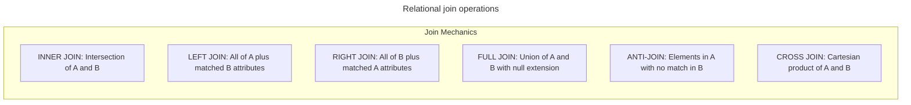

# Fundamental joins

## Overview

SQL joins combine columns from two or more tables by evaluating relationships
between common attributes. In relational algebra, joins decompose complex
cross products into filtered, correlated subsets using projection $\pi$,
selection $\sigma$, and set operators.

This guide provides a comprehensive reference for join operations. It covers
inner joins, left outer joins, right outer joins, full outer joins, cross
joins, self joins, anti-joins, and non-equi range joins through concrete
datasets, row-level engine evaluation traces, and side-by-side output tables.

## Reference datasets

The examples throughout this guide use three interrelated tables:
`Departments`, `Employees`, and `SalaryBands`.

```sql
CREATE TABLE Departments (
  DepartmentID   INTEGER PRIMARY KEY,
  DepartmentName VARCHAR(50) NOT NULL
);

CREATE TABLE Employees (
  EmployeeID     INTEGER PRIMARY KEY,
  FirstName      VARCHAR(50) NOT NULL,
  DepartmentID   INTEGER,
  ManagerID      INTEGER,
  Salary         NUMERIC(10, 2) NOT NULL
);

CREATE TABLE SalaryBands (
  BandLevel      VARCHAR(20) PRIMARY KEY,
  MinSalary      NUMERIC(10, 2) NOT NULL,
  MaxSalary      NUMERIC(10, 2) NOT NULL
);
```

### Table contents

#### `Departments` table

| DepartmentID | DepartmentName |
| :--- | :--- |
| `10` | Sales |
| `20` | Engineering |
| `30` | Marketing |

#### `Employees` table

| EmployeeID | FirstName | DepartmentID | ManagerID | Salary |
| :--- | :--- | :--- | :--- | :--- |
| `101` | Alice | `10` | `NULL` | `95000.00` |
| `102` | Bob | `20` | `101` | `72000.00` |
| `103` | Charlie | `20` | `101` | `48000.00` |
| `104` | Diana | `NULL` | `102` | `58000.00` |

#### `SalaryBands` table

| BandLevel | MinSalary | MaxSalary |
| :--- | :--- | :--- |
| Junior | `30000.00` | `49999.99` |
| Intermediate | `50000.00` | `79999.99` |
| Senior | `80000.00` | `120000.00` |

## Join taxonomy

The diagram illustrates how join types evaluate overlapping record sets
between a left relation $A$ and a right relation $B$:



## Join types and execution mechanics

### `INNER JOIN`

An inner join returns rows where the predicate in the `ON` clause evaluates
to `TRUE`. The engine discards unmatched rows from both tables:

```sql
SELECT
  d.DepartmentName,
  e.FirstName,
  e.Salary
FROM Departments AS d
INNER JOIN Employees AS e
  ON d.DepartmentID = e.DepartmentID;
```

#### Row matching evaluation trace

| Department | Employee | Evaluation of `d.DepartmentID = e.DepartmentID` | Action |
| :--- | :--- | :--- | :--- |
| `10` - Sales | `101` - Alice, Dept `10` | `10 = 10` $\rightarrow$ `TRUE` | Matched pair |
| `20` - Engineering | `102` - Bob, Dept `20` | `20 = 20` $\rightarrow$ `TRUE` | Matched pair |
| `20` - Engineering | `103` - Charlie, Dept `20` | `20 = 20` $\rightarrow$ `TRUE` | Matched pair |
| `30` - Marketing | None | No right match found | Discarded |
| None | `104` - Diana, Dept `NULL` | `NULL = d.DepartmentID` $\rightarrow$ `UNKNOWN` | Discarded |

#### Resultant output

| DepartmentName | FirstName | Salary |
| :--- | :--- | :--- |
| Sales | Alice | `95000.00` |
| Engineering | Bob | `72000.00` |
| Engineering | Charlie | `48000.00` |

### `LEFT JOIN`

A left outer join preserves every row from the left table. When a left-side row
finds no matching right-side row, the engine fills all right-side columns with
`NULL`:

```sql
SELECT
  d.DepartmentName,
  e.FirstName,
  e.Salary
FROM Departments AS d
LEFT JOIN Employees AS e
  ON d.DepartmentID = e.DepartmentID;
```

#### Resultant output

Department `30`, Marketing, has no assigned employees. The engine retains
Marketing and supplies `NULL` for employee attributes:

| DepartmentName | FirstName | Salary |
| :--- | :--- | :--- |
| Sales | Alice | `95000.00` |
| Engineering | Bob | `72000.00` |
| Engineering | Charlie | `48000.00` |
| Marketing | `NULL` | `NULL` |

### `RIGHT JOIN`

A right outer join preserves every row from the right table. When a right-side
row finds no matching left-side row, the engine fills all left-side columns
with `NULL`:

```sql
SELECT
  d.DepartmentName,
  e.FirstName,
  e.Salary
FROM Departments AS d
RIGHT JOIN Employees AS e
  ON d.DepartmentID = e.DepartmentID;
```

#### Resultant output

Diana has a `NULL` department reference. The engine retains Diana and supplies
`NULL` for department attributes:

| DepartmentName | FirstName | Salary |
| :--- | :--- | :--- |
| Sales | Alice | `95000.00` |
| Engineering | Bob | `72000.00` |
| Engineering | Charlie | `48000.00` |
| `NULL` | Diana | `58000.00` |

### `FULL OUTER JOIN`

A full outer join preserves every row from both tables. It combines matched
rows and generates `NULL` attributes for unmatched rows on either side:

```sql
SELECT
  d.DepartmentName,
  e.FirstName,
  e.Salary
FROM Departments AS d
FULL OUTER JOIN Employees AS e
  ON d.DepartmentID = e.DepartmentID;
```

#### Resultant output

Both the department without employees, Marketing, and the unassigned employee,
Diana, appear in the final result:

| DepartmentName | FirstName | Salary |
| :--- | :--- | :--- |
| Sales | Alice | `95000.00` |
| Engineering | Bob | `72000.00` |
| Engineering | Charlie | `48000.00` |
| Marketing | `NULL` | `NULL` |
| `NULL` | Diana | `58000.00` |

### `CROSS JOIN`

A cross join computes the Cartesian product of two relations. Every row in the
left table pairs with every row in the right table without any matching predicate:

```sql
SELECT
  d.DepartmentName,
  b.BandLevel,
  b.MinSalary,
  b.MaxSalary
FROM Departments AS d
CROSS JOIN SalaryBands AS b;
```

With 3 departments and 3 salary bands, the operation produces $3 \times 3 = 9$
permutations:

| DepartmentName | BandLevel | MinSalary | MaxSalary |
| :--- | :--- | :--- | :--- |
| Sales | Junior | `30000.00` | `49999.99` |
| Sales | Intermediate | `50000.00` | `79999.99` |
| Sales | Senior | `80000.00` | `120000.00` |
| Engineering | Junior | `30000.00` | `49999.99` |
| Engineering | Intermediate | `50000.00` | `79999.99` |
| Engineering | Senior | `80000.00` | `120000.00` |
| Marketing | Junior | `30000.00` | `49999.99` |
| Marketing | Intermediate | `50000.00` | `79999.99` |
| Marketing | Senior | `80000.00` | `120000.00` |

### Self join

A self join correlates records within the same physical table by assigning
distinct table aliases. This pattern evaluates hierarchical structures, such
as employee-manager reporting chains:

```sql
SELECT
  e.FirstName AS Employee,
  m.FirstName AS Manager
FROM Employees AS e
LEFT JOIN Employees AS m
  ON e.ManagerID = m.EmployeeID;
```

#### Resultant output

Alice has a `NULL` manager key, indicating executive status. The left join
retains Alice with a `NULL` manager column:

| Employee | Manager |
| :--- | :--- |
| Alice | `NULL` |
| Bob | Alice |
| Charlie | Alice |
| Diana | Bob |

## Advanced join patterns

### Anti-joins for difference detection

An anti-join identifies rows in the left table that have no matching record in
the right table. The standard pattern combines a `LEFT JOIN` with an `IS NULL`
filter on the right table primary key:

```sql
SELECT
  d.DepartmentID,
  d.DepartmentName
FROM Departments AS d
LEFT JOIN Employees AS e
  ON d.DepartmentID = e.DepartmentID
WHERE e.EmployeeID IS NULL;
```

#### Step-by-step anti-join trace

1. Left join produces all 3 departments, null-extending Marketing with `e.EmployeeID = NULL`.
2. The `WHERE` clause tests `e.EmployeeID IS NULL`.
3. Sales with `EmployeeID = 101` and Engineering with `EmployeeID = 102, 103` evaluate to `FALSE` and drop out.
4. Marketing evaluates to `TRUE` and survives.

#### Resultant output

| DepartmentID | DepartmentName |
| :--- | :--- |
| `30` | Marketing |

### Non-equi range joins

Joins aren't restricted to equality comparisons. A non-equi join matches
records using inequality operators, such as `BETWEEN`, `<`, or `>`:

```sql
SELECT
  e.FirstName,
  e.Salary,
  b.BandLevel
FROM Employees AS e
INNER JOIN SalaryBands AS b
  ON e.Salary BETWEEN b.MinSalary AND b.MaxSalary;
```

#### Salary range matching trace

| Employee | Salary | Matching Band Range | Assigned BandLevel |
| :--- | :--- | :--- | :--- |
| Alice | `95000.00` | `80000.00` to `120000.00` | Senior |
| Bob | `72000.00` | `50000.00` to `79999.99` | Intermediate |
| Charlie | `48000.00` | `30000.00` to `49999.99` | Junior |
| Diana | `58000.00` | `50000.00` to `79999.99` | Intermediate |

## Engine evaluation lifecycle: `ON` versus `WHERE`

A common query bug occurs when filtering preserved rows in an outer join.
The placement of a filter predicate dictates when the engine evaluates it:

- `ON` predicate: evaluated during relation construction before null extension.
- `WHERE` predicate: evaluated after relation construction and null extension.

### The silent inner join trap

Consider an engineer seeking to display all departments, but showing only
assigned employees named Charlie:

#### Flawed query with `WHERE` filter

```sql
SELECT
  d.DepartmentName,
  e.FirstName
FROM Departments AS d
LEFT JOIN Employees AS e
  ON d.DepartmentID = e.DepartmentID
WHERE e.FirstName = 'Charlie';
```

#### Execution trace for flawed query

1. The `LEFT JOIN` produces Marketing with `e.FirstName = NULL`.
2. The `WHERE` clause evaluates `e.FirstName = 'Charlie'`.
3. For Marketing, `'NULL' = 'Charlie'` evaluates to `UNKNOWN`.
4. The database discards Marketing, silently transforming the `LEFT JOIN`
   into an `INNER JOIN`.

| DepartmentName | FirstName |
| :--- | :--- |
| Engineering | Charlie |

#### Correct query with `ON` filter

Move the employee filter into the `ON` clause to preserve all departments:

```sql
SELECT
  d.DepartmentName,
  e.FirstName
FROM Departments AS d
LEFT JOIN Employees AS e
  ON d.DepartmentID = e.DepartmentID
 AND e.FirstName = 'Charlie';
```

#### Resultant output

| DepartmentName | FirstName |
| :--- | :--- |
| Sales | `NULL` |
| Engineering | Charlie |
| Marketing | `NULL` |

## Row multiplication and aggregate distortion

Joining a parent entity to multiple child tables with one-to-many relationships
causes a Cartesian explosion across child rows, producing severe calculation
errors in aggregate functions.

### Demonstration schema and sample data

```sql
-- Parent table: 1 Order
CREATE TABLE CustomerOrders (
  OrderID INTEGER PRIMARY KEY,
  OrderDate DATE NOT NULL
);

-- Child table 1: 2 Line Items for Order 1
CREATE TABLE OrderLineItems (
  ItemID INTEGER PRIMARY KEY,
  OrderID INTEGER NOT NULL,
  ItemCost NUMERIC(10, 2) NOT NULL
);

-- Child table 2: 2 Payment Installments for Order 1
CREATE TABLE OrderPayments (
  PaymentID INTEGER PRIMARY KEY,
  OrderID INTEGER NOT NULL,
  PaymentAmount NUMERIC(10, 2) NOT NULL
);
```

Suppose Order `1` contains:

- Two items: item `1` costs `100.00`, and item `2` costs `200.00`, with true total `300.00`.
- Two payments: payment `1` is `150.00`, and payment `2` is `150.00`, with true total `300.00`.

### The naive join trap

```sql
-- FLAWED: Multiplies rows across independent 1:N branches
SELECT
  o.OrderID,
  SUM(i.ItemCost) AS TotalItems,
  SUM(p.PaymentAmount) AS TotalPayments
FROM CustomerOrders AS o
JOIN OrderLineItems AS i ON o.OrderID = i.OrderID
JOIN OrderPayments AS p ON o.OrderID = p.OrderID
GROUP BY o.OrderID;
```

#### Underlying row multiplication trace

Because each item matches each payment, the engine generates $2 \times 2 = 4$ rows:

| OrderID | ItemID | ItemCost | PaymentID | PaymentAmount |
| :--- | :--- | :--- | :--- | :--- |
| `1` | `1` | `100.00` | `1` | `150.00` |
| `1` | `1` | `100.00` | `2` | `150.00` |
| `1` | `2` | `200.00` | `1` | `150.00` |
| `1` | `2` | `200.00` | `2` | `150.00` |

#### Distorted aggregation output

The computed sums double the actual financial totals:

| OrderID | TotalItems | TotalPayments |
| :--- | :--- | :--- |
| `1` | `600.00` - inflated by 2x | `600.00` - inflated by 2x |

### The safe pre-aggregation solution

Pre-aggregate each one-to-many relationship independently using common table
expressions before joining the aggregated summaries to the parent record:

```sql
WITH ItemSummary AS (
  SELECT
    OrderID,
    SUM(ItemCost) AS TotalItems
  FROM OrderLineItems
  GROUP BY OrderID
),
PaymentSummary AS (
  SELECT
    OrderID,
    SUM(PaymentAmount) AS TotalPayments
  FROM OrderPayments
  GROUP BY OrderID
)
SELECT
  o.OrderID,
  COALESCE(i.TotalItems, 0) AS TotalItems,
  COALESCE(p.TotalPayments, 0) AS TotalPayments
FROM CustomerOrders AS o
LEFT JOIN ItemSummary AS i ON o.OrderID = i.OrderID
LEFT JOIN PaymentSummary AS p ON o.OrderID = p.OrderID;
```

#### Correct resultant output

| OrderID | TotalItems | TotalPayments |
| :--- | :--- | :--- |
| `1` | `300.00` | `300.00` |

## Key takeaways

- Use `INNER JOIN` when returning records that satisfy the match condition in
  both tables.
- Use `LEFT JOIN` or `RIGHT JOIN` to preserve unmatched rows from one side.
- Filter unmatched rows in outer joins by placing right-table conditions in
  the `ON` clause rather than the `WHERE` clause.
- Detect orphan records using the anti-join pattern: `LEFT JOIN` with `WHERE right_pk IS NULL`.
- Use non-equi joins to categorize values into continuous ranges.
- Prevent duplicate rows and aggregate inflation by pre-aggregating independent
  child relationships before joining.
