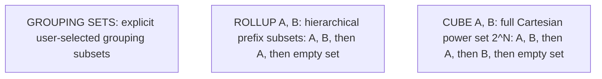

# Multidimensional aggregation

## Overview

Multidimensional aggregation produces detail rows, intermediate subtotals, and
grand totals within a single Structured Query Language, or `SQL`, statement.
Rather than executing multiple separate `GROUP BY` queries and stitching them
together with `UNION ALL`, `SQL` provides three dedicated operators:
`GROUPING SETS`, `ROLLUP`, and `CUBE`.

This guide provides an operational reference for multidimensional aggregation,
covering grouping combinations, hierarchical summaries, Cartesian cube sets, the
`GROUPING()` disambiguation function, and query optimization using the Stanford
University academic revenue database.

## Reference schema and dataset

The queries in this guide run against the `school_tuition_revenue` relation,
which records tuition earnings across university academic schools and degree
levels:

```sql
CREATE TABLE school_tuition_revenue (
  school_name    VARCHAR(50) NOT NULL,
  degree_level   VARCHAR(50) NOT NULL,
  tuition_amount NUMERIC(12, 2) NOT NULL,
  PRIMARY KEY (school_name, degree_level)
);
```

### Table contents

| `school_name` | `degree_level` | `tuition_amount` |
| :--- | :--- | :--- |
| School of Engineering | Undergraduate | `500000.00` |
| School of Engineering | Graduate | `300000.00` |
| School of Humanities | Undergraduate | `400000.00` |
| School of Humanities | Graduate | `200000.00` |

## Comparison of multidimensional operators

The three operators differ in which combinations of grouping columns they
evaluate:



| Operator | Grouping formula for columns $A, B$ | Number of grouping sets | Typical use case |
| :--- | :--- | :--- | :--- |
| `ROLLUP(A, B)` | `(A, B)`, `(A)`, `()` | $N + 1$ sets | Hierarchical dimensions such as Year $\rightarrow$ Quarter $\rightarrow$ Month |
| `CUBE(A, B)` | `(A, B)`, `(A)`, `(B)`, `()` | $2^N$ sets | Cross-tabulation matrices and multi-pivot reporting |
| `GROUPING SETS (...)` | Explicit list provided by user | Custom count | Targeted reports needing specific subtotals without grand totals |

## `GROUPING SETS`

`GROUPING SETS` provides manual control over the generated aggregation levels.
The query engine computes only the exact grouping sets specified in the list:

```sql
SELECT
  school_name,
  degree_level,
  SUM(tuition_amount) AS total_tuition
FROM school_tuition_revenue
GROUP BY GROUPING SETS (
  (school_name, degree_level),
  (school_name),
  ()
);
```

### Output table for `GROUPING SETS`

| `school_name` | `degree_level` | `total_tuition` | Aggregation level |
| :--- | :--- | :--- | :--- |
| School of Engineering | Undergraduate | `500000.00` | Detail row |
| School of Engineering | Graduate | `300000.00` | Detail row |
| School of Humanities | Undergraduate | `400000.00` | Detail row |
| School of Humanities | Graduate | `200000.00` | Detail row |
| School of Engineering | `NULL` | `800000.00` | Subtotal for School of Engineering |
| School of Humanities | `NULL` | `600000.00` | Subtotal for School of Humanities |
| `NULL` | `NULL` | `1400000.00` | University grand total |

The empty set, `()`, instructs the database to aggregate across all rows without
grouping, producing the grand-total row.

## `ROLLUP`

`ROLLUP` creates hierarchical subtotals by successively stripping columns from
right to left. For $N$ columns, `ROLLUP` produces $N + 1$ grouping sets.

For `ROLLUP (school_name, degree_level)`, the engine computes:

1. `(school_name, degree_level)`: detail rows.
2. `(school_name)`: school subtotals.
3. `()`: grand total.

```sql
SELECT
  school_name,
  degree_level,
  SUM(tuition_amount) AS total_tuition
FROM school_tuition_revenue
GROUP BY ROLLUP (school_name, degree_level);
```

### Output table for `ROLLUP`

| `school_name` | `degree_level` | `total_tuition` | Aggregation level |
| :--- | :--- | :--- | :--- |
| School of Engineering | Undergraduate | `500000.00` | Detail row |
| School of Engineering | Graduate | `300000.00` | Detail row |
| School of Engineering | `NULL` | `800000.00` | School of Engineering subtotal |
| School of Humanities | Undergraduate | `400000.00` | Detail row |
| School of Humanities | Graduate | `200000.00` | Detail row |
| School of Humanities | `NULL` | `600000.00` | School of Humanities subtotal |
| `NULL` | `NULL` | `1400000.00` | University grand total |

Column order is significant in `ROLLUP`. Specifying `ROLLUP (degree_level, school_name)`
generates degree level subtotals rather than school subtotals.

## `CUBE`

`CUBE` generates every mathematical permutation of the specified columns. For
$N$ grouping columns, `CUBE` produces $2^N$ grouping sets.

For `CUBE (school_name, degree_level)`, where $N = 2$, the engine produces
$2^2 = 4$ grouping sets:

1. `(school_name, degree_level)`: detail level.
2. `(school_name)`: school subtotal.
3. `(degree_level)`: degree level subtotal across all schools.
4. `()`: grand total.

```sql
SELECT
  school_name,
  degree_level,
  SUM(tuition_amount) AS total_tuition
FROM school_tuition_revenue
GROUP BY CUBE (school_name, degree_level);
```

### Output table for `CUBE`

| `school_name` | `degree_level` | `total_tuition` | Aggregation level |
| :--- | :--- | :--- | :--- |
| School of Engineering | Undergraduate | `500000.00` | Detail row |
| School of Engineering | Graduate | `300000.00` | Detail row |
| School of Humanities | Undergraduate | `400000.00` | Detail row |
| School of Humanities | Graduate | `200000.00` | Detail row |
| School of Engineering | `NULL` | `800000.00` | School of Engineering subtotal |
| School of Humanities | `NULL` | `600000.00` | School of Humanities subtotal |
| `NULL` | Undergraduate | `900000.00` | Undergraduate university subtotal |
| `NULL` | Graduate | `500000.00` | Graduate university subtotal |
| `NULL` | `NULL` | `1400000.00` | University grand total |

Notice that `CUBE` includes degree level subtotals across all schools, enabling
cross-dimensional pivot analysis.

## Distinguishing null values with the `GROUPING()` function

When `ROLLUP` or `CUBE` generates a subtotal or grand total, the database places
a `NULL` marker in the aggregated columns. However, source records can also
contain natural `NULL` values, such as courses without an assigned degree track.

The `GROUPING(column)` function resolves this ambiguity:

- `GROUPING(column) = 0`: the column value represents genuine row data.
- `GROUPING(column) = 1`: the column value is a subtotal placeholder created
  by the aggregation operator.

```sql
SELECT
  CASE
    WHEN GROUPING(school_name) = 1 THEN 'All Schools'
    ELSE school_name
  END AS school_label,
  CASE
    WHEN GROUPING(degree_level) = 1 THEN 'All Degree Levels'
    ELSE degree_level
  END AS degree_label,
  GROUPING(school_name) AS is_school_aggregated,
  GROUPING(degree_level) AS is_degree_aggregated,
  SUM(tuition_amount) AS total_tuition
FROM school_tuition_revenue
GROUP BY CUBE (school_name, degree_level)
ORDER BY
  GROUPING(school_name),
  GROUPING(degree_level),
  school_name,
  degree_level;
```

### Output table with explicit grouping labels

| `school_label` | `degree_label` | `is_school_aggregated` | `is_degree_aggregated` | `total_tuition` | Level |
| :--- | :--- | :--- | :--- | :--- | :--- |
| School of Engineering | Undergraduate | `0` | `0` | `500000.00` | Detail |
| School of Engineering | Graduate | `0` | `0` | `300000.00` | Detail |
| School of Humanities | Undergraduate | `0` | `0` | `400000.00` | Detail |
| School of Humanities | Graduate | `0` | `0` | `200000.00` | Detail |
| School of Engineering | All Degree Levels | `0` | `1` | `800000.00` | School subtotal |
| School of Humanities | All Degree Levels | `0` | `1` | `600000.00` | School subtotal |
| All Schools | Undergraduate | `1` | `0` | `900000.00` | Degree subtotal |
| All Schools | Graduate | `1` | `0` | `500000.00` | Degree subtotal |
| All Schools | All Degree Levels | `1` | `1` | `1400000.00` | Grand total |

## Common pitfalls

### Combinatorial explosion with high-dimensional `CUBE`

Because `CUBE` produces $2^N$ grouping combinations, expanding five dimensions
produces $2^5 = 32$ grouping passes. Expanding ten dimensions generates
$2^{10} = 1024$ grouping sets, creating high row counts, memory pressure, and
extended query run times.

Use `GROUPING SETS` to target only specific subtotal combinations required by
reporting tools.

### Filtering subtotals in `WHERE` versus `HAVING`

A `WHERE` clause filters individual rows before aggregation occurs. Attempting
to filter out grand totals using `WHERE` fails because grand totals don't exist
until after aggregation runs.

To filter out intermediate subtotals or retain only grand totals, filter on
`GROUPING()` inside the `HAVING` clause:

```sql
-- Retain only school subtotals, excluding detail rows and grand totals:
SELECT school_name, degree_level, SUM(tuition_amount) AS total_tuition
FROM school_tuition_revenue
GROUP BY CUBE (school_name, degree_level)
HAVING GROUPING(school_name) = 0 AND GROUPING(degree_level) = 1;
```

## Key takeaways

- Use `GROUPING SETS` to calculate custom subsets of aggregations without
  generating unneeded permutations.
- Use `ROLLUP` for ordered hierarchical dimensions, producing $N + 1$ sets.
- Use `CUBE` for full cross-tabulation matrices across dimensions, producing
  $2^N$ sets.
- Use `GROUPING(column)` to distinguish between natural data nulls and
  engine-generated subtotal placeholders.
- Filter detail rows using `WHERE` and filter generated subtotal levels using
  `HAVING`.

## What's next

- Learn how storage engines manage pages, buffer pools, and write-ahead logging in
  [Database storage engine internals](/sql/database-storage-engine-internals).
- Explore B-trees, hash indexes, and covering indexes in
  [Indexing internals](/sql/indexing-internals).
- Understand logical planning and physical execution operators in
  [Query execution engine](/sql/query-execution-engine).
