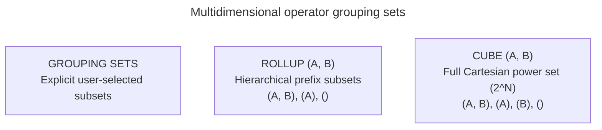

# Multidimensional aggregation

## Overview

Multidimensional aggregation produces detail rows, intermediate subtotals, and grand totals within a single SQL statement. Rather than executing multiple separate `GROUP BY` queries and stitching them together with `UNION ALL`, SQL provides three dedicated operators: `GROUPING SETS`, `ROLLUP`, and `CUBE`.

This guide provides an operational reference for multidimensional aggregation, covering grouping combinations, hierarchical summaries, Cartesian cube sets, the `GROUPING()` disambiguation function, and query optimization.

## Example dataset

The queries in this guide use the following `RegionalSales` table:

| `Region` | `Category` | `SalesAmount` |
| :--- | :--- | :--- |
| North | Electronics | 50000.00 |
| North | Furniture | 30000.00 |
| South | Electronics | 40000.00 |
| South | Furniture | 20000.00 |

## Comparison of multidimensional operators

The three operators differ in which combinations of grouping columns they evaluate:



| Operator | Grouping formula for columns $A, B$ | Number of grouping sets | Typical use case |
| :--- | :--- | :--- | :--- |
| `ROLLUP(A, B)` | `(A, B)`, `(A)`, `()` | $N + 1$ sets | Hierarchical data like Year $\rightarrow$ Quarter $\rightarrow$ Month |
| `CUBE(A, B)` | `(A, B)`, `(A)`, `(B)`, `()` | $2^N$ sets | Cross-tabulation matrices and multi-pivot reporting |
| `GROUPING SETS (...)` | User specifies exact list | Custom count | Targeted reports needing specific subtotals without grand totals |

## `GROUPING SETS`

`GROUPING SETS` provides manual control over the generated aggregation levels. The query engine computes only the exact grouping sets specified in the list:

```sql
SELECT
  Region,
  Category,
  SUM(SalesAmount) AS TotalSales
FROM RegionalSales
GROUP BY GROUPING SETS (
  (Region, Category),
  (Region),
  ()
);
```

### Output table for `GROUPING SETS`

| `Region` | `Category` | `TotalSales` | Aggregation level |
| :--- | :--- | :--- | :--- |
| North | Electronics | 50000.00 | Detail row |
| North | Furniture | 30000.00 | Detail row |
| South | Electronics | 40000.00 | Detail row |
| South | Furniture | 20000.00 | Detail row |
| North | `NULL` | 80000.00 | Subtotal for North region |
| South | `NULL` | 60000.00 | Subtotal for South region |
| `NULL` | `NULL` | 140000.00 | Grand total |

The empty set `()` instructs the database to aggregate across all rows without grouping, producing the grand-total row.

## `ROLLUP`

`ROLLUP` creates hierarchical subtotals by successively stripping columns from right to left. For $N$ columns, `ROLLUP` produces $N + 1$ grouping sets.

For `ROLLUP (Region, Category)`, the engine computes:

1. `(Region, Category)`: detail rows.
2. `(Region)`: regional subtotals.
3. `()`: grand total.

```sql
SELECT
  Region,
  Category,
  SUM(SalesAmount) AS TotalSales
FROM RegionalSales
GROUP BY ROLLUP (Region, Category);
```

### Output table for `ROLLUP`

| `Region` | `Category` | `TotalSales` | Aggregation level |
| :--- | :--- | :--- | :--- |
| North | Electronics | 50000.00 | Detail row |
| North | Furniture | 30000.00 | Detail row |
| North | `NULL` | 80000.00 | North subtotal |
| South | Electronics | 40000.00 | Detail row |
| South | Furniture | 20000.00 | Detail row |
| South | `NULL` | 60000.00 | South subtotal |
| `NULL` | `NULL` | 140000.00 | Grand total |

Column order is significant in `ROLLUP`. Specifying `ROLLUP (Category, Region)` generates category subtotals rather than regional subtotals.

## `CUBE`

`CUBE` generates every mathematical permutation of the specified columns. For $N$ grouping columns, `CUBE` produces $2^N$ grouping sets.

For `CUBE (Region, Category)`, where $N = 2$, the engine produces $2^2 = 4$ grouping sets:

1. `(Region, Category)`: detail level.
2. `(Region)`: regional subtotal.
3. `(Category)`: category subtotal.
4. `()`: grand total.

```sql
SELECT
  Region,
  Category,
  SUM(SalesAmount) AS TotalSales
FROM RegionalSales
GROUP BY CUBE (Region, Category);
```

### Output table for `CUBE`

| `Region` | `Category` | `TotalSales` | Aggregation level |
| :--- | :--- | :--- | :--- |
| North | Electronics | 50000.00 | Detail row |
| North | Furniture | 30000.00 | Detail row |
| South | Electronics | 40000.00 | Detail row |
| South | Furniture | 20000.00 | Detail row |
| North | `NULL` | 80000.00 | North region subtotal |
| South | `NULL` | 60000.00 | South region subtotal |
| `NULL` | Electronics | 90000.00 | Electronics category subtotal |
| `NULL` | Furniture | 50000.00 | Furniture category subtotal |
| `NULL` | `NULL` | 140000.00 | Grand total |

Notice that `CUBE` includes category subtotals across all regions, enabling cross-dimensional pivot analysis.

## Distinguishing null values with the `GROUPING()` function

When `ROLLUP` or `CUBE` generates a subtotal or grand total, the database places a `NULL` marker in the aggregated columns. However, source records may also contain natural `NULL` values, such as products without an assigned category.

The `GROUPING(column)` function resolves this ambiguity:

- `GROUPING(column) = 0`: the column value represents genuine row data.
- `GROUPING(column) = 1`: the column value is a subtotal placeholder created by the aggregation operator.

```sql
SELECT
  CASE
    WHEN GROUPING(Region) = 1 THEN 'All Regions'
    ELSE Region
  END AS RegionLabel,
  CASE
    WHEN GROUPING(Category) = 1 THEN 'All Categories'
    ELSE Category
  END AS CategoryLabel,
  GROUPING(Region) AS IsRegionAggregated,
  GROUPING(Category) AS IsCategoryAggregated,
  SUM(SalesAmount) AS TotalSales
FROM RegionalSales
GROUP BY CUBE (Region, Category)
ORDER BY
  GROUPING(Region),
  GROUPING(Category),
  Region,
  Category;
```

### Output table with explicit grouping labels

| `RegionLabel` | `CategoryLabel` | `IsRegionAggregated` | `IsCategoryAggregated` | `TotalSales` | Level |
| :--- | :--- | :--- | :--- | :--- | :--- |
| North | Electronics | 0 | 0 | 50000.00 | Detail |
| North | Furniture | 0 | 0 | 30000.00 | Detail |
| South | Electronics | 0 | 0 | 40000.00 | Detail |
| South | Furniture | 0 | 0 | 20000.00 | Detail |
| North | All Categories | 0 | 1 | 80000.00 | Region subtotal |
| South | All Categories | 0 | 1 | 60000.00 | Region subtotal |
| All Regions | Electronics | 1 | 0 | 90000.00 | Category subtotal |
| All Regions | Furniture | 1 | 0 | 50000.00 | Category subtotal |
| All Regions | All Categories | 1 | 1 | 140000.00 | Grand total |

## Common pitfalls

### Combinatorial explosion with high-dimensional `CUBE`

Because `CUBE` produces $2^N$ grouping combinations, expanding five dimensions produces $2^5 = 32$ grouping passes. Expanding ten dimensions generates $2^{10} = 1024$ grouping sets, creating high row counts, severe memory pressure, and extended query run times.

Use `GROUPING SETS` to target only the specific subtotal combinations required by reporting tools.

### Filtering subtotals in `WHERE` versus `HAVING`

A `WHERE` clause filters individual rows before aggregation occurs. Attempting to filter out grand totals using `WHERE` fails because grand totals don't exist until after aggregation runs.

To filter out intermediate subtotals or retain only grand totals, filter on `GROUPING()` inside the `HAVING` clause:

```sql
-- Retain only regional subtotals, excluding detail rows and grand totals:
SELECT Region, Category, SUM(SalesAmount) AS TotalSales
FROM RegionalSales
GROUP BY CUBE (Region, Category)
HAVING GROUPING(Region) = 0 AND GROUPING(Category) = 1;
```

## Key takeaways

- Use `GROUPING SETS` to calculate custom subsets of aggregations without generating unused permutations.
- Use `ROLLUP` for ordered hierarchical dimensions, producing $N + 1$ sets.
- Use `CUBE` for full cross-tabulation matrices across dimensions, producing $2^N$ sets.
- Use `GROUPING(column)` to distinguish between natural data nulls and engine-generated subtotal placeholders.
- Filter detail rows using `WHERE` and filter generated subtotal levels using `HAVING`.
