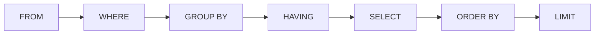
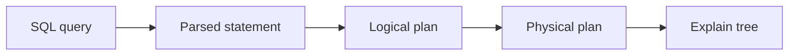
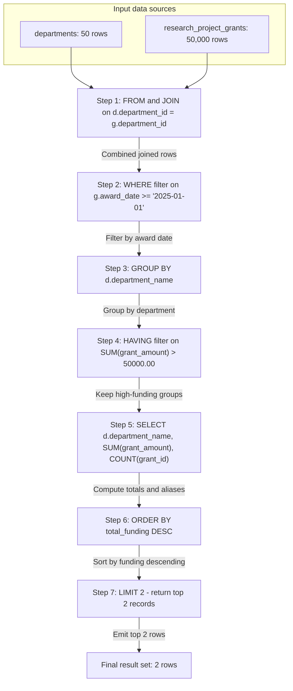
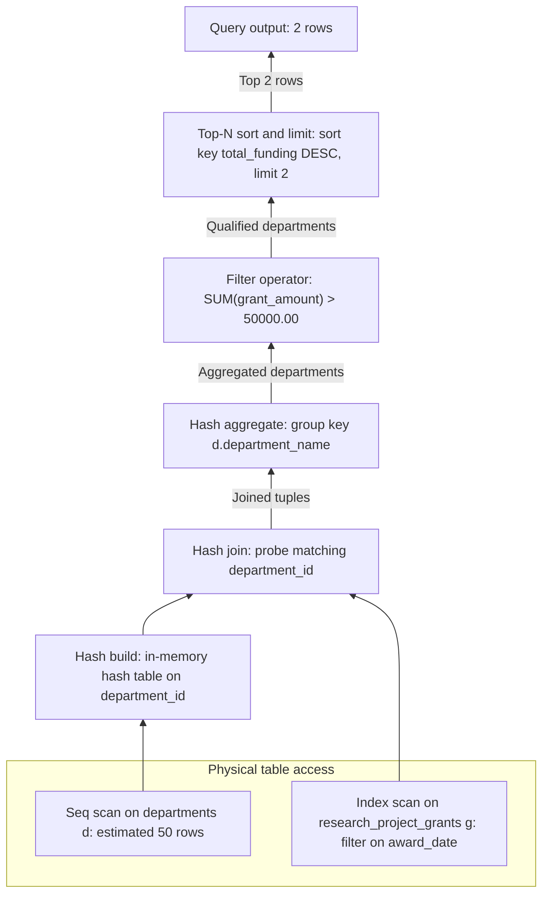

# Query execution engine

## Overview

Structured Query Language, or `SQL`, is a declarative language. You describe the
data you want, and the query optimizer decides how to retrieve and process it
efficiently.

This guide explains two concepts that govern query execution:

- The logical order in which the database evaluates a query.
- The `EXPLAIN` plan that shows the physical work chosen by the optimizer.

The written `SQL` syntax order and the actual execution sequence are different.
Understanding both semantic evaluation and physical execution is essential for
optimizing query performance.

## Logical execution order

Developers write `SQL` queries in the following syntactic order:

```sql
SELECT
FROM
WHERE
GROUP BY
HAVING
ORDER BY
LIMIT
```

The database engine evaluates query components in this logical order instead:



This order describes the logical execution pipeline. It models how the engine
filters records, groups them, computes aggregates, sorts results, and limits
output.

### Reading source rows

The engine starts with the relations listed in the `FROM` clause. If the query
specifies join conditions, it pairs rows from those tables before performing
subsequent operations.

This step creates the base row set for the rest of the query.

### Filtering rows

The `WHERE` clause filters individual rows before aggregation. Only rows that
evaluate to `TRUE` continue to the next stage.

Filtering early reduces the volume of data that subsequent grouping and sorting
stages must process.

### Grouping data

The `GROUP BY` clause partitions rows into buckets based on one or more grouping
keys. Rows sharing identical group keys enter the same bucket.

After grouping, aggregate functions such as `SUM`, `COUNT`, and `AVG` compute
summary metrics across each bucket.

### Filtering grouped data

The `HAVING` clause filters grouped results after aggregation. It tests
conditions on aggregate metrics, such as `SUM(grant_amount) > 50000.00`.

This differs from `WHERE`, which evaluates individual records before grouping.

### Selecting output columns

The `SELECT` clause shapes the final output. It projects requested columns,
computes expressions, and assigns column aliases.

The engine evaluates this stage after row filtering and grouping complete.

### Sorting and limiting

The `ORDER BY` clause sorts the projected rows. The `LIMIT` or `OFFSET` clause
then restricts the number of rows emitted to the client.

Because sorting occurs near the end of the pipeline, column aliases defined in
`SELECT` are valid in `ORDER BY`.

## Explain plans and the optimizer

The logical execution order explains `SQL` semantics. The optimizer determines
how the engine executes the query in practice.

A cost-based query optimizer converts a declarative `SQL` statement into a
physical execution plan. It selects access paths, join algorithms, and execution
order:



An `EXPLAIN` plan displays the physical operations, access methods, join
algorithms, and estimated execution costs chosen by the optimizer.

### What an explain plan includes

An explain plan displays:

- Table scans and index range scans.
- Filter operators and predicate push-down.
- Join algorithms such as nested loops, hash joins, and merge joins.
- Grouping and aggregation operators.
- In-memory and external sorting passes.
- Limit and offset boundaries.

These details reveal whether the optimizer used indexes, filtered rows early,
or sorted large intermediate sets.

## Complete example

Consider two tables from the Stanford University research administration schema:
`departments` and `research_project_grants`. The query identifies the top two
academic departments with total research funding exceeding $50,000 for grants
awarded in 2025:

```sql
SELECT
  d.department_name,
  SUM(g.grant_amount) AS total_funding,
  COUNT(g.grant_id) AS total_grants
FROM departments AS d
JOIN research_project_grants AS g
  ON d.department_id = g.department_id
WHERE g.award_date >= '2025-01-01'
GROUP BY d.department_name
HAVING SUM(g.grant_amount) > 50000.00
ORDER BY total_funding DESC
LIMIT 2;
```

### Query execution flow



This pipeline matches the logical execution model. The database evaluates the
query following the step sequence rather than the written clause order.

### Physical explain plan

The following diagram illustrates a physical execution tree:



The optimizer chose:

- A hash join to combine the tables.
- A sequential scan on the compact `departments` relation.
- An index scan on `research_project_grants` with an early date filter.
- A hash aggregate operator for the `GROUP BY` clause.
- A bounded Top-N sort before emitting the final two records.

## Common pitfalls

### Using aliases in the where clause

A column alias created in `SELECT` is unavailable in the `WHERE` clause. The
`WHERE` clause executes before the database resolves the final `SELECT` projection.

If you need to filter on an alias, use a Common Table Expression or move the
condition into `HAVING` when it applies to aggregated rows.

### Putting aggregate filters in the where clause

A `WHERE` clause can't filter on aggregate results such as `SUM(amount) > 50000`.
Those conditions belong in `HAVING`, which evaluates after aggregation completes.

### Optimizer reordering versus logical order

The logical order describes query semantics. The optimizer can reorder physical
operations to improve performance while preserving identical results.

A query plan can look different from the logical order without being incorrect.

### Explain versus explain analyze

`EXPLAIN` displays estimated execution plans without running the query.
`EXPLAIN ANALYZE` executes the query and reports actual runtime durations,
memory consumption, and row counts.

Use `EXPLAIN` to inspect query shapes and `EXPLAIN ANALYZE` to validate real
execution metrics.

## Key takeaways

- `SQL` is declarative, but the database evaluates clauses in a defined sequence.
- The logical evaluation pipeline progresses from `FROM` through `LIMIT`.
- The optimizer selects physical operators and access paths that can reorder work
  for efficiency.
- `EXPLAIN` plans help you identify bottlenecks and verify index utilization.
- Understanding semantics and execution planning is critical for diagnosing
  query performance in production.

## What's next

- Master cost-based query optimization, search-argumentable predicates, and join choices in
  [Advanced query optimization](/sql/advanced-query-optimization).
- Explore page layouts, heap files, and write-ahead logging in
  [Database storage engine internals](/sql/database-storage-engine-internals).
- Learn B-tree indexing and covering indexes in
  [Indexing internals](/sql/indexing-internals).
