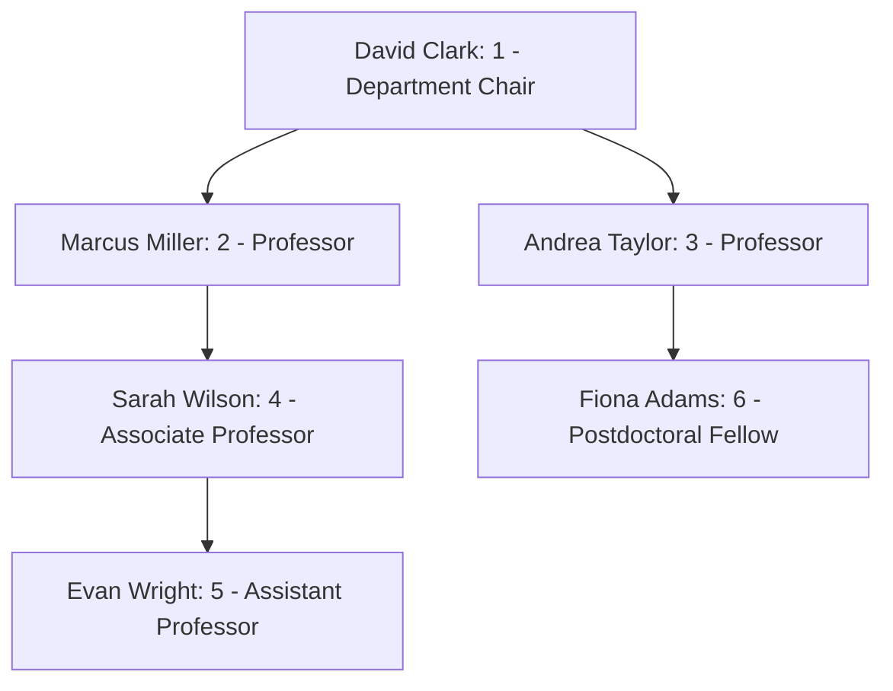
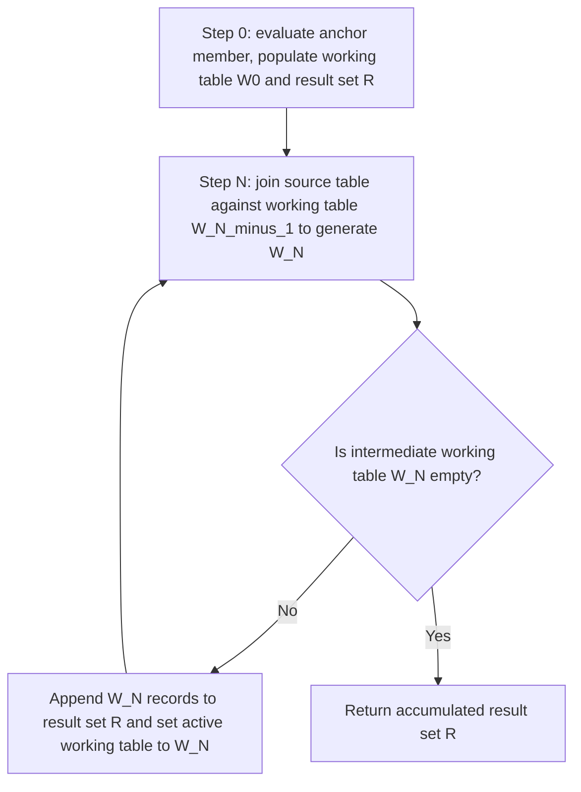
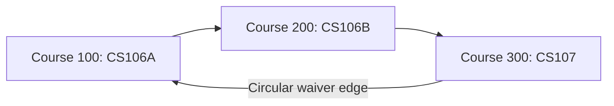

# Recursive queries and graph traversals

## Overview

Recursive queries navigate hierarchical, nested, or graph-shaped data when the
number of relationship levels is unknown in advance. While standard Structured
Query Language, or `SQL`, joins require fixed table aliases for each traversal
level, a recursive Common Table Expression, or `CTE`, repeatedly executes a query
expression, following relationships until it satisfies a termination condition.

This guide provides a reference for recursive queries, covering anchor members,
recursive iteration flow, working-table state queues, cycle detection,
curriculum prerequisite graph traversals, and production query optimization
using the Stanford University academic database.

## Reference schema: academic mentoring hierarchy

Hierarchical data commonly follows an adjacency list pattern, where a foreign
key in each row references the primary key of its parent row in the same table.

Consider the following `instructors` relation from the Stanford University faculty
directory:

```sql
CREATE TABLE instructors (
  instructor_id        INTEGER PRIMARY KEY,
  first_name           VARCHAR(50) NOT NULL,
  last_name            VARCHAR(50) NOT NULL,
  academic_title       VARCHAR(50) NOT NULL,
  mentor_instructor_id INTEGER REFERENCES instructors(instructor_id)
);
```

### Table contents

| `instructor_id` | `first_name` | `last_name` | `academic_title` | `mentor_instructor_id` |
| :--- | :--- | :--- | :--- | :--- |
| `1` | David | Clark | Department Chair | `NULL` |
| `2` | Marcus | Miller | Professor | `1` |
| `3` | Andrea | Taylor | Professor | `1` |
| `4` | Sarah | Wilson | Associate Professor | `2` |
| `5` | Evan | Wright | Assistant Professor | `4` |
| `6` | Fiona | Adams | Postdoctoral Fellow | `3` |



## Structure of a recursive query

A recursive query combines two distinct members using the `UNION ALL` operator:

1. **Anchor member**: a non-recursive query that executes exactly once to
   retrieve base or root records.
2. **Recursive member**: a query that references the recursive `CTE` itself,
   joining previous iteration results back to the source table to find child
   records.

```sql
WITH RECURSIVE faculty_hierarchy AS (
  -- 1. Anchor member: locate the root faculty chair
  SELECT
    instructor_id,
    first_name,
    last_name,
    academic_title,
    mentor_instructor_id,
    0 AS traversal_depth,
    CAST(first_name || ' ' || last_name AS VARCHAR(500)) AS mentorship_path
  FROM instructors
  WHERE mentor_instructor_id IS NULL

  UNION ALL

  -- 2. Recursive member: join mentees to their mentors from the prior iteration
  SELECT
    i.instructor_id,
    i.first_name,
    i.last_name,
    i.academic_title,
    i.mentor_instructor_id,
    h.traversal_depth + 1 AS traversal_depth,
    CAST(h.mentorship_path || ' -> ' || i.first_name || ' ' || i.last_name AS VARCHAR(500)) AS mentorship_path
  FROM instructors AS i
  INNER JOIN faculty_hierarchy AS h
    ON i.mentor_instructor_id = h.instructor_id
)
SELECT
  instructor_id,
  first_name,
  last_name,
  academic_title,
  traversal_depth,
  mentorship_path
FROM faculty_hierarchy
ORDER BY traversal_depth, instructor_id;
```

## Step-by-step engine execution trace

Relational database engines evaluate recursive queries through an iterative
working-table queue.



### Iteration 0: anchor evaluation

The engine executes the anchor query. It populates initial Working Table $W_0$
and appends these rows to final accumulator result set $R$:

**Working Table $W_0$**:

| `instructor_id` | `first_name` | `last_name` | `academic_title` | `traversal_depth` | `mentorship_path` |
| :--- | :--- | :--- | :--- | :--- | :--- |
| `1` | David | Clark | Department Chair | `0` | David Clark |

### Iteration 1: first recursive hop

The engine executes the recursive member by joining `instructors` against
Working Table $W_0$ on `i.mentor_instructor_id = h.instructor_id`, matching
records where `mentor_instructor_id = 1`. This yields Working Table $W_1$:

**Working Table $W_1$**:

| `instructor_id` | `first_name` | `last_name` | `academic_title` | `traversal_depth` | `mentorship_path` |
| :--- | :--- | :--- | :--- | :--- | :--- |
| `2` | Marcus | Miller | Professor | `1` | David Clark -> Marcus Miller |
| `3` | Andrea | Taylor | Professor | `1` | David Clark -> Andrea Taylor |

The engine appends $W_1$ rows to result set $R$. Because $W_1$ contains rows,
recursion proceeds.

### Iteration 2: second recursive hop

The engine joins `instructors` against Working Table $W_1$, matching records
where `mentor_instructor_id` is 2 or 3. This yields Working Table $W_2$:

**Working Table $W_2$**:

| `instructor_id` | `first_name` | `last_name` | `academic_title` | `traversal_depth` | `mentorship_path` |
| :--- | :--- | :--- | :--- | :--- | :--- |
| `4` | Sarah | Wilson | Associate Professor | `2` | David Clark -> Marcus Miller -> Sarah Wilson |
| `6` | Fiona | Adams | Postdoctoral Fellow | `2` | David Clark -> Andrea Taylor -> Fiona Adams |

The engine appends $W_2$ rows to result set $R$.

### Iteration 3: third recursive hop

The engine joins `instructors` against Working Table $W_2$, matching records
where `mentor_instructor_id` is 4 or 6. This yields Working Table $W_3$:

**Working Table $W_3$**:

| `instructor_id` | `first_name` | `last_name` | `academic_title` | `traversal_depth` | `mentorship_path` |
| :--- | :--- | :--- | :--- | :--- | :--- |
| `5` | Evan | Wright | Assistant Professor | `3` | David Clark -> Marcus Miller -> Sarah Wilson -> Evan Wright |

The engine appends $W_3$ rows to result set $R$.

### Iteration 4: loop termination

The engine joins `instructors` against Working Table $W_3$, matching records
where `mentor_instructor_id` is 5. No faculty report to Evan Wright, so Working
Table $W_4$ returns zero rows.

Because $W_4$ is empty, the engine terminates the recursive loop and returns
accumulated result set $R$.

#### Final query output

| `instructor_id` | `first_name` | `last_name` | `academic_title` | `traversal_depth` | `mentorship_path` |
| :--- | :--- | :--- | :--- | :--- | :--- |
| `1` | David | Clark | Department Chair | `0` | David Clark |
| `2` | Marcus | Miller | Professor | `1` | David Clark -> Marcus Miller |
| `3` | Andrea | Taylor | Professor | `1` | David Clark -> Andrea Taylor |
| `4` | Sarah | Wilson | Associate Professor | `2` | David Clark -> Marcus Miller -> Sarah Wilson |
| `6` | Fiona | Adams | Postdoctoral Fellow | `2` | David Clark -> Andrea Taylor -> Fiona Adams |
| `5` | Evan | Wright | Assistant Professor | `3` | David Clark -> Marcus Miller -> Sarah Wilson -> Evan Wright |

## Graph traversals and cycle detection

Unlike tree hierarchies, general directed graphs can contain cycles. A cycle
occurs when following relationship edges leads back to an already visited node,
such as course prerequisite waivers that circle back to introductory courses.

Without cycle detection, a recursive query enters an infinite loop, consuming
memory and CPU until query timeout or process termination.



### Path tracking for cycle prevention

To stop cycles in standard `SQL`, maintain a delimited path string of visited
identifiers and inspect whether the child identifier already appears in the
path history:

```sql
CREATE TABLE course_prerequisites (
  course_id       INTEGER NOT NULL,
  prereq_course_id INTEGER NOT NULL,
  PRIMARY KEY (course_id, prereq_course_id)
);

INSERT INTO course_prerequisites (course_id, prereq_course_id) VALUES
  (100, 200),
  (200, 300),
  (300, 100); -- Accidental circular loop in curriculum registry
```

```sql
WITH RECURSIVE prerequisite_traversal AS (
  -- Anchor: start from course 100
  SELECT
    course_id,
    prereq_course_id,
    1 AS traversal_depth,
    CAST('/' || course_id || '/' || prereq_course_id || '/' AS VARCHAR(500)) AS visited_path,
    0 AS is_cycle
  FROM course_prerequisites
  WHERE course_id = 100

  UNION ALL

  -- Recursive member with cycle flag
  SELECT
    cp.course_id,
    cp.prereq_course_id,
    pt.traversal_depth + 1 AS traversal_depth,
    CAST(pt.visited_path || cp.prereq_course_id || '/' AS VARCHAR(500)) AS visited_path,
    CASE
      WHEN pt.visited_path LIKE '%/' || cp.prereq_course_id || '/%' THEN 1
      ELSE 0
    END AS is_cycle
  FROM course_prerequisites AS cp
  INNER JOIN prerequisite_traversal AS pt
    ON cp.course_id = pt.prereq_course_id
  WHERE pt.is_cycle = 0
)
SELECT
  course_id,
  prereq_course_id,
  traversal_depth,
  visited_path,
  is_cycle
FROM prerequisite_traversal;
```

#### Traversal output with cycle resolution

| `course_id` | `prereq_course_id` | `traversal_depth` | `visited_path` | `is_cycle` |
| :--- | :--- | :--- | :--- | :--- |
| `100` | `200` | `1` | `/100/200/` | `0` |
| `200` | `300` | `2` | `/100/200/300/` | `0` |
| `300` | `100` | `3` | `/100/200/300/100/` | `1` |

When the traversal reaches `(300, 100)`, the `CASE` statement flags
`is_cycle = 1`. The recursive filter `WHERE pt.is_cycle = 0` halts further
expansion along that path, preventing an infinite loop.

## Curriculum credit decomposition

A curriculum credit hierarchy tracks degree plans, specialization tracks, and
individual courses. Expanding a curriculum requires multiplying module units
cumulatively across requirement tiers.

Consider a degree program structure:

| `parent_module` | `child_module` | `units_multiplier` |
| :--- | :--- | :--- |
| Computer Science Major | Systems Specialization | `1` |
| Computer Science Major | Theory Specialization | `1` |
| Systems Specialization | Systems Core Lab | `2` |
| Systems Specialization | Operating Systems | `4` |
| Systems Core Lab | Hardware Laboratory | `3` |

```sql
WITH RECURSIVE curriculum_explosion AS (
  -- Anchor: root degree program
  SELECT
    parent_module,
    child_module,
    units_multiplier AS total_units,
    1 AS curriculum_level,
    CAST(parent_module || ' -> ' || child_module AS VARCHAR(500)) AS requirement_path
  FROM degree_curriculum_requirements
  WHERE parent_module = 'Computer Science Major'

  UNION ALL

  -- Recursive: multiply units by parent requirement
  SELECT
    req.parent_module,
    req.child_module,
    c.total_units * req.units_multiplier AS total_units,
    c.curriculum_level + 1 AS curriculum_level,
    CAST(c.requirement_path || ' -> ' || req.child_module AS VARCHAR(500)) AS requirement_path
  FROM degree_curriculum_requirements AS req
  INNER JOIN curriculum_explosion AS c
    ON req.parent_module = c.child_module
)
SELECT
  child_module,
  curriculum_level,
  total_units,
  requirement_path
FROM curriculum_explosion
ORDER BY curriculum_level, child_module;
```

### Curriculum query result

| `child_module` | `curriculum_level` | `total_units` | `requirement_path` |
| :--- | :--- | :--- | :--- |
| Systems Specialization | `1` | `1` | Computer Science Major -> Systems Specialization |
| Theory Specialization | `1` | `1` | Computer Science Major -> Theory Specialization |
| Operating Systems | `2` | `4` | Computer Science Major -> Systems Specialization -> Operating Systems |
| Systems Core Lab | `2` | `2` | Computer Science Major -> Systems Specialization -> Systems Core Lab |
| Hardware Laboratory | `3` | `6` | Computer Science Major -> Systems Specialization -> Systems Core Lab -> Hardware Laboratory |

Because Systems Core Lab requires `2` modules and Hardware Laboratory requires
`3` units per lab module, the query multiplies `2 * 3` to compute the correct
total of `6` units.

## Common pitfalls

### Performance penalty of `UNION` versus `UNION ALL`

Always combine recursive `CTE` members with `UNION ALL` unless your specific
algorithm requires distinct row removal at every step. Standard `UNION` forces
the database engine to sort and hash the working table between iterations,
causing severe memory pressure on deep graphs:

```sql
-- Fast and standard: appends intermediate rows directly
UNION ALL

-- Slow: executes expensive duplicate removal on every iteration
UNION
```

### Missing string width casts in path tracking

Concatenating strings inside a recursive member expands string length. If the
anchor member defines a string without an explicit size, the database infers the
column width from the anchor literal.

In PostgreSQL and SQLite, text columns adjust dynamically. However, in SQL Server
and Oracle, omitting an explicit `CAST(... AS VARCHAR(500))` in the anchor
triggers a string truncation or arithmetic overflow error as paths lengthen.

### Filtering in the wrong query block

Define traversal depth limits and cycle filters directly in the recursive
member `WHERE` clause. Placing filters only in the outer `SELECT` query allows
the recursive engine to execute the entire traversal before discarding rows:

```sql
-- Efficient: stops the recursive engine at depth 3
SELECT ... FROM instructors AS i JOIN faculty_hierarchy AS h ON ... WHERE h.traversal_depth < 3

-- Inefficient: traverses the entire tree, filtering only after full execution
SELECT ... FROM faculty_hierarchy WHERE traversal_depth <= 3
```

## Key takeaways

- Use recursive common table expressions to query tree hierarchies and graphs
  of variable depth.
- Formulate the query with an anchor member for base rows and a recursive
  member for child hops.
- Understand the working-table loop: the engine evaluates each step against the
  immediate prior iteration, not the entire accumulated table.
- Guard against infinite recursion by tracking visited paths or enforcing a
  maximum depth threshold.
- Cast string paths explicitly in both members to prevent string truncation
  errors.
- Apply traversal filters inside the recursive member to prune branches early
  during execution.

## What's next

- Explore multidimensional grouping sets and cubes in
  [Multidimensional aggregation](/sql/multidimensional-aggregation).
- Learn slotted-page architectures, buffer pools, and write-ahead logging in
  [Database storage engine internals](/sql/database-storage-engine-internals).
- Understand B-tree structures and clustered indexes in
  [Indexing internals](/sql/indexing-internals).
