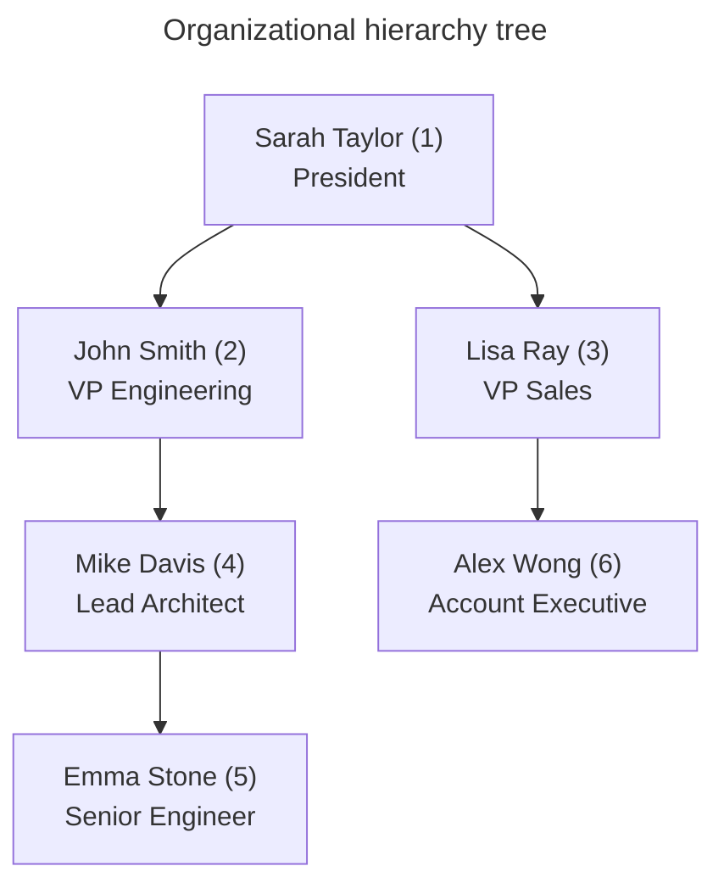
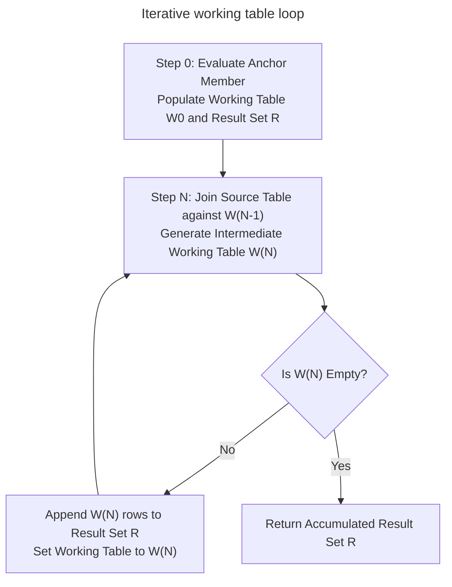
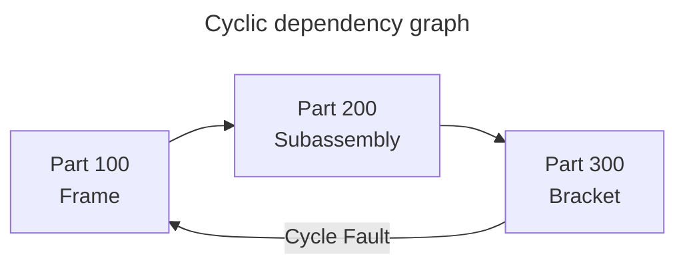

# Recursive queries and graph traversals

## Overview

Recursive queries navigate hierarchical, nested, or graph-shaped data when the number of relationship levels isn't known in advance. While standard SQL joins require fixed table aliases for each traversal level, a recursive Common Table Expression (CTE) repeatedly executes a query expression, following relationships until it meets a termination condition.

This guide provides a ground-level reference for recursive queries, covering anchor members, recursive iteration mechanics, working-table state queues, cycle detection, bill of materials explosions, and production query optimization.

## Example organizational hierarchy

Hierarchical data commonly follows an adjacency list pattern, where a foreign key in each row references the primary key of its parent row in the same table.

Consider the following `Employees` table:

| `EmployeeID` | `Name` | `Title` | `ManagerID` |
| :--- | :--- | :--- | :--- |
| 1 | Sarah Taylor | President | `NULL` |
| 2 | John Smith | VP Engineering | 1 |
| 3 | Lisa Ray | VP Sales | 1 |
| 4 | Mike Davis | Lead Architect | 2 |
| 5 | Emma Stone | Senior Engineer | 4 |
| 6 | Alex Wong | Account Executive | 3 |



## Structure of a recursive query

A recursive query combines two distinct members using the `UNION ALL` operator:

1. **Anchor member**: a non-recursive query that executes exactly once to retrieve the base or root records.
2. **Recursive member**: a query that references the recursive CTE itself, joining the previous iteration results back to the source table to find child records.

```sql
WITH RECURSIVE OrgHierarchy AS (
  -- 1. Anchor Member: Find the root executive (ManagerID IS NULL)
  SELECT
    EmployeeID,
    Name,
    Title,
    ManagerID,
    0 AS Depth,
    CAST(Name AS VARCHAR(500)) AS ManagementPath
  FROM Employees
  WHERE ManagerID IS NULL

  UNION ALL

  -- 2. Recursive Member: Join children to their parent from the previous iteration
  SELECT
    e.EmployeeID,
    e.Name,
    e.Title,
    e.ManagerID,
    h.Depth + 1 AS Depth,
    CAST(h.ManagementPath || ' -> ' || e.Name AS VARCHAR(500)) AS ManagementPath
  FROM Employees AS e
  INNER JOIN OrgHierarchy AS h
    ON e.ManagerID = h.EmployeeID
)
SELECT
  EmployeeID,
  Name,
  Title,
  Depth,
  ManagementPath
FROM OrgHierarchy
ORDER BY Depth, EmployeeID;
```

## Step-by-step engine execution trace

Relational database engines evaluate recursive queries through an iterative working table queue.



### Iteration 0: anchor evaluation

The engine executes the anchor query. It populates initial Working Table $W_0$ and appends these rows to final accumulator result set $R$:

**Working Table $W_0$**:

| `EmployeeID` | `Name` | `Title` | `ManagerID` | `Depth` | `ManagementPath` |
| :--- | :--- | :--- | :--- | :--- | :--- |
| 1 | Sarah Taylor | President | `NULL` | 0 | Sarah Taylor |

### Iteration 1: first recursive hop

The engine executes the recursive member by joining `Employees` against Working Table $W_0$ on `e.ManagerID = h.EmployeeID`, matching records where `ManagerID = 1`. This yields Working Table $W_1$:

**Working Table $W_1$**:

| `EmployeeID` | `Name` | `Title` | `ManagerID` | `Depth` | `ManagementPath` |
| :--- | :--- | :--- | :--- | :--- | :--- |
| 2 | John Smith | VP Engineering | 1 | 1 | Sarah Taylor -> John Smith |
| 3 | Lisa Ray | VP Sales | 1 | 1 | Sarah Taylor -> Lisa Ray |

The engine appends $W_1$ rows to result set $R$. Because $W_1$ contains rows, recursion proceeds.

### Iteration 2: second recursive hop

The engine joins `Employees` against Working Table $W_1$, matching records where `ManagerID` is 2 or 3. This yields Working Table $W_2$:

**Working Table $W_2$**:

| `EmployeeID` | `Name` | `Title` | `ManagerID` | `Depth` | `ManagementPath` |
| :--- | :--- | :--- | :--- | :--- | :--- |
| 4 | Mike Davis | Lead Architect | 2 | 2 | Sarah Taylor -> John Smith -> Mike Davis |
| 6 | Alex Wong | Account Executive | 3 | 2 | Sarah Taylor -> Lisa Ray -> Alex Wong |

The engine appends $W_2$ rows to result set $R$.

### Iteration 3: third recursive hop

The engine joins `Employees` against Working Table $W_2$, matching records where `ManagerID` is 4 or 6. This yields Working Table $W_3$:

**Working Table $W_3$**:

| `EmployeeID` | `Name` | `Title` | `ManagerID` | `Depth` | `ManagementPath` |
| :--- | :--- | :--- | :--- | :--- | :--- |
| 5 | Emma Stone | Senior Engineer | 4 | 3 | Sarah Taylor -> John Smith -> Mike Davis -> Emma Stone |

The engine appends $W_3$ rows to result set $R$.

### Iteration 4: loop termination

The engine joins `Employees` against Working Table $W_3$, matching records where `ManagerID` is 5. No employees report to Emma Stone, so Working Table $W_4$ returns zero rows.

Because $W_4$ is empty, the engine terminates the recursive loop and returns accumulated result set $R$.

#### Final query output

| `EmployeeID` | `Name` | `Title` | `Depth` | `ManagementPath` |
| :--- | :--- | :--- | :--- | :--- |
| 1 | Sarah Taylor | President | 0 | Sarah Taylor |
| 2 | John Smith | VP Engineering | 1 | Sarah Taylor -> John Smith |
| 3 | Lisa Ray | VP Sales | 1 | Sarah Taylor -> Lisa Ray |
| 4 | Mike Davis | Lead Architect | 2 | Sarah Taylor -> John Smith -> Mike Davis |
| 6 | Alex Wong | Account Executive | 2 | Sarah Taylor -> Lisa Ray -> Alex Wong |
| 5 | Emma Stone | Senior Engineer | 3 | Sarah Taylor -> John Smith -> Mike Davis -> Emma Stone |

## Graph traversals and cycle detection

Unlike simple trees, directed graphs can contain cycles. A cycle occurs when following relationships leads back to an already visited node, such as `Node 1 -> Node 2 -> Node 3 -> Node 1`.

Without cycle detection, a recursive query enters an infinite loop, consuming CPU and memory until the database crashes or reaches its query timeout.



### Path string tracking for cycle prevention

To stop cycles in standard SQL engines, maintain a delimited path string of visited identifiers and inspect whether the child identifier already exists in the path history:

```sql
CREATE TABLE GraphEdges (
  SourceID INTEGER NOT NULL,
  TargetID INTEGER NOT NULL,
  PRIMARY KEY (SourceID, TargetID)
);

INSERT INTO GraphEdges (SourceID, TargetID) VALUES
  (100, 200),
  (200, 300),
  (300, 100); -- Cycles back to 100
```

```sql
WITH RECURSIVE Traversal AS (
  -- Anchor: start from node 100
  SELECT
    SourceID,
    TargetID,
    1 AS Depth,
    CAST('/' || SourceID || '/' || TargetID || '/' AS VARCHAR(500)) AS VisitedPath,
    0 AS IsCycle
  FROM GraphEdges
  WHERE SourceID = 100

  UNION ALL

  -- Recursive member with cycle flag
  SELECT
    g.SourceID,
    g.TargetID,
    t.Depth + 1 AS Depth,
    CAST(t.VisitedPath || g.TargetID || '/' AS VARCHAR(500)) AS VisitedPath,
    CASE
      WHEN t.VisitedPath LIKE '%/' || g.TargetID || '/%' THEN 1
      ELSE 0
    END AS IsCycle
  FROM GraphEdges AS g
  INNER JOIN Traversal AS t
    ON g.SourceID = t.TargetID
  WHERE t.IsCycle = 0
)
SELECT
  SourceID,
  TargetID,
  Depth,
  VisitedPath,
  IsCycle
FROM Traversal;
```

#### Traversal output with cycle resolution

| `SourceID` | `TargetID` | `Depth` | `VisitedPath` | `IsCycle` |
| :--- | :--- | :--- | :--- | :--- |
| 100 | 200 | 1 | `/100/200/` | 0 |
| 200 | 300 | 2 | `/100/200/300/` | 0 |
| 300 | 100 | 3 | `/100/200/300/100/` | **1** |

When the traversal reaches `(300, 100)`, the `CASE` statement flags `IsCycle = 1`. The recursive filter `WHERE t.IsCycle = 0` halts further expansion along that path, preventing an infinite loop.

## Bill of materials explosion

A Bill of Materials (BOM) tracks parts, assemblies, and raw components required to manufacture a product. Expanding a BOM requires multiplying component quantities cumulatively down each assembly level.

Consider an electric bicycle assembly:

| `ParentPart` | `ChildPart` | `QuantityPerParent` |
| :--- | :--- | :--- |
| E-Bike | Frame | 1 |
| E-Bike | Wheel | 2 |
| Wheel | Rim | 1 |
| Wheel | Spoke | 36 |
| Wheel | Tire | 1 |

```sql
WITH RECURSIVE PartsExplosion AS (
  -- Anchor: Root product
  SELECT
    ParentPart,
    ChildPart,
    QuantityPerParent AS TotalQuantity,
    1 AS AssemblyLevel,
    CAST(ParentPart || ' -> ' || ChildPart AS VARCHAR(500)) AS AssemblyPath
  FROM BillOfMaterials
  WHERE ParentPart = 'E-Bike'

  UNION ALL

  -- Recursive: Multiply quantity by parent requirement
  SELECT
    bom.ParentPart,
    bom.ChildPart,
    p.TotalQuantity * bom.QuantityPerParent AS TotalQuantity,
    p.AssemblyLevel + 1 AS AssemblyLevel,
    CAST(p.AssemblyPath || ' -> ' || bom.ChildPart AS VARCHAR(500)) AS AssemblyPath
  FROM BillOfMaterials AS bom
  INNER JOIN PartsExplosion AS p
    ON bom.ParentPart = p.ChildPart
)
SELECT
  ChildPart,
  AssemblyLevel,
  TotalQuantity,
  AssemblyPath
FROM PartsExplosion
ORDER BY AssemblyLevel, ChildPart;
```

### Bill of materials query result

| `ChildPart` | `AssemblyLevel` | `TotalQuantity` | `AssemblyPath` |
| :--- | :--- | :--- | :--- |
| Frame | 1 | 1 | E-Bike -> Frame |
| Wheel | 1 | 2 | E-Bike -> Wheel |
| Rim | 2 | 2 | E-Bike -> Wheel -> Rim |
| Spoke | 2 | **72** | E-Bike -> Wheel -> Spoke |
| Tire | 2 | 2 | E-Bike -> Wheel -> Tire |

Because an E-Bike requires `2` Wheels and each Wheel requires `36` Spokes, the recursive query multiplies `2 * 36` to compute the correct total of `72` Spokes.

## Common pitfalls

### Accidental performance penalty of `UNION` versus `UNION ALL`

Always combine recursive CTE members with `UNION ALL` unless your specific algorithm requires distinct row removal at every step. Standard `UNION` forces the database engine to sort and hash the working table between iterations, causing severe memory pressure on deep graphs.

```sql
-- Fast and standard: appends intermediate rows directly
UNION ALL

-- Slow: executes expensive duplicate removal on every iteration
UNION
```

### Missing string width casts in path tracking

Concatenating strings inside a recursive member expands the string width. If the anchor member defines a string without an explicit size, the database infers the column width from the anchor literal.

In PostgreSQL and SQLite, text columns adjust dynamically. However, in SQL Server and Oracle, omitting an explicit `CAST(... AS VARCHAR(500))` in the anchor triggers an arithmetic overflow error as strings lengthen.

### Filtering in the wrong query block

To limit how deep the recursion descends, place depth and cycle filters inside the recursive member `WHERE` clause. Placing filters only in the outer `SELECT` query allows the recursive engine to execute the entire deep traversal before discarding rows.

```sql
-- Efficient: Stops the recursive engine at depth 3
SELECT ... FROM Employees AS e JOIN OrgHierarchy AS h ON ... WHERE h.Depth < 3

-- Inefficient: Traverses the entire tree, filtering only after full execution
SELECT ... FROM OrgHierarchy WHERE Depth <= 3
```

## Key takeaways

- Use recursive common table expressions to query tree hierarchies and graphs of variable depth.
- Formulate the query with an anchor member for base rows and a recursive member for child hops.
- Understand the working-table loop: the engine evaluates each step against the immediate prior iteration, not the entire accumulated table.
- Guard against infinite recursion by tracking visited paths or enforcing a maximum depth threshold.
- Cast string paths explicitly in both members to prevent string truncation errors.
- Apply traversal filters inside the recursive member to prune branches early during execution.
