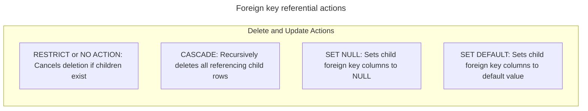

# Relational model concepts

## Overview

The relational model organizes data into structured relations, known as
tables, and uses mathematical integrity constraints to enforce data
validity. First formulated in 1970, this model provides the
theoretical foundation for modern relational database management systems,
including PostgreSQL, MySQL, and SQLite.

This guide provides a comprehensive reference for relational model concepts.
It covers mathematical foundations, schema definition constraints, constraint
violation lifecycle traces, foreign key referential actions, and surrogate
versus natural key design patterns through concrete datasets and
before-and-after data states.

## Mathematical foundations and relational terminology

In relational theory, a database is a collection of relations governed by
first-order predicate logic and set theory. Relational database management
systems translate these formal concepts into practical SQL structures:

| Relational Theory Concept | SQL Implementation | Formal Definition |
| :--- | :--- | :--- |
| Relation | Table | An unordered set of tuples sharing identical attributes |
| Tuple | Row or record | An ordered mapping of attribute names to domain values |
| Attribute | Column or field | A named property associated with an explicit domain |
| Domain | Data type | The set of permissible scalar values for an attribute |
| Degree | Column count | The total number of attributes defining a relation |
| Cardinality | Row count | The total number of tuples stored in a relation |

Relational operations exhibit closure. Every operation on one or more
relations evaluates to another relation, which lets queries nest and chain
indefinitely.

## Integrity constraints taxonomy

Integrity constraints define declarative rules enforced by the database
engine on every `INSERT`, `UPDATE`, and `DELETE` operation:

- Entity integrity: each tuple in a relation must be uniquely identifiable.
  A relation must define a primary key, and no attribute participating in the
  primary key may contain `NULL`.
- Referential integrity: a foreign key attribute in a child relation must
  either match an existing primary or candidate key in the referenced parent
  relation, or contain `NULL`.
- Domain integrity: attribute values must conform to their assigned data type,
  character length, and optional `CHECK` range predicates.
- Semantic integrity: business rules enforced by `UNIQUE` and `NOT NULL`
  constraints.

## Reference production schema

The examples throughout this guide use two interrelated tables, `Departments`
and `Employees`:

```sql
CREATE TABLE Departments (
  DepartmentID   INTEGER PRIMARY KEY,
  DepartmentCode VARCHAR(10) NOT NULL UNIQUE,
  DepartmentName VARCHAR(50) NOT NULL
);

CREATE TABLE Employees (
  EmployeeID    INTEGER PRIMARY KEY,
  WorkEmail     VARCHAR(100) NOT NULL UNIQUE,
  FirstName     VARCHAR(50) NOT NULL,
  LastName      VARCHAR(50) NOT NULL,
  DepartmentID  INTEGER,
  Salary        NUMERIC(10, 2) NOT NULL,
  ManagerID     INTEGER,
  CONSTRAINT ck_employee_salary
    CHECK (Salary > 0),
  CONSTRAINT fk_employee_department
    FOREIGN KEY (DepartmentID)
    REFERENCES Departments(DepartmentID)
    ON DELETE RESTRICT,
  CONSTRAINT fk_employee_manager
    FOREIGN KEY (ManagerID)
    REFERENCES Employees(EmployeeID)
    ON DELETE SET NULL
);
```

### Initial database state

#### `Departments` table

| DepartmentID | DepartmentCode | DepartmentName |
| :--- | :--- | :--- |
| `10` | `SAL` | Sales |
| `20` | `ENG` | Engineering |
| `30` | `MKT` | Marketing |

#### `Employees` table

| EmployeeID | WorkEmail | FirstName | LastName | DepartmentID | Salary | ManagerID |
| :--- | :--- | :--- | :--- | :--- | :--- | :--- |
| `101` | `alice@example.com` | Alice | Smith | `10` | `95000.00` | `NULL` |
| `102` | `bob@example.com` | Bob | Jones | `20` | `72000.00` | `101` |
| `103` | `charlie@example.com` | Charlie | Brown | `20` | `65000.00` | `101` |
| `104` | `diana@example.com` | Diana | Prince | `NULL` | `58000.00` | `102` |

## Constraint violation lifecycle traces

The database engine validates constraints before committing row changes to
storage pages. If any constraint evaluates to `FALSE`, the transaction
fails and the engine rolls back all pending changes.

### Trace 1: primary key uniqueness violation

Consider an attempt to insert a new employee reusing an existing `EmployeeID`:

```sql
-- Fails with primary key violation
INSERT INTO Employees (
  EmployeeID,
  WorkEmail,
  FirstName,
  LastName,
  DepartmentID,
  Salary,
  ManagerID
) VALUES (
  101,
  'alex@example.com',
  'Alex',
  'Rivera',
  10,
  82000.00,
  NULL
);
```

#### Engine evaluation sequence

1. The execution engine parses and plans the `INSERT` statement.
2. The storage engine checks the unique B-tree index supporting the primary
   key constraint on `EmployeeID`.
3. The engine detects an existing index leaf entry for key `101` pointing
   to Alice's tuple.
4. The engine halts execution and raises a duplicate key error:
   `ERROR: duplicate key value violates unique constraint "Employees_pkey" (Key EmployeeID=101 already exists)`.
5. The transaction rolls back, preserving table integrity.

### Trace 2: referential integrity violation

Consider an attempt to assign an employee to a non-existent department:

```sql
-- Fails with referential integrity foreign key violation
INSERT INTO Employees (
  EmployeeID,
  WorkEmail,
  FirstName,
  LastName,
  DepartmentID,
  Salary,
  ManagerID
) VALUES (
  105,
  'evan@example.com',
  'Evan',
  'Wright',
  99,
  61000.00,
  101
);
```

#### Engine evaluation sequence

1. The engine inspects candidate foreign key value `DepartmentID = 99`.
2. The engine performs an index seek on `Departments.DepartmentID` looking
   for key value `99`.
3. The seek returns zero matching tuples.
4. Because the foreign key value is non-null and no corresponding parent
   record exists, referential integrity fails.
5. The engine raises an integrity error:
   `ERROR: insert or update on table "Employees" violates foreign key constraint "fk_employee_department"`.

### Trace 3: domain check constraint violation

Consider an attempt to record a negative compensation amount:

```sql
-- Fails with domain CHECK constraint violation
INSERT INTO Employees (
  EmployeeID,
  WorkEmail,
  FirstName,
  LastName,
  DepartmentID,
  Salary,
  ManagerID
) VALUES (
  105,
  'evan@example.com',
  'Evan',
  'Wright',
  10,
  -5000.00,
  101
);
```

#### Engine evaluation sequence

1. The engine evaluates the table `CHECK` predicate `Salary > 0` against
   candidate value `-5000.00`.
2. The comparison `-5000.00 > 0` evaluates to `FALSE`.
3. Under standard SQL rules, a `CHECK` constraint allows values where the
   expression evaluates to `TRUE` or `UNKNOWN`. It rejects values evaluating
   to `FALSE`.
4. The engine raises a constraint violation:
   `ERROR: new row for table "Employees" violates check constraint "ck_employee_salary"`.

## Referential actions on parent deletion

When an app deletes a parent row, child rows containing referencing
foreign keys require explicit resolution. SQL defines four standard
referential actions:



### Comparison of referential actions

Suppose an app issues a command to delete Department `20`, Engineering,
which employs Bob with ID `102` and Charlie with ID `103`:

```sql
DELETE FROM Departments
WHERE DepartmentID = 20;
```

The table below contrasts how each referential action processes this operation:

| Referential Action | Database Behavior | Final State of Child Rows |
| :--- | :--- | :--- |
| `RESTRICT` or `NO ACTION` | Stops immediately | Deletion rejected. Both employees remain in Department `20`. |
| `CASCADE` | Propagates deletion | Engine deletes Department `20` and automatically deletes Bob and Charlie. |
| `SET NULL` | Modifies foreign key | Engine deletes Department `20` and updates Bob and Charlie with `DepartmentID = NULL`. |
| `SET DEFAULT` | Resets foreign key | Engine deletes Department `20` and updates child foreign keys to the column default. |

### Concrete state transition with `ON DELETE CASCADE`

If `fk_employee_department` specifies `ON DELETE CASCADE`, deleting
Department `20` automatically removes Bob and Charlie from `Employees`:

#### `Employees` table state after cascade deletion

| EmployeeID | WorkEmail | FirstName | LastName | DepartmentID | Salary | ManagerID |
| :--- | :--- | :--- | :--- | :--- | :--- | :--- |
| `101` | `alice@example.com` | Alice | Smith | `10` | `95000.00` | `NULL` |
| `104` | `diana@example.com` | Diana | Prince | `NULL` | `58000.00` | `NULL` |

Notice that the engine updated Diana's `ManagerID` from `102` to `NULL`
when it deleted Bob, as `fk_employee_manager` specifies `ON DELETE SET NULL`.

### Concrete state transition with `ON DELETE SET NULL`

If `fk_employee_department` specifies `ON DELETE SET NULL`, deleting
Department `20` preserves the employee records while nullifying their
department association:

#### `Employees` table state after set null deletion

| EmployeeID | WorkEmail | FirstName | LastName | DepartmentID | Salary | ManagerID |
| :--- | :--- | :--- | :--- | :--- | :--- | :--- |
| `101` | `alice@example.com` | Alice | Smith | `10` | `95000.00` | `NULL` |
| `102` | `bob@example.com` | Bob | Jones | `NULL` | `72000.00` | `101` |
| `103` | `charlie@example.com` | Charlie | Brown | `NULL` | `65000.00` | `101` |
| `104` | `diana@example.com` | Diana | Prince | `NULL` | `58000.00` | `102` |

## Natural keys versus surrogate keys

Choosing candidate keys to serve as the relation primary key involves
evaluating trade-offs between business semantics and schema stability:

- Natural key: an attribute whose value exists in the real-world business
  domain, such as a Tax Identification Number, email address, or vehicle
  identification number.
- Surrogate key: an artificial identifier generated by the database system,
  such as an auto-incrementing integer or universally unique identifier
  `UUID`, with no intrinsic business meaning.

### Architectural trade-off analysis

| Architectural Dimension | Natural Key Design | Surrogate Key Design |
| :--- | :--- | :--- |
| Storage efficiency | May require wide string storage across foreign keys | Compact fixed-width integers or 16-byte `UUID` values |
| Business rule volatility | High risk: real-world identifier changes require cascading updates | Zero risk: artificial keys never change across business lifecycle |
| Query join performance | Joins on wide strings consume more buffer pool memory | Joins on compact integer keys optimize CPU cache alignment |
| Accidental duplication | Enforces business uniqueness inherently on the primary key | Requires explicit supplementary `UNIQUE` constraint on business column |

The recommended pattern combines both approaches: use a compact surrogate key
as the physical primary key to optimize joins and index storage, while enforcing
a `UNIQUE NOT NULL` constraint on the natural business identifier:

```sql
CREATE TABLE Customers (
  CustomerID   BIGINT GENERATED ALWAYS AS IDENTITY PRIMARY KEY,
  TaxNumber    VARCHAR(32) NOT NULL UNIQUE,
  CompanyName  VARCHAR(100) NOT NULL
);
```

## Common pitfalls

### Missing indexes on child foreign key columns

Creating a foreign key constraint doesn't automatically construct an index
on the referencing child column in most database engines.

Without an index on the child foreign key column:

- Joins between parent and child tables require expensive full table scans
  on the child relation.
- Deleting a row from the parent table acquires table-level locks or scans
  the entire child table to verify that no referencing records exist.

Always build a supporting index on child foreign key columns:

```sql
CREATE INDEX idx_employees_department_id
  ON Employees(DepartmentID);
```

### Divergent `NULL` semantics in unique constraints

Database engines differ in how they evaluate `NULL` values within `UNIQUE`
constraints:

- PostgreSQL, SQLite, and Oracle: multiple rows may contain `NULL` in a
  single-column unique constraint because `NULL <> NULL` under three-valued
  logic.
- SQL Server: traditionally treats `NULL` as a distinct value, permitting
  only one row with `NULL` under a standard unique constraint.

When a column must be unique and present on every record, declare both
`NOT NULL` and `UNIQUE`:

```sql
WorkEmail VARCHAR(100) NOT NULL UNIQUE
```

### Unintended orphan records from foreign keys allowing nulls

Declaring a foreign key column without `NOT NULL` allows rows to exist
without any association to a parent record.

While valid for optional relationships, such as an employee without a
department, foreign keys that permit null values cause child records to
disappear from standard inner join query results. When every child record
must strictly belong to a parent entity, declare the foreign key column
as `NOT NULL`.

## Key takeaways

- Relational databases enforce entity integrity through primary keys and
  referential integrity through foreign keys.
- Constraint checks cancel transactions and roll back pending state changes
  when predicates evaluate to `FALSE`.
- Select referential actions like `RESTRICT`, `CASCADE`, or `SET NULL` based on
  child entity lifecycle dependencies.
- Pair surrogate primary keys with unique constraints on natural business
  attributes to balance join performance with domain integrity.
- Index foreign key columns explicitly in child tables to prevent full table
  scans and lock contention during parent record deletions.
- Enforce both `NOT NULL` and `UNIQUE` when an attribute must remain distinct
  across every stored tuple.
