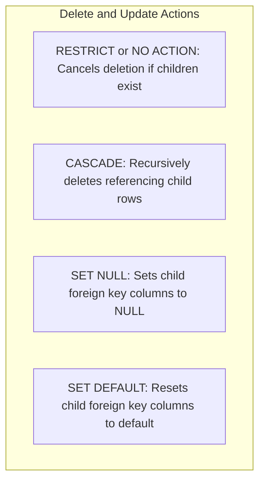

# Relational model concepts

The relational model organizes data into structured relations, known as
tables, and uses mathematical integrity constraints to enforce data
validity. First formulated in 1970 by Edgar F. `Codd`, this model provides the
theoretical foundation for modern relational database management systems,
including `PostgreSQL`, `MySQL`, and `SQLite`.

This guide provides a comprehensive reference for relational model concepts.
It covers mathematical foundations, schema definition constraints, constraint
violation lifecycle traces, foreign key referential actions, and surrogate
versus natural key design patterns using the canonical Stanford University
academic schema.

## Mathematical foundations and relational terminology

In relational theory, a database is a collection of relations governed by
first-order predicate logic and set theory. Relational database management
systems translate these formal concepts into practical SQL structures:

| Relational theory concept | SQL implementation | Formal definition |
| :--- | :--- | :--- |
| **Relation** | Table | An unordered set of tuples sharing identical attributes |
| **Tuple** | Row or record | An ordered mapping of attribute names to domain values |
| **Attribute** | Column or field | A named property associated with an explicit domain |
| **Domain** | Data type | The set of permissible scalar values for an attribute |
| **Degree** | Column count | The total number of attributes defining a relation |
| **Cardinality** | Row count | The total number of tuples stored in a relation |

Relational operations exhibit closure: every operation on one or more relations
evaluates to another relation, which lets queries nest and chain indefinitely.

## Integrity constraints taxonomy

Integrity constraints define declarative rules enforced by the database
engine on every `INSERT`, `UPDATE`, and `DELETE` operation:

- Entity integrity requires each tuple in a relation to be uniquely identifiable. A relation must define a primary key, and no attribute participating in the primary key may contain a null value.
- Referential integrity requires a foreign key attribute in a child relation to either match an existing primary key in the referenced parent relation or contain a null value.
- Domain integrity requires attribute values to conform to their assigned data type, character length, and optional `CHECK` range predicates.
- Semantic integrity enforces business rules through explicit constraints, such as `UNIQUE` and `NOT NULL`.

## Reference schema for the university scenario

The examples throughout this guide use two interrelated academic tables,
`departments` and `instructors`:

```sql
CREATE TABLE departments (
    department_id   INT PRIMARY KEY,
    department_code VARCHAR(10) NOT NULL UNIQUE,
    department_name VARCHAR(100) NOT NULL,
    school_name     VARCHAR(100) NOT NULL
);

CREATE TABLE instructors (
    instructor_id        INT PRIMARY KEY,
    email                VARCHAR(100) NOT NULL UNIQUE,
    first_name           VARCHAR(50) NOT NULL,
    last_name            VARCHAR(50) NOT NULL,
    department_id        INT,
    salary               DECIMAL(10,2) NOT NULL,
    mentor_instructor_id INT,
    academic_rank        VARCHAR(30) NOT NULL,
    CONSTRAINT ck_instructor_salary
        CHECK (salary > 0),
    CONSTRAINT fk_instructor_department
        FOREIGN KEY (department_id)
        REFERENCES departments (department_id)
        ON DELETE RESTRICT,
    CONSTRAINT fk_instructor_mentor
        FOREIGN KEY (mentor_instructor_id)
        REFERENCES instructors (instructor_id)
        ON DELETE SET NULL
);
```

### Initial database state

#### `departments` table

| `department_id` | `department_code` | `department_name` | `school_name` |
| :--- | :--- | :--- | :--- |
| `10` | `CS` | Computer Science | School of Engineering |
| `20` | `EE` | Electrical Engineering | School of Engineering |
| `30` | `STATS` | Statistics | School of Humanities and Sciences |

#### `instructors` table

| `instructor_id` | `email` | `first_name` | `last_name` | `department_id` | `salary` | `mentor_instructor_id` | `academic_rank` |
| :--- | :--- | :--- | :--- | :--- | :--- | :--- | :--- |
| `101` | `hennessy@stanford.edu` | John | Hennessy | `10` | `180000.00` | `NULL` | Professor |
| `102` | `marcus@stanford.edu` | Marcus | Miller | `10` | `145000.00` | `101` | Professor |
| `103` | `andrea@stanford.edu` | Andrea | Taylor | `20` | `160000.00` | `101` | Professor |
| `104` | `sarah@stanford.edu` | Sarah | Wilson | `30` | `175000.00` | `NULL` | Professor |

## Constraint violation lifecycle traces

The database engine validates constraints before committing row changes to
storage pages. If any constraint evaluates to `FALSE`, the transaction
fails and the engine rolls back all pending changes.

### Trace 1: primary key uniqueness violation

Consider an attempt to insert a new instructor reusing existing identifier
`101`:

```sql
-- Fails with primary key violation
INSERT INTO instructors (
    instructor_id,
    email,
    first_name,
    last_name,
    department_id,
    salary,
    mentor_instructor_id,
    academic_rank
) VALUES (
    101,
    'widom@stanford.edu',
    'Jennifer',
    'Widom',
    10,
    170000.00,
    NULL,
    'Professor'
);
```

#### Engine evaluation sequence

1. The execution engine parses and plans the `INSERT` statement.
2. The storage engine checks the unique B-tree index supporting the primary
   key constraint on `instructor_id`.
3. The engine detects an existing index leaf entry for key `101`.
4. The engine halts execution and raises a duplicate key error:
   `ERROR: duplicate key value violates unique constraint "instructors_pkey" (Key instructor_id=101 already exists)`.
5. The transaction rolls back, preserving table integrity.

### Trace 2: referential integrity violation

Consider an attempt to assign an instructor to a non-existent department `99`:

```sql
-- Fails with referential integrity foreign key violation
INSERT INTO instructors (
    instructor_id,
    email,
    first_name,
    last_name,
    department_id,
    salary,
    mentor_instructor_id,
    academic_rank
) VALUES (
    105,
    'ng@stanford.edu',
    'Andrew',
    'Ng',
    99,
    165000.00,
    101,
    'Associate Professor'
);
```

#### Engine evaluation sequence

1. The engine inspects candidate foreign key value `department_id = 99`.
2. The engine performs an index seek on `departments.department_id` looking
   for key value `99`.
3. The seek returns zero matching tuples.
4. Because the foreign key value is non-null and no corresponding parent
   record exists, referential integrity fails.
5. The engine raises an integrity error:
   `ERROR: insert or update on table "instructors" violates foreign key constraint "fk_instructor_department"`.

### Trace 3: domain check constraint violation

Consider an attempt to record a negative salary amount:

```sql
-- Fails with domain CHECK constraint violation
INSERT INTO instructors (
    instructor_id,
    email,
    first_name,
    last_name,
    department_id,
    salary,
    mentor_instructor_id,
    academic_rank
) VALUES (
    105,
    'ng@stanford.edu',
    'Andrew',
    'Ng',
    10,
    -5000.00,
    101,
    'Associate Professor'
);
```

#### Engine evaluation sequence

1. The engine evaluates the table `CHECK` predicate `salary > 0` against
   candidate value `-5000.00`.
2. The comparison `-5000.00 > 0` evaluates to `FALSE`.
3. Under standard SQL rules, a `CHECK` constraint allows values where the
   expression evaluates to `TRUE` or `UNKNOWN`. It rejects values evaluating
   to `FALSE`.
4. The engine raises a constraint violation:
   `ERROR: new row for table "instructors" violates check constraint "ck_instructor_salary"`.

## Referential actions on parent deletion

When a database client deletes a parent row, child rows containing referencing
foreign keys require explicit resolution. SQL defines four standard referential
actions:



### Comparison of referential actions

Suppose an administrator issues a command to delete Department `20`,
Electrical Engineering, which employs instructor Andrea Taylor with ID
`103`:

```sql
DELETE FROM departments
WHERE department_id = 20;
```

The table below contrasts how each referential action processes this operation:

| Referential action | Database behavior | Final state of child rows |
| :--- | :--- | :--- |
| `RESTRICT` or `NO ACTION` | Stops immediately | Deletion rejected. The instructor remains in Department `20`. |
| `CASCADE` | Propagates deletion | Engine deletes Department `20` and automatically deletes instructor record `103`. |
| `SET NULL` | Modifies foreign key | Engine deletes Department `20` and updates instructor `103` with `department_id = NULL`. |
| `SET DEFAULT` | Resets foreign key | Engine deletes Department `20` and updates child foreign keys to the column default. |

### Concrete state transition with `ON DELETE CASCADE`

If `fk_instructor_department` specifies `ON DELETE CASCADE`, deleting
Department `20` automatically removes instructor `103` from `instructors`:

```sql
-- Final instructors state after cascade deletion of department 20
SELECT instructor_id, last_name, department_id 
FROM instructors;
```

| `instructor_id` | `last_name` | `department_id` |
| :--- | :--- | :--- |
| `101` | Hennessy | `10` |
| `102` | Miller | `10` |
| `104` | Wilson | `30` |

### Concrete state transition with `ON DELETE SET NULL`

If `fk_instructor_department` specifies `ON DELETE SET NULL`, deleting
Department `20` preserves the instructor record while setting their
department reference to null:

```sql
-- Final instructors state after set null deletion of department 20
SELECT instructor_id, last_name, department_id 
FROM instructors;
```

| `instructor_id` | `last_name` | `department_id` |
| :--- | :--- | :--- |
| `101` | Hennessy | `10` |
| `102` | Miller | `10` |
| `103` | Taylor | `NULL` |
| `104` | Wilson | `30` |

## Natural keys versus surrogate keys

Choosing candidate keys to serve as the relation primary key involves
evaluating trade-offs between business semantics and schema stability:

- A natural key is an attribute whose value exists in the real-world business domain, such as a student email address or universal institutional code.
- A surrogate key is an artificial identifier generated by the database system (such as an auto-incrementing integer or universally unique identifier `UUID`) with no intrinsic business meaning.

### Architectural trade-off analysis

| Architectural dimension | Natural key design | Surrogate key design |
| :--- | :--- | :--- |
| **Storage efficiency** | May require wide string storage across foreign keys | Compact fixed-width integers or 16-byte `UUID` values |
| **Business rule volatility** | High risk: real-world identifier changes require cascading updates | Zero risk: artificial keys never change across business lifecycle |
| **Query join performance** | Joins on wide strings consume more buffer pool memory | Joins on compact integer keys optimize CPU cache alignment |
| **Accidental duplication** | Enforces business uniqueness inherently on the primary key | Requires an explicit supplementary `UNIQUE` constraint on business column |

The recommended pattern combines both approaches: use a compact surrogate key
as the physical primary key to optimize joins and index storage, while enforcing
a `UNIQUE NOT NULL` constraint on the natural business identifier:

```sql
CREATE TABLE students (
    student_key  BIGINT GENERATED ALWAYS AS IDENTITY PRIMARY KEY,
    student_id   VARCHAR(20)  NOT NULL UNIQUE, -- Natural institutional identifier
    full_name    VARCHAR(100) NOT NULL,
    email        VARCHAR(100) NOT NULL UNIQUE
);
```

## Common pitfalls

When designing relational tables, watch for these common mistakes:

### Missing indexes on child foreign key columns

Creating a foreign key constraint doesn't automatically construct an index
on the referencing child column in most database engines.

Without an index on the child foreign key column:

- Joins between parent and child tables require expensive full table scans
  on the child relation.
- Deleting a row from the parent table acquires table-level locks or scans
  the entire child table to verify that no referencing records exist.

Always build a supporting index on child foreign key columns:

```sql
CREATE INDEX idx_instructors_department_id
  ON instructors(department_id);
```

### Divergent null semantics in unique constraints

Database engines differ in how they evaluate null values within `UNIQUE`
constraints:

- `PostgreSQL`, `SQLite`, and `Oracle`: multiple rows may contain null values in
  a single-column unique constraint because null doesn't equal null under
  three-valued logic.
- SQL Server: traditionally treats null as a distinct value, permitting only
  one row with a null value under a standard unique constraint.

When a column must be unique and present on every record, declare both
`NOT NULL` and `UNIQUE`:

```sql
email VARCHAR(100) NOT NULL UNIQUE
```

### Unintended orphan records from foreign keys allowing nulls

Declaring a foreign key column without `NOT NULL` allows rows to exist
without any association to a parent record.

While valid for optional relationships, such as an instructor without an
assigned department, foreign keys that permit null values cause child records to
disappear from standard inner join query results. When every child record must
strictly belong to a parent entity, declare the foreign key column as
`NOT NULL`.

## What's next

- Learn basic querying, column selection, and predicates in
  [Basic querying and filtering](/sql/basic-querying-and-filtering).
- Master inner, outer, and anti-semi-joins in
  [Fundamental joins](/sql/fundamental-joins).
- Understand normalization rules and functional dependencies in
  [Database normalization](/modeling/database-normalization).
