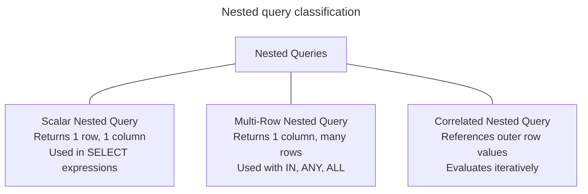
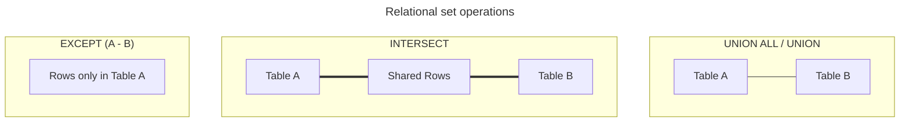

# Sub queries and set operations

## Overview

Nested queries and set operations provide foundational mechanisms to combine, filter, and compare data across SQL statements. A nested query is an inner query embedded inside an outer SQL statement. A set operation vertically combines or compares row sets returned by two or more independent queries.

This guide provides an end-to-end operational reference for scalar and correlated nested queries, the three-valued logic null trap in `NOT IN` versus `NOT EXISTS`, and set mechanics for `UNION`, `UNION ALL`, `INTERSECT`, and `EXCEPT`.

## Example datasets

The queries in this guide use three tables: `Employees`, `Departments`, and `Contractors`.

### `Employees` table

| `EmployeeID` | `Name` | `DepartmentID` | `Salary` |
| :--- | :--- | :--- | :--- |
| 101 | Alice | 10 | 95000.00 |
| 102 | Bob | 10 | 80000.00 |
| 103 | Charlie | 20 | 75000.00 |
| 104 | Diana | 30 | 110000.00 |
| 105 | Evan | `NULL` | 60000.00 |

### `Departments` table

| `DepartmentID` | `DepartmentName` |
| :--- | :--- |
| 10 | Engineering |
| 20 | Marketing |
| 30 | Finance |
| 40 | Legal |

### `Contractors` table

| `ContractorID` | `Name` | `DepartmentID` | `HourlyRate` |
| :--- | :--- | :--- | :--- |
| 501 | Bob | 10 | 85.00 |
| 502 | Fiona | 10 | 95.00 |
| 503 | George | 40 | 70.00 |

## Nested query categories

Nested queries fall into three main categories based on the shape of data they return and how they interact with the outer query.



### Scalar nested queries

A scalar nested query returns exactly one value: a single row with a single column. You can place a scalar nested query anywhere the database accepts a single literal or expression.

The following query compares each employee salary to the company-wide average salary:

```sql
SELECT
  EmployeeID,
  Name,
  Salary,
  ROUND(
    Salary - (SELECT AVG(Salary) FROM Employees),
    2
  ) AS DifferenceFromAvg
FROM Employees;
```

#### Query execution mechanics

1. The scalar nested query `(SELECT AVG(Salary) FROM Employees)` executes first, computing the company average: `84000.00`.
2. The outer query substitutes this computed constant into each evaluated row.

#### Output table

| `EmployeeID` | `Name` | `Salary` | `DifferenceFromAvg` |
| :--- | :--- | :--- | :--- |
| 101 | Alice | 95000.00 | 11000.00 |
| 102 | Bob | 80000.00 | -4000.00 |
| 103 | Charlie | 75000.00 | -9000.00 |
| 104 | Diana | 110000.00 | 26000.00 |
| 105 | Evan | 60000.00 | -24000.00 |

If a scalar nested query returns more than one row at runtime, the database engine aborts execution with a cardinal violation error. If the inner query returns zero rows, the expression evaluates to `NULL`.

### Correlated nested queries

A correlated nested query references columns from the outer query table. Unlike independent nested queries that evaluate once, a correlated nested query depends on the current row context of the outer query.

The following query finds employees who earn more than the average salary of their own department:

```sql
SELECT
  e.EmployeeID,
  e.Name,
  e.DepartmentID,
  e.Salary
FROM Employees AS e
WHERE e.Salary > (
  SELECT AVG(inner_emp.Salary)
  FROM Employees AS inner_emp
  WHERE inner_emp.DepartmentID = e.DepartmentID
);
```

#### Step-by-step correlation trace

- For Alice `(Dept 10, Salary 95000.00)`: the inner query computes the Department 10 average `(95000 + 80000) / 2 = 87500.00`. Because `95000.00 > 87500.00`, the query retains Alice.
- For Bob `(Dept 10, Salary 80000.00)`: the inner query computes `87500.00`. Because `80000.00` isn't greater than `87500.00`, the query discards Bob.
- For Charlie `(Dept 20, Salary 75000.00)`: the only employee in Department 20 is Charlie, so the department average is `75000.00`. The comparison `75000 > 75000` evaluates to false, discarding Charlie.
- For Diana `(Dept 30, Salary 110000.00)`: the department average is `110000.00`. Discarded.
- For Evan `(Dept NULL)`: `inner_emp.DepartmentID = NULL` produces `UNKNOWN`, yielding no rows and a `NULL` average. Discarded.

#### Output table

| `EmployeeID` | `Name` | `DepartmentID` | `Salary` |
| :--- | :--- | :--- | :--- |
| 101 | Alice | 10 | 95000.00 |

## Predicate evaluations: `EXISTS` versus `IN`

Both `EXISTS` and `IN` test whether related records exist in another dataset, but their evaluation models differ fundamentally.

### `EXISTS` mechanics

`EXISTS` tests whether a nested query returns at least one row. The database engine short-circuits evaluation immediately upon discovering a single matching row, ignoring the column projection list in the nested query:

```sql
SELECT
  d.DepartmentID,
  d.DepartmentName
FROM Departments AS d
WHERE EXISTS (
  SELECT 1
  FROM Employees AS e
  WHERE e.DepartmentID = d.DepartmentID
);
```

#### Query result

| `DepartmentID` | `DepartmentName` |
| :--- | :--- |
| 10 | Engineering |
| 20 | Marketing |
| 30 | Finance |

Legal `(Department 40)` has no employees in the table, so the nested query returns zero rows and the outer query excludes it.

### The dangerous null trap: `NOT IN` versus `NOT EXISTS`

A classic production hazard in SQL occurs when using `NOT IN` against an inner query that contains a `NULL` value.

Consider a table of audited departments that contains a `NULL` record:

| `DepartmentID` |
| :--- |
| 20 |
| 40 |
| `NULL` |

An engineer attempts to find departments that haven't undergone an audit:

```sql
-- DANGEROUS: Returns zero rows when AuditedDepartments contains NULL
SELECT DepartmentName
FROM Departments
WHERE DepartmentID NOT IN (
  SELECT DepartmentID
  FROM AuditedDepartments
);
```

#### Why `NOT IN` fails with nulls

Under standard SQL rules, `DepartmentID NOT IN (20, 40, NULL)` expands into a conjunction of inequality comparisons:

```sql
DepartmentID <> 20 AND DepartmentID <> 40 AND DepartmentID <> NULL
```

Now evaluate this condition for Engineering `(DepartmentID = 10)`:

1. `10 <> 20` evaluates to `TRUE`.
2. `10 <> 40` evaluates to `TRUE`.
3. `10 <> NULL` evaluates to `UNKNOWN`.
4. `TRUE AND TRUE AND UNKNOWN` evaluates to `UNKNOWN`.

Because a `WHERE` clause keeps only rows that evaluate strictly to `TRUE`, the engine discards Engineering. In fact, **every single department evaluates to `UNKNOWN`**, and the query returns zero rows.

#### The robust solution: `NOT EXISTS`

Use `NOT EXISTS` instead of `NOT IN`. `NOT EXISTS` checks for the presence or absence of rows rather than testing value equality. Because a row containing `NULL` is still a valid row, existence checks evaluate to a clean Boolean `TRUE` or `FALSE`:

```sql
-- RELIABLE: Correctly returns un-audited departments
SELECT d.DepartmentName
FROM Departments AS d
WHERE NOT EXISTS (
  SELECT 1
  FROM AuditedDepartments AS a
  WHERE a.DepartmentID = d.DepartmentID
);
```

#### Output table with `NOT EXISTS`

| `DepartmentName` |
| :--- |
| Engineering |
| Finance |

## Set operations

Set operations combine the result sets of two independent `SELECT` queries vertically.



### Compatibility rules

1. Both queries must project the exact same number of columns.
2. Corresponding column positions must share compatible data types.
3. The resulting column headers match the names defined in the first query.

### Comparing `UNION ALL`, `UNION`, `INTERSECT`, and `EXCEPT`

The following queries contrast all four set operations between staff names in `Employees` and contractor names in `Contractors`:

#### `UNION ALL`: appends all rows preserving duplicates

```sql
SELECT Name FROM Employees
UNION ALL
SELECT Name FROM Contractors;
```

The output returns all eight records from both sources, including Alice, Bob, Charlie, Diana, Evan, Bob, Fiona, and George.

#### `UNION`: appends rows and removes duplicates

```sql
SELECT Name FROM Employees
UNION
SELECT Name FROM Contractors;
```

The output removes the duplicate entry for Bob, returning seven unique names.

#### `INTERSECT`: returns rows shared by both queries

```sql
SELECT Name FROM Employees
INTERSECT
SELECT Name FROM Contractors;
```

The output returns only Bob, the single person appearing in both tables.

#### `EXCEPT`: returns rows in query 1 that aren't in query 2

```sql
SELECT Name FROM Employees
EXCEPT
SELECT Name FROM Contractors;
```

The output returns Alice, Charlie, Diana, and Evan. The query excludes Bob because Bob appears in `Contractors`.

### Summary matrix of set operations

| Operator | Action | Duplicate handling | Performance characteristics |
| :--- | :--- | :--- | :--- |
| `UNION ALL` | Appends row streams directly | Preserves all duplicate rows | High throughput: streams rows directly without hashing |
| `UNION` | Appends row streams | Eliminates duplicate rows | Requires memory hash table or sort operation |
| `INTERSECT` | Finds common rows | Retains distinct matching rows | Requires hash join or sort between both inputs |
| `EXCEPT` | Subtracts second set from first | Retains distinct remaining rows | Requires hash anti-join or sort operation |

## Common pitfalls

### Positional alignment errors

Set operations align columns by position, never by name. Swapping columns in the second query produces mixed values without throwing a syntax error if data types match:

```sql
-- INCORRECT: Recipient names and department names swap columns
SELECT Name, DepartmentName FROM Employees JOIN Departments USING (DepartmentID)
UNION ALL
SELECT DepartmentName, Name FROM Contractors JOIN Departments USING (DepartmentID);
```

Always verify that column order matches precisely across all queries in the set block.

### Correlated nested query performance degradation

A correlated nested query that executes inside a large table can force the engine to run an $O(N \times M)$ nested loop.

Whenever possible, rewrite correlated nested queries into set-based `LEFT JOIN` or window function operations:

```sql
-- Suboptimal correlated nested query:
SELECT e.Name, (SELECT d.DepartmentName FROM Departments d WHERE d.DepartmentID = e.DepartmentID)
FROM Employees e;

-- Optimal set-based join:
SELECT e.Name, d.DepartmentName
FROM Employees AS e
LEFT JOIN Departments AS d
  ON e.DepartmentID = d.DepartmentID;
```

## Key takeaways

- Use scalar nested queries when you need a single value inside a projection expression.
- Use correlated nested queries to evaluate row-specific conditions against an outer record stream.
- Always prefer `NOT EXISTS` over `NOT IN` when comparing columns that can contain `NULL` values to avoid the three-valued logic pitfall.
- Choose `UNION ALL` over `UNION` by default to avoid the memory and CPU overhead of distinct duplicate removal when duplicate rows are valid or impossible.
- Align columns strictly by position and compatible data types when using set operators.
