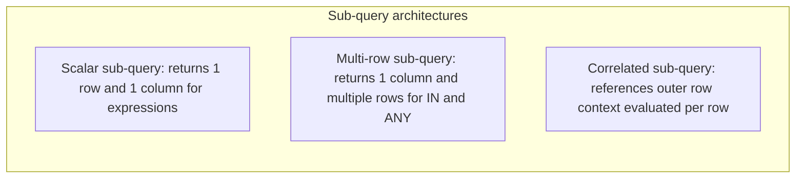
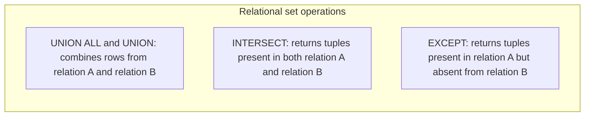

# Subqueries and set operations

## Overview

Subqueries and set operations provide foundational mechanisms to evaluate,
filter, and combine datasets across Structured Query Language (`SQL`)
queries. A subquery is an inner query nested within an outer statement. A set
operation combines or compares row sets returned by two independent queries.

This guide provides an end-to-end reference for scalar and correlated subqueries,
the three-valued logic null trap in `NOT IN` versus `NOT EXISTS`, and set
operations for `UNION`, `UNION ALL`, `INTERSECT`, and `EXCEPT` using the Stanford
University academic database.

## Reference schema and datasets

The examples in this guide run against three relations from the Stanford
University registrar schema: `departments`, `instructors`, and
`teaching_assistants`.

### Table schemas

```sql
CREATE TABLE departments (
  department_id   INTEGER PRIMARY KEY,
  department_name VARCHAR(50) NOT NULL,
  building        VARCHAR(50) NOT NULL
);

CREATE TABLE instructors (
  instructor_id   INTEGER PRIMARY KEY,
  first_name      VARCHAR(50) NOT NULL,
  last_name       VARCHAR(50) NOT NULL,
  department_id   INTEGER REFERENCES departments(department_id),
  salary          NUMERIC(10, 2) NOT NULL
);

CREATE TABLE teaching_assistants (
  assistant_id    INTEGER PRIMARY KEY,
  first_name      VARCHAR(50) NOT NULL,
  last_name       VARCHAR(50) NOT NULL,
  department_id   INTEGER REFERENCES departments(department_id),
  stipend         NUMERIC(10, 2) NOT NULL
);
```

### Sample data

#### `departments` table

| `department_id` | `department_name` | `building` |
| :--- | :--- | :--- |
| `10` | Computer Science | Gates Building |
| `20` | Electrical Engineering | Packard Building |
| `30` | Linguistics | Memorial Hall |
| `40` | Statistics | Sequoia Hall |

#### `instructors` table

| `instructor_id` | `first_name` | `last_name` | `department_id` | `salary` |
| :--- | :--- | :--- | :--- | :--- |
| `101` | David | Clark | `10` | `140000.00` |
| `102` | Marcus | Miller | `10` | `120000.00` |
| `103` | Andrea | Taylor | `20` | `115000.00` |
| `104` | Sarah | Wilson | `30` | `150000.00` |
| `105` | Evan | Wright | `NULL` | `90000.00` |

#### `teaching_assistants` table

| `assistant_id` | `first_name` | `last_name` | `department_id` | `stipend` |
| :--- | :--- | :--- | :--- | :--- |
| `501` | Marcus | Miller | `10` | `32000.00` |
| `502` | Fiona | Adams | `10` | `30000.00` |
| `503` | George | Baker | `40` | `28000.00` |

## Sub-query categories

Sub-queries fall into three main architectures based on their return shape and
interaction with the outer query:



### Scalar sub-queries

A scalar sub-query returns a single cell value: exactly one row and one column.
You can place a scalar sub-query anywhere the database accepts an expression or
literal.

The following query compares each faculty salary to the university-wide average
instructor salary:

```sql
SELECT
  instructor_id,
  first_name,
  last_name,
  salary,
  ROUND(
    salary - (SELECT AVG(salary) FROM instructors),
    2
  ) AS diff_from_avg
FROM instructors;
```

#### Scalar sub-query execution flow

1. The scalar sub-query `SELECT AVG(salary) FROM instructors` executes once,
   computing the university faculty average: `123000.00`.
2. The outer query substitutes this constant into each evaluated row.

#### Result set

| `instructor_id` | `first_name` | `last_name` | `salary` | `diff_from_avg` |
| :--- | :--- | :--- | :--- | :--- |
| `101` | David | Clark | `140000.00` | `17000.00` |
| `102` | Marcus | Miller | `120000.00` | `-3000.00` |
| `103` | Andrea | Taylor | `115000.00` | `-8000.00` |
| `104` | Sarah | Wilson | `150000.00` | `27000.00` |
| `105` | Evan | Wright | `90000.00` | `-33000.00` |

If a scalar sub-query returns more than one row at runtime, the engine aborts
execution with a cardinality violation error. If the sub-query returns zero rows,
the expression evaluates to `NULL`.

### Correlated sub-queries

A correlated sub-query references attributes from the outer query row. Unlike
independent sub-queries that evaluate once, a correlated sub-query depends on the
current tuple context of the outer query.

The following query finds instructors who earn more than the average salary of
their own department:

```sql
SELECT
  outer_inst.instructor_id,
  outer_inst.first_name,
  outer_inst.last_name,
  outer_inst.department_id,
  outer_inst.salary
FROM instructors AS outer_inst
WHERE outer_inst.salary > (
  SELECT AVG(inner_inst.salary)
  FROM instructors AS inner_inst
  WHERE inner_inst.department_id = outer_inst.department_id
);
```

#### Step-by-step correlation trace

- David Clark, Department `10`, salary `140000.00`: the sub-query computes the
  Department 10 average, `(140000 + 120000) / 2 = 130000.00`. Because
  `140000.00 > 130000.00`, the query retains David Clark.
- Marcus Miller, Department `10`, salary `120000.00`: the sub-query computes
  `130000.00`. Because `120000.00` is less than `130000.00`, the engine discards
  Marcus Miller.
- Andrea Taylor, Department `20`, salary `115000.00`: the only faculty member in
  Department 20 is Andrea Taylor, so the department average is `115000.00`.
  Because `115000.00 > 115000.00` evaluates to `FALSE`, the engine discards
  Andrea Taylor.
- Sarah Wilson, Department `30`, salary `150000.00`: the department average is
  `150000.00`. Discarded.
- Evan Wright, Department `NULL`: `inner_inst.department_id = NULL` evaluates to
  `UNKNOWN`, yielding no rows and a `NULL` average. Discarded.

#### Result set

| `instructor_id` | `first_name` | `last_name` | `department_id` | `salary` |
| :--- | :--- | :--- | :--- | :--- |
| `101` | David | Clark | `10` | `140000.00` |

## Predicate evaluations: `EXISTS` compared with `IN`

Both `EXISTS` and `IN` test whether related records exist in another dataset,
but their evaluation engines behave differently.

### How the `EXISTS` operator works

`EXISTS` tests whether a sub-query returns at least one record. The database
engine short-circuits evaluation immediately upon discovering a single matching
row, ignoring the column projection list in the sub-query:

```sql
SELECT
  d.department_id,
  d.department_name
FROM departments AS d
WHERE EXISTS (
  SELECT 1
  FROM instructors AS i
  WHERE i.department_id = d.department_id
);
```

#### Result set

| `department_id` | `department_name` |
| :--- | :--- |
| `10` | Computer Science |
| `20` | Electrical Engineering |
| `30` | Linguistics |

Statistics, Department `40`, has no faculty in the `instructors` table, so the
sub-query yields zero records and the outer query excludes it.

### The null trap: `NOT IN` compared with `NOT EXISTS`

A classic production issue in `SQL` occurs when using `NOT IN` against a sub-query
that contains a `NULL` value.

Consider a table of accredited departments that contains an unverified `NULL`
record:

| `department_id` |
| :--- |
| `20` |
| `40` |
| `NULL` |

An analyst attempts to find departments that lack formal accreditation:

```sql
-- DANGEROUS: Returns zero rows when accredited_departments contains NULL
SELECT department_name
FROM departments
WHERE department_id NOT IN (
  SELECT department_id
  FROM accredited_departments
);
```

#### Why `NOT IN` fails with null values

Under standard `SQL` logic, `department_id NOT IN (20, 40, NULL)` expands into
a conjunction of inequality checks:

```sql
department_id <> 20 AND department_id <> 40 AND department_id <> NULL
```

Evaluate this condition for Computer Science, Department `10`:

1. `10 <> 20` evaluates to `TRUE`.
2. `10 <> 40` evaluates to `TRUE`.
3. `10 <> NULL` evaluates to `UNKNOWN`.
4. `TRUE AND TRUE AND UNKNOWN` evaluates to `UNKNOWN`.

Because a `WHERE` clause accepts rows only when the predicate evaluates strictly
to `TRUE`, the engine discards Computer Science. In fact, every single department
evaluates to `UNKNOWN`, and the query returns zero rows.

#### Reliable evaluation with `NOT EXISTS`

Use `NOT EXISTS` instead of `NOT IN`. `NOT EXISTS` checks for the presence or
absence of rows rather than testing value equality. Because a row containing
`NULL` is still an existing row, existence checks evaluate to a Boolean `TRUE`
or `FALSE`:

```sql
-- RELIABLE: Correctly returns unaccredited departments
SELECT d.department_name
FROM departments AS d
WHERE NOT EXISTS (
  SELECT 1
  FROM accredited_departments AS a
  WHERE a.department_id = d.department_id
);
```

#### Result set with `NOT EXISTS`

| `department_name` |
| :--- |
| Computer Science |
| Linguistics |

## Set operations

Set operations combine the result sets of two independent `SELECT` queries
vertically.



### Compatibility rules

1. Both queries must project the exact same number of attributes.
2. Corresponding column positions must share compatible data types.
3. The resulting column headers match the names defined in the first query.

### Comparing `UNION ALL`, `UNION`, `INTERSECT`, and `EXCEPT`

The following queries contrast all four set operations between faculty in
`instructors` and graduate assistants in `teaching_assistants`:

#### `UNION ALL`: appends all rows preserving duplicates

```sql
SELECT first_name, last_name FROM instructors
UNION ALL
SELECT first_name, last_name FROM teaching_assistants;
```

The output returns all eight rows from both sources, retaining the duplicate
record for Marcus Miller.

#### `UNION`: appends rows and removes duplicates

```sql
SELECT first_name, last_name FROM instructors
UNION
SELECT first_name, last_name FROM teaching_assistants;
```

The output eliminates the duplicate entry for Marcus Miller, returning seven
unique names.

#### `INTERSECT`: returns rows shared by both queries

```sql
SELECT first_name, last_name FROM instructors
INTERSECT
SELECT first_name, last_name FROM teaching_assistants;
```

The output returns only Marcus Miller, the single academic who appears in both
relations.

#### `EXCEPT`: returns rows in query 1 that are absent from query 2

```sql
SELECT first_name, last_name FROM instructors
EXCEPT
SELECT first_name, last_name FROM teaching_assistants;
```

The output returns David Clark, Andrea Taylor, Sarah Wilson, and Evan Wright.
The query excludes Marcus Miller because Marcus Miller appears in
`teaching_assistants`.

### Summary matrix of set operations

| Operator | Action | Duplicate handling | Performance characteristics |
| :--- | :--- | :--- | :--- |
| `UNION ALL` | Appends row streams directly | Preserves all duplicate rows | High throughput: streams rows without hashing |
| `UNION` | Appends row streams | Eliminates duplicate rows | Requires memory hash table or sort operation |
| `INTERSECT` | Finds common rows | Retains distinct matching rows | Requires hash join or sort between both inputs |
| `EXCEPT` | Subtracts second set from first | Retains distinct remaining rows | Requires hash anti-join or sort operation |

## Common pitfalls

### Positional alignment errors

Set operations align columns by position, never by attribute name. Swapping
columns in the second query mixes data values without throwing an error if data
types match:

```sql
-- INCORRECT: Instructor name and department name swap positions
SELECT first_name, department_name FROM instructors JOIN departments USING (department_id)
UNION ALL
SELECT department_name, first_name FROM teaching_assistants JOIN departments USING (department_id);
```

Always verify that column order matches across all queries in the set block.

### Correlated sub-query performance degradation

A correlated sub-query evaluated across a large table forces the engine to run an
$O(N \times M)$ nested loop.

Whenever possible, rewrite correlated sub-queries into set-based `LEFT JOIN` or
analytic window operations:

```sql
-- Suboptimal correlated sub-query:
SELECT
  i.first_name,
  i.last_name,
  (SELECT d.department_name FROM departments AS d WHERE d.department_id = i.department_id) AS department_name
FROM instructors AS i;

-- Optimal set-based join:
SELECT
  i.first_name,
  i.last_name,
  d.department_name
FROM instructors AS i
LEFT JOIN departments AS d
  ON i.department_id = d.department_id;
```

## Key takeaways

- Use scalar sub-queries when returning a single metric inside a projection expression.
- Use correlated sub-queries to evaluate row-specific conditions against an outer record stream.
- Prefer `NOT EXISTS` over `NOT IN` when comparing columns that accept null values to avoid three-valued logic failures.
- Choose `UNION ALL` over `UNION` by default to avoid the memory and CPU overhead of distinct duplicate elimination when duplicate rows are acceptable.
- Align columns strictly by position and compatible data types when using set operators.

## What's next

- Explore window functions, partition frames, and rankings in
  [Analytical and window functions](/sql/analytical-and-window-functions).
- Learn relative row offsets with `LAG` and `LEAD` in
  [Value and frame navigation](/sql/value-and-frame-navigation).
- Structure multi-step transformation pipelines using
  [Common table expressions](/sql/common-table-expressions).
