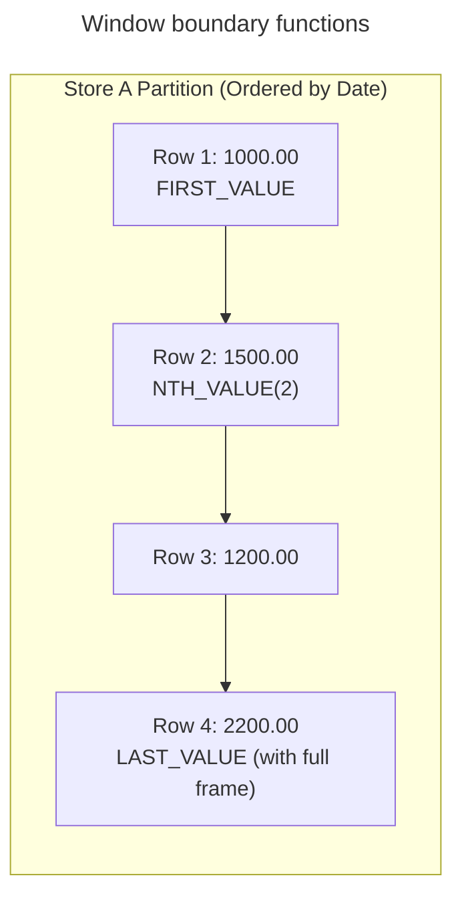

# Value and frame navigation

## Overview

Value-navigation and frame functions allow SQL queries to access values from earlier or later rows relative to the current evaluation row without performing self-joins. Window frames define the dynamic physical or logical boundaries across which the database computes sliding aggregations.

This guide provides an end-to-end operational reference for `LAG`, `LEAD`, `FIRST_VALUE`, `LAST_VALUE`, `NTH_VALUE`, the sliding frame clause, and the default frame trap.

## Example dataset

The queries in this guide use the following `StoreDailySales` table, tracking daily revenue across two retail locations:

| `StoreID` | `SaleDate` | `Revenue` |
| :--- | :--- | :--- |
| Store A | 2026-01-01 | 1000.00 |
| Store A | 2026-01-02 | 1500.00 |
| Store A | 2026-01-03 | 1200.00 |
| Store A | 2026-01-04 | 2200.00 |
| Store B | 2026-01-01 | 3000.00 |
| Store B | 2026-01-02 | 2800.00 |
| Store B | 2026-01-03 | 3500.00 |

## Relative row navigation: `LAG` and `LEAD`

`LAG` inspects previous rows, while `LEAD` inspects subsequent rows inside the partition according to the window sort order.

```sql
LAG(expression [, offset [, default_value]]) OVER (
  [PARTITION BY partition_column]
  ORDER BY sort_column
)
```

- `offset`: the number of rows to look backward or forward. The default is `1`.
- `default_value`: the fallback returned when no row exists at the target offset. If omitted, the engine returns `NULL`.

### Day-over-day revenue analysis

The following query compares each day against the previous day and subsequent day for `Store A`:

```sql
SELECT
  SaleDate,
  Revenue,
  LAG(Revenue, 1, 0.00) OVER (
    ORDER BY SaleDate
  ) AS PriorDayRevenue,
  Revenue - LAG(Revenue, 1, Revenue) OVER (
    ORDER BY SaleDate
  ) AS DayOverDayChange,
  LEAD(Revenue) OVER (
    ORDER BY SaleDate
  ) AS NextDayRevenue
FROM StoreDailySales
WHERE StoreID = 'Store A'
ORDER BY SaleDate;
```

#### Query output table

| `SaleDate` | `Revenue` | `PriorDayRevenue` | `DayOverDayChange` | `NextDayRevenue` |
| :--- | :--- | :--- | :--- | :--- |
| 2026-01-01 | 1000.00 | 0.00 | 0.00 | 1500.00 |
| 2026-01-02 | 1500.00 | 1000.00 | 500.00 | 1200.00 |
| 2026-01-03 | 1200.00 | 1500.00 | -300.00 | 2200.00 |
| 2026-01-04 | 2200.00 | 1200.00 | 1000.00 | `NULL` |

On the first row, `LAG` returns the fallback value `0.00`. On the final row, `LEAD` returns `NULL` because no subsequent record exists.

## Partition boundary navigation: `FIRST_VALUE`, `LAST_VALUE`, and `NTH_VALUE`

Boundary functions return the expression value from a specific position in the evaluated window frame:

- `FIRST_VALUE(expression)`: returns the value from the first row of the frame.
- `LAST_VALUE(expression)`: returns the value from the last row of the frame.
- `NTH_VALUE(expression, n)`: returns the value from the $n$-th row of the frame.



### The infamous `LAST_VALUE` frame trap

By default, an ordered window specification uses the following implicit frame:

```sql
RANGE BETWEEN UNBOUNDED PRECEDING AND CURRENT ROW
```

Because the default frame terminates at `CURRENT ROW`, calling `LAST_VALUE(Revenue)` without an explicit frame clause returns the current row value rather than the final partition value.

To return the actual final value of the partition, declare an explicit frame spanning `UNBOUNDED PRECEDING AND UNBOUNDED FOLLOWING`:

```sql
SELECT
  SaleDate,
  Revenue,
  FIRST_VALUE(Revenue) OVER (
    ORDER BY SaleDate
  ) AS OpeningRevenue,
  -- DEFECTIVE: Terminates at CURRENT ROW, returning the current row value:
  LAST_VALUE(Revenue) OVER (
    ORDER BY SaleDate
  ) AS DefectiveLastRevenue,
  -- CORRECT: Spans the full partition to inspect the true final row:
  LAST_VALUE(Revenue) OVER (
    ORDER BY SaleDate
    ROWS BETWEEN UNBOUNDED PRECEDING AND UNBOUNDED FOLLOWING
  ) AS TrueClosingRevenue,
  NTH_VALUE(Revenue, 2) OVER (
    ORDER BY SaleDate
    ROWS BETWEEN UNBOUNDED PRECEDING AND UNBOUNDED FOLLOWING
  ) AS SecondDayRevenue
FROM StoreDailySales
WHERE StoreID = 'Store A'
ORDER BY SaleDate;
```

#### Comparison output table

| `SaleDate` | `Revenue` | `OpeningRevenue` | `DefectiveLastRevenue` | `TrueClosingRevenue` | `SecondDayRevenue` |
| :--- | :--- | :--- | :--- | :--- | :--- |
| 2026-01-01 | 1000.00 | 1000.00 | **1000.00** | 2200.00 | `NULL` |
| 2026-01-02 | 1500.00 | 1000.00 | **1500.00** | 2200.00 | 1500.00 |
| 2026-01-03 | 1200.00 | 1000.00 | **1200.00** | 2200.00 | 1500.00 |
| 2026-01-04 | 2200.00 | 1000.00 | **2200.00** | 2200.00 | 1500.00 |

Notice that `DefectiveLastRevenue` merely echoes the `Revenue` column of the current row. `TrueClosingRevenue` successfully projects the final closing value `2200.00` across all records.

## Sliding window frame specifications

A frame clause defines a dynamic window subset that slides relative to the current row.

### Frame boundary keywords

- `UNBOUNDED PRECEDING`: begins at the first row of the partition.
- `n PRECEDING`: begins `n` physical rows before the current row.
- `CURRENT ROW`: sets the boundary at the active evaluation row.
- `n FOLLOWING`: extends `n` physical rows after the current row.
- `UNBOUNDED FOLLOWING`: extends through the final row of the partition.

### Centered moving average calculation

To smooth volatility in retail trends, calculate a 3-day centered moving average covering the preceding day, the current day, and the following day:

```sql
SELECT
  SaleDate,
  Revenue,
  ROUND(AVG(Revenue) OVER (
    ORDER BY SaleDate
    ROWS BETWEEN 1 PRECEDING AND 1 FOLLOWING
  ), 2) AS ThreeDayMovingAvg
FROM StoreDailySales
WHERE StoreID = 'Store A'
ORDER BY SaleDate;
```

#### Moving average output table

| `SaleDate` | `Revenue` | Included frame rows | `ThreeDayMovingAvg` | Calculation note |
| :--- | :--- | :--- | :--- | :--- |
| 2026-01-01 | 1000.00 | Day 1, Day 2 | 1250.00 | `(1000 + 1500) / 2` |
| 2026-01-02 | 1500.00 | Day 1, Day 2, Day 3 | 1233.33 | `(1000 + 1500 + 1200) / 3` |
| 2026-01-03 | 1200.00 | Day 2, Day 3, Day 4 | 1633.33 | `(1500 + 1200 + 2200) / 3` |
| 2026-01-04 | 2200.00 | Day 3, Day 4 | 1700.00 | `(1200 + 2200) / 2` |

At partition boundaries, the engine adjusts automatically, calculating the average across the available rows in the frame.

## Common pitfalls

### Accidental default frame with `LAST_VALUE`

Calling `LAST_VALUE` without an explicit frame clause is the most common window function bug in production SQL. Always supply `ROWS BETWEEN UNBOUNDED PRECEDING AND UNBOUNDED FOLLOWING` when seeking the terminal value of a partition.

### Unhandled boundary nulls in `LAG` and `LEAD`

The first row of a partition evaluated with `LAG` returns `NULL` unless you provide a fallback argument. When calculating differences or ratios, unhandled nulls propagate, turning calculations into `NULL`.

```sql
-- Vulnerable: First row returns NULL difference
Revenue - LAG(Revenue) OVER (ORDER BY SaleDate)

-- Safe: First row evaluates cleanly to zero difference
Revenue - LAG(Revenue, 1, Revenue) OVER (ORDER BY SaleDate)
```

### Logical `RANGE` versus physical `ROWS` with duplicate timestamps

When sorting by non-unique timestamps, the default `RANGE` unit bundles duplicate values into peer groups. If multiple transactions share the exact same timestamp, `RANGE` calculates a shared total across all tied rows. Use `ROWS` with a unique secondary tie-breaker to enforce deterministic, row-by-row navigation.

## Key takeaways

- Use `LAG` and `LEAD` for inter-row navigation, calculating growth rates, intervals, and status changes without self-joins.
- Always provide fallback defaults in `LAG` and `LEAD` to prevent boundary null propagation.
- Always declare `ROWS BETWEEN UNBOUNDED PRECEDING AND UNBOUNDED FOLLOWING` when using `LAST_VALUE` or `NTH_VALUE` across an entire partition.
- Use `ROWS BETWEEN n PRECEDING AND n FOLLOWING` to compute sliding centered moving averages.
- Supply unique tie-breaker columns in `ORDER BY` to maintain deterministic row evaluations.
