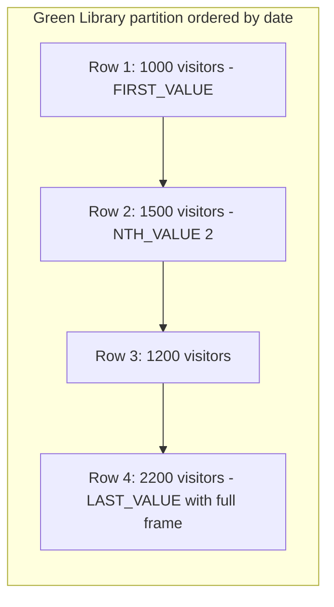

# Value and frame navigation

## Overview

Value-navigation and frame functions allow Structured Query Language, or `SQL`,
queries to access values from earlier or later rows relative to the current
evaluation row without performing self-joins. Window frames define the dynamic
physical or logical boundaries across which the database computes sliding
aggregations.

This guide provides an end-to-end operational reference for `LAG`, `LEAD`,
`FIRST_VALUE`, `LAST_VALUE`, `NTH_VALUE`, the sliding frame clause, and the
default frame trap using the Stanford University library attendance database.

## Reference schema and dataset

The queries in this guide run against the `library_daily_visitors` relation,
which tracks entry gate traffic across two primary Stanford University campus
libraries: `Green Library` and `Engineering Library`.

```sql
CREATE TABLE library_daily_visitors (
  library_name  VARCHAR(50) NOT NULL,
  entry_date    DATE NOT NULL,
  visitor_count INTEGER NOT NULL,
  PRIMARY KEY (library_name, entry_date)
);
```

### Table contents

| `library_name` | `entry_date` | `visitor_count` |
| :--- | :--- | :--- |
| Green Library | 2026-01-01 | `1000` |
| Green Library | 2026-01-02 | `1500` |
| Green Library | 2026-01-03 | `1200` |
| Green Library | 2026-01-04 | `2200` |
| Engineering Library | 2026-01-01 | `3000` |
| Engineering Library | 2026-01-02 | `2800` |
| Engineering Library | 2026-01-03 | `3500` |

## Relative row navigation: `LAG` and `LEAD`

`LAG` inspects previous rows, while `LEAD` inspects subsequent rows inside the
partition according to the window sort order:

```sql
LAG(expression [, offset [, default_value]]) OVER (
  [PARTITION BY partition_column]
  ORDER BY sort_column
)
```

- `offset`: the number of rows to look backward or forward. The default is `1`.
- `default_value`: the fallback returned when no row exists at the target offset.
  If omitted, the engine returns `NULL`.

### Day-over-day attendance analysis

The following query compares each day against the previous day and subsequent
day for `Green Library`:

```sql
SELECT
  entry_date,
  visitor_count,
  LAG(visitor_count, 1, 0) OVER (
    ORDER BY entry_date
  ) AS prior_day_visitors,
  visitor_count - LAG(visitor_count, 1, visitor_count) OVER (
    ORDER BY entry_date
  ) AS day_over_day_change,
  LEAD(visitor_count) OVER (
    ORDER BY entry_date
  ) AS next_day_visitors
FROM library_daily_visitors
WHERE library_name = 'Green Library'
ORDER BY entry_date;
```

#### Query output table

| `entry_date` | `visitor_count` | `prior_day_visitors` | `day_over_day_change` | `next_day_visitors` |
| :--- | :--- | :--- | :--- | :--- |
| 2026-01-01 | `1000` | `0` | `0` | `1500` |
| 2026-01-02 | `1500` | `1000` | `500` | `1200` |
| 2026-01-03 | `1200` | `1500` | `-300` | `2200` |
| 2026-01-04 | `2200` | `1200` | `1000` | `NULL` |

On the first row, `LAG` returns the fallback value `0`. On the final row, `LEAD`
returns `NULL` because no subsequent record exists.

## Partition boundary navigation: `FIRST_VALUE`, `LAST_VALUE`, and `NTH_VALUE`

Boundary functions return the expression value from a specific position in the
evaluated window frame:

- `FIRST_VALUE(expression)`: returns the value from the first row of the frame.
- `LAST_VALUE(expression)`: returns the value from the last row of the frame.
- `NTH_VALUE(expression, n)`: returns the value from the $n$-th row of the frame.



### The default frame trap in `LAST_VALUE`

By default, an ordered window specification uses the following implicit frame:

```sql
RANGE BETWEEN UNBOUNDED PRECEDING AND CURRENT ROW
```

Because the default frame terminates at `CURRENT ROW`, calling
`LAST_VALUE(visitor_count)` without an explicit frame clause returns the current
row value rather than the final partition value.

To return the actual final value of the partition, declare an explicit frame
spanning `UNBOUNDED PRECEDING AND UNBOUNDED FOLLOWING`:

```sql
SELECT
  entry_date,
  visitor_count,
  FIRST_VALUE(visitor_count) OVER (
    ORDER BY entry_date
  ) AS opening_attendance,
  -- DEFECTIVE: Terminates at CURRENT ROW, echoing the current row value:
  LAST_VALUE(visitor_count) OVER (
    ORDER BY entry_date
  ) AS defective_last_attendance,
  -- CORRECT: Spans the full partition to inspect the true final row:
  LAST_VALUE(visitor_count) OVER (
    ORDER BY entry_date
    ROWS BETWEEN UNBOUNDED PRECEDING AND UNBOUNDED FOLLOWING
  ) AS true_closing_attendance,
  NTH_VALUE(visitor_count, 2) OVER (
    ORDER BY entry_date
    ROWS BETWEEN UNBOUNDED PRECEDING AND UNBOUNDED FOLLOWING
  ) AS second_day_attendance
FROM library_daily_visitors
WHERE library_name = 'Green Library'
ORDER BY entry_date;
```

#### Comparison output table

| `entry_date` | `visitor_count` | `opening_attendance` | `defective_last_attendance` | `true_closing_attendance` | `second_day_attendance` |
| :--- | :--- | :--- | :--- | :--- | :--- |
| 2026-01-01 | `1000` | `1000` | `1000` | `2200` | `NULL` |
| 2026-01-02 | `1500` | `1000` | `1500` | `2200` | `1500` |
| 2026-01-03 | `1200` | `1000` | `1200` | `2200` | `1500` |
| 2026-01-04 | `2200` | `1000` | `2200` | `2200` | `1500` |

`defective_last_attendance` merely echoes the `visitor_count` column of the
current row. In contrast, `true_closing_attendance` projects the terminal
attendance value `2200` across all records.

## Sliding window frame specifications

A frame clause defines a dynamic window subset that slides relative to the
current row.

### Frame boundary keywords

- `UNBOUNDED PRECEDING`: begins at the first row of the partition.
- `n PRECEDING`: begins `n` physical rows before the current row.
- `CURRENT ROW`: sets the boundary at the active evaluation row.
- `n FOLLOWING`: extends `n` physical rows after the current row.
- `UNBOUNDED FOLLOWING`: extends through the final row of the partition.

### Centered moving average calculation

To smooth volatility in daily facility traffic, calculate a 3-day centered moving
average covering the preceding day, the current day, and the following day:

```sql
SELECT
  entry_date,
  visitor_count,
  ROUND(AVG(visitor_count) OVER (
    ORDER BY entry_date
    ROWS BETWEEN 1 PRECEDING AND 1 FOLLOWING
  ), 2) AS three_day_moving_avg
FROM library_daily_visitors
WHERE library_name = 'Green Library'
ORDER BY entry_date;
```

#### Moving average output table

| `entry_date` | `visitor_count` | Included frame rows | `three_day_moving_avg` | Calculation note |
| :--- | :--- | :--- | :--- | :--- |
| 2026-01-01 | `1000` | Day 1, Day 2 | `1250.00` | Average of `1000` and `1500` |
| 2026-01-02 | `1500` | Day 1, Day 2, Day 3 | `1233.33` | Average of `1000`, `1500`, and `1200` |
| 2026-01-03 | `1200` | Day 2, Day 3, Day 4 | `1633.33` | Average of `1500`, `1200`, and `2200` |
| 2026-01-04 | `2200` | Day 3, Day 4 | `1700.00` | Average of `1200` and `2200` |

At partition boundaries, the engine adjusts automatically, calculating the
average across the available rows in the frame.

## Common pitfalls

### Accidental default frame with `LAST_VALUE`

Calling `LAST_VALUE` without an explicit frame clause is the most common window
function error in production `SQL`. Always supply
`ROWS BETWEEN UNBOUNDED PRECEDING AND UNBOUNDED FOLLOWING` when seeking the
terminal value of a partition.

### Unhandled boundary nulls in `LAG` and `LEAD`

The first row of a partition evaluated with `LAG` returns `NULL` unless you
provide a fallback argument. When calculating differences or ratios, unhandled
nulls propagate, turning calculations into `NULL`:

```sql
-- Vulnerable: First row returns NULL difference
visitor_count - LAG(visitor_count) OVER (ORDER BY entry_date)

-- Safe: First row evaluates cleanly to zero difference
visitor_count - LAG(visitor_count, 1, visitor_count) OVER (ORDER BY entry_date)
```

### Logical `RANGE` versus physical `ROWS` with duplicate timestamps

When sorting by non-unique timestamps, the default `RANGE` unit bundles duplicate
values into peer groups. If multiple transactions share the exact same timestamp,
`RANGE` calculates a shared total across all tied rows. Use `ROWS` with a unique
secondary tie-breaker to enforce deterministic, row-by-row navigation.

## Key takeaways

- Use `LAG` and `LEAD` for inter-row navigation, calculating growth rates, intervals, and status changes without self-joins.
- Provide fallback defaults in `LAG` and `LEAD` to prevent boundary null propagation.
- Declare `ROWS BETWEEN UNBOUNDED PRECEDING AND UNBOUNDED FOLLOWING` when using `LAST_VALUE` or `NTH_VALUE` across an entire partition.
- Use `ROWS BETWEEN n PRECEDING AND n FOLLOWING` to compute sliding centered moving averages.
- Supply unique tie-breaker columns in `ORDER BY` to maintain deterministic row evaluations.

## What's next

- Organize complex analytical transformations using
  [Common table expressions](/sql/common-table-expressions).
- Query organizational hierarchies and graph structures in
  [Recursive queries and graph traversals](/sql/recursive-queries-and-graph-traversals).
- Compute multi-level aggregations with `ROLLUP` and `CUBE` in
  [Multidimensional aggregation](/sql/multidimensional-aggregation).
